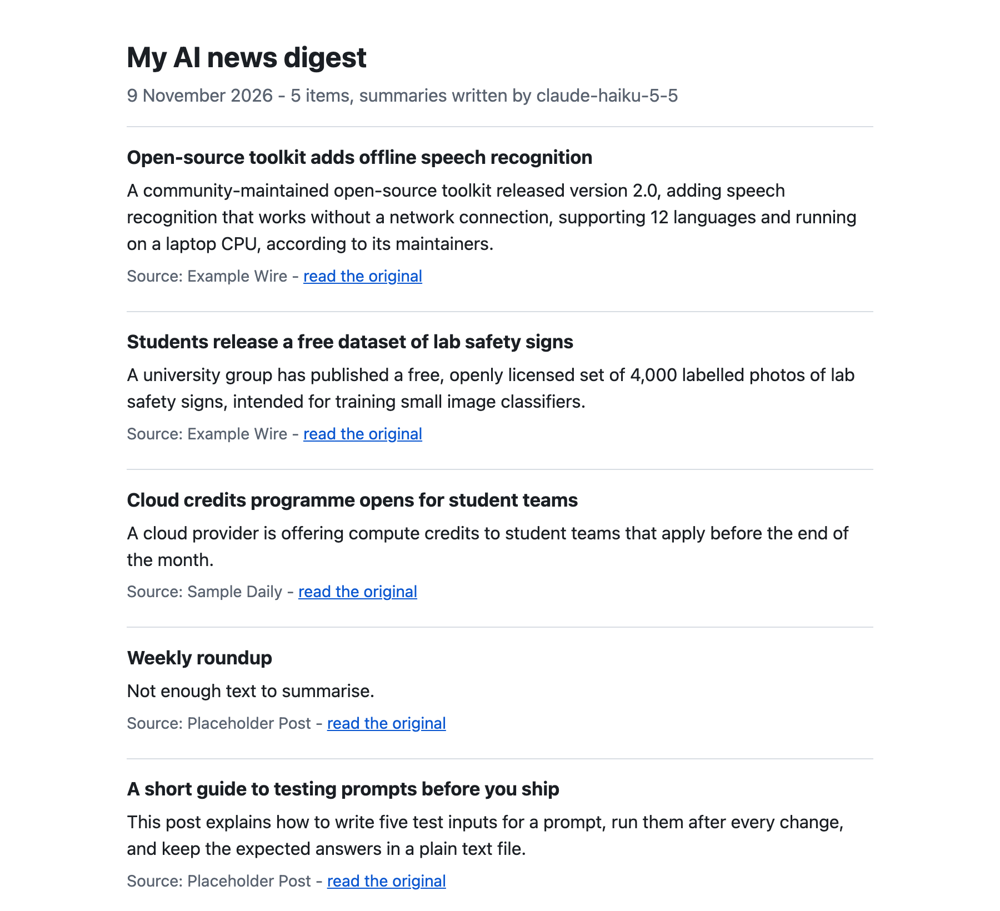
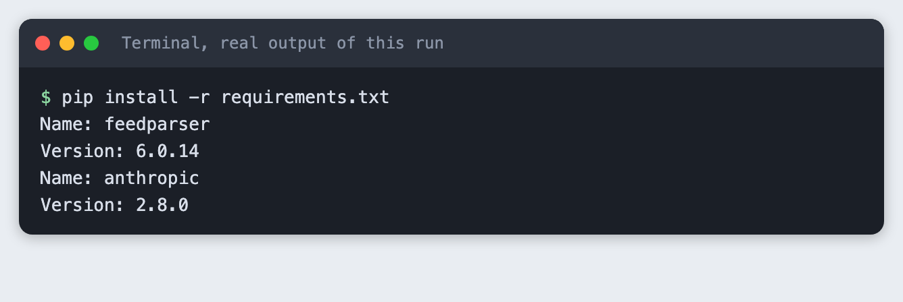
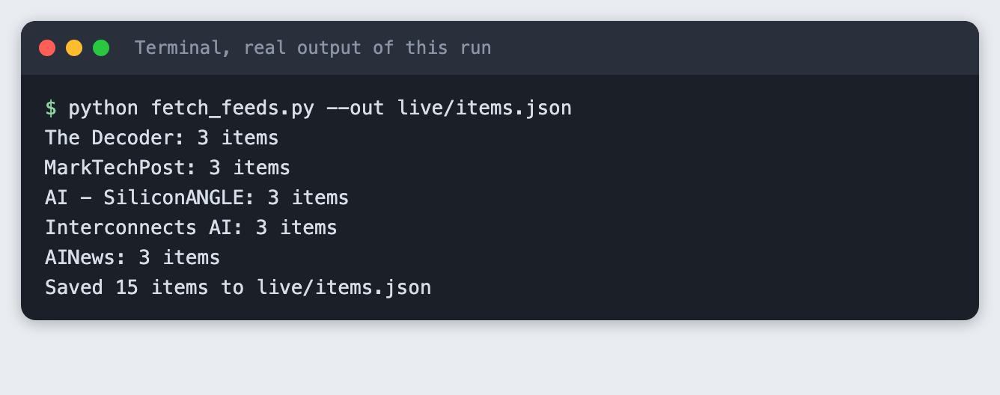
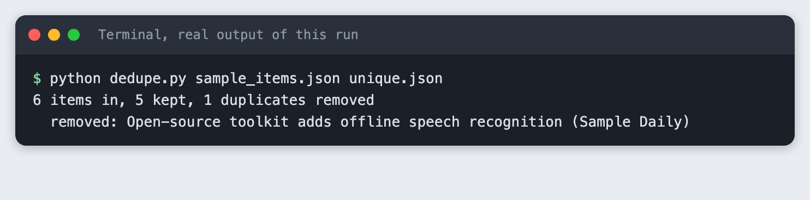
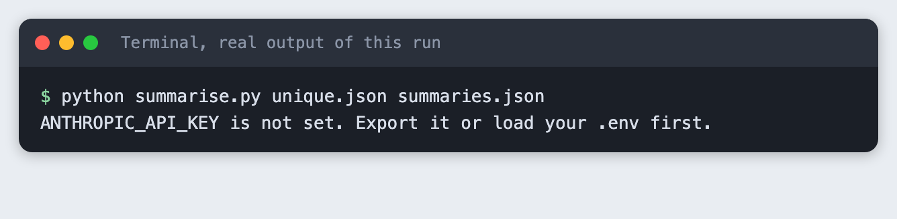
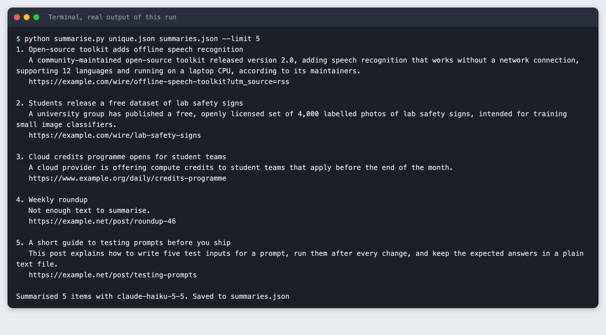
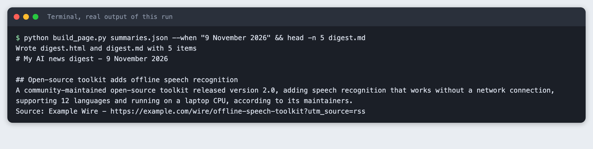
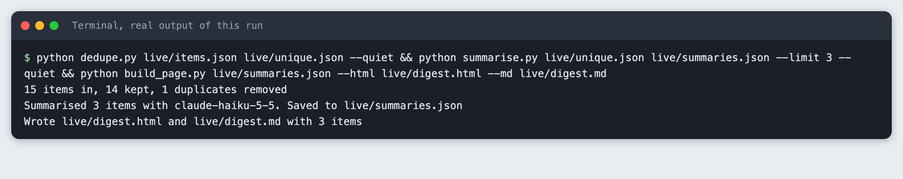

# Build a personal AI news digest from RSS feeds with an LLM

You build a Python script that reads five public RSS feeds, removes duplicate items, asks a language model for a one-sentence summary of each item, and writes a page with the source link beside every summary.

**Time:** about 30 minutes. **Level:** intermediate. **You need:** Python basics, Python 3.10 or newer, a terminal and an Anthropic API key. **Tested:** 11 November 2026 on macOS with Python 3.14.6, `feedparser` 6.0.14 and `anthropic` 2.8.0.

A news digest is a good AI hackathon project idea: the data is small, the result is clear and anyone can follow a demo. If you are looking for a project, see the [upcoming AI hackathons](/ai-hackathons/) and pick one that fits. Everything below also works outside an event.

Live feeds change every day, and model replies differ from run to run. Your items and wording will not match the output below. The shape of the output will.

## Why this matters

A summary is only useful if you can check it. A model can leave out a detail or add one that is not in the text. So this digest keeps the link from the feed next to each summary, and the code, not the model, supplies that link. If a summary looks wrong, one click takes you to the original.

## See it running first

This is the finished page. The items here are invented example items from `sample_items.json`, not real headlines. The summaries on it are real model output. The rest of the tutorial builds it from scratch.



## Step 1: Set up the project

Make a folder and create a virtual environment. Activate it. The commands from here on assume it is active.

```bash
python3 -m venv .venv
```


Create `requirements.txt`:

```text
feedparser>=6.0
anthropic>=2.7.0
```
*File: `requirements.txt`*

Install it. The output shows the versions used for this tutorial.

```bash
pip install -r requirements.txt
```



Put your key in a file named `.env`. Copy the placeholder file and edit it:

```
ANTHROPIC_API_KEY=your_key_here
```
*File: `.env.example`*

Never paste a real key into code or a screenshot. Add `.env` to `.gitignore`. Load it into your terminal session (macOS and Linux):

```bash
set -a; source .env; set +a
```

## Step 2: Pick five feeds and read them

Put one feed address per line in `feeds.txt`. These are the five used here. Use any public feeds you like, and check each site's terms for personal or other use before you rely on a feed.

```text
https://the-decoder.com/feed/
https://www.marktechpost.com/feed/
https://siliconangle.com/category/ai/feed/
https://www.interconnects.ai/feed
https://news.smol.ai/rss.xml
```
*File: `feeds.txt`*

`fetch_feeds.py` reads each feed with feedparser. It keeps the title, link, date and a short plain-text excerpt of each item, and only the three newest items per feed so that the run stays small. If a feed cannot be read, the script prints a "skipped" line and moves on. It does not try another way in.

```python
import argparse
import html
import json
import re
import sys
from pathlib import Path

import feedparser

AGENT = "labs-tutorial-ai-news-digest/1.0"


def plain(text: str, limit: int = 600) -> str:
    """Strip tags and extra spaces from a feed's summary and cut it to a short excerpt."""
    text = re.sub(r"<[^>]+>", " ", text or "")
    return re.sub(r"\s+", " ", html.unescape(text)).strip()[:limit]


def main() -> int:
    parser = argparse.ArgumentParser()
    parser.add_argument("--feeds", default="feeds.txt")
    parser.add_argument("--out", default="items.json")
    parser.add_argument("--per-feed", type=int, default=3)
    args = parser.parse_args()

    urls = [u.strip() for u in Path(args.feeds).read_text().splitlines() if u.strip()]
    items = []
    for url in urls:
        feed = feedparser.parse(url, agent=AGENT)
        if feed.bozo and not feed.entries:
            print(f"skipped {url}: could not read the feed", file=sys.stderr)
            continue
        source = feed.feed.get("title", url)
        entries = feed.entries[: args.per_feed]
        for entry in entries:
            items.append({
                "source": source,
                "title": entry.get("title", "").strip(),
                "link": entry.get("link", ""),
                "published": entry.get("published", ""),
                "text": plain(entry.get("summary", "")),
            })
        print(f"{source}: {len(entries)} items")
    Path(args.out).parent.mkdir(parents=True, exist_ok=True)
    Path(args.out).write_text(json.dumps(items, indent=2), encoding="utf-8")
    print(f"Saved {len(items)} items to {args.out}")
    return 0 if items else 1


if __name__ == "__main__":
    sys.exit(main())
```
*File: `fetch_feeds.py`*

```bash
python fetch_feeds.py --out live/items.json
```



Five feeds with three items each gave 15 items. The screenshot shows counts only, because the items are other people's headlines and this tutorial does not republish them.

## Step 3: Remove duplicates

Two feeds often cover one story, and one feed may list the same page twice with a different tracking tail on the address. `dedupe.py` treats two items as the same when the link matches after the query part and the trailing slash are removed, or when the title matches after lowercasing and removing punctuation. It keeps the first one it sees.

This is a plain rule on purpose. It does not catch two different headlines about one story. Matching on meaning is a bigger job, so it is left out.

```python
import argparse
import json
import re
from pathlib import Path
from urllib.parse import urlsplit


def link_key(link: str) -> str:
    """Same page, different tracking tail: drop the query, fragment and trailing slash."""
    parts = urlsplit(link.strip().lower())
    return f"{parts.netloc.removeprefix('www.')}{parts.path.rstrip('/')}"


def title_key(title: str) -> str:
    return " ".join(re.findall(r"[a-z0-9]+", title.lower()))


def dedupe(items: list[dict]) -> list[dict]:
    seen_links, seen_titles, kept = set(), set(), []
    for item in items:
        lk, tk = link_key(item["link"]), title_key(item["title"])
        if lk in seen_links or tk in seen_titles:
            continue
        seen_links.add(lk)
        seen_titles.add(tk)
        kept.append(item)
    return kept


def main() -> None:
    parser = argparse.ArgumentParser()
    parser.add_argument("infile")
    parser.add_argument("outfile")
    parser.add_argument("--quiet", action="store_true", help="print counts only, not titles")
    args = parser.parse_args()

    items = json.loads(Path(args.infile).read_text())
    kept = dedupe(items)
    Path(args.outfile).write_text(json.dumps(kept, indent=2), encoding="utf-8")
    print(f"{len(items)} items in, {len(kept)} kept, {len(items) - len(kept)} duplicates removed")
    if not args.quiet:
        kept_ids = {id(i) for i in kept}
        for item in items:
            if id(item) not in kept_ids:
                print(f"  removed: {item['title']} ({item['source']})")


if __name__ == "__main__":
    main()
```
*File: `dedupe.py`*

To see the rule work on data that never changes, run it on `sample_items.json`. It holds six invented items. Two of them are the same story under different links.

```json
[
  {"source": "Example Wire", "title": "Open-source toolkit adds offline speech recognition",
   "link": "https://example.com/wire/offline-speech-toolkit?utm_source=rss",
   "published": "Mon, 09 Nov 2026 08:00:00 GMT",
   "text": "A community-maintained toolkit released version 2.0 with speech recognition that runs without a network connection. The maintainers say it supports 12 languages and runs on a laptop CPU."},
  {"source": "Sample Daily", "title": "Open-source toolkit adds offline speech recognition",
   "link": "https://www.example.org/daily/offline-speech-toolkit/",
   "published": "Mon, 09 Nov 2026 09:30:00 GMT",
   "text": "The toolkit's 2.0 release can transcribe audio on a laptop without a network connection, according to its maintainers."},
  {"source": "Example Wire", "title": "Students release a free dataset of lab safety signs",
   "link": "https://example.com/wire/lab-safety-signs",
   "published": "Mon, 09 Nov 2026 10:00:00 GMT",
   "text": "A university group published 4,000 labelled photos of lab safety signs under an open licence. The set is meant for training small image classifiers."},
  {"source": "Sample Daily", "title": "Cloud credits programme opens for student teams",
   "link": "https://www.example.org/daily/credits-programme",
   "published": "Mon, 09 Nov 2026 11:15:00 GMT",
   "text": "A cloud provider will give compute credits to student teams that apply before the end of the month."},
  {"source": "Placeholder Post", "title": "Weekly roundup",
   "link": "https://example.net/post/roundup-46",
   "published": "Mon, 09 Nov 2026 12:00:00 GMT",
   "text": ""},
  {"source": "Placeholder Post", "title": "A short guide to testing prompts before you ship",
   "link": "https://example.net/post/testing-prompts",
   "published": "Mon, 09 Nov 2026 13:00:00 GMT",
   "text": "The post walks through writing five test inputs for a prompt, running them after every change, and keeping the expected answers in a plain text file."}
]
```
*File: `sample_items.json`*

```bash
python dedupe.py sample_items.json unique.json
```



The first and second items have different links (`example.com` and `www.example.org`) but the same title, so the second one is removed. On the live feeds the same script printed `15 items in, 14 kept, 1 duplicates removed` in the last step of this tutorial. Your count will differ.

## Step 4: Summarise each item

`summarise.py` sends one request per item. The instructions tell the model to use only the title and text it is given, to add nothing, and to reply with a fixed sentence when the text is too thin. Without that last instruction a model tends to fill the gap with a guess. The model name comes from `TUTORIAL_MODEL` when it is set, and otherwise it is `claude-haiku-5-5`.

The link is copied from the feed item into the result. It is never part of the request, so the model cannot change it or invent one.

```python
import argparse
import json
import os
import sys
from pathlib import Path

from anthropic import Anthropic

from spend_log import log_usage

MODEL = os.environ.get("TUTORIAL_MODEL", "claude-haiku-5-5")
MAX_TOKENS = 120
SYSTEM = (
    "You write one-sentence news summaries. Use only the title and text you are given. "
    "Do not add facts, names or numbers that are not in them. "
    "If the text is too thin to summarise, reply exactly: Not enough text to summarise."
)


def summarise(client: Anthropic, item: dict) -> str:
    prompt = f"Title: {item['title']}\n\nText: {item['text'] or '(no text in the feed)'}"
    response = client.messages.create(
        model=MODEL, max_tokens=MAX_TOKENS, system=SYSTEM,
        messages=[{"role": "user", "content": prompt}],
    )
    log_usage("summarise.py", response)
    return "".join(b.text for b in response.content if b.type == "text").strip()


def main() -> None:
    parser = argparse.ArgumentParser()
    parser.add_argument("infile")
    parser.add_argument("outfile")
    parser.add_argument("--limit", type=int, default=6)
    parser.add_argument("--quiet", action="store_true", help="print counts only, not titles or summaries")
    args = parser.parse_args()

    if not os.environ.get("ANTHROPIC_API_KEY"):
        sys.exit("ANTHROPIC_API_KEY is not set. Export it or load your .env first.")
    client = Anthropic()

    items = json.loads(Path(args.infile).read_text())[: args.limit]
    done = []
    for n, item in enumerate(items, 1):
        # The link comes from the feed item, never from the model, so it cannot be invented.
        done.append({**item, "summary": summarise(client, item)})
        if not args.quiet:
            print(f"{n}. {item['title']}\n   {done[-1]['summary']}\n   {item['link']}\n")
    Path(args.outfile).write_text(json.dumps(done, indent=2), encoding="utf-8")
    print(f"Summarised {len(done)} items with {MODEL}. Saved to {args.outfile}")


if __name__ == "__main__":
    main()
```
*File: `summarise.py`*

`spend_log.py` is a budget helper. It adds one line per call to `spend.log` and is not part of the lesson.

```python
"""Budget helper, not part of the lesson: one line per API call in spend.log."""
from datetime import datetime, timezone
from pathlib import Path


def log_usage(script, response):
    stamp = datetime.now(timezone.utc).isoformat(timespec="seconds")
    line = f"{stamp} {script} in={response.usage.input_tokens} out={response.usage.output_tokens}\n"
    with open(Path(__file__).with_name("spend.log"), "a") as f:
        f.write(line)
```
*File: `spend_log.py`*

First see what a missing key looks like. Run the script in a terminal where the variable is not set:

```bash
python summarise.py unique.json summaries.json
```



Now run it with the key loaded:

```bash
python summarise.py unique.json summaries.json --limit 5
```



Read the summaries against the example items. The 12 languages and the 4,000 photos come from the text that was given. The "Weekly roundup" item had an empty text field, so the script returned the fixed sentence, "Not enough text to summarise.", instead of a guess. That is the behaviour you want, and it is the one thing to check first if you change the instructions.

## Step 5: Write the page

`build_page.py` turns the summaries into `digest.html` and `digest.md`. It escapes the text before it goes into the page, and each item gets a "read the original" link.

```python
import argparse
import html
import json
from datetime import date
from pathlib import Path

PAGE = """<!doctype html>
<html lang="en"><head><meta charset="utf-8"><meta name="viewport" content="width=device-width, initial-scale=1">
<title>My AI news digest</title>
<style>
body {{ font-family: system-ui, sans-serif; max-width: 42rem; margin: 2rem auto; padding: 0 1rem; color: #1b1f24; line-height: 1.5; }}
h1 {{ font-size: 1.6rem; margin-bottom: 0.2rem; }}
.meta {{ color: #5a6370; margin-top: 0; }}
article {{ border-top: 1px solid #d8dde3; padding: 0.9rem 0; }}
article h2 {{ font-size: 1.05rem; margin: 0 0 0.3rem; }}
article p {{ margin: 0 0 0.4rem; }}
.src {{ font-size: 0.9rem; color: #5a6370; }}
a {{ color: #0b57d0; }}
</style></head><body>
<h1>My AI news digest</h1>
<p class="meta">{when} - {count} items, summaries written by {model}</p>
{items}
</body></html>
"""


def render_html(items: list[dict], when: str, model: str) -> str:
    cards = "\n".join(
        f'<article><h2>{html.escape(i["title"])}</h2><p>{html.escape(i["summary"])}</p>'
        f'<p class="src">Source: {html.escape(i["source"])} - '
        f'<a href="{html.escape(i["link"], quote=True)}">read the original</a></p></article>'
        for i in items
    )
    return PAGE.format(when=when, count=len(items), model=html.escape(model), items=cards)


def render_markdown(items: list[dict], when: str) -> str:
    lines = [f"# My AI news digest - {when}", ""]
    for i in items:
        lines += [f"## {i['title']}", i["summary"], f"Source: {i['source']} - {i['link']}", ""]
    return "\n".join(lines)


def main() -> None:
    parser = argparse.ArgumentParser()
    parser.add_argument("infile")
    parser.add_argument("--html", default="digest.html")
    parser.add_argument("--md", default="digest.md")
    parser.add_argument("--when", default=date.today().isoformat())
    parser.add_argument("--model", default="claude-haiku-5-5")
    args = parser.parse_args()

    items = json.loads(Path(args.infile).read_text())
    Path(args.html).write_text(render_html(items, args.when, args.model), encoding="utf-8")
    Path(args.md).write_text(render_markdown(items, args.when), encoding="utf-8")
    print(f"Wrote {args.html} and {args.md} with {len(items)} items")


if __name__ == "__main__":
    main()
```
*File: `build_page.py`*

```bash
python build_page.py summaries.json --when "9 November 2026" && head -n 5 digest.md
```



Serve the folder and open the page in a browser:

```bash
python -m http.server 8019 --bind 127.0.0.1
```

Then open `http://127.0.0.1:8019/digest.html`. It looks like the screenshot at the top.

## Step 6: Run the whole chain on live feeds

The same three scripts work on the feeds you fetched in Step 2. This run reads only the first three items to keep the cost small, and it prints counts, not headlines.

```bash
python dedupe.py live/items.json live/unique.json --quiet && python summarise.py live/unique.json live/summaries.json --limit 3 --quiet && python build_page.py live/summaries.json --html live/digest.html --md live/digest.md
```



Open `live/digest.html` to see your own digest. It contains other sites' headlines and short model summaries. Keep it for yourself, or check the terms of each feed before you share it.

## Troubleshooting

**"ANTHROPIC_API_KEY is not set."** The variable is not in this terminal. Run the `set -a; source .env; set +a` line again in the same window.

**A line starting "skipped" when you fetch.** The feed could not be read. It may be down, moved, or it may refuse automated requests. Remove it from `feeds.txt` or replace it. Do not look for a way around a refusal.

**"Not enough text to summarise."** The feed gave a title and little else. Some feeds send only the headline. Either accept it, or fetch the full article page where its terms allow that, which this tutorial does not cover.

**The same story shows twice.** Two different headlines about one story are not caught by the link and title rule. See the ideas below.

## What to try next

- Send the digest as a message to yourself instead of writing a page.
- Add a rule for stories that appear in more than one feed, such as comparing the words in two titles.
- Read the summaries in a second pass and ask a model to flag any sentence that is not backed by the item text.

## Frequently asked questions

### Is a news digest a good AI hackathon idea?

It fits a short event. This one uses five feeds, five short scripts and one page, and you can show a working result in a few minutes. The check against the source link also gives you something to say about accuracy.

### Can I use RSS feeds in a hackathon project?

Public feeds are made to be read by programs, and this project reads them with a normal feed library. Each site sets its own terms, so check them, keep the source link beside every summary and avoid republishing full articles. If a feed refuses a request, skip it.

### How do I keep AI summaries accurate?

Give the model only the item's own text, tell it to add nothing, and give it a fixed reply for when the text is thin. Keep the link next to every summary, supplied by your code. In this run the item with no text got the fixed reply, and the other four summaries matched the text they were given.

## How this tutorial was tested

Tested on 11 November 2026 on macOS with Python 3.14.6. The code in this article is copied from the project files, and the command output is the saved output of the run. The steps ran from a clean state, and then again from a copy of the project in an empty folder. All steps passed both times.

The terminal images are rendered from the saved output of the real run. They are not captures of a terminal window. The page image is a real Chrome screenshot of the page served by the project. It shows invented example items, not real headlines.

Not run: Windows and Linux, Python versions other than 3.14, and any feed other than the five in `feeds.txt`. The model calls used `claude-haiku-5-5` with small inputs. The live step's counts and summaries change every day.

