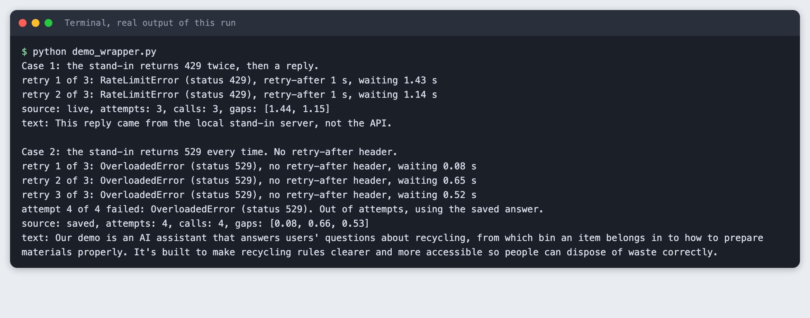
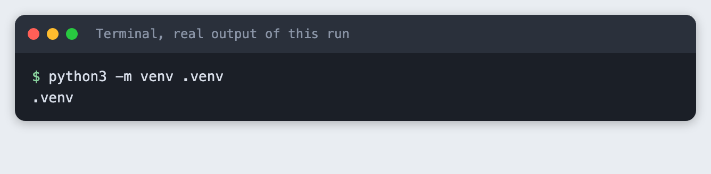
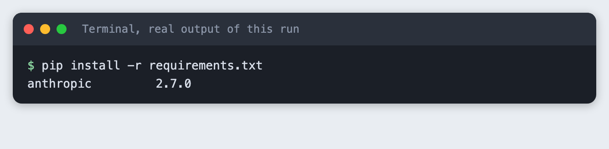
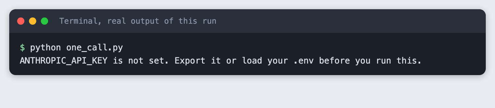
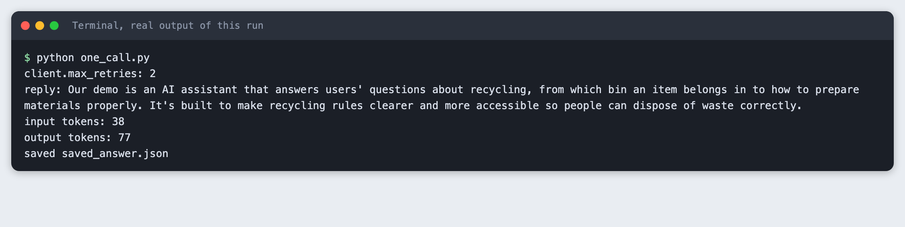
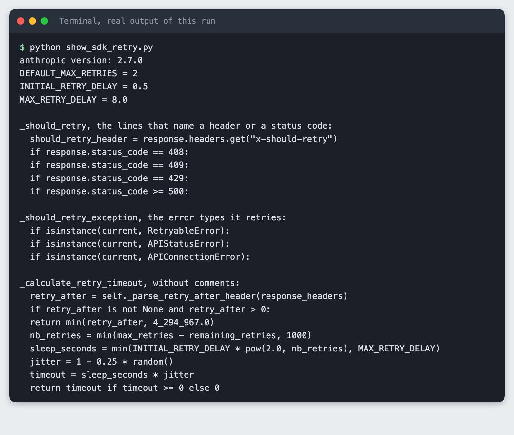
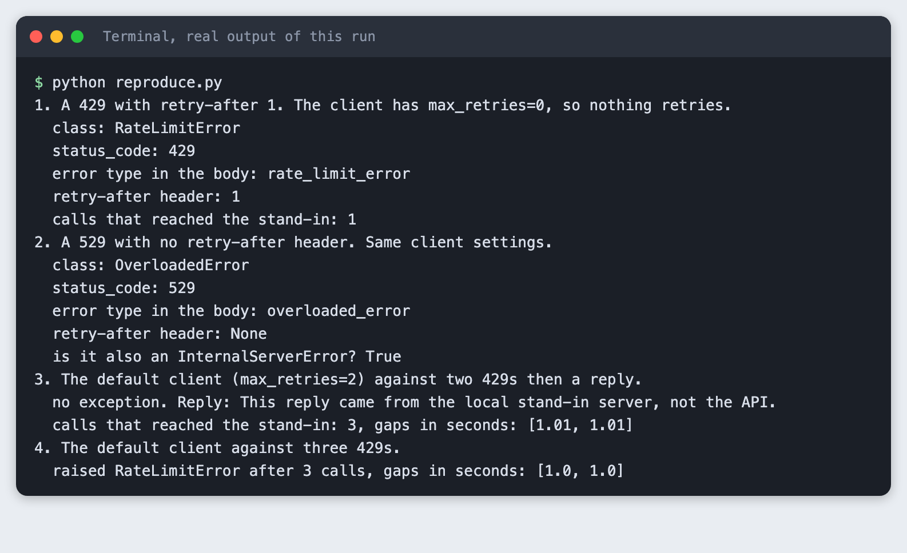
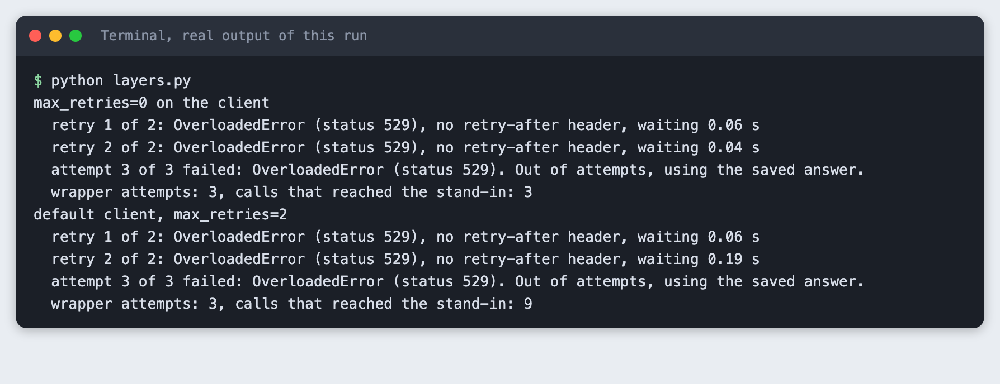
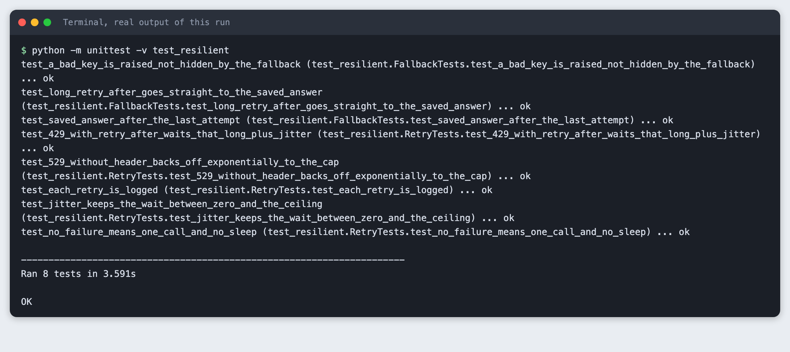

# Keep your hackathon demo working when the API rate limit hits

You build a small wrapper around the Claude API that retries with exponential backoff and jitter, logs each retry, and falls back to a saved answer when the API keeps failing. You test it against a local stand-in server, so you never have to hit a real limit.

**Time:** about two hours. **Level:** intermediate. **You need:** Python basics, Python 3.10 or newer, and an Anthropic API key. **Tested:** 10 November 2026 with Python 3.14.6 and `anthropic` 2.7.0 on macOS.

Model replies differ from run to run. Your reply will not match the one below word for word, and the timings will differ too.

Some AI hackathon sponsors raise API limits only for the length of the event, and demo day is when the limits bite hardest. A demo that shows an error page at that moment is worse than a demo that shows an answer you saved earlier. For more events like this, see the [upcoming AI hackathons](/ai-hackathons/).

## Why this matters

A rate limit is the API telling you to slow down. The error is normal, it is temporary, and your code can plan for it. This tutorial does three jobs: it shows what the error looks like, it waits and tries again in a way that does not make things worse, and it keeps the demo on screen if waiting does not help.

One thing to say plainly. The stand-in server in this tutorial is a test tool I wrote. It sends the errors the API documents, so the SDK's real error classes run against them. It is not the API, and it says nothing about your account's limits. Real limits depend on your account and plan, and on the model. I never hit a real limit while writing this.

## See it running

Here is the finished wrapper handling an API that keeps returning 529, and then falling back. The rest of the tutorial builds it.



## Step 1: Set up and make one real call

Create a virtual environment and install the SDK.

```bash
python3 -m venv .venv
```



```text
anthropic>=2.7.0
```
*File: `requirements.txt`*

```bash
pip install -r requirements.txt
```



Put your key in a file named `.env`. Copy the placeholder file and edit it:

```
ANTHROPIC_API_KEY=your_key_here
```
*File: `.env.example`*

Never paste a real key into code, a screenshot or a chat. Load the file into your terminal session (macOS and Linux):

```bash
set -a; source .env; set +a
```

Without the key, the script stops with a message:



The settings are in `prompt.py`. `thinking={"type": "disabled"}` turns off extended thinking, which the API docs list as accepted by `claude-haiku-5-5`.

```python
MODEL = "claude-haiku-5-5"
MAX_TOKENS = 300
PROMPT = "In two short sentences, tell a hackathon judge what this demo does: it answers questions about recycling."
```
*File: `prompt.py`*

```python
"""Budget helper, not part of the lesson: one line per API call in spend.log."""
from datetime import datetime, timezone
from pathlib import Path


def log_usage(script, response):
    stamp = datetime.now(timezone.utc).isoformat(timespec="seconds")
    line = f"{stamp} {script} in={response.usage.input_tokens} out={response.usage.output_tokens}\n"
    with open(Path(__file__).with_name("spend.log"), "a") as f:
        f.write(line)
```
*File: `spend_log.py`*

`one_call.py` makes the normal case: one real call that works. It also prints `client.max_retries`, and it saves the reply to `saved_answer.json`. That file is your fallback. Make it before the event, when the API is working.

```python
"""One real API call. Prints the reply and saves it as the fallback answer."""
import json
import os
import sys

from anthropic import Anthropic

from prompt import MAX_TOKENS, MODEL, PROMPT
from spend_log import log_usage

if not os.environ.get("ANTHROPIC_API_KEY"):
    sys.exit("ANTHROPIC_API_KEY is not set. Export it or load your .env before you run this.")

client = Anthropic()  # reads ANTHROPIC_API_KEY from the environment
print("client.max_retries:", client.max_retries)

response = client.messages.create(
    model=MODEL,
    max_tokens=MAX_TOKENS,
    thinking={"type": "disabled"},
    messages=[{"role": "user", "content": PROMPT}],
)
log_usage("one_call.py", response)

text = "".join(block.text for block in response.content if block.type == "text")
print("reply:", text)
print("input tokens:", response.usage.input_tokens)
print("output tokens:", response.usage.output_tokens)

with open("saved_answer.json", "w") as f:
    json.dump({"prompt": PROMPT, "text": text}, f)
print("saved saved_answer.json")
```
*File: `one_call.py`*

```bash
python one_call.py
```

```text
client.max_retries: 2
reply: Our demo is an AI assistant that answers users' questions about recycling, from which bin an item belongs in to how to prepare materials properly. It's built to make recycling rules clearer and more accessible so people can dispose of waste correctly.
input tokens: 38
output tokens: 77
saved saved_answer.json
```



The number `2` on the opening line is the SDK's default. The next step shows where it comes from.

## Step 2: Read what the SDK already does

The SDK retries by itself. Before you add a second layer, read what the built-in one does. `show_sdk_retry.py` prints it from the package you installed, so the output is the code, not a description of it.

```python
"""Print the SDK's own retry rules, read from the installed package."""
import inspect

import anthropic
from anthropic import _constants
from anthropic._base_client import BaseClient

print("anthropic version:", anthropic.__version__)
print("DEFAULT_MAX_RETRIES =", _constants.DEFAULT_MAX_RETRIES)
print("INITIAL_RETRY_DELAY =", _constants.INITIAL_RETRY_DELAY)
print("MAX_RETRY_DELAY =", _constants.MAX_RETRY_DELAY)

print("\n_should_retry, the lines that name a header or a status code:")
for line in inspect.getsource(BaseClient._should_retry).splitlines():
    if ("status_code" in line or "x-should-retry" in line) and "log.debug" not in line and "#" not in line:
        print(" ", line.strip())

print("\n_should_retry_exception, the error types it retries:")
for line in inspect.getsource(BaseClient._should_retry_exception).splitlines():
    if "isinstance" in line:
        print(" ", line.strip())

print("\n_calculate_retry_timeout, without comments:")
for line in inspect.getsource(BaseClient._calculate_retry_timeout).splitlines()[7:]:
    if line.strip() and not line.strip().startswith("#"):
        print(" ", line.strip())
```
*File: `show_sdk_retry.py`*

```bash
python show_sdk_retry.py
```

```text
anthropic version: 2.7.0
DEFAULT_MAX_RETRIES = 2
INITIAL_RETRY_DELAY = 0.5
MAX_RETRY_DELAY = 8.0

_should_retry, the lines that name a header or a status code:
  should_retry_header = response.headers.get("x-should-retry")
  if response.status_code == 408:
  if response.status_code == 409:
  if response.status_code == 429:
  if response.status_code >= 500:

_should_retry_exception, the error types it retries:
  if isinstance(current, RetryableError):
  if isinstance(current, APIStatusError):
  if isinstance(current, APIConnectionError):

_calculate_retry_timeout, without comments:
  retry_after = self._parse_retry_after_header(response_headers)
  if retry_after is not None and retry_after > 0:
  return min(retry_after, 4_294_967.0)
  nb_retries = min(max_retries - remaining_retries, 1000)
  sleep_seconds = min(INITIAL_RETRY_DELAY * pow(2.0, nb_retries), MAX_RETRY_DELAY)
  jitter = 1 - 0.25 * random()
  timeout = sleep_seconds * jitter
  return timeout if timeout >= 0 else 0
```



Read it in three parts:

- **What it retries.** Status 408, 409, 429 and everything from 500 up, plus connection errors. A response header named `x-should-retry` can override the status code. A 400 or 401 is not retried.
- **How many times.** `DEFAULT_MAX_RETRIES = 2`, so up to three calls in all.
- **How long it waits.** If the response has a positive `retry-after` header, the SDK waits exactly that long. If not, it waits 0.5 s doubled for each retry, capped at 8.0 s, then multiplied by a random number between 0.75 and 1.0 as jitter.

Anthropic's error documentation says the same: the SDK retries connection errors, rate limits and 5xx errors twice by default, with exponential backoff, and honors `retry-after` when present.

So why write your own? Three reasons. The SDK gives up after two retries, and you may want more. It has no fallback. And its retry messages go to Python's `logging` module at info level (I read this in the source), which is silent unless you set logging up, so a stalled demo looks like a hung page.

## Step 3: Reproduce the errors without hammering the API

To test an error path you need the error. Sending real traffic until the API pushes back costs money, and is not repeatable. Instead, `standin.py` is a small local HTTP server. It answers `POST /v1/messages` with an error for N calls at the start, and then with a valid reply. You can set the status (429 or 529), the `retry-after` header, and N. It also records when each call arrived.

The SDK takes a `base_url` option, so you point the real client at the stand-in. The SDK code that parses the response, builds the error and decides about retries is the real code. Only the server is fake.

```python
"""A local stand-in for the API, for tests. It is not the real API.

It answers POST /v1/messages with an error for the opening `fail` calls, then with a
valid reply. It records when each call arrived. Real limits depend on your account.
"""
import json
import threading
import time
from http.server import BaseHTTPRequestHandler, ThreadingHTTPServer

ERROR_TYPES = {429: "rate_limit_error", 529: "overloaded_error", 500: "api_error", 401: "authentication_error"}

OK_BODY = {
    "id": "msg_standin", "type": "message", "role": "assistant", "model": "claude-haiku-5-5",
    "content": [{"type": "text", "text": "This reply came from the local stand-in server, not the API."}],
    "stop_reason": "end_turn", "stop_sequence": None,
    "usage": {"input_tokens": 10, "output_tokens": 12},
}


class StandIn:
    """Use as a context manager. `calls` holds the arrival time of each request."""

    def __init__(self, fail=2, status=429, retry_after=1):
        self.fail, self.status, self.retry_after = fail, status, retry_after
        self.calls = []
        stand_in = self

        class Handler(BaseHTTPRequestHandler):
            def do_POST(self):
                self.rfile.read(int(self.headers.get("content-length", 0)))
                stand_in.calls.append(time.monotonic())
                if len(stand_in.calls) <= stand_in.fail:
                    body = {"type": "error", "request_id": "req_standin",
                            "error": {"type": ERROR_TYPES[stand_in.status], "message": "Stand-in error for testing."}}
                    self.send_response(stand_in.status)
                    if stand_in.retry_after is not None:
                        self.send_header("retry-after", str(stand_in.retry_after))
                else:
                    body = OK_BODY
                    self.send_response(200)
                data = json.dumps(body).encode()
                self.send_header("content-type", "application/json")
                self.send_header("content-length", str(len(data)))
                self.end_headers()
                self.wfile.write(data)

            def log_message(self, *args):
                pass

        self.server = ThreadingHTTPServer(("127.0.0.1", 0), Handler)
        self.base_url = f"http://127.0.0.1:{self.server.server_port}"

    def __enter__(self):
        threading.Thread(target=self.server.serve_forever, daemon=True).start()
        return self

    def __exit__(self, *exc):
        self.server.shutdown()
        self.server.server_close()

    def gaps(self):
        """Seconds between each call and the one before it."""
        return [round(b - a, 2) for a, b in zip(self.calls, self.calls[1:])]
```
*File: `standin.py`*

`reproduce.py` shows four cases. The client in cases 1 and 2 has `max_retries=0`, so you see the raw error.

```python
"""Show how a 429 and a 529 arrive, using the real SDK against the local stand-in."""
import anthropic
from anthropic import Anthropic

from prompt import MAX_TOKENS, MODEL, PROMPT
from standin import StandIn


def call(client):
    return client.messages.create(model=MODEL, max_tokens=MAX_TOKENS,
                                  messages=[{"role": "user", "content": PROMPT}])


def show(error):
    print(f"  class: {type(error).__name__}")
    print(f"  status_code: {error.status_code}")
    print(f"  error type in the body: {error.type}")
    print(f"  retry-after header: {error.response.headers.get('retry-after')}")


print("1. A 429 with retry-after 1. The client has max_retries=0, so nothing retries.")
with StandIn(fail=1, status=429, retry_after=1) as stand_in:
    client = Anthropic(base_url=stand_in.base_url, api_key="stand-in-key", max_retries=0)
    try:
        call(client)
    except anthropic.RateLimitError as error:
        show(error)
    print(f"  calls that reached the stand-in: {len(stand_in.calls)}")

print("2. A 529 with no retry-after header. Same client settings.")
with StandIn(fail=1, status=529, retry_after=None) as stand_in:
    client = Anthropic(base_url=stand_in.base_url, api_key="stand-in-key", max_retries=0)
    try:
        call(client)
    except anthropic.OverloadedError as error:
        show(error)
        print(f"  is it also an InternalServerError? {isinstance(error, anthropic.InternalServerError)}")

print("3. The default client (max_retries=2) against two 429s then a reply.")
with StandIn(fail=2, status=429, retry_after=1) as stand_in:
    client = Anthropic(base_url=stand_in.base_url, api_key="stand-in-key")
    response = call(client)
    print(f"  no exception. Reply: {response.content[0].text}")
    print(f"  calls that reached the stand-in: {len(stand_in.calls)}, gaps in seconds: {stand_in.gaps()}")

print("4. The default client against three 429s.")
with StandIn(fail=3, status=429, retry_after=1) as stand_in:
    client = Anthropic(base_url=stand_in.base_url, api_key="stand-in-key")
    try:
        call(client)
    except anthropic.RateLimitError as error:
        print(f"  raised {type(error).__name__} after {len(stand_in.calls)} calls, gaps in seconds: {stand_in.gaps()}")
```
*File: `reproduce.py`*

```bash
python reproduce.py
```

```text
1. A 429 with retry-after 1. The client has max_retries=0, so nothing retries.
  class: RateLimitError
  status_code: 429
  error type in the body: rate_limit_error
  retry-after header: 1
  calls that reached the stand-in: 1
2. A 529 with no retry-after header. Same client settings.
  class: OverloadedError
  status_code: 529
  error type in the body: overloaded_error
  retry-after header: None
  is it also an InternalServerError? True
3. The default client (max_retries=2) against two 429s then a reply.
  no exception. Reply: This reply came from the local stand-in server, not the API.
  calls that reached the stand-in: 3, gaps in seconds: [1.01, 1.01]
4. The default client against three 429s.
  raised RateLimitError after 3 calls, gaps in seconds: [1.0, 1.0]
```



What to notice:

- A 429 arrives as `anthropic.RateLimitError`. The `retry-after` header is on `error.response.headers`.
- A 529 arrives as `anthropic.OverloadedError`, which is a subclass of `anthropic.InternalServerError`. Catching `InternalServerError` catches both.
- In case 3 the default client hit two 429s and then got a reply, and your code saw no error at all. The stand-in received 3 calls, about a second apart, which is the `retry-after` value.
- In case 4 a third 429 made the default client give up and raise.

## Step 4: Add retry with backoff and jitter

`resilient.py` holds the wrapper. Here is why it looks like this.

- **Backoff.** Each wait is longer than the one before, so a struggling API gets room to recover.
- **Jitter.** Each wait is a random fraction of the ceiling. If many clients fail together and all wait the same time, they all return together. Randomness spreads them out. With a `retry-after` header the wrapper waits that long plus a small random amount.
- **A limit on waiting.** If the server asks for more than `max_wait` seconds, the wrapper stops and uses the saved answer. On a stage nobody waits a minute.
- **Which errors.** It retries rate limits, server errors and connection errors. A 401 means your key is wrong, and waiting will not fix it, so the wrapper raises it. A fallback that hides a bad key would hide a bug until demo day.
- **Logging.** Each retry writes one line: the attempt, the error class and status, the header, and the wait.
- **Functions you can replace.** `sleep` and `rand` are parameters so a test can run without waiting.

```python
"""Ask the model with retry, backoff, jitter and a saved-answer fallback."""
import logging
import random
import time
from dataclasses import dataclass

import anthropic

from prompt import MAX_TOKENS, MODEL

log = logging.getLogger("resilient")

# Errors worth another try: rate limit, server trouble (500 and above, which
# includes 529 overloaded), and network failures. A 400 or 401 will not get
# better by waiting, so those are raised.
RETRYABLE = (anthropic.RateLimitError, anthropic.InternalServerError, anthropic.APIConnectionError)


@dataclass
class Answer:
    text: str
    source: str  # "live" or "saved"
    attempts: int


def retry_after_seconds(error):
    """The retry-after header as a number of seconds, or None."""
    response = getattr(error, "response", None)
    value = response.headers.get("retry-after") if response is not None else None
    try:
        return float(value)
    except (TypeError, ValueError):
        return None


def backoff_delay(attempt, error, *, base=0.5, cap=8.0, rand=random.random):
    """Seconds to wait before the next attempt. `attempt` is 1 for the opening failure.

    If the server sent retry-after, wait that long plus a little jitter.
    Otherwise wait a random time between 0 and base * 2 ** (attempt - 1), capped.
    """
    wait = retry_after_seconds(error)
    if wait is not None:
        return wait + rand() * base
    return rand() * min(cap, base * 2 ** (attempt - 1))


def ask(client, prompt, saved_text, *, max_attempts=4, base=0.5, cap=8.0, max_wait=10.0,
        sleep=time.sleep, rand=random.random):
    """Return an Answer. Falls back to saved_text when the API keeps failing.

    Make the client with max_retries=0, so this function is the only retry layer.
    """
    for attempt in range(1, max_attempts + 1):
        try:
            response = client.messages.create(
                model=MODEL, max_tokens=MAX_TOKENS, thinking={"type": "disabled"},
                messages=[{"role": "user", "content": prompt}],
            )
        except RETRYABLE as error:
            status = getattr(error, "status_code", None)
            kind = f"{type(error).__name__} (status {status})" if status else type(error).__name__
            if attempt == max_attempts:
                log.warning("attempt %d of %d failed: %s. Out of attempts, using the saved answer.", attempt, max_attempts, kind)
                break
            server_wait = retry_after_seconds(error)
            if server_wait is not None and server_wait > max_wait:
                log.warning("attempt %d of %d failed: %s. The server asks for %s s, more than %s s. Using the saved answer.",
                            attempt, max_attempts, kind, server_wait, max_wait)
                break
            delay = backoff_delay(attempt, error, base=base, cap=cap, rand=rand)
            header = f"retry-after {server_wait:g} s" if server_wait is not None else "no retry-after header"
            log.warning("retry %d of %d: %s, %s, waiting %.2f s", attempt, max_attempts - 1, kind, header, delay)
            sleep(delay)
        else:
            text = "".join(block.text for block in response.content if block.type == "text")
            return Answer(text, "live", attempt)
    return Answer(saved_text, "saved", attempt)
```
*File: `resilient.py`*

## Step 5: Add the saved answer and watch it work

`ask()` returns an `Answer` that says where the text came from, `live` or `saved`. Show that on screen in your real demo so you know which one the judges see.

`demo_wrapper.py` runs two cases against the stand-in. In case 1 the stand-in returns 429 twice and then a reply. In case 2 it returns 529 every time.

```python
"""Run the wrapper against the stand-in: one case that recovers, one that falls back."""
import json
import logging
import sys

from anthropic import Anthropic

from resilient import ask
from standin import StandIn

logging.basicConfig(level=logging.WARNING, format="%(message)s",
                    handlers=[logging.StreamHandler(sys.stdout), logging.FileHandler("retries.log", mode="w")])

saved = json.load(open("saved_answer.json"))


def client_for(stand_in):
    return Anthropic(base_url=stand_in.base_url, api_key="stand-in-key", max_retries=0)


print("Case 1: the stand-in returns 429 twice, then a reply.")
with StandIn(fail=2, status=429, retry_after=1) as stand_in:
    answer = ask(client_for(stand_in), saved["prompt"], saved["text"], base=0.5)
    print(f"source: {answer.source}, attempts: {answer.attempts}, calls: {len(stand_in.calls)}, gaps: {stand_in.gaps()}")
    print("text:", answer.text)

print()
print("Case 2: the stand-in returns 529 every time. No retry-after header.")
with StandIn(fail=99, status=529, retry_after=None) as stand_in:
    answer = ask(client_for(stand_in), saved["prompt"], saved["text"], base=0.5)
    print(f"source: {answer.source}, attempts: {answer.attempts}, calls: {len(stand_in.calls)}, gaps: {stand_in.gaps()}")
    print("text:", answer.text)
```
*File: `demo_wrapper.py`*

```bash
python demo_wrapper.py
```

```text
Case 1: the stand-in returns 429 twice, then a reply.
retry 1 of 3: RateLimitError (status 429), retry-after 1 s, waiting 1.43 s
retry 2 of 3: RateLimitError (status 429), retry-after 1 s, waiting 1.14 s
source: live, attempts: 3, calls: 3, gaps: [1.44, 1.15]
text: This reply came from the local stand-in server, not the API.

Case 2: the stand-in returns 529 every time. No retry-after header.
retry 1 of 3: OverloadedError (status 529), no retry-after header, waiting 0.08 s
retry 2 of 3: OverloadedError (status 529), no retry-after header, waiting 0.65 s
retry 3 of 3: OverloadedError (status 529), no retry-after header, waiting 0.52 s
attempt 4 of 4 failed: OverloadedError (status 529). Out of attempts, using the saved answer.
source: saved, attempts: 4, calls: 4, gaps: [0.08, 0.66, 0.53]
text: Our demo is an AI assistant that answers users' questions about recycling, from which bin an item belongs in to how to prepare materials properly. It's built to make recycling rules clearer and more accessible so people can dispose of waste correctly.
```

Case 1 recovered after two retries. Each wait was a little over the 1 s the stand-in asked for, because of the jitter, and the stand-in's own record of call gaps matches the log lines. Case 2 made 4 calls, waited between them, and then returned the saved answer from Step 1. The waits in this run were random numbers under a ceiling that doubles each time (0.5 s, 1 s, 2 s). The log lines are also written to `retries.log`.

## Step 6: Do not stack retry layers

The wrapper in `demo_wrapper.py` uses a client made with `max_retries=0`. That is deliberate. If you leave the SDK default in place, each of your attempts becomes up to three calls, and you hit the API harder at the moment it asked you to slow down. `layers.py` counts the calls.

```python
"""What happens when your wrapper retries on top of a client that also retries."""
import logging
import sys

from anthropic import Anthropic

from resilient import ask
from standin import StandIn

logging.basicConfig(level=logging.WARNING, format="  %(message)s", stream=sys.stdout)

for label, max_retries in (("max_retries=0 on the client", 0), ("default client, max_retries=2", 2)):
    print(label)
    with StandIn(fail=99, status=529, retry_after=None) as stand_in:
        client = Anthropic(base_url=stand_in.base_url, api_key="stand-in-key", max_retries=max_retries)
        answer = ask(client, "hello", "saved text", max_attempts=3, base=0.1)
        print(f"  wrapper attempts: {answer.attempts}, calls that reached the stand-in: {len(stand_in.calls)}")
```
*File: `layers.py`*

```bash
python layers.py
```

```text
max_retries=0 on the client
  retry 1 of 2: OverloadedError (status 529), no retry-after header, waiting 0.06 s
  retry 2 of 2: OverloadedError (status 529), no retry-after header, waiting 0.04 s
  attempt 3 of 3 failed: OverloadedError (status 529). Out of attempts, using the saved answer.
  wrapper attempts: 3, calls that reached the stand-in: 3
default client, max_retries=2
  retry 1 of 2: OverloadedError (status 529), no retry-after header, waiting 0.06 s
  retry 2 of 2: OverloadedError (status 529), no retry-after header, waiting 0.19 s
  attempt 3 of 3 failed: OverloadedError (status 529). Out of attempts, using the saved answer.
  wrapper attempts: 3, calls that reached the stand-in: 9
```



Three wrapper attempts reached the stand-in as 3 calls with `max_retries=0` and as 9 calls with the default. Pick one layer. Either keep the SDK's two retries and write only the fallback, or set `max_retries=0` and own the whole policy, as here.

## Step 7: Test it

The tests start the stand-in on a free port, call `ask()` with the real SDK, and record the waits instead of sleeping. They check the success path, a `retry-after` wait, the exponential growth and the cap, the log lines, the fallback after the last attempt, a long `retry-after` going straight to the fallback, and that a 401 is raised. They use the standard library `unittest`, so there is nothing more to install.

```python
import logging
import unittest

import anthropic
from anthropic import Anthropic

from resilient import ask, backoff_delay
from standin import StandIn

SAVED = "saved answer text"
logging.getLogger("resilient").addHandler(logging.NullHandler())  # keep test output quiet


def run(stand_in, **options):
    """Call ask() with a client that does not retry, and sleeps that are recorded, not slept."""
    sleeps = []
    client = Anthropic(base_url=stand_in.base_url, api_key="stand-in-key", max_retries=0)
    options.setdefault("rand", lambda: 1.0)
    answer = ask(client, "hello", SAVED, sleep=sleeps.append, **options)
    return answer, sleeps


class RetryTests(unittest.TestCase):
    def test_no_failure_means_one_call_and_no_sleep(self):
        with StandIn(fail=0) as stand_in:
            answer, sleeps = run(stand_in)
        self.assertEqual((answer.source, answer.attempts, sleeps), ("live", 1, []))
        self.assertEqual(len(stand_in.calls), 1)

    def test_429_with_retry_after_waits_that_long_plus_jitter(self):
        with StandIn(fail=2, status=429, retry_after=3) as stand_in:
            answer, sleeps = run(stand_in, base=0.5)
        self.assertEqual((answer.source, answer.attempts), ("live", 3))
        self.assertEqual(sleeps, [3.5, 3.5])
        self.assertEqual(len(stand_in.calls), 3)

    def test_529_without_header_backs_off_exponentially_to_the_cap(self):
        with StandIn(fail=3, status=529, retry_after=None) as stand_in:
            answer, sleeps = run(stand_in, max_attempts=5, base=0.5, cap=1.5)
        self.assertEqual(answer.source, "live")
        self.assertEqual(sleeps, [0.5, 1.0, 1.5])

    def test_each_retry_is_logged(self):
        with StandIn(fail=2, status=429, retry_after=1) as stand_in:
            with self.assertLogs("resilient", level="WARNING") as logs:
                run(stand_in)
        self.assertEqual(len(logs.records), 2)
        self.assertIn("retry 1 of 3: RateLimitError (status 429)", logs.output[0])
        self.assertIn("retry 2 of 3", logs.output[1])

    def test_jitter_keeps_the_wait_between_zero_and_the_ceiling(self):
        error = anthropic.APIConnectionError(request=None)
        self.assertEqual(backoff_delay(3, error, base=0.5, rand=lambda: 0.0), 0.0)
        self.assertEqual(backoff_delay(3, error, base=0.5, rand=lambda: 1.0), 2.0)


class FallbackTests(unittest.TestCase):
    def test_saved_answer_after_the_last_attempt(self):
        with StandIn(fail=99, status=529, retry_after=None) as stand_in:
            answer, sleeps = run(stand_in, max_attempts=3)
        self.assertEqual((answer.text, answer.source, answer.attempts), (SAVED, "saved", 3))
        self.assertEqual(len(sleeps), 2)
        self.assertEqual(len(stand_in.calls), 3)

    def test_long_retry_after_goes_straight_to_the_saved_answer(self):
        with StandIn(fail=99, status=429, retry_after=60) as stand_in:
            answer, sleeps = run(stand_in, max_wait=10)
        self.assertEqual((answer.source, sleeps), ("saved", []))
        self.assertEqual(len(stand_in.calls), 1)

    def test_a_bad_key_is_raised_not_hidden_by_the_fallback(self):
        with StandIn(fail=99, status=401, retry_after=None) as stand_in:
            with self.assertRaises(anthropic.AuthenticationError):
                run(stand_in)
        self.assertEqual(len(stand_in.calls), 1)


if __name__ == "__main__":
    unittest.main()
```
*File: `test_resilient.py`*

```bash
python -m unittest -v test_resilient
```

```text
test_a_bad_key_is_raised_not_hidden_by_the_fallback (test_resilient.FallbackTests.test_a_bad_key_is_raised_not_hidden_by_the_fallback) ... ok
test_long_retry_after_goes_straight_to_the_saved_answer (test_resilient.FallbackTests.test_long_retry_after_goes_straight_to_the_saved_answer) ... ok
test_saved_answer_after_the_last_attempt (test_resilient.FallbackTests.test_saved_answer_after_the_last_attempt) ... ok
test_429_with_retry_after_waits_that_long_plus_jitter (test_resilient.RetryTests.test_429_with_retry_after_waits_that_long_plus_jitter) ... ok
test_529_without_header_backs_off_exponentially_to_the_cap (test_resilient.RetryTests.test_529_without_header_backs_off_exponentially_to_the_cap) ... ok
test_each_retry_is_logged (test_resilient.RetryTests.test_each_retry_is_logged) ... ok
test_jitter_keeps_the_wait_between_zero_and_the_ceiling (test_resilient.RetryTests.test_jitter_keeps_the_wait_between_zero_and_the_ceiling) ... ok
test_no_failure_means_one_call_and_no_sleep (test_resilient.RetryTests.test_no_failure_means_one_call_and_no_sleep) ... ok

----------------------------------------------------------------------
Ran 8 tests in 3.591s

OK
```



All eight tests passed. The tests prove that the wrapper behaves as designed against the stand-in. They do not prove how the real API behaves under a real limit.

## Questions people ask

**Why do I get a 429 error in my AI hackathon project?** A 429 means a rate limit was hit. In the SDK it arrives as `anthropic.RateLimitError`, and the `retry-after` header tells you how long to wait if the server sent one. Anthropic's error documentation also lists a 429 that comes from a spend cap and has no `retry-after` header, and says it keeps failing until access resumes, so retrying will not fix that one. Which limits apply to you depends on your account.

**What should my demo do when the API is down?** Retry a few times with growing, random waits, then show a saved answer and label it as saved. A 529 arrives as `OverloadedError`. In Step 5 the wrapper made 4 calls against a stand-in that always failed, then returned the saved reply. Raise errors that waiting cannot fix, such as a bad key.

**Should I use more than one model provider in an AI hackathon?** I did not test a second provider here, so I cannot say what it costs you in time. The wrapper has one place where the live call happens, so a second provider would be another attempt before the saved answer. The saved answer is the one fallback that needs no network.

## Troubleshooting

- **`ANTHROPIC_API_KEY is not set`.** Load the key in the same terminal you run the script from.
- **`FileNotFoundError: saved_answer.json`.** Run `python one_call.py` once. It writes the file.
- **Your demo still calls the API far more than you expect.** Check the client's `max_retries`. See Step 6.
- **The wrapper raises `AuthenticationError`.** That is on purpose. The key is wrong or revoked.

## What to try next

- Show a small "saved answer" badge on the page when `source` is `saved`.
- Add a total time budget, so retries stop after a fixed number of seconds.
- Save each good live answer, so the fallback stays current.

## How this tutorial was tested

- Date: 10 November 2026. Python 3.14.6, `anthropic` 2.7.0, macOS. The model is `claude-haiku-5-5`, set in `prompt.py`.
- The code in this article is copied from the project files by a script. The output and screenshots come from saved logs. The only real API call in each run is `one_call.py` in Step 1. Everything else runs against the local stand-in server.
- Every step was run from a clean folder, then replayed from an empty copy of the folder with no virtual environment. The replay passed. The model's reply differed between the two runs, as expected, and so did the random waits.
- Terminal screenshots are rendered from the saved output of the run. They are not captures of a terminal window.
- The SDK behaviour in Step 2 is read from the installed package at version 2.7.0. Other versions can differ.
- Not run: a real rate limit or a real overloaded response from the API, other models, streaming calls, the async client, Windows, Linux, and Python versions other than 3.14.6.

