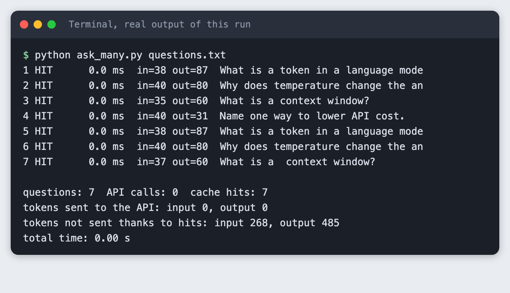
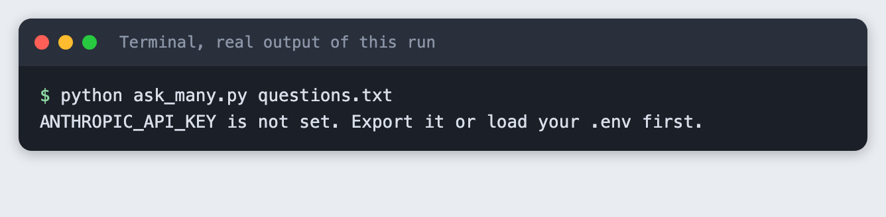
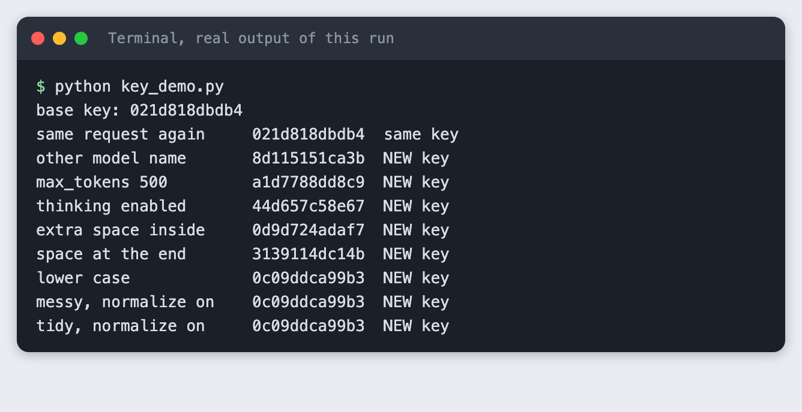
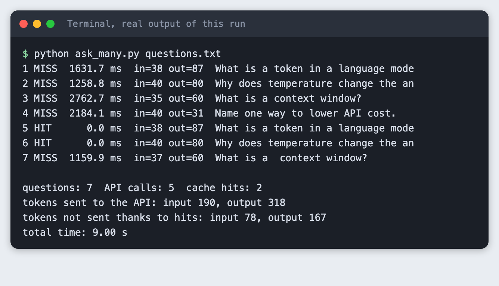
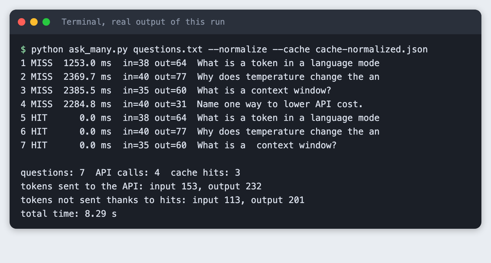
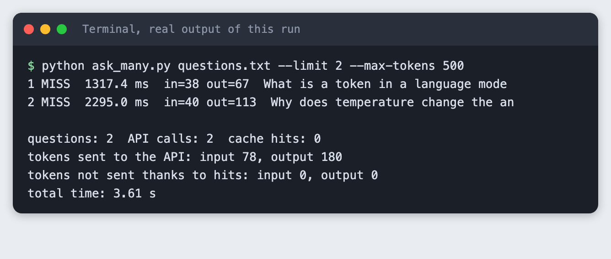
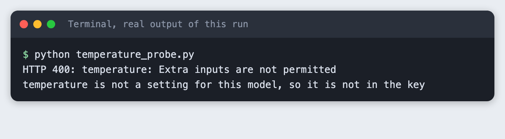
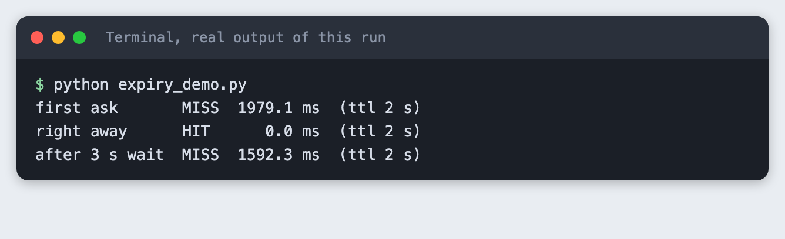

# Cache LLM answers in Python to skip repeat calls

You build a small cache that sits in front of the Anthropic API. It hashes the request, returns a stored answer when the same request comes back, forgets entries after a set time, and reports how many calls and tokens it saved on a test set.

**Time:** about 40 minutes. **Level:** intermediate. **You need:** Python basics, Python 3.10 or newer, and an Anthropic API key. **Tested:** 11 November 2026 with Python 3.14.6 and the `anthropic` package 2.8.0 on macOS.

Model replies differ from run to run. Your words, token counts and timings will not match the output below. The shape of the output will: a miss makes a call, a hit does not.

Credits are limited in an AI hackathon, and a cache stops you paying twice for the same answer. If you plan to build something with a language model, see the [upcoming AI hackathons](/ai-hackathons/).

## Why this matters

Every call to a language model API costs tokens and takes seconds. Programs often ask the same thing more than once: a demo that reloads, a test suite that reruns, a user who clicks twice. A cache answers the repeats from a file on disk. The part that needs care is the key. If the key leaves out something that changes the answer, you return a wrong answer. If it includes something that does not matter, you miss when you did not need to.

This tutorial reports tokens, not money. The saved output has no prices, so the numbers below are calls, tokens and time. Multiply the tokens by the price on your provider's page on the day you run it.

## See it running first

This is the second run of the same seven questions. Nothing was sent to the API.



The rest of the tutorial builds it from scratch.

## Step 1: Set up the project

Make a folder, create a virtual environment and activate it.

```bash
python3 -m venv .venv
```


Create `requirements.txt` with one line:

```text
anthropic>=2.7.0
```
*File: `requirements.txt`*

Install it. The output shows the version used for this tutorial.

```bash
pip install -r requirements.txt
```

```text
Name: anthropic
Version: 2.8.0
```

Put your key in a file named `.env`, copied from this placeholder:

```
ANTHROPIC_API_KEY=your_key_here
```
*File: `.env.example`*

Load it into your terminal session (macOS and Linux) with `set -a; source .env; set +a`. Never paste a real key into code, a screenshot or a chat. If the key is not set, the scripts stop with a plain message. This is what that looks like:



## Step 2: Decide what goes into the key

The key is a hash of everything that can change the answer. Here that is the model name, `max_tokens`, the thinking mode, the system prompt and the question. The fields go into a JSON string with sorted keys, so the same fields always give the same text, and the text goes through SHA-256.

`llm_cache.py` holds the key function, the cache and the `ask` function. The whole file is below. The next steps use parts of it.

```python
import hashlib
import json
import time
from pathlib import Path

from anthropic import Anthropic

MODEL = "claude-haiku-5-5"
MAX_TOKENS = 300
SYSTEM = "You are a concise tutor. Answer in one or two short sentences."


def make_key(model, max_tokens, thinking, system, question, normalize=False):
    """Hash every field that can change the answer. Same fields, same key."""
    if normalize:
        question = " ".join(question.split()).lower()
    payload = {
        "model": model,
        "max_tokens": max_tokens,
        "thinking": thinking,
        "system": system,
        "question": question,
    }
    text = json.dumps(payload, sort_keys=True)
    return hashlib.sha256(text.encode("utf-8")).hexdigest()


def reply_text(response):
    """Join the text blocks. A reply can hold only a thinking block and no text."""
    return "".join(b.text for b in response.content if b.type == "text").strip()


class Cache:
    def __init__(self, path, ttl_seconds=3600):
        self.path = Path(path)
        self.ttl = ttl_seconds
        self.entries = json.loads(self.path.read_text()) if self.path.exists() else {}

    def get(self, key):
        entry = self.entries.get(key)
        if entry is None:
            return None
        if time.time() - entry["saved_at"] > self.ttl:
            del self.entries[key]  # expired: treat as a miss
            return None
        return entry

    def put(self, key, text, usage):
        if not text:
            return  # never cache an empty reply
        self.entries[key] = {"text": text, "usage": usage, "saved_at": time.time()}
        self.path.write_text(json.dumps(self.entries, indent=1))


def ask(cache, client, question, normalize=False, model=MODEL, max_tokens=MAX_TOKENS, thinking="disabled"):
    """Return (text, hit, usage, seconds). A hit makes no API call."""
    start = time.perf_counter()
    key = make_key(model, max_tokens, thinking, SYSTEM, question, normalize)
    entry = cache.get(key)
    if entry:
        return entry["text"], True, entry["usage"], time.perf_counter() - start
    response = client.messages.create(
        model=model,
        max_tokens=max_tokens,
        system=SYSTEM,
        thinking={"type": thinking},
        messages=[{"role": "user", "content": question}],
    )
    text = reply_text(response)
    usage = {"input": response.usage.input_tokens, "output": response.usage.output_tokens}
    cache.put(key, text, usage)
    return text, False, usage, time.perf_counter() - start


def make_client():
    return Anthropic()
```
*File: `llm_cache.py`*

Run `key_demo.py`. It changes one field at a time and shows whether the key changes. No API call is made.

```bash
python key_demo.py
```



Read the verdict column. The same request gives the same key. A different model name gives a new key, which is right: another model gives another answer. A different `max_tokens` or thinking mode also gives a new key. So does one extra space inside the question, or one space at the end.

The last three lines are the fix for whitespace. With `normalize=True`, the question is split on whitespace, joined with single spaces and lower-cased before hashing. The messy and the tidy question then share one key. That key also differs from the base key, because the base key was made without normalizing. Lower-casing is a choice, not a rule: if capital letters change the meaning of your questions, such as in code, do not lower-case.

## Step 3: Store the answer and return hits

The `Cache` class keeps a dictionary and writes it to a JSON file after each new answer. `get` returns an entry or `None`. `put` saves the text, the token usage from the API's `usage` field, and the time. The usage is saved so that a hit can report how many tokens it avoided.

`ask_many.py` runs `questions.txt` through the cache. The file has seven lines: four different questions, two exact repeats of the first two, and a messy repeat of the third with a double space and spaces at both ends.

```text
What is a token in a language model?
Why does temperature change the answer?
What is a context window?
Name one way to lower API cost.
What is a token in a language model?
Why does temperature change the answer?
  What is a  context window?
```
*File: `questions.txt`*

```python
import argparse
import os
import sys

from llm_cache import MAX_TOKENS, Cache, ask, make_client

parser = argparse.ArgumentParser()
parser.add_argument("questions")
parser.add_argument("--cache", default="cache.json")
parser.add_argument("--ttl", type=float, default=3600)
parser.add_argument("--max-tokens", type=int, default=MAX_TOKENS)
parser.add_argument("--normalize", action="store_true")
parser.add_argument("--limit", type=int, default=0, help="only the first N questions")
args = parser.parse_args()

if not os.environ.get("ANTHROPIC_API_KEY"):
    sys.exit("ANTHROPIC_API_KEY is not set. Export it or load your .env first.")

lines = [l for l in open(args.questions).read().split("\n") if l.strip()]
if args.limit:
    lines = lines[: args.limit]

cache = Cache(args.cache, args.ttl)
client = make_client()
calls = hits = 0
spent_in = spent_out = saved_in = saved_out = 0
total_seconds = 0.0
for i, q in enumerate(lines, 1):
    text, hit, usage, secs = ask(cache, client, q, args.normalize, max_tokens=args.max_tokens)
    total_seconds += secs
    if hit:
        hits += 1
        saved_in += usage["input"]
        saved_out += usage["output"]
    else:
        calls += 1
        spent_in += usage["input"]
        spent_out += usage["output"]
    tag = "HIT " if hit else "MISS"
    print(f"{i} {tag} {secs * 1000:7.1f} ms  in={usage['input']} out={usage['output']}  {q.strip()[:34]}")

print()
print(f"questions: {len(lines)}  API calls: {calls}  cache hits: {hits}")
print(f"tokens sent to the API: input {spent_in}, output {spent_out}")
print(f"tokens not sent thanks to hits: input {saved_in}, output {saved_out}")
print(f"total time: {total_seconds:.2f} s")
```
*File: `ask_many.py`*

Run it with an empty cache:

```bash
python ask_many.py questions.txt
```



Five calls were made, for seven questions. Lines 5 and 6 were hits: they returned the stored answers for lines 1 and 2. Each miss took between 1159.9 ms and 2762.7 ms. A hit rounds to 0.0 ms. Total time was 9.00 s.

The tokens sent to the API were 190 input and 318 output, counted from the `usage` field of each real reply. The two hits avoided 78 input and 167 output tokens. For a hit, the `in=` and `out=` columns show the tokens of the original call.

Line 7 was a miss. The extra spaces made a new key, and the cache paid for an answer it already had.

## Step 4: Run it again

Run the same command without deleting the cache file:

```bash
python ask_many.py questions.txt
```

```text
1 HIT      0.0 ms  in=38 out=87  What is a token in a language mode
2 HIT      0.0 ms  in=40 out=80  Why does temperature change the an
3 HIT      0.0 ms  in=35 out=60  What is a context window?
4 HIT      0.0 ms  in=40 out=31  Name one way to lower API cost.
5 HIT      0.0 ms  in=38 out=87  What is a token in a language mode
6 HIT      0.0 ms  in=40 out=80  Why does temperature change the an
7 HIT      0.0 ms  in=37 out=60  What is a  context window?

questions: 7  API calls: 0  cache hits: 7
tokens sent to the API: input 0, output 0
tokens not sent thanks to hits: input 268, output 485
total time: 0.00 s
```

All seven were hits and no call was made. The run avoided 268 input and 485 output tokens, and the total time rounds to 0.00 s. The cache file kept the answers between two separate runs of the program, which is the point of writing it to disk.

## Step 5: Fix the whitespace miss

Run the test set again with `--normalize` and a new cache file, so the old entries do not interfere:

```bash
python ask_many.py questions.txt --normalize --cache cache-normalized.json
```



Four calls instead of five, and three hits instead of two. Line 7 now matches the answer stored for line 3. The input tokens sent fell from 190 to 153. The output tokens fell from 318 to 232, but part of that gap is the model answering differently, so do not credit all of it to the cache.

## Step 6: Change a setting and miss on purpose

The cache must not return an answer made under other settings. Run the first two questions with `--max-tokens 500` against the original `cache.json`, which holds answers made with 300:

```bash
python ask_many.py questions.txt --limit 2 --max-tokens 500
```



Both were misses. The questions were in the file, but under keys made with `max_tokens` 300. This is a correct miss. It costs a call, and it prevents mixing answers made under different settings.

## Step 7: Know which settings the model accepts

A common cache key holds the temperature. I planned to include it. When I added `temperature` to the call, the SDK method I used (`messages.create` in `anthropic` 2.8.0) had no such argument. Sending it through `extra_body` shows what the API says:

```python
import os
import sys

from anthropic import Anthropic, BadRequestError

from llm_cache import MODEL

if not os.environ.get("ANTHROPIC_API_KEY"):
    sys.exit("ANTHROPIC_API_KEY is not set. Export it or load your .env first.")

client = Anthropic()
try:
    client.messages.create(
        model=MODEL,
        max_tokens=50,
        thinking={"type": "disabled"},
        messages=[{"role": "user", "content": "Say hi."}],
        extra_body={"temperature": 0.0},  # the SDK method has no temperature argument
    )
    print("temperature accepted: add it to make_key")
except BadRequestError as err:
    print(f"HTTP {err.status_code}: {err.body['error']['message']}")
    print("temperature is not a setting for this model, so it is not in the key")
```
*File: `temperature_probe.py`*

```bash
python temperature_probe.py
```



For `claude-haiku-5-5` the request was refused, so temperature is not in this key. The rule is general: put every setting you send into the key, and nothing you do not send. If you use a model that takes a temperature, add it to `make_key`, or two requests that differ only in temperature will share an answer. I did not test other models.

## Step 8: Add an expiry

An answer can go stale. `Cache.get` compares the saved time with the time-to-live (TTL). If the entry is older, it deletes it and reports a miss. `expiry_demo.py` uses a 2 second TTL so the demo is short. A real TTL is hours or days, and depends on how fast your answers go out of date.

```bash
python expiry_demo.py
```



The first ask was a miss at 1979.1 ms. The second, right away, was a hit. After a 3 second wait the entry had expired, and the third ask was a miss at 1592.3 ms.

## Step 9: Never cache an empty reply

A reply can hold no text. While building other tutorials, we saw that with thinking on and a low `max_tokens`, `claude-haiku-5-5` can return only a thinking block. I did not reproduce that here, because the code turns thinking off with `{"type": "disabled"}` and uses 300 tokens. The code still defends against it. `reply_text` joins only the text blocks, and `Cache.put` returns without saving when the text is empty. Otherwise one bad reply would be returned forever.

`test_cache.py` checks this with fixed data and a stand-in client. It makes no API call, so it is a check of the rule, not a test of the model.

```bash
python test_cache.py
```

```text
empty reply: not cached, 2 calls for 2 asks
good reply: cached, 1 call for 2 asks
expired entry: called again
all checks passed
```

## Troubleshooting

- **`TypeError: Messages.create() got an unexpected keyword argument 'temperature'`.** The SDK method has no `temperature` argument in the version tested. See Step 7. The API also refused it.
- **Every run is all misses.** Check that the cache file is in the folder you run from, and that nothing in the key changes each run, such as a timestamp in the system prompt.
- **Two questions that mean the same thing both miss.** The cache matches the exact text after tidying, not the meaning. Matching by meaning needs embeddings, and is not built here.
- **The cache returns an old answer.** Lower the TTL or delete the cache file.
- **The cache file holds your questions and answers as plain text.** Do not cache anything private, and do not commit the file.

## Frequently asked questions

**Does caching work when answers vary?**

Yes, with a limit. The cache returns the first answer it saw, so later calls repeat it. In this test the same question gave 87 output tokens in one run and 64 in another, so a fresh call would have been different. Cache when a stored answer is good enough.

**How long should I keep a cached answer?**

It depends on how fast the answer goes stale. The demo used 2 seconds only to show an expiry. Pick a TTL from your own data: a definition can stay for days, a question about today's news should not.

**How do I measure the saving?**

Count calls and read the `usage` field. On the seven-question test the first run made 5 calls instead of 7. The second run made none and avoided 268 input and 485 output tokens. Turn tokens into money with the price on your provider's page.

## What to try next

- Add a cap on the number of entries and remove the oldest first.
- Cache by meaning with embeddings, and check how often it returns a wrong answer.
- Keep the system prompt in a file and hash its contents, so an edit to it makes new keys.

## How this tutorial was tested

- Date: 11 November 2026. Python 3.14.6, `anthropic` 2.8.0, macOS. The model is `claude-haiku-5-5`, set in the `MODEL` constant.
- The code in this article is copied from the project files by a script. The output and screenshots come from saved logs of real API calls, with one exception: `test_cache.py` uses fixed data and a stand-in client on purpose.
- Every step was run from a clean folder, then replayed from an empty copy of the folder with no virtual environment and no cache files. The replay passed. The saved text of replies differed between the two runs, as expected.
- Terminal screenshots are rendered from the saved output of the run. They are not captures of a terminal window.
- Not run: Windows, Linux, Python versions other than 3.14.6, and models other than `claude-haiku-5-5`. The empty-reply case from thinking mode was not reproduced. The cost was not computed because the saved output has no prices.

