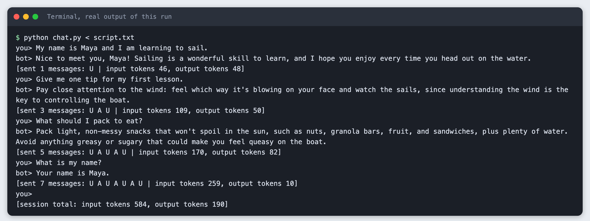
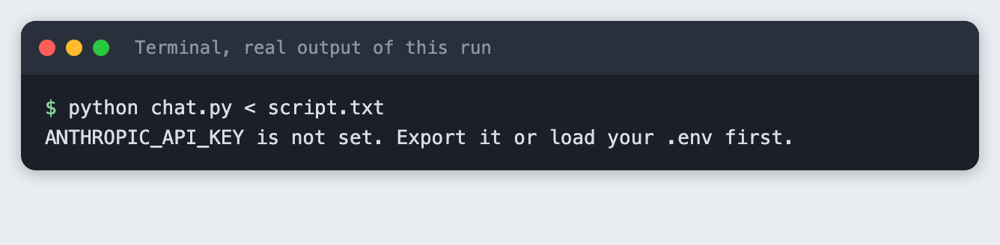
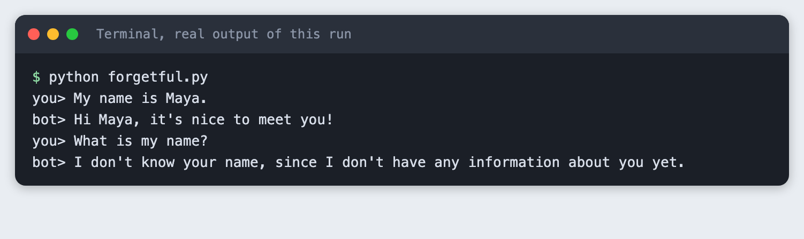

# Build a chatbot that remembers the conversation in Python

You build a terminal chatbot that keeps the chat history between turns, prints a token count for every call, and trims old messages when the history gets long.

**Time:** about 30 minutes. **Level:** beginner. **You need:** Python basics, Python 3.10 or newer, and an Anthropic API key. **Tested:** 10 November 2026 with Python 3.14.6 and the `anthropic` package 2.7.0 on macOS.

Model replies differ from run to run. Your words and token counts will not match the output below exactly. The shape of the output will.

A chatbot that forgets the last question is easy to spot in a demo, and memory is a small change. If you plan to build a chatbot, see the [upcoming AI hackathons](/ai-hackathons/).

## Why this matters

A language model API does not remember anything between calls. Each call sees only the messages you send in it. A chatbot that seems to remember is a program that sends the earlier messages again each turn. That has a cost: every turn sends more input tokens than the one before. Trimming old messages is how you keep that cost in check, and it is also how a bot forgets.

## See it running first

This is the finished bot answering four scripted lines. The last line asks for the name given in the first line.



The rest of the tutorial builds it from nothing.

## Step 1: Set up the project

Make a folder, create a virtual environment and activate it. The commands from here on assume it is active.

```bash
python3 -m venv .venv
```


Create `requirements.txt` with one line:

```text
anthropic>=2.7.0
```
*File: `requirements.txt`*

Install it. The output below shows the version used for this tutorial.

```bash
pip install -r requirements.txt
```

```text
Name: anthropic
Version: 2.7.0
```

## Step 2: Store the key outside the code

Put your key in a file named `.env` in the project folder. Copy the placeholder file and edit it:

```
ANTHROPIC_API_KEY=your_key_here
```
*File: `.env.example`*

Never paste a real key into code, a screenshot or a chat. Add `.env` to `.gitignore` if you use git. Then load the file into your terminal session (macOS and Linux):

```bash
set -a; source .env; set +a
```

You can also run `export ANTHROPIC_API_KEY=...` in the terminal yourself. The scripts below read the variable from the environment, and the SDK reads it too.

If the variable is missing, the script stops with a clear message. This is what the message looks like when you run `chat.py` (built in Step 4) in a terminal where the variable is not set:



## Step 3: Make a call, and see that it forgets

`forgetful.py` makes two separate calls. The first says a name. The second asks for it. The second call sends only its own message. The `MODEL` and `MAX_TOKENS` constants sit at the top so you can change them in one place.

```python
import os
import sys

from anthropic import Anthropic

from spend_log import log_usage

MODEL = "claude-haiku-5-5"
MAX_TOKENS = 100

if not os.environ.get("ANTHROPIC_API_KEY"):
    sys.exit("ANTHROPIC_API_KEY is not set. Export it or load your .env first.")

client = Anthropic()  # reads ANTHROPIC_API_KEY from the environment


def ask(messages):
    response = client.messages.create(model=MODEL, max_tokens=MAX_TOKENS, messages=messages)
    log_usage("forgetful.py", response)
    # A reply can hold other blocks, such as a thinking block, so join only the text blocks.
    return "".join(block.text for block in response.content if block.type == "text")


# Two separate calls. The second call sends only the new question.
print("you> My name is Maya.")
print("bot>", ask([{"role": "user", "content": "My name is Maya. Reply in one short sentence."}]))
print("you> What is my name?")
print("bot>", ask([{"role": "user", "content": "What is my name? Reply in one short sentence."}]))
```
*File: `forgetful.py`*

Run it:

```bash
python forgetful.py
```



The second call has no way to know the name. Nothing was stored between the calls.

## Step 4: Keep a message list

The fix is a Python list. Each turn you append the user's message, send the whole list, and append the reply. The API takes a list of `{"role": ..., "content": ...}` items. Roles are `user` and `assistant`, and a `system` string sets the bot's manner.

`chat.py` also prints a line after each reply. It shows how many messages were sent, a letter per message (U for user, A for assistant), and the input and output token counts. These come from `response.usage`, which the API returns with each reply.

A real chatbot waits for you to type. To make this tutorial repeatable, the questions come from a file, `script.txt`, piped into the program. When input is piped, a terminal does not show the lines, so the program prints each one.

```text
My name is Maya and I am learning to sail.
Give me one tip for my first lesson.
What should I pack to eat?
What is my name?
```
*File: `script.txt`*

```python
import argparse
import os
import sys

from anthropic import Anthropic

from spend_log import log_usage

MODEL = "claude-haiku-5-5"
MAX_TOKENS = 150
SYSTEM = "You are a friendly assistant. Answer in one or two short sentences."

LETTER = {"user": "U", "assistant": "A"}


def reply_text(response):
    """Join the text blocks. A reply can also hold other blocks, such as a thinking block."""
    return "".join(block.text for block in response.content if block.type == "text")


def trim(messages, keep):
    """Keep the last `keep` messages (0 means keep all), starting on a user turn."""
    kept = messages[-keep:] if keep else messages
    while kept and kept[0]["role"] != "user":
        kept = kept[1:]
    return kept


def main():
    parser = argparse.ArgumentParser()
    parser.add_argument("--keep", type=int, default=0, help="keep only the last N messages (0 = all)")
    args = parser.parse_args()

    if not os.environ.get("ANTHROPIC_API_KEY"):
        sys.exit("ANTHROPIC_API_KEY is not set. Export it or load your .env first.")
    client = Anthropic()

    messages = []
    total_in = total_out = 0
    while True:
        try:
            line = input("you> ")
        except EOFError:
            break
        if not sys.stdin.isatty():
            print(line)  # a piped line is not echoed by a terminal, so print it
        if not line.strip():
            continue

        messages.append({"role": "user", "content": line})
        before = len(messages)
        messages = trim(messages, args.keep)
        if len(messages) < before:
            print(f"[trimmed {before - len(messages)} old messages]")

        response = client.messages.create(model=MODEL, max_tokens=MAX_TOKENS, system=SYSTEM, messages=messages)
        log_usage("chat.py", response)
        reply = reply_text(response)
        usage = response.usage
        total_in += usage.input_tokens
        total_out += usage.output_tokens

        letters = " ".join(LETTER[m["role"]] for m in messages)
        print(f"bot> {reply}")
        print(f"[sent {len(messages)} messages: {letters} | input tokens {usage.input_tokens}, output tokens {usage.output_tokens}]")
        messages.append({"role": "assistant", "content": reply})

    print()
    print(f"[session total: input tokens {total_in}, output tokens {total_out}]")


main()
```
*File: `chat.py`*

Run it with the script as input. In your own terminal you can run `python chat.py` and type the lines yourself.

```bash
python chat.py < script.txt
```

```text
you> My name is Maya and I am learning to sail.
bot> Nice to meet you, Maya! Sailing is a wonderful skill to learn, and I hope you enjoy every time you head out on the water.
[sent 1 messages: U | input tokens 46, output tokens 48]
you> Give me one tip for my first lesson.
bot> Pay close attention to the wind: feel which way it's blowing on your face and watch the sails, since understanding the wind is the key to controlling the boat.
[sent 3 messages: U A U | input tokens 109, output tokens 50]
you> What should I pack to eat?
bot> Pack light, non-messy snacks that won't spoil in the sun, such as nuts, granola bars, fruit, and sandwiches, plus plenty of water. Avoid anything greasy or sugary that could make you feel queasy on the boat.
[sent 5 messages: U A U A U | input tokens 170, output tokens 82]
you> What is my name?
bot> Your name is Maya.
[sent 7 messages: U A U A U A U | input tokens 259, output tokens 10]
you> 
[session total: input tokens 584, output tokens 190]
```

Read the lines that start with `[sent`. The message count goes 1, 3, 5, 7. The input tokens go 46, 109, 170, 259. Input grows because the whole list is sent again each turn, and each reply is added to it. The output tokens depend on how long each reply is, so they do not grow in a pattern. At the end the bot answers with the name from the first line. Totals for the session were 584 input tokens and 190 output tokens.

## Step 5: Trim old messages

A list that only grows will cost more every turn, and it will eventually exceed the model's input limit. The simplest fix is to keep only the last few messages. The `trim` function in `chat.py` does that. It keeps the last N messages, then drops a leading assistant message if there is one, because the list should start on a user turn.

Run the same script with `--keep 4`:

```bash
python chat.py --keep 4 < script.txt
```

```text
you> My name is Maya and I am learning to sail.
bot> Nice to meet you, Maya! Sailing is a wonderful skill to learn, and I hope you enjoy every time you're out on the water.
[sent 1 messages: U | input tokens 46, output tokens 48]
you> Give me one tip for my first lesson.
bot> Pay close attention to the wind: feel which way it's blowing on your face and watch the sails, since the wind tells you how to steer.
[sent 3 messages: U A U | input tokens 109, output tokens 44]
you> What should I pack to eat?
[trimmed 2 old messages]
bot> Pack light, non-messy snacks like a sandwich, fruit, nuts, or granola bars, plus plenty of water. Keep everything in a sealed container or dry bag so
[sent 3 messages: U A U | input tokens 99, output tokens 150]
you> What is my name?
[trimmed 2 old messages]
bot> I don't know your name, since I don't have any information about you. If you tell me, I'll be happy to use it!
[sent 3 messages: U A U | input tokens 107, output tokens 35]
you> 
[session total: input tokens 361, output tokens 277]
```

The bot reports `[trimmed 2 old messages]` before the third and fourth turns. From the third turn on, only three messages are sent each time, so the input stays near 100 tokens. The cost is that the bot no longer has the first line. When the script asks for the name in the last turn, the bot has nothing to answer from. Check your own output: the exact words differ per run.

One reply in this run stops mid-sentence. That is the `MAX_TOKENS` limit of 150 doing its job. Raise it if you want longer replies.

Dropping old messages is the blunt method. Two common alternatives are to keep the first message pinned, or to ask the model to summarise old messages into one. Neither is built here.

## Troubleshooting

- **`ANTHROPIC_API_KEY is not set`.** The variable is not in the terminal you are running from. Run the `set -a; source .env; set +a` line again in that terminal.
- **`AttributeError: ... has no attribute 'text'`.** In one of my test runs the reply held a block of another type before the text, and `response.content[0].text` failed. I did not find out why it appeared in that run. The scripts here join only the blocks whose type is `text`, which avoids the error.
- **An authentication error from the API.** The key is wrong or has been revoked. Create a new one in your Anthropic account and update `.env`.
- **The bot answers as if it forgot.** Check that you append the reply to the list after each call. Without it, the model never sees its own earlier answers.

## Frequently asked questions

**How does a chatbot remember a conversation?**

The API remembers nothing between calls. The program keeps a list of messages and sends the whole list again each turn. In the test, the bot answered with the name from the opening line.

**How much memory can a chatbot keep?**

The tutorial did not find a limit. It kept every message in one run, and with `--keep 4` it sent only three messages per turn. The model's input limit was not tested here.

**Does chat memory raise API cost in a hackathon?**

Yes. Input tokens rose from 46 to 109, 170 and 259 over four turns, and the session used 584 input tokens. Trimming keeps the input near 100 tokens, but the bot then forgot the name.

## What to try next

- Pin the first message so it is never trimmed.
- Trim by token count, using the `input_tokens` value, instead of by message count.
- Ask the model to summarise the messages you are about to drop, and keep the summary as the first message.

## How this tutorial was tested

- Date: 10 November 2026. Python 3.14.6, `anthropic` 2.7.0, macOS. The model is `claude-haiku-5-5`, set in the `MODEL` constant.
- The code in this article is copied from the project files by a script. The output and screenshots come from saved logs of real API calls.
- Every step was run from a clean folder, then replayed from an empty copy of the folder with no virtual environment. The replay passed. Model replies differed between the two runs, as expected.
- Terminal screenshots are rendered from the saved output of the run. They are not captures of a terminal window.
- Not run: Windows, Linux, and Python versions other than 3.14.6. The `source .env` line is for macOS and Linux shells.

