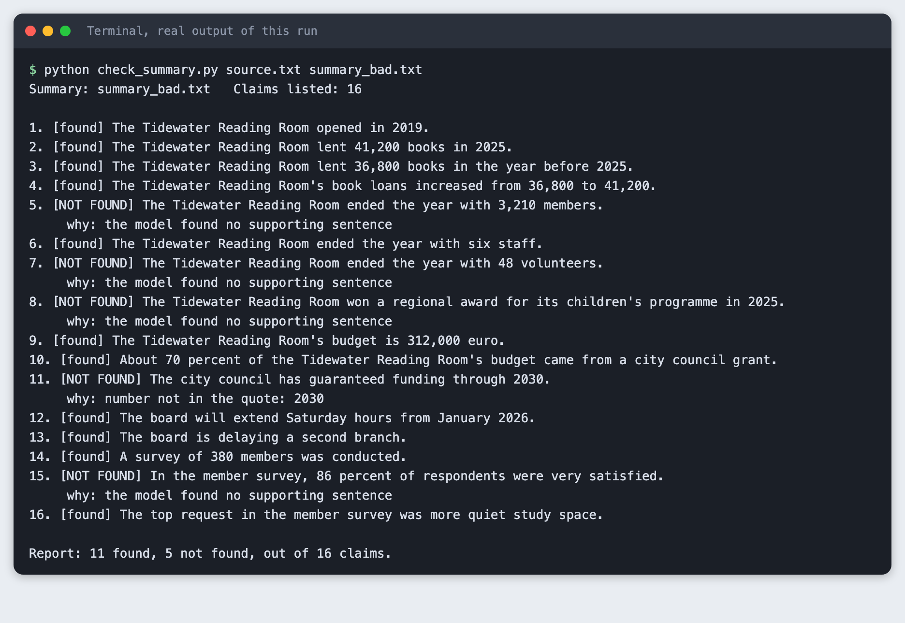
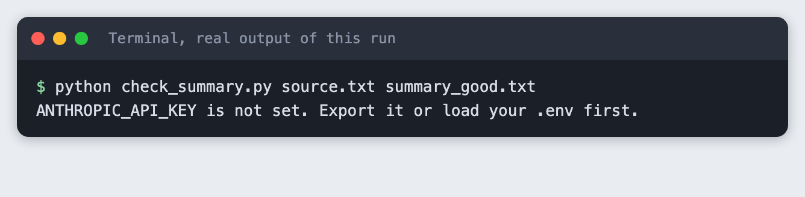
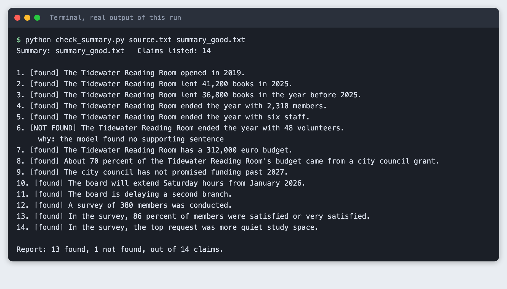
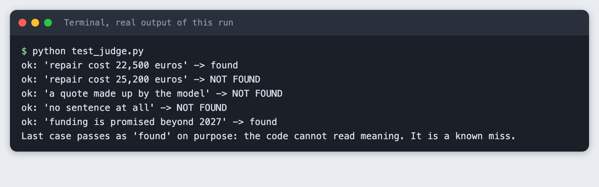

# Check an AI summary against its source with a second pass in Python

You build a script that takes a source text and a summary, lists every claim in the summary, looks for each claim in the source, and prints a report of what it could not find.

**Time:** about 40 minutes. **Level:** intermediate. **You need:** Python basics, Python 3.10 or newer, and an Anthropic API key. **Tested:** 11 November 2026 with Python 3.14.6 and the `anthropic` package 2.8.0 on macOS.

Model replies differ from run to run. The claims it lists, the wording and sometimes the found and not found marks will not match the output below exactly. The shape of the report will.

A demo that shows how you checked a model's answer is easier to trust than one that does not. If you are building a summary tool for one of the [upcoming AI hackathons](/ai-hackathons/), a second pass like this one is a small addition that you can show on screen.

## Why this matters

A model that summarises a text can write a number that is not in the text, or a fact that was never there. You can read the summary against the source yourself, but that does not scale. A second pass does part of that work. It turns the summary into a list of claims, then asks, for each claim, "which sentence in the source says this?" A claim with no sentence behind it is the one to read by hand.

This is a spot-check, not proof. Later sections show what it flagged in this tutorial and what the code cannot catch by design.

## See it running first

This is the finished script run on a summary that has four errors planted in it: a wrong number, an invented award, a funding promise that reverses the source, and a changed survey result.



The rest of the tutorial builds it from scratch.

## Step 1: Set up the project

Make a folder, create a virtual environment and activate it. The commands from here on assume it is active.

```bash
python3 -m venv .venv
```


Create `requirements.txt` with one line:

```text
anthropic>=2.7.0
```
*File: `requirements.txt`*

Install it. The output shows the version used for this tutorial.

```bash
pip install -r requirements.txt
```

```text
Name: anthropic
Version: 2.8.0
```

Put your key in a `.env` file. Copy this placeholder file and edit it. Never paste a real key into code, a screenshot or a chat.

```
ANTHROPIC_API_KEY=your_key_here
```
*File: `.env.example`*

Load it into your terminal session (macOS and Linux) with `set -a; source .env; set +a`. If the variable is missing, the script stops with a message. This is what you see when it is not set:



## Step 2: Write a source text and two summaries

The tutorial uses a text written for it, about an invented library, so there is nothing to look up and no one else's text is copied. Use your own text when you try this.

```text
The Tidewater Reading Room opened in 2019 in a former grain store on the east side of the harbour. In 2025 it lent 41,200 books, up from 36,800 in 2024. Membership ended the year at 2,310 people, of whom 640 were under sixteen. The library employs six staff and relies on 48 volunteers, who together worked about 5,100 hours.
The budget for 2025 was 312,000 euros. Roughly 70 percent came from the city council grant, 18 percent from membership fees, and the rest from donations. The council has not promised funding beyond 2027.
In March the roof over the children's section was repaired after a leak. The repair cost 22,500 euros and the section was closed for nine days.
The board decided in October to extend Saturday opening hours from 10:00 to 16:00, starting in January 2026, and to hold off on a second branch until the funding position is clearer.
A survey of 380 members found that 86 percent were satisfied or very satisfied. The most common request was for more quiet study space.
```
*File: `source.txt`*

`summary_good.txt` is a faithful summary. Every claim in it is in the source, in other words.

```text
The Tidewater Reading Room opened in 2019 and lent 41,200 books in 2025, up from 36,800 the year before. It ended the year with 2,310 members, six staff and 48 volunteers. About 70 percent of its 312,000 euro budget came from a city council grant, and the council has not promised funding past 2027. The board will extend Saturday hours from January 2026 and is delaying a second branch. In a survey of 380 members, 86 percent were satisfied or very satisfied, and the top request was more quiet study space.
```
*File: `summary_good.txt`*

`summary_bad.txt` has four planted errors. The member count says 3,210, but the source says 2,310. The award does not appear in the source. The council "has guaranteed" funding through 2030, where the source says it has not promised funding beyond 2027. The survey says 86 percent were "very satisfied", where the source says "satisfied or very satisfied". The last one is a small change of meaning on purpose.

```text
The Tidewater Reading Room opened in 2019 and lent 41,200 books in 2025, up from 36,800 the year before. It ended the year with 3,210 members, six staff and 48 volunteers. The library won a regional award for its children's programme in 2025. About 70 percent of its 312,000 euro budget came from a city council grant, and the council has guaranteed funding through 2030. The board will extend Saturday hours from January 2026 and is delaying a second branch. In a survey of 380 members, 86 percent were very satisfied, and the top request was more quiet study space.
```
*File: `summary_bad.txt`*

## Step 3: List the claims, find each one, print a report

The script makes two kinds of call. One call turns the summary into a list of short claims. Then one call per claim shows the model the source and asks for the sentence that supports the claim, copied word for word.

Asking for a quote matters. A model can say "yes, that is supported" about anything. A quote is something the code can check. The `judge` function does three checks that need no model:

- The quote must exist in the source text.
- Every number in the claim must also be in the quote.
- The model's own `supports` answer must be true.

The code is below. Two details came from problems while building, described in Troubleshooting: the large `max_tokens` value and the `parse_json` function.

```python
import json
import os
import re
import sys

from anthropic import Anthropic

from spend_log import log_usage

MODEL = "claude-haiku-5-5"

EXTRACT_PROMPT = """List every factual claim in the summary below as a short, self-contained sentence.
One fact per claim. Keep numbers, names and dates exactly as written in the summary.
Do not add any number, name or date that the summary does not state in that sentence.
Reply with a JSON list of strings and nothing else.

Summary:
{summary}"""

FIND_PROMPT = """Here is a source text and one claim.
Find the one sentence in the source that supports the claim, and copy it exactly, word for word.
If no sentence in the source supports the claim, use null.
Reply with JSON only, in this form: {{"quote": "<exact sentence or null>", "supports": true or false}}
"supports" is true only if the quote states what the claim states.

Source:
{source}

Claim: {claim}"""


def ask(client, prompt, max_tokens=3000):
    """One call. Returns the text of the reply and logs the token use.

    The limit is generous because this model can spend tokens thinking before it writes.
    With a limit of 300 the reply came back empty."""
    response = client.messages.create(model=MODEL, max_tokens=max_tokens, messages=[{"role": "user", "content": prompt}])
    log_usage("check_summary.py", response)
    return "".join(block.text for block in response.content if block.type == "text")


def parse_json(text):
    """Return the last JSON value in the reply, or None.

    The model sometimes writes one answer, then "Wait, correcting:" and a second one, so the
    last value is the one to trust. strict=False allows a raw line break inside a string.
    """
    decoder = json.JSONDecoder(strict=False)
    last, pos = None, 0
    while True:
        match = re.compile(r"[\[{]").search(text, pos)
        if not match:
            return last
        try:
            last, pos = decoder.raw_decode(text, match.start())
        except json.JSONDecodeError:
            pos = match.start() + 1


def normalise(text):
    return re.sub(r"\s+", " ", text).strip().lower()


def numbers_in(text):
    return {n.replace(",", "") for n in re.findall(r"\d[\d,]*(?:\.\d+)?", text)}


def judge(claim, answer, source):
    """Turn the model's answer into found / not found, and say why.

    The model has to quote the source. The code then checks the quote really is in the
    source, and that every number in the claim is in the quote. Neither check needs a model.
    """
    quote = answer.get("quote")
    if not quote:
        return "NOT FOUND", "the model found no supporting sentence"
    if normalise(quote) not in normalise(source):
        return "NOT FOUND", "the quoted sentence is not in the source"
    missing = numbers_in(claim) - numbers_in(quote)
    if missing:
        return "NOT FOUND", "number not in the quote: " + ", ".join(sorted(missing))
    if not answer.get("supports"):
        return "NOT FOUND", "the model says the quote does not support the claim"
    return "found", ""


def main():
    if len(sys.argv) != 3:
        sys.exit("usage: python check_summary.py source.txt summary.txt")
    if not os.environ.get("ANTHROPIC_API_KEY"):
        sys.exit("ANTHROPIC_API_KEY is not set. Export it or load your .env first.")
    source = open(sys.argv[1], encoding="utf-8").read()
    summary = open(sys.argv[2], encoding="utf-8").read()
    client = Anthropic()

    claims = parse_json(ask(client, EXTRACT_PROMPT.format(summary=summary)))
    if not isinstance(claims, list):
        sys.exit("The model did not return a list of claims. Run it again.")
    print(f"Summary: {sys.argv[2]}   Claims listed: {len(claims)}")
    print()

    not_found = 0
    for number, claim in enumerate(claims, 1):
        reply = ask(client, FIND_PROMPT.format(source=source, claim=claim))
        try:
            answer = parse_json(reply)
        except json.JSONDecodeError:
            answer = None
        if not isinstance(answer, dict):
            status, reason = "NOT FOUND", f"the reply was not valid JSON: {reply[:60]!r}"
        else:
            status, reason = judge(claim, answer, source)
        print(f"{number}. [{status}] {claim}")
        if reason:
            print(f"     why: {reason}")
        if status != "found":
            not_found += 1

    print()
    print(f"Report: {len(claims) - not_found} found, {not_found} not found, out of {len(claims)} claims.")


main()
```
*File: `check_summary.py`*

The `spend_log.py` helper only writes one line per API call to a local log. It is not part of the lesson.

```python
"""Budget helper, not part of the lesson: one line per API call in spend.log."""
from datetime import datetime, timezone
from pathlib import Path


def log_usage(script, response):
    stamp = datetime.now(timezone.utc).isoformat(timespec="seconds")
    line = f"{stamp} {script} in={response.usage.input_tokens} out={response.usage.output_tokens}\n"
    with open(Path(__file__).with_name("spend.log"), "a") as f:
        f.write(line)
```
*File: `spend_log.py`*

## Step 4: Run it on the good summary

```bash
python check_summary.py source.txt summary_good.txt
```



The script listed 14 claims. It marked 13 as found and 1 as not found. The claim marked not found is "ended the year with 48 volunteers". The source does say 48 volunteers, so this is a false alarm. The script reports that the model found no supporting sentence. I did not find out why the model returned no sentence for that claim. In another run of the same files, that claim was found. Treat a not found mark as "read this one", not as "this is wrong".

## Step 5: Run it on the summary with planted errors

```bash
python check_summary.py source.txt summary_bad.txt
```

```text
Summary: summary_bad.txt   Claims listed: 16

1. [found] The Tidewater Reading Room opened in 2019.
2. [found] The Tidewater Reading Room lent 41,200 books in 2025.
3. [found] The Tidewater Reading Room lent 36,800 books in the year before 2025.
4. [found] The Tidewater Reading Room's book loans increased from 36,800 to 41,200.
5. [NOT FOUND] The Tidewater Reading Room ended the year with 3,210 members.
     why: the model found no supporting sentence
6. [found] The Tidewater Reading Room ended the year with six staff.
7. [NOT FOUND] The Tidewater Reading Room ended the year with 48 volunteers.
     why: the model found no supporting sentence
8. [NOT FOUND] The Tidewater Reading Room won a regional award for its children's programme in 2025.
     why: the model found no supporting sentence
9. [found] The Tidewater Reading Room's budget is 312,000 euro.
10. [found] About 70 percent of the Tidewater Reading Room's budget came from a city council grant.
11. [NOT FOUND] The city council has guaranteed funding through 2030.
     why: number not in the quote: 2030
12. [found] The board will extend Saturday hours from January 2026.
13. [found] The board is delaying a second branch.
14. [found] A survey of 380 members was conducted.
15. [NOT FOUND] In the member survey, 86 percent of respondents were very satisfied.
     why: the model found no supporting sentence
16. [found] The top request in the member survey was more quiet study space.

Report: 11 found, 5 not found, out of 16 claims.
```

The script listed 16 claims and marked 11 found and 5 not found. All four planted errors were flagged in this run:

- 3,210 members: the model found no sentence with that claim.
- The regional award: the model found no sentence.
- The funding "through 2030": the number check flagged 2030 as missing from the quote. The model had quoted the real sentence about 2027, and the number check is what exposed the mismatch.
- "86 percent were very satisfied": the model found no supporting sentence.

The fifth mark, the 48 volunteers claim, is the same false alarm as in Step 4. Four of four planted errors caught in one run is not a catch rate. In the replay of this project the planted errors were flagged again, and the false alarm did not appear. A different text or a different run can miss an error. Run it more than once on your own data.

## Step 6: See what the code cannot catch

The model's quote check and number check are code. Run `test_judge.py` to see them on fixed data, with no API call:

```bash
python test_judge.py
```



The code catches a wrong number, a made-up quote and a missing quote. It marks the last case as found, though the claim "funding is promised beyond 2027" says the opposite of the quote. The code does not read meaning. Only the model's `supports` answer stands between a reversed claim and a found mark, and that answer comes from the same kind of model that may have written the summary. Things this check does not cover:

- A claim the source supports but that leaves out something important.
- A reversal where the numbers match, such as a claim that says "will" where the source says "will not".
- Claims the extraction step failed to list. A claim that is never listed is never checked.
- A source that is itself wrong.

## Troubleshooting

- **The reply is empty and the script reports invalid JSON.** In my first runs, the model returned only a thinking block with no text. The `max_tokens` limit was 300 and the thinking used all of it (the stop reason was `max_tokens`). Raising the limit to 3000 fixed it. I did not test other limits in between.
- **The script reports invalid JSON, but the reply has text.** Some replies held one answer, then the words "Wait, correcting" and a second answer. Two JSON objects in one reply cannot be parsed together. `parse_json` now takes the last value in the reply.
- **A claim is marked not found for a number that is in the source, such as a year.** In some runs the model added "2025" to a claim, and 2025 was not in the quoted sentence. The extraction prompt now says not to add numbers, names or dates. It still happened once after that change, and not in the runs after it. It may happen with your text.
- **`ANTHROPIC_API_KEY is not set`.** Run the `set -a; source .env; set +a` line again in the terminal you are using.

## Frequently asked questions

**How do I check an AI answer against a source?**

Turn the answer into a list of claims. For each claim, ask the model to quote the supporting sentence, then check in code that the quote is really in the source. In the test on the summary with planted errors, this flagged the wrong number, the invented award, the reversed funding claim and the changed survey result.

**Can a second pass catch every error?**

No. In this tutorial it flagged all four planted errors in the clean run, and it also flagged a correct claim (48 volunteers). The code check cannot read meaning, as the fixed-data step shows with a reversed claim marked found. Use the report to decide what to read by hand.

**Does a check add cost to a hackathon project?**

Yes. It makes one call to list the claims and one call per claim, and each of those sends the full source text. The good summary needed 15 calls in the clean run, and the summary with errors needed 17. Short texts and the small model used here keep each run cheap, but the number of calls grows with the number of claims.

## What to try next

- Send all claims in one call with the source, and compare the cost and the results with one call per claim.
- Print the quoted sentence next to each found claim, so a reader can check the match fast.
- Add a third summary with an error that keeps all the numbers the same, and see whether the check flags it.

## How this tutorial was tested

- Date: 11 November 2026. Python 3.14.6, `anthropic` 2.8.0, macOS. The model is `claude-haiku-5-5`, set in the `MODEL` constant.
- The code in this article is copied from the project files by a script. The output and screenshots come from saved logs of real API calls. The source text and both summaries were written for this tutorial.
- Every step was run from a clean folder, then replayed from an empty copy of the folder with no virtual environment. The replay passed. Model replies differed between runs, as expected: the replay listed 15 claims on each summary and had no false alarm on the good summary.
- Terminal screenshots are rendered from the saved output of the run. They are not captures of a terminal window.
- Not run: Windows, Linux, Python versions other than 3.14.6, other models, and any source text longer than a few paragraphs.

