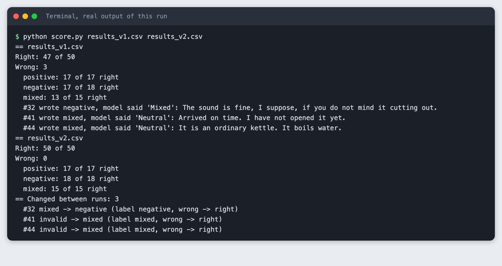
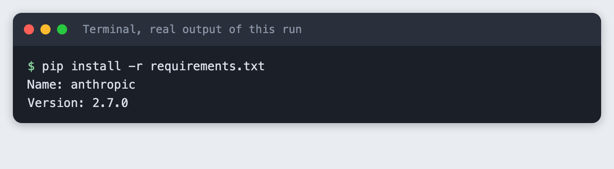
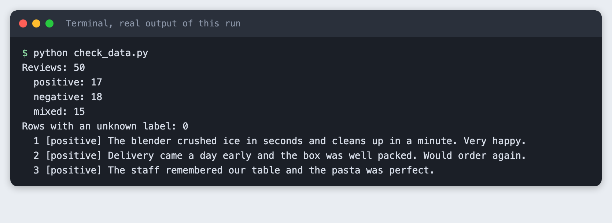
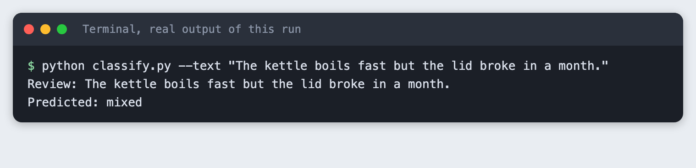
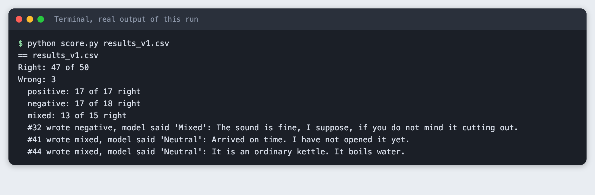
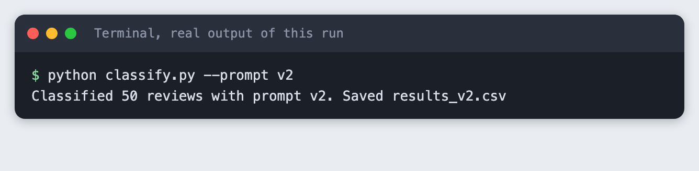
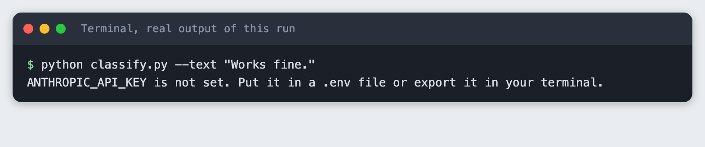
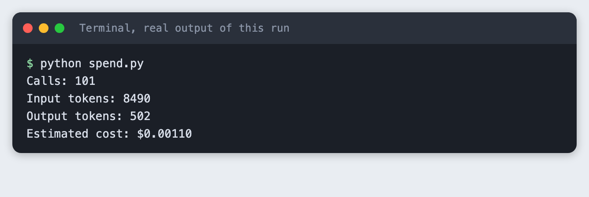

# Classify customer reviews with an LLM and check it on 50 examples

You will build a small Python tool that labels reviews as positive, negative or mixed with the Claude API, then counts how many labels match ones you wrote yourself. It takes about 45 minutes.

**Level:** Intermediate. **You need:** Python 3.10 or newer, a terminal, and an Anthropic API key. **Tested:** 10 November 2026 on macOS with Python 3.14.6 and `anthropic` 2.7.0, using the model `claude-haiku-5-5`. The Windows commands were not run.

Classification is a small project you can finish in an AI hackathon, and counting right and wrong labels shows whether a prompt change helped. See the [upcoming AI hackathons](/ai-hackathons/) if you want to try it with a team.

## Why check a prompt on labelled data

A prompt that looks right on three examples can fail on the fourth. If you write down the answers you expect for a set of examples, you can count the misses and see which kind of review causes them. You can then change the prompt and measure again, instead of guessing whether the change helped.

## See it running first

By the end you will compare two prompts on the same 50 reviews and get a summary like this:



Model output varies from run to run. Your counts may differ from the ones in this article. The rest of the tutorial builds the tool from scratch.

## Step 1. Create a virtual environment

A virtual environment keeps this project's packages apart from the rest of your machine. Make a folder, open a terminal in it, and run:

```bash
python3 -m venv .venv
```


Activate it. On macOS and Linux use `source .venv/bin/activate`. On Windows use `.venv\Scripts\activate`. Every command below assumes the environment is active.

## Step 2. Install the SDK and set your key

The only package is the official Anthropic Python SDK. List it in `requirements.txt`:

```text
anthropic>=2.7.0
```
*File: `requirements.txt`*

Install it:

```bash
pip install -r requirements.txt
```



Create a file named `.env` in the project folder with your own key, or export the variable in your terminal. Never paste a key into code or share the file. The project ships a `.env.example` that shows the format:

```
ANTHROPIC_API_KEY=your_key_here
```
*File: `.env.example`*

## Step 3. Write the labelled reviews

The check is only as good as the labels, so write them yourself. This tutorial uses 50 short reviews written for it: 17 positive, 18 negative and 15 mixed. Some are plain. Others are meant to be hard: sarcasm that sounds like praise, praise with a catch, and reviews with no opinion at all. The label column is the answer you expect, and `reviews.csv` is the file the rest of the code reads.

The script below counts the rows and the labels so you can catch a typo before you spend any API calls:

```python
"""Check reviews.csv: count the rows and the labels."""
import csv
from collections import Counter

from prompts import LABELS

rows = list(csv.DictReader(open("reviews.csv", newline="")))
counts = Counter(r["label"] for r in rows)
bad = [r["id"] for r in rows if r["label"] not in LABELS]
print(f"Reviews: {len(rows)}")
for label in LABELS:
    print(f"  {label}: {counts[label]}")
print(f"Rows with an unknown label: {len(bad)}")
for r in rows[:3]:
    print(f"  {r['id']} [{r['label']}] {r['text']}")
```
*File: `check_data.py`*

```bash
python check_data.py
```



The file has 50 rows and 17, 18 and 15 reviews in the three labels. No row has an unknown label.

## Step 4. Write the prompt and classify one review

The prompt is a short instruction plus the review. It names the three labels and asks for one word, so the answer is easy to compare with your label. Both prompts used in this tutorial live in one file:

```python
"""The two prompts the tutorial compares. {review} is filled in for each review."""

PROMPT_V1 = (
    "Label this review as positive, negative or mixed. Answer with one word.\n"
    "Review: {review}"
)

PROMPT_V2 = (
    "Label this review. Answer with one word: positive, negative or mixed.\n"
    "positive: the writer is happy overall.\n"
    "negative: the writer is unhappy overall. Praise words used as a joke still count as negative.\n"
    "mixed: clear good and bad points, or no strong opinion either way.\n"
    "Review: {review}"
)

PROMPTS = {"v1": PROMPT_V1, "v2": PROMPT_V2}
LABELS = ("positive", "negative", "mixed")
```
*File: `prompts.py`*

`classify.py` sends one review per call. It sets `max_tokens` to 10 because a label is one word, and it turns thinking off with `thinking={"type": "disabled"}`. Anthropic's model notes say this model thinks by default, and thinking tokens would count against the 10-token limit. Each call writes one line to `spend.log` with the input and output tokens from the response's `usage` field. Anything the model says that is not one of the three labels is stored as `invalid`.

```python
"""Classify reviews as positive, negative or mixed with one API call per review.

  python classify.py --text "Some review"      one review, prints the label
  python classify.py --prompt v1               all of reviews.csv, saves results_v1.csv
"""
import argparse, csv, os, sys, time
from pathlib import Path

import anthropic

from prompts import LABELS, PROMPTS

MODEL = "claude-haiku-5-5"
MAX_TOKENS = 10  # a label is one word
SPEND_LOG = Path("spend.log")


def get_client():
    if not os.environ.get("ANTHROPIC_API_KEY") and Path(".env").is_file():
        for line in Path(".env").read_text().splitlines():
            if line.startswith("ANTHROPIC_API_KEY="):
                os.environ["ANTHROPIC_API_KEY"] = line.split("=", 1)[1].strip()
    if not os.environ.get("ANTHROPIC_API_KEY"):
        print("ANTHROPIC_API_KEY is not set. Put it in a .env file or export it in your terminal.")
        sys.exit(2)
    return anthropic.Anthropic()


def classify(client, prompt_name, review):
    response = client.messages.create(
        model=MODEL,
        max_tokens=MAX_TOKENS,
        thinking={"type": "disabled"},  # no reasoning tokens: the answer is one word
        messages=[{"role": "user", "content": PROMPTS[prompt_name].format(review=review)}],
    )
    with SPEND_LOG.open("a") as log:
        log.write(f"{time.strftime('%Y-%m-%dT%H:%M:%S')} {MODEL} in={response.usage.input_tokens} out={response.usage.output_tokens}\n")
    raw = "".join(b.text for b in response.content if b.type == "text").strip()
    words = raw.lower().split()
    word = words[0].strip(".,!:;\"'") if words else ""
    return (word if word in LABELS else "invalid"), raw


def main():
    parser = argparse.ArgumentParser()
    parser.add_argument("--prompt", default="v1", choices=sorted(PROMPTS))
    parser.add_argument("--text")
    parser.add_argument("--input", default="reviews.csv")
    args = parser.parse_args()
    client = get_client()
    if args.text:
        label, raw = classify(client, args.prompt, args.text)
        print(f"Review: {args.text}")
        print(f"Predicted: {label}")
        return
    rows = list(csv.DictReader(open(args.input, newline="")))
    out_path = f"results_{args.prompt}.csv"
    with open(out_path, "w", newline="") as f:
        writer = csv.writer(f)
        writer.writerow(["id", "text", "label", "predicted", "raw"])
        for row in rows:
            predicted, raw = classify(client, args.prompt, row["text"])
            writer.writerow([row["id"], row["text"], row["label"], predicted, raw])
    print(f"Classified {len(rows)} reviews with prompt {args.prompt}. Saved {out_path}")


if __name__ == "__main__":
    main()
```
*File: `classify.py`*

Try one review:

```bash
python classify.py --text "The kettle boils fast but the lid broke in a month."
```



The review praises the speed and complains about the lid, and the model said mixed.

## Step 5. Run the prompt on all 50 reviews

Now run prompt v1 over the whole file. This makes 50 calls, one per review, and saves every answer to `results_v1.csv`.

```bash
python classify.py --prompt v1
```


## Step 6. Count right and wrong

`score.py` compares the `predicted` column with your `label` column. It prints the totals, a count per label, and every wrong row with the model's raw answer. Looking at the wrong rows matters more than the total, because they tell you what to change.

```python
"""Count right and wrong for one or more results files, and list the wrong ones.

  python score.py results_v1.csv [results_v2.csv]
With two files it also lists the reviews whose prediction changed.
"""
import csv, sys
from collections import Counter

from prompts import LABELS


def load(path):
    return {r["id"]: r for r in csv.DictReader(open(path, newline=""))}


def report(path, rows):
    right = sum(r["predicted"] == r["label"] for r in rows.values())
    print(f"== {path}")
    print(f"Right: {right} of {len(rows)}")
    print(f"Wrong: {len(rows) - right}")
    for label in LABELS:
        mine = [r for r in rows.values() if r["label"] == label]
        ok = sum(r["predicted"] == label for r in mine)
        print(f"  {label}: {ok} of {len(mine)} right")
    wrong = [r for r in rows.values() if r["predicted"] != r["label"]]
    for r in wrong:
        print(f"  #{r['id']} wrote {r['label']}, model said {r['raw']!r}: {r['text'][:72]}")
    return right


def main():
    paths = sys.argv[1:]
    runs = [load(p) for p in paths]
    for p, rows in zip(paths, runs):
        report(p, rows)
    if len(runs) == 2:
        a, b = runs
        changed = [i for i in a if a[i]["predicted"] != b[i]["predicted"]]
        print(f"== Changed between runs: {len(changed)}")
        for i in changed:
            ok_a, ok_b = a[i]["predicted"] == a[i]["label"], b[i]["predicted"] == b[i]["label"]
            print(f"  #{i} {a[i]['predicted']} -> {b[i]['predicted']} (label {a[i]['label']}, "
                  f"{'right' if ok_a else 'wrong'} -> {'right' if ok_b else 'wrong'})")


if __name__ == "__main__":
    main()
```
*File: `score.py`*

```bash
python score.py results_v1.csv
```



With prompt v1 the model matched 47 of 50 labels. The three misses are in the output above. Two reviews I labelled mixed got the answer "Neutral", which is not one of the three labels, so the script counted them as `invalid`. The third was review 32, where I wrote negative and the model said "Mixed". That one is a judgement call: the reviewer says the sound is fine "if you do not mind it cutting out", and a reader could argue for either label. Labels you write are opinions too, so keep that in mind when you read a score.

## Step 7. Change the prompt once and rerun

I wrote prompt v2 before I saw the v1 results. It does two things: it defines each label in a sentence, and it says that praise used as a joke still counts as negative. It still asks for one word. Run it:

```bash
python classify.py --prompt v2
```



Then score both runs together. With two files, `score.py` also lists the reviews whose prediction changed:

```bash
python score.py results_v1.csv results_v2.csv
```

```text
== results_v1.csv
Right: 47 of 50
Wrong: 3
  positive: 17 of 17 right
  negative: 17 of 18 right
  mixed: 13 of 15 right
  #32 wrote negative, model said 'Mixed': The sound is fine, I suppose, if you do not mind it cutting out.
  #41 wrote mixed, model said 'Neutral': Arrived on time. I have not opened it yet.
  #44 wrote mixed, model said 'Neutral': It is an ordinary kettle. It boils water.
== results_v2.csv
Right: 50 of 50
Wrong: 0
  positive: 17 of 17 right
  negative: 18 of 18 right
  mixed: 15 of 15 right
== Changed between runs: 3
  #32 mixed -> negative (label negative, wrong -> right)
  #41 invalid -> mixed (label mixed, wrong -> right)
  #44 invalid -> mixed (label mixed, wrong -> right)
```

In this run v2 matched 50 of 50 labels, and the three reviews that changed are the three v1 misses. Be careful with that result. The 50 reviews are the same ones used to compare the prompts, so a perfect score here does not show the prompt will do as well on reviews it has not seen. A fair test of v2 needs new reviews that you did not look at while writing the prompt. Rerunning also gives a different answer sometimes, so one run is a sample, not a fixed number.

## Step 8. What a missing key looks like

If the key is not set, the script stops before it makes any call and says why. Here the step runs without a key on purpose:

```bash
python classify.py --text "Works fine."
```



The exit code is 2. If you see this message, create the `.env` file or export the variable in the same terminal you run the script from.

## Step 9. Check what it cost

Every call logged its token counts. `spend.py` adds the lines and turns the totals into a dollar estimate with the prices for this model, which were 0.10 dollars per million input tokens and 0.50 dollars per million output tokens when this was tested. Check the provider's price page for current prices.

```python
"""Add up spend.log. Prices are dollars per million tokens for the demo model."""
INPUT_PER_M, OUTPUT_PER_M = 0.10, 0.50  # check the provider's price page before you rely on these

calls = tin = tout = 0
for line in open("spend.log"):
    parts = dict(p.split("=") for p in line.split()[2:])
    calls += 1
    tin += int(parts["in"])
    tout += int(parts["out"])
cost = tin * INPUT_PER_M / 1e6 + tout * OUTPUT_PER_M / 1e6
print(f"Calls: {calls}")
print(f"Input tokens: {tin}")
print(f"Output tokens: {tout}")
print(f"Estimated cost: ${cost:.5f}")
```
*File: `spend.py`*

```bash
python spend.py
```



The whole tutorial run made 101 calls: one for the single review, 50 for v1 and 50 for v2. The tokens and estimated cost are in the output above.

## Troubleshooting

**"ANTHROPIC_API_KEY is not set".** Add the key to `.env` in the folder you run the script from, or export it in the same terminal.

**Some answers are counted as `invalid`.** The model wrote a word that is not one of your labels, as it did with "Neutral" in Step 6. Either add the word to your prompt as a label or tell the prompt to choose only from the three.

**The score changes when I rerun.** Model output varies between runs. Run the same prompt more than once if the score decides something, and look at the wrong rows rather than only the total.

## Frequently asked questions

**How do I measure whether my prompt works?**

Write the expected labels yourself, run the prompt on every example and count the matches. Here, prompt v1 matched 47 of 50 labels, and prompt v2 matched 50 of 50 on the same reviews. Use new reviews to test a prompt fairly.

**How many labelled examples do I need?**

Not tested here. This tutorial used 50 reviews that we wrote. A perfect score on the same reviews used to write the prompt does not show how the prompt does on new ones.

**Can an LLM replace a trained classifier in a hackathon?**

Not tested here. The tutorial did not compare the LLM with a trained classifier. It shows only that the model matched 47 of 50 labels with prompt v1 on the 50 reviews.

## What to try next

- Write 50 more reviews and score v2 on them without changing the prompt.
- Add a fourth label and see which of your own labels the model disagrees with.
- Save the wrong rows from each run and compare them across three or four prompt versions.

## How this tutorial was tested

The tutorial was run on 10 November 2026 on macOS with Python 3.14.6, `anthropic` 2.7.0 and the model `claude-haiku-5-5`. The code blocks are copied from the project files, and the output blocks are the saved output of the real run. The steps were replayed from an empty copy of the folder. Screenshots are terminal-style images rendered from the saved output of each command. They are not captures of a terminal window. Not run: Windows and Linux, and any model other than `claude-haiku-5-5`.

