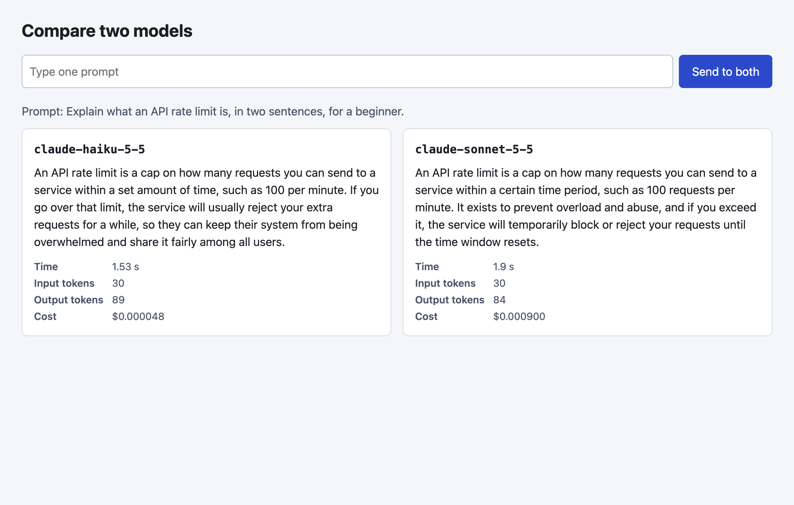
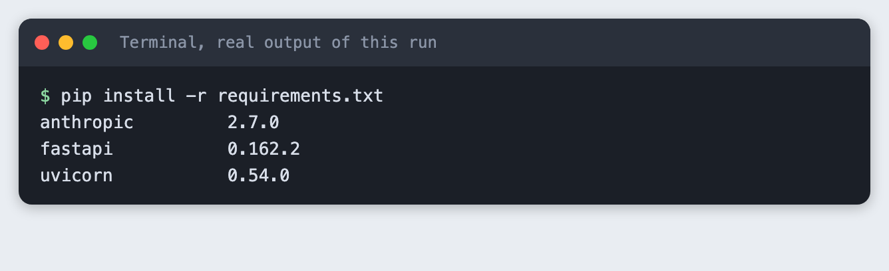
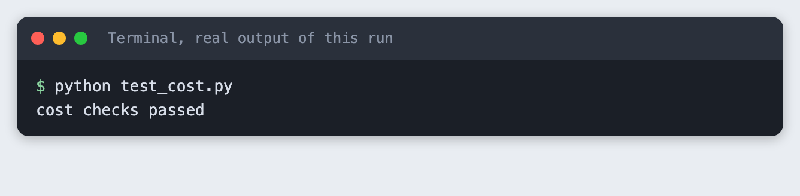
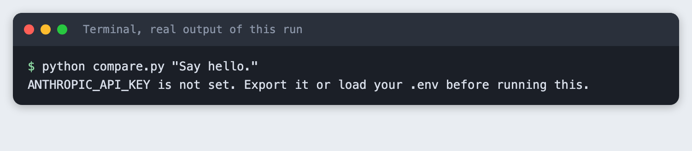
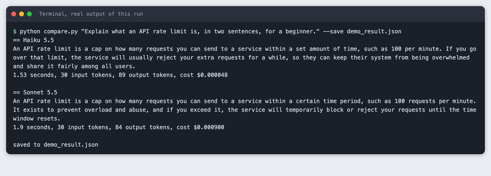
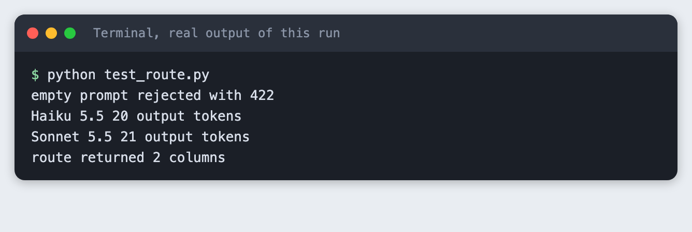

# Build a hackathon app that compares two models side by side

You build a small web page that sends one prompt to two language models and shows the answers in two columns, with the time each call took, the tokens it used and a cost worked out from the listed prices. The backend is about 50 lines of Python.

**Time:** about two hours. **Level:** intermediate. **You need:** Python basics, Python 3.10 or newer, a browser, and an Anthropic API key. **Tested:** 10 November 2026 with Python 3.14.6, `anthropic` 2.7.0, `fastapi` 0.162.2 and `uvicorn` 0.54.0 on macOS.

Model answers, timings and token counts differ from run to run. Yours will not match the numbers below.

**One provider only.** This tutorial compares two models from one provider, `claude-haiku-5-5` and `claude-sonnet-5-5`, because the Anthropic key is the one the author of this tutorial has. The pattern does not depend on that. To add a model from another provider, add an entry to `models.py` with its prices, write one `ask` function for that provider's client, and the page shows a third column the same way. I did not run any other provider.

Choosing a model is an early decision in an AI hackathon, and your own prompts say more than a leaderboard. If you are still looking for an event to use this in, see the list of [upcoming AI hackathons](/ai-hackathons/).

## Why this matters

A model that reads well in a demo of someone else's prompt may not suit yours. If you send the same prompt to two models and put the answer, the wait and the cost next to each other, you decide from your own data in a few minutes. The cost column matters because the two models in this tutorial have different listed prices, and a demo that gets many requests adds that difference up.

## See it running

This is the finished page, opened with a saved result so that opening it makes no model calls. The prompt, answers, times and token counts are real output of the run in Step 3.



The rest of the tutorial builds it from nothing.

## Step 1: Set up the project and the key

Make a folder, create a virtual environment and activate it. The commands from here on assume it is active.

```bash
python3 -m venv .venv
```


Create `requirements.txt`:

```text
anthropic>=2.7.0
fastapi>=0.115
uvicorn>=0.30
```
*File: `requirements.txt`*

Install it. The output lists the versions used for this tutorial.

```bash
pip install -r requirements.txt
```



Put your key in a file named `.env` in the project folder. Copy the placeholder file and edit it:

```
ANTHROPIC_API_KEY=your_key_here
```
*File: `.env.example`*

Never paste a real key into code, a screenshot or a chat. Load the file into your terminal session (macOS and Linux):

```bash
set -a; source .env; set +a
```

## Step 2: List the two models and their prices

Everything that differs between models lives in one file. Each entry has the price per million input tokens, the price per million output tokens, and the setting that stops the model from thinking before it answers. I turned thinking off so that the output tokens you see are the answer and nothing else.

The two models name that setting differently. `claude-haiku-5-5` accepts `{"type": "disabled"}`. When I sent that to `claude-sonnet-5-5`, the API refused it with a message to send `{"type": "between_tools"}` instead. So the setting is stored per model. This is the kind of difference you meet when you add a model from a second provider, and it is a reason to keep it in data and not in `if` statements.

The model IDs came from the installed `anthropic` package. The prices came from Anthropic's public pricing page, read on 10 November 2026: $0.10 per million input tokens and $0.50 per million output tokens for `claude-haiku-5-5`, and $2 and $10 for `claude-sonnet-5-5`. Prices change, so check the page before you rely on them.

```python
"""The two models and their prices in US dollars per million tokens.
Check the provider's pricing page before you rely on these numbers."""

MODELS = {
    # "thinking" is how each model is told not to think before it answers. The two models name it differently.
    "claude-haiku-5-5": {"label": "Haiku 5.5", "input": 0.10, "output": 0.50, "thinking": {"type": "disabled"}},
    "claude-sonnet-5-5": {"label": "Sonnet 5.5", "input": 2.00, "output": 10.00, "thinking": {"type": "between_tools"}},
}
MAX_TOKENS = 200


def cost_usd(model, input_tokens, output_tokens):
    price = MODELS[model]
    return (input_tokens * price["input"] + output_tokens * price["output"]) / 1_000_000
```
*File: `models.py`*

The cost arithmetic is easy to get wrong by a factor of a million, so it has a test with fixed numbers and no API call:

```python
from models import cost_usd

# 1,000,000 input tokens at the listed input price, and the same for output.
assert abs(cost_usd("claude-haiku-5-5", 1_000_000, 0) - 0.10) < 1e-9
assert abs(cost_usd("claude-haiku-5-5", 0, 1_000_000) - 0.50) < 1e-9
assert abs(cost_usd("claude-sonnet-5-5", 1_000_000, 0) - 2.00) < 1e-9
assert abs(cost_usd("claude-sonnet-5-5", 0, 1_000_000) - 10.00) < 1e-9
# A small call: 40 input and 60 output tokens on the second model.
assert abs(cost_usd("claude-sonnet-5-5", 40, 60) - 0.00068) < 1e-9
print("cost checks passed")
```
*File: `test_cost.py`*

```bash
python test_cost.py
```



## Step 3: Send one prompt to both models

`compare.py` has one function, `ask`, that sends the prompt to one model, times the call, reads the token counts from `response.usage` and works out the cost. `compare` calls it for each model, one after the other, so the two calls do not share a connection while they are timed. `max_tokens` is 200 to keep each call short.

The script also runs from the command line. If the key is missing it stops with a message. This is what that looks like:



```python
import json
import os
import sys
import time

import anthropic

from models import MAX_TOKENS, MODELS, cost_usd
from spend_log import log_usage


def ask(client, model, prompt):
    """Send the prompt to one model. Return the answer and what the call cost."""
    start = time.perf_counter()
    response = client.messages.create(
        model=model,
        max_tokens=MAX_TOKENS,
        thinking=MODELS[model]["thinking"],
        messages=[{"role": "user", "content": prompt}],
    )
    seconds = time.perf_counter() - start
    log_usage("compare.py", model, response.usage)
    return {
        "model": model,
        "label": MODELS[model]["label"],
        "answer": "".join(block.text for block in response.content if block.type == "text"),
        "seconds": round(seconds, 2),
        "input_tokens": response.usage.input_tokens,
        "output_tokens": response.usage.output_tokens,
        "cost_usd": cost_usd(model, response.usage.input_tokens, response.usage.output_tokens),
    }


def compare(client, prompt):
    # One after the other, so the two timings do not compete for the same connection.
    return [ask(client, model, prompt) for model in MODELS]


if __name__ == "__main__":
    args = [a for a in sys.argv[1:] if a != "--save"]
    if not args:
        sys.exit('Usage: python compare.py "your prompt" [--save file.json]')
    if not os.environ.get("ANTHROPIC_API_KEY"):
        sys.exit("ANTHROPIC_API_KEY is not set. Export it or load your .env before running this.")
    prompt = args[0]
    results = compare(anthropic.Anthropic(), prompt)
    for r in results:
        print(f"== {r['label']}")
        print(r["answer"])
        print(f"{r['seconds']} seconds, {r['input_tokens']} input tokens, "
              f"{r['output_tokens']} output tokens, cost ${r['cost_usd']:.6f}")
        print()
    if "--save" in sys.argv:
        path = args[1]
        with open(path, "w") as f:
            json.dump({"prompt": prompt, "results": results}, f, indent=2)
        print(f"saved to {path}")
```
*File: `compare.py`*

Run it with a prompt. The `--save` option writes the result to a file, which Step 5 uses for the page:

```bash
python compare.py "Explain what an API rate limit is, in two sentences, for a beginner." --save demo_result.json
```



In this run both models were sent the same 30 input tokens. Haiku 5.5 answered in 1.53 seconds with 89 output tokens and a cost of $0.000048. Sonnet 5.5 answered in 1.9 seconds with 84 output tokens and a cost of $0.000900. Both answers were a short explanation of rate limits, and you should read them yourself: the script measures time, tokens and cost, and it does not judge which answer is better. One call each is not a benchmark. Run the same prompt several times before you trust a timing.

## Step 4: Put it behind a web route

`app.py` has two routes. `POST /compare` takes a prompt and returns both results. `GET /` serves the page. Two small choices: the prompt is limited to 1 to 500 characters, so an empty prompt is refused with a 422 error before any model is called, and if a model call fails the browser gets a short fixed message, not the provider's error text.

The `?demo=1` option on `GET /` fills the page from the file that `compare.py --save` wrote. It exists so that a screenshot tool, or you, can open a finished page without paying for two calls each time.

```python
import json
from pathlib import Path

import anthropic
from fastapi import FastAPI, HTTPException, Query
from fastapi.responses import HTMLResponse
from pydantic import BaseModel, Field

from compare import compare

PAGE = Path(__file__).with_name("index.html")
SAVED = Path(__file__).with_name("demo_result.json")

app = FastAPI()


class CompareRequest(BaseModel):
    prompt: str = Field(min_length=1, max_length=500)


@app.post("/compare")
def compare_route(req: CompareRequest):
    try:
        client = anthropic.Anthropic()  # reads ANTHROPIC_API_KEY when a request arrives
        return {"results": compare(client, req.prompt)}
    except anthropic.APIError:
        # Do not pass the provider's error text to the browser.
        raise HTTPException(status_code=502, detail="A model call failed. Check the server log.")


@app.get("/", response_class=HTMLResponse)
def index(demo: int = Query(0)):
    # /?demo=1 shows the result saved by compare.py --save. It makes no model calls,
    # so a screenshot tool can open the page for free as often as it likes.
    start = json.loads(SAVED.read_text()) if demo and SAVED.exists() else None
    return PAGE.read_text().replace("__START__", json.dumps(start).replace("<", "\\u003c"))
```
*File: `app.py`*

`test_route.py` checks both behaviours against a running server: the empty prompt, then one real prompt. Start the server in one terminal, with any free port:

```bash
uvicorn app:app --port 8042
```

Run the test in a second terminal:

```python
import json
import time
import urllib.error
import urllib.request

BASE = "http://127.0.0.1:8042"


def post(body):
    req = urllib.request.Request(BASE + "/compare", data=json.dumps(body).encode(),
                                 headers={"Content-Type": "application/json"})
    return urllib.request.urlopen(req, timeout=60)


for _ in range(60):  # wait for the server
    try:
        urllib.request.urlopen(BASE + "/?demo=0", timeout=2)
        break
    except OSError:
        time.sleep(0.5)

try:
    post({"prompt": ""})
    raise SystemExit("an empty prompt was accepted")
except urllib.error.HTTPError as e:
    assert e.code == 422, e.code
    print("empty prompt rejected with 422")

data = json.load(post({"prompt": "Name one use of a rate limit, in ten words or fewer."}))
results = data["results"]
assert len(results) == 2 and all(r["answer"] for r in results)
for r in results:
    print(r["label"], r["output_tokens"], "output tokens")
print("route returned 2 columns")
```
*File: `test_route.py`*

```bash
python test_route.py
```



The empty prompt was rejected with 422, and the route returned one answer per model. In this run the short prompt got 20 output tokens from Haiku 5.5 and 21 from Sonnet 5.5.

## Step 5: Add the page

`index.html` is plain HTML and JavaScript with no build step. It posts the prompt to `/compare`, then builds one column per result. It uses `textContent`, not `innerHTML`, so a model answer is shown as text and never run as markup. The columns stack on a narrow screen.

```html
<!doctype html>
<html lang="en">
<head>
<meta charset="utf-8">
<meta name="viewport" content="width=device-width, initial-scale=1">
<title>Compare two models</title>
<style>
  body { font: 16px/1.5 system-ui, sans-serif; margin: 0; background: #f4f6f9; color: #1b1f27; }
  main { max-width: 1040px; margin: 0 auto; padding: 24px 16px; }
  h1 { font-size: 24px; margin: 0 0 16px; }
  form { display: flex; gap: 8px; margin-bottom: 20px; }
  input { flex: 1; padding: 10px; font: inherit; border: 1px solid #b8c0cc; border-radius: 6px; }
  button { padding: 10px 18px; font: inherit; border: 0; border-radius: 6px; background: #2b4acb; color: #fff; cursor: pointer; }
  .prompt { margin: 0 0 12px; color: #4a5568; }
  .cols { display: grid; grid-template-columns: 1fr 1fr; gap: 16px; }
  .col { background: #fff; border: 1px solid #d5dbe4; border-radius: 8px; padding: 16px; }
  .col h2 { font-size: 16px; margin: 0 0 8px; font-family: ui-monospace, Menlo, monospace; }
  .answer { white-space: pre-wrap; min-height: 120px; }
  dl { display: grid; grid-template-columns: auto 1fr; gap: 2px 12px; margin: 12px 0 0; font-size: 14px; color: #4a5568; }
  dt { font-weight: 600; } dd { margin: 0; }
  @media (max-width: 700px) { .cols { grid-template-columns: 1fr; } }
</style>
</head>
<body>
<main>
  <h1>Compare two models</h1>
  <form id="form">
    <input id="prompt" maxlength="500" placeholder="Type one prompt" required>
    <button>Send to both</button>
  </form>
  <p class="prompt" id="asked"></p>
  <div class="cols" id="cols"></div>
</main>
<script>
const START = __START__;
const cols = document.getElementById("cols");

function show(prompt, results) {
  document.getElementById("asked").textContent = "Prompt: " + prompt;
  cols.replaceChildren();
  for (const r of results) {
    const col = document.createElement("section");
    col.className = "col";
    const h = document.createElement("h2"); h.textContent = r.model;
    const a = document.createElement("div"); a.className = "answer"; a.textContent = r.answer;
    const dl = document.createElement("dl");
    for (const [k, v] of [["Time", r.seconds + " s"], ["Input tokens", r.input_tokens],
                          ["Output tokens", r.output_tokens], ["Cost", "$" + r.cost_usd.toFixed(6)]]) {
      const dt = document.createElement("dt"); dt.textContent = k;
      const dd = document.createElement("dd"); dd.textContent = v;
      dl.append(dt, dd);
    }
    col.append(h, a, dl);
    cols.append(col);
  }
}

if (START) show(START.prompt, START.results);

document.getElementById("form").addEventListener("submit", async (e) => {
  e.preventDefault();
  const prompt = document.getElementById("prompt").value;
  document.getElementById("asked").textContent = "Waiting for both models...";
  cols.replaceChildren();
  try {
    const res = await fetch("/compare", {method: "POST", headers: {"Content-Type": "application/json"},
                                         body: JSON.stringify({prompt})});
    if (!res.ok) throw new Error("status " + res.status);
    show(prompt, (await res.json()).results);
  } catch (err) {
    document.getElementById("asked").textContent = "Something went wrong. Look at the server terminal.";
  }
});
</script>
</body>
</html>
```
*File: `index.html`*

Open `http://127.0.0.1:8042/` for the live page, or `http://127.0.0.1:8042/?demo=1` for the saved result. The screenshot at the top of this article is the second one. I did not type into the page and press the button in a browser for this tutorial. The route behind the button was tested in Step 4.


## Troubleshooting

- **`ANTHROPIC_API_KEY is not set`.** Load the key in the terminal you run the command from, then run it again. The web route reads the key when a request arrives, so start the server from a terminal that has it.
- **A 400 error that mentions `thinking`.** The model wants a different thinking setting. Read the message: it names the value to send. Put that value in the model's entry in `models.py`.
- **The page shows "Something went wrong".** Look at the terminal where `uvicorn` runs. The browser only gets a short message by design.
- **`Address already in use`.** An old server is still running on port 8042. Stop it, or pick another port and change `BASE` in `test_route.py`.
- **The `?demo=1` page is empty.** `demo_result.json` does not exist yet. Run `compare.py` with `--save` to create it.

## What to try next

- Add a third column for a model from another provider, using the same entry in `models.py` and an `ask` function for that provider.
- Send both calls at the same time with threads, and say in the page that the timings were measured that way.
- Run a list of ten prompts through `compare` and save every result to a file, so you can read them side by side later.

## How this tutorial was tested

- Date: 10 November 2026. Python 3.14.6, `anthropic` 2.7.0, `fastapi` 0.162.2, `uvicorn` 0.54.0, macOS. The models are `claude-haiku-5-5` and `claude-sonnet-5-5`.
- The code in this article is copied from the project files by a script. The output and screenshots come from saved logs of real API calls.
- Every step was run from a clean folder, then replayed from an empty copy of the folder with no virtual environment. The replay passed. Model answers, timings and token counts differed between the two runs, as expected.
- Terminal screenshots are rendered from the saved output of the run. They are not captures of a terminal window. The page screenshot is a real Chrome screenshot of the running page, opened with `?demo=1`, so it shows a saved result.
- In the terminal output the models are shown as "Haiku 5.5" and "Sonnet 5.5", the names in the `label` field, and the full IDs are in the code.
- Not run: typing into the page and pressing the button in a browser, any provider other than Anthropic, Windows, Linux, and Python versions other than 3.14.6.

## Questions people ask

### Which model should I use for an AI hackathon project?

It depends on your prompts, so test them. This tutorial gives you a page that shows two models answering the same prompt with the time and cost next to each answer. In the run above both models answered in two sentences, and the cost differed: $0.000048 for Haiku 5.5 and $0.000900 for Sonnet 5.5. Read the answers yourself, because the page does not score them.

### How do I compare two models fairly?

Send the same prompt, with the same `max_tokens` and the same thinking setting, and read the same fields from each response. Time the calls one after the other, and repeat the prompt several times, since one call each is not enough to trust a timing. This tutorial does the same prompt, limit and setting for you and leaves the repeats to you.

### Does the cheaper model work for a hackathon demo?

For the one prompt in this run, the cheaper model answered in two sentences like the other one, at a lower cost per call. That is one prompt, not a test of your project. Put your own prompts through the page and read both columns before you choose.

