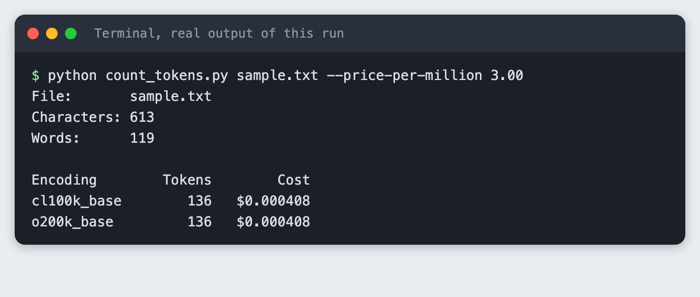
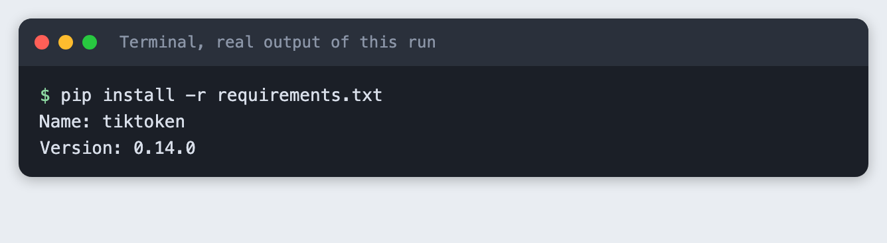
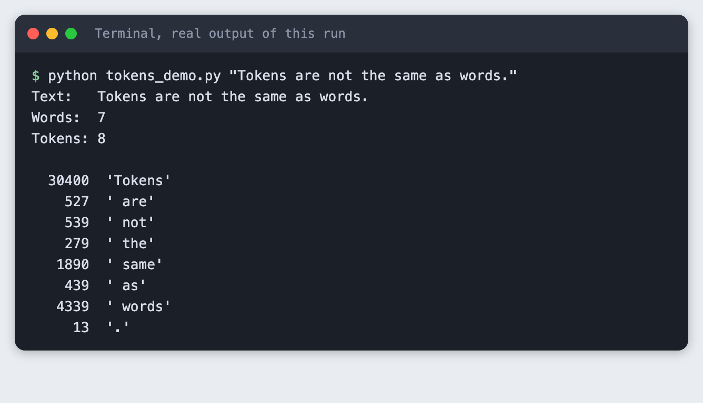
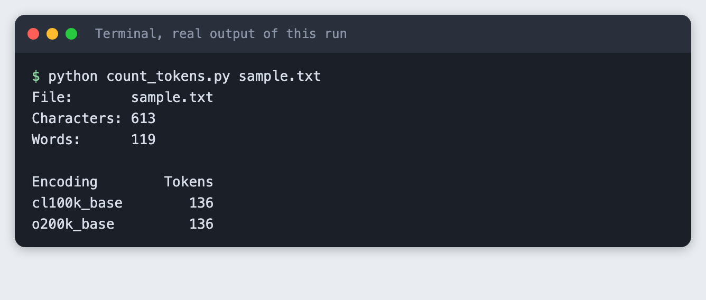
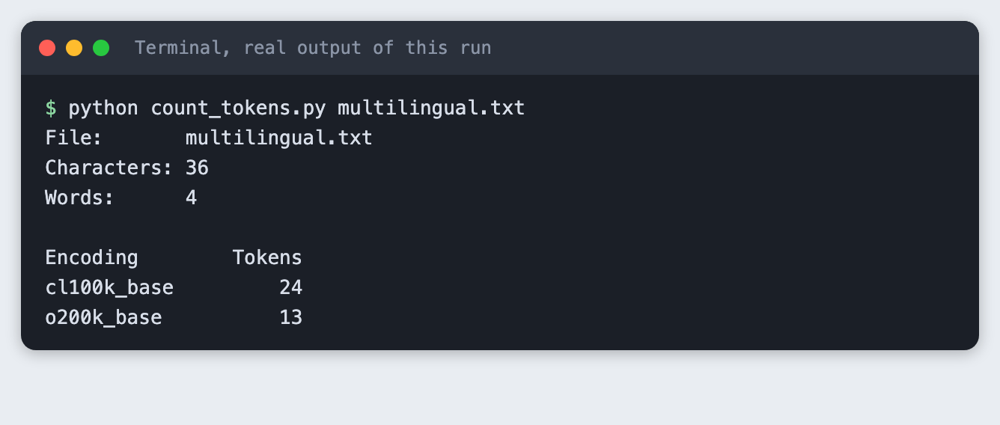
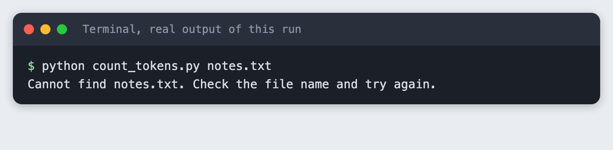

# Count tokens in your text with a tokenizer library

You will build a small Python tool that counts the tokens in a text file and turns the count into a cost estimate. It takes about 20 minutes and needs no API key.

**Level:** Beginner. **You need:** Python 3.10 or newer and a terminal. **Tested:** 10 November 2026 on macOS with Python 3.14 and `tiktoken` 0.14.0. The Windows command is from the Python docs and was not run.

In an AI hackathon you may have limited credits, so knowing how many tokens a prompt uses tells you what you can afford. Once you can count them, see the [upcoming AI hackathons](/ai-hackathons/) and plan your budget.

## Why count tokens

A language model does not read words. It reads tokens, which are pieces of text. A short, common word is often one token. A long or rare word is split into several. Providers set limits and prices by the token, so knowing the count before you send text tells you whether it fits and roughly what it will cost.

## See it running first

By the end you will run one command and get this:



The cost column comes from a price you type in. The rest of this tutorial builds the tool from scratch.

## Step 1. Create a project folder and a virtual environment

A virtual environment keeps this project's packages apart from the rest of your machine. Make a folder, open a terminal in it, and run:

```bash
python3 -m venv .venv
```


Then activate it. On macOS and Linux use `source .venv/bin/activate`. On Windows use `.venv\Scripts\activate`. Every command below assumes the environment is active.

## Step 2. Install tiktoken

`tiktoken` is a tokenizer library published by OpenAI. It turns text into token numbers on your own machine, so it needs no API key. List it in `requirements.txt` so anyone can install the same thing:

```text
tiktoken>=0.8
```
*File: `requirements.txt`*

Install it:

```bash
pip install -r requirements.txt
```



The first time you count tokens, `tiktoken` downloads the encoding data it needs, so the first run needs an internet connection.

## Step 3. See one sentence split into tokens

Before counting a whole file, look at how a single sentence breaks up. This script encodes a sentence, then decodes each token number back to its text piece. It uses the `cl100k_base` encoding, one of the encodings `tiktoken` ships.

```python
import sys

import tiktoken

text = " ".join(sys.argv[1:]) or "Tokens are not the same as words."
encoding = tiktoken.get_encoding("cl100k_base")

ids = encoding.encode(text)
print(f"Text:   {text}")
print(f"Words:  {len(text.split())}")
print(f"Tokens: {len(ids)}")
print()
for token_id in ids:
    piece = encoding.decode([token_id])
    print(f"{token_id:>7}  {piece!r}")
```
*File: `tokens_demo.py`*

Run it:

```bash
python tokens_demo.py "Tokens are not the same as words."
```



The sentence has 7 words and 8 tokens. Each word became one token, and the full stop became its own. The space before a word is part of that word's token, which is why each piece starts with a space. Words and tokens are close here, but they are not the same thing.

## Step 4. Count the tokens in a file

Now count a whole file. This script takes a path, reads the file and counts tokens for two encodings. Models from different generations use different encodings, so the counts can differ. The script prints a friendly message and exits with code 2 if the file is missing, which Step 7 shows.

```python
import argparse
import sys
from pathlib import Path

import tiktoken

ENCODINGS = ["cl100k_base", "o200k_base"]


def main() -> int:
    parser = argparse.ArgumentParser(description="Count the tokens in a text file.")
    parser.add_argument("path", help="the text file to count")
    parser.add_argument("--price-per-million", type=float,
                        help="price in dollars per million input tokens, copied from your provider's price page")
    args = parser.parse_args()

    path = Path(args.path)
    if not path.is_file():
        print(f"Cannot find {path}. Check the file name and try again.", file=sys.stderr)
        return 2

    text = path.read_text(encoding="utf-8")
    print(f"File:       {path}")
    print(f"Characters: {len(text):,}")
    print(f"Words:      {len(text.split()):,}")
    print()
    print(f"{'Encoding':<14}{'Tokens':>8}", end="")
    print(f"{'Cost':>12}" if args.price_per_million is not None else "")
    for name in ENCODINGS:
        count = len(tiktoken.get_encoding(name).encode(text))
        line = f"{name:<14}{count:>8,}"
        if args.price_per_million is not None:
            line += f"{'$' + format(count / 1_000_000 * args.price_per_million, '.6f'):>12}"
        print(line)
    return 0


if __name__ == "__main__":
    sys.exit(main())
```
*File: `count_tokens.py`*

You also need some text to count. Save this as `sample.txt`, or use your own notes:

```text
A hackathon team has two days to build a working demo. Most of that time goes into the parts around the model: reading input, calling an API, handling errors and showing the result.

Before sending text to a language model, it helps to know how large it is. Models read tokens, which are pieces of words, and providers count and bill by the token. A short word may be one token. A long or rare word may be split into several.

This file is a small sample you can replace with your own notes, an email or an article. Run the counter on it, then change a few sentences and run it again to see how the numbers move.
```
*File: `sample.txt`*

Run the counter:

```bash
python count_tokens.py sample.txt
```



The sample has 613 characters and 119 words. Both encodings count 136 tokens. That is more tokens than words, because longer words and punctuation take extra tokens.

## Step 5. Turn the count into a cost estimate

Providers price input by the million tokens. Pass the price with `--price-per-million`. Copy the real number from your provider's price page on the day you run it, because prices change. The `3.00` below is an example, not a real price.

```bash
python count_tokens.py sample.txt --price-per-million 3.00
```


At that example price, this file costs about $0.0004 to send once. Small files cost very little. The numbers matter when you send many requests, or very large documents.

## Step 6. Count a text in two languages

The two encodings agree on plain English. They can disagree on other text. Save this line as `multilingual.txt`:

```text
Здравствуйте, как дела? 你好，今天过得怎么样？
```
*File: `multilingual.txt`*

```bash
python count_tokens.py multilingual.txt
```



The same 36 characters need 24 tokens with `cl100k_base` and 13 with `o200k_base`. The newer encoding splits this text into fewer pieces. If you build for users who write in other languages, count with the encoding that matches your model.

## Step 7. Check what a mistake looks like

Run the counter on a file that does not exist:

```bash
python count_tokens.py notes.txt
```



You get a clear message instead of a long error trace. The command ends with exit code 2, so a script or a scheduler can tell that it failed.

## Troubleshooting

- **`ModuleNotFoundError: No module named 'tiktoken'`.** The virtual environment is not active, or the install did not finish. Activate it and run `pip install -r requirements.txt` again.
- **The first run is slow or fails with a network error.** `tiktoken` downloads encoding data on first use. Check your connection and run it again.
- **Your count differs from a provider's own number.** Tokenizers differ between model families. Use the tokenizer that matches your model, and treat this tool's number as an estimate.

## Frequently asked questions

**What is a token in an AI hackathon project?**

A token is a piece of text that a model reads. A short, common word is often one token, and a long or rare word is split into several. In the test, a sentence of 7 words became 8 tokens.

**How do I estimate API cost before a hackathon demo?**

Count the tokens with `tiktoken`, then multiply by your provider's price per million tokens. The 136-token sample file cost about $0.0004 at an example price of $3.00 per million. That price is an example, so copy the real one from your provider's price page.

**Why do different models count different numbers of tokens?**

Models use different encodings. The same 36-character Russian and Chinese line needed 24 tokens with `cl100k_base` and 13 with `o200k_base`. Count with the encoding that matches your model.

## What to try next

- Count a longer document and watch the cost estimate grow.
- Add a third encoding to the `ENCODINGS` list and compare.
- Read the whole folder instead of one file.

## How this tutorial was tested

Every command and every screenshot above comes from one real run on 10 November 2026. The code in the blocks is copied from the project files, not retyped. The steps were then run again from an empty folder, and all of them passed. The screenshots show the saved output of those commands in a terminal-style frame.

