# Turn text into embeddings and find similar sentences in Python

You build a script that turns 20 sentences into vectors, then finds the three sentences closest in meaning to a question. You also run it on three questions where it goes wrong.

**Time:** about 40 minutes, most of it the first model download. **Level:** intermediate. **You need:** Python basics and Python 3.10 or newer. No API key. **Tested:** 11 November 2026 with Python 3.14.6, `fastembed` 0.9.1, `numpy` 2.5.4 and `onnxruntime` 1.31.1 on macOS.

Semantic search is behind many AI hackathon projects, from document question answering to recommendations. If you plan to build one, see the [upcoming AI hackathons](/ai-hackathons/).

## Why this matters

A keyword search finds the words you typed. An embedding search finds text with a similar meaning, even when no word is shared. A model turns each text into a list of numbers, and texts with similar meaning get lists that point in a similar direction. Searching then means comparing lists of numbers.

Anthropic does not offer an embeddings API, so this tutorial runs a small open model on your own machine. No text leaves your computer, and no account is needed.

**The model.** `BAAI/bge-small-en-v1.5`, published under the MIT licence. The `fastembed` library (Apache-2.0) loads a quantized ONNX build of it from the Hugging Face repository `Qdrant/bge-small-en-v1.5-onnx-Q`, which is also marked MIT on its model page. The download is about 66 MB. On the test machine it took about 50 seconds the first time. The files are then kept in a `models/` folder inside the project, and later runs load them from there. It is an English model. Check the licence pages yourself before you use it in a product.

## See it running first

This is the finished search answering a question. The top sentence shares almost no words with the question: it says "ferry", the question says "boat".

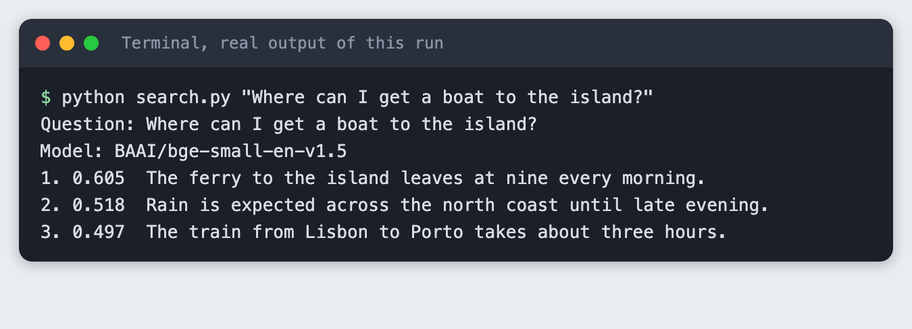

The rest of the tutorial builds it from scratch.

## Step 1: Set up the project

Make a folder, create a virtual environment and activate it. The commands from here on assume it is active.

```bash
python3 -m venv .venv
```


Create `requirements.txt`:

```text
fastembed>=0.7
numpy>=2.0
```
*File: `requirements.txt`*

Install it:

```bash
pip install -r requirements.txt
```

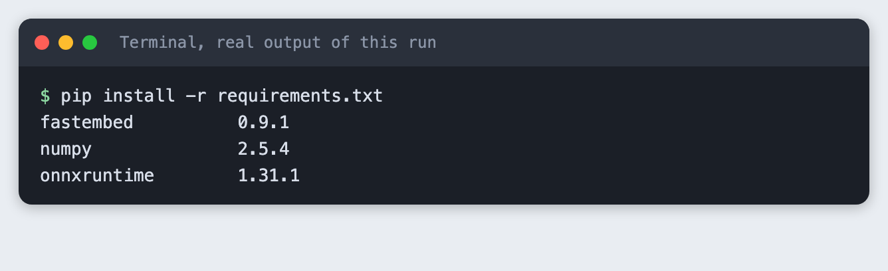

`fastembed` runs the model through `onnxruntime`, so there is no large machine-learning framework to install. On the test machine, wheels were available for Python 3.14.

## Step 2: Write the sentences

`sentences.txt` holds 20 sentences, one per line. They cover travel, cooking, pets, weather and hackathon life. Some are there on purpose to cause trouble later: two use the word "bank" in different ways, and one says the soup was *not* hot.

```text
The ferry to the island leaves at nine every morning.
Our team won the hackathon with a voice-controlled recipe assistant.
Keep the sourdough starter in the fridge if you bake only once a week.
She deposited her salary at the bank on Friday afternoon.
We had a picnic on the grassy bank of the river.
The cat curled up on the warm laptop and refused to move.
Rain is expected across the north coast until late evening.
He forgot his charger, so the phone died before the demo.
Python lists keep items in the order you added them.
A neural network learns by adjusting its weights to reduce errors.
The train from Lisbon to Porto takes about three hours.
Slice the onions thin and cook them slowly until they turn golden.
The mentors gave useful feedback on our pitch slides.
My dog needs a long walk twice a day, even in winter.
The museum is closed on Mondays but free on the first Sunday.
Use a virtual environment so each project keeps its own packages.
The soup was not hot, and the bread was stale.
Our app sends a reminder when the plants need water.
The flight was delayed two hours because of fog.
The judges liked that the demo ran without any internet connection.
```
*File: `sentences.txt`*

## Step 3: Embed the sentences

`common.py` keeps the model name and the small helpers in one place. `cache_dir` points the download at a `models/` folder in the project, so the model is easy to find and delete.

```python
"""Shared helpers: load the embedding model, read the sentences, compare vectors."""
from pathlib import Path

import numpy as np
from fastembed import TextEmbedding

MODEL_NAME = "BAAI/bge-small-en-v1.5"
HERE = Path(__file__).parent
SENTENCES_FILE = HERE / "sentences.txt"
MODEL_DIR = HERE / "models"  # the model is downloaded here once


def load_model():
    return TextEmbedding(model_name=MODEL_NAME, cache_dir=str(MODEL_DIR))


def load_sentences():
    lines = SENTENCES_FILE.read_text(encoding="utf-8").splitlines()
    return [line.strip() for line in lines if line.strip()]


def embed(model, texts):
    """Return an array with one row per text."""
    return np.array(list(model.embed(texts)))


def cosine(a, b):
    """Cosine similarity: 1.0 means the same direction, 0 means unrelated."""
    return float(np.dot(a, b) / (np.linalg.norm(a) * np.linalg.norm(b)))
```
*File: `common.py`*

`embed_sentences.py` embeds all 20 sentences at once and saves the result.

```python
"""Embed every sentence once and save the vectors to vectors.npy."""
import time

import numpy as np

from common import MODEL_NAME, embed, load_model, load_sentences

start = time.time()
model = load_model()
print(f"Model: {MODEL_NAME} (loaded in {time.time() - start:.1f}s)")

sentences = load_sentences()
vectors = embed(model, sentences)
np.save("vectors.npy", vectors)

print(f"Sentences: {len(sentences)}")
print(f"Vector array shape: {vectors.shape}")
print(f"First sentence: {sentences[0]}")
first = ", ".join(f"{x:.3f}" for x in vectors[0][:5])
print(f"First 5 numbers: [{first}]")
```
*File: `embed_sentences.py`*

Run it. The first run downloads the model.

```bash
python embed_sentences.py
```

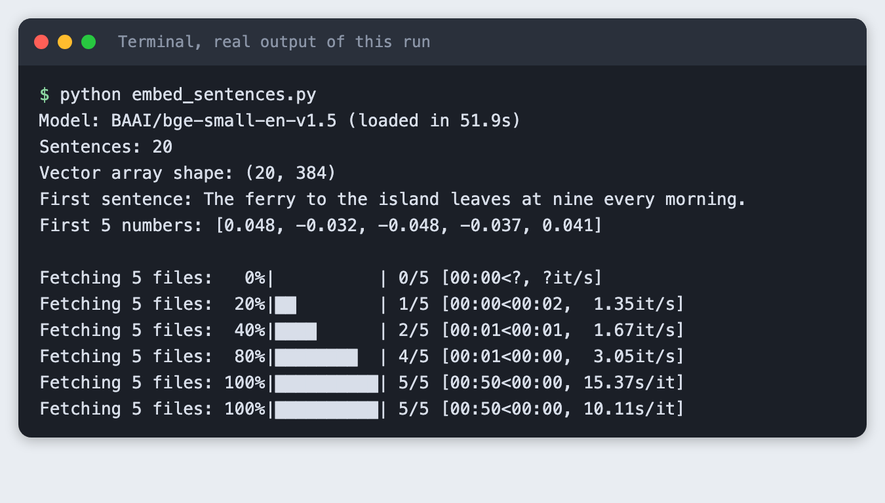

The shape `(20, 384)` means 20 vectors of 384 numbers each. One number alone means nothing. The meaning is in the direction of the whole list. In this run the model took 51.9 seconds to load, nearly all of it the download. A second run loads in a moment, because the files are already in `models/`. Your time depends on your connection.

## Step 4: Embed a question and compare it

To compare a question with a sentence, embed the question with the same model, then measure the angle between the two vectors. That measure is cosine similarity. It is 1.0 when two vectors point the same way and falls as they drift apart. A vector compared with itself gives exactly 1.0.

The code is the `cosine` function in `common.py` above. `compare.py` uses it on one question and three sentences.

```python
"""Embed one question and compare it with three sentences, one at a time."""
from common import cosine, embed, load_model, load_sentences

question = "Where can I get a boat to the island?"
sentences = load_sentences()
picks = [0, 5, 8]  # a close match, an unrelated cat sentence, an unrelated Python sentence

model = load_model()
q_vec = embed(model, [question])[0]
print(f"Question: {question}")
print(f"Question vector: {q_vec.shape[0]} numbers")
for i in picks:
    s_vec = embed(model, [sentences[i]])[0]
    print(f"cosine = {cosine(q_vec, s_vec):.3f}  {sentences[i]}")
print(f"cosine = {cosine(q_vec, q_vec):.3f}  (the question against itself)")
```
*File: `compare.py`*

```bash
python compare.py
```

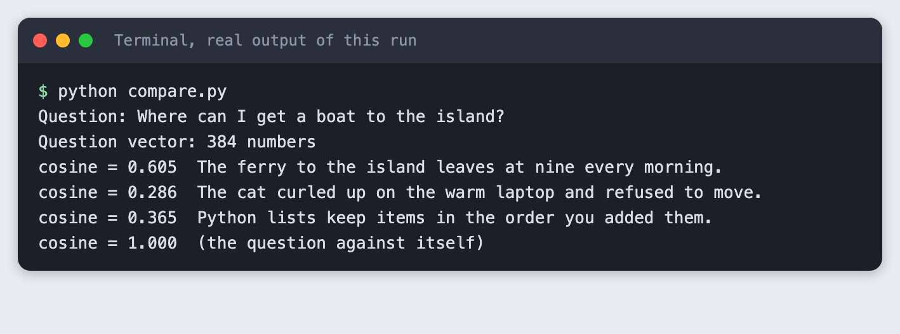

The ferry sentence scores 0.605 and the two unrelated sentences score 0.286 and 0.365. These scores are not percentages. For this model, a good match tends to land around 0.6 to 0.8 and unrelated text around 0.3 to 0.5. Another model has another range, so look at your own numbers before you pick a threshold.

## Step 5: Show the top three

`search.py` embeds the question, scores it against every saved vector, sorts, and prints the top matches.

```python
"""Find the sentences closest in meaning to a question.

Usage: python search.py "your question" [--top 3]
"""
import argparse
import sys
from pathlib import Path

import numpy as np

from common import MODEL_NAME, cosine, embed, load_model, load_sentences

parser = argparse.ArgumentParser()
parser.add_argument("question")
parser.add_argument("--top", type=int, default=3)
parser.add_argument("--min-score", type=float, default=None, help="hide matches below this score")
args = parser.parse_args()

if not Path("vectors.npy").exists():
    print("Cannot find vectors.npy. Run python embed_sentences.py first.", file=sys.stderr)
    sys.exit(2)

sentences = load_sentences()
vectors = np.load("vectors.npy")
if len(vectors) != len(sentences):
    print("vectors.npy does not match sentences.txt. Run embed_sentences.py again.", file=sys.stderr)
    sys.exit(2)

model = load_model()
question_vector = embed(model, [args.question])[0]

scores = [cosine(question_vector, v) for v in vectors]
order = np.argsort(scores)[::-1][: args.top]

print(f"Question: {args.question}")
print(f"Model: {MODEL_NAME}")
shown = 0
for i in order:
    if args.min_score is not None and scores[i] < args.min_score:
        break
    shown += 1
    print(f"{shown}. {scores[i]:.3f}  {sentences[i]}")
if shown == 0:
    print(f"No sentence scored {args.min_score} or higher.")
```
*File: `search.py`*

```bash
python search.py "Where can I get a boat to the island?"
```


The ferry sentence wins at 0.605. The second and third places, a weather sentence at 0.518 and a train sentence at 0.497, are weak matches. They are the next-closest of 20, not good answers. Remember that: a search always returns something.

Try a second question with a clearer answer:

```bash
python search.py "What should I cook with onions?"
```

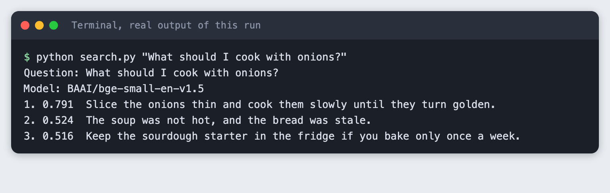

The onion sentence scores 0.791, well above the 0.524 of the runner-up. When the gap between first and second is large, you can trust the top result more.

## Step 6: See where embeddings fail

Embeddings are useful and they are wrong in predictable ways. Here are three, each from a real run.

**Failure one: negation.** The question says the soup was hot and the bread fresh. The sentence in the file says the opposite.

```bash
python search.py "The soup was hot and the bread was fresh."
```

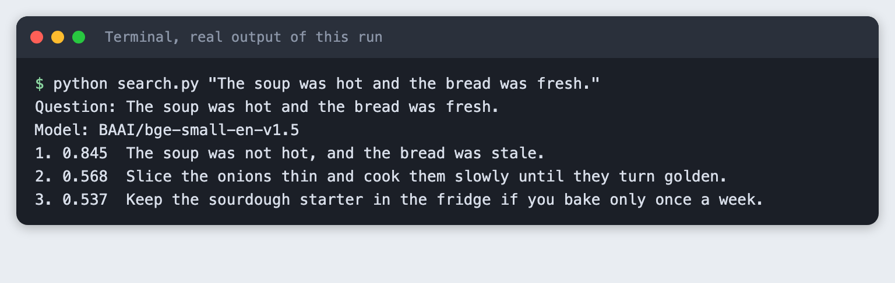

It scores 0.845, the highest score in this tutorial. The two sentences talk about the same things (soup, bread, temperature, freshness), so their vectors are close, even though the meanings are opposite. If your project depends on yes versus no, an embedding score alone will not tell them apart.

**Failure two: a shared word pulls in the wrong topic.** The question asks where to sit by the water.

```bash
python search.py "Where should I sit by the water?"
```

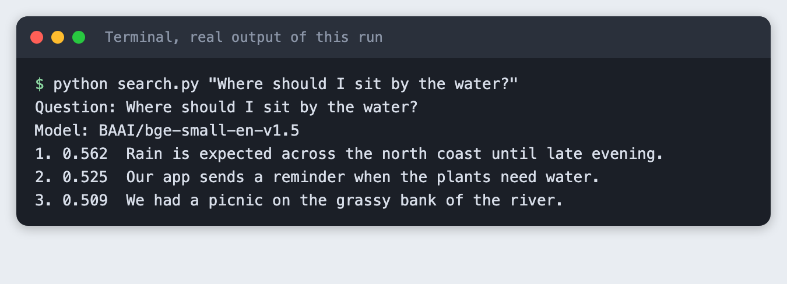

The sentence we wanted, the picnic on the river bank, comes third at 0.509. A weather sentence is first at 0.562, and a sentence about watering plants is second at 0.525. The scores are close together. With this small model and 20 sentences, a gap that small is a warning sign.

**Failure three: no answer in the text.** The question asks for the capital of France. None of the 20 sentences says anything about it.

```bash
python search.py "What is the capital of France?"
```

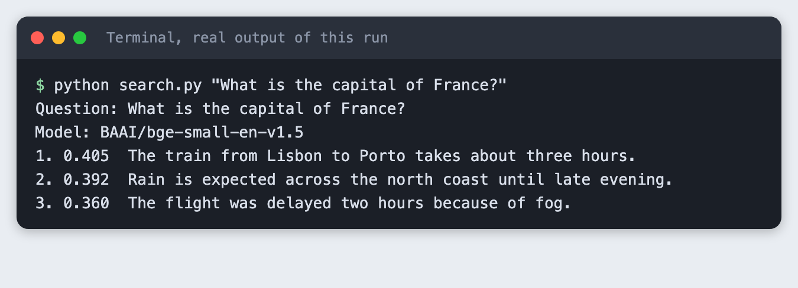

The search still returns three sentences, with the top one at 0.405. It has no way to say "nothing here". It only ranks what it has.

## Step 7: Add a minimum score, and see its limit

A common fix is to hide anything below a minimum score. `search.py` takes `--min-score` for this (it is in the code above).

```bash
python search.py "What is the capital of France?" --min-score 0.5
```

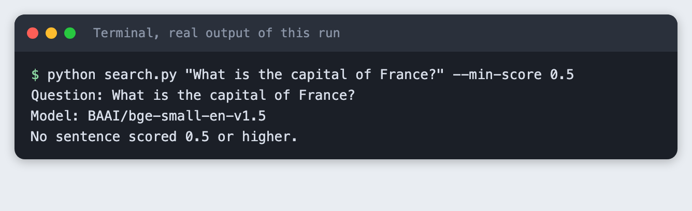

For the France question this works: the highest score was 0.405, so nothing passes. Now run the boat question with the same threshold:

```bash
python search.py "Where can I get a boat to the island?" --min-score 0.5
```

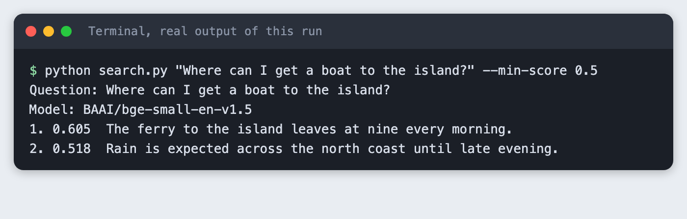

The weather sentence scores 0.518, so it passes the same threshold of 0.5. A fixed cut-off helps, and it does not separate good matches from bad ones cleanly. Pick a value by looking at scores for your own questions, and test it again if you change the model.

## Step 8: Check what a mistake looks like

Run `search.py` in a folder that has no `vectors.npy`:

```bash
python search.py hi   # run in a folder with no vectors.npy
```

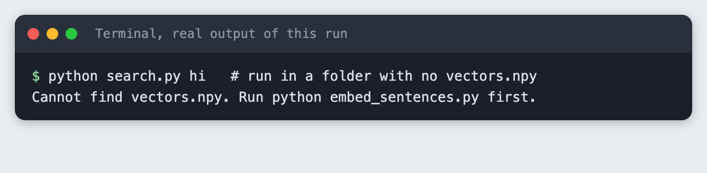

You get a clear message and exit code 2 instead of a long error trace.

## Troubleshooting

- **The first run seems stuck.** It is downloading about 66 MB. The progress bar shows it. If it fails with a network error, run `python embed_sentences.py` again.
- **`ModuleNotFoundError: No module named 'fastembed'`.** The virtual environment is not active, or the install did not finish. Activate it and run `pip install -r requirements.txt` again.
- **A warning about unauthenticated requests to the Hugging Face Hub.** The model download does not need an account. The warning says only that you are not logged in, so you may see slower downloads. The scripts set `HF_HUB_VERBOSITY=error` in this tutorial's test runs to keep the screenshots short. You do not need to.
- **`vectors.npy does not match sentences.txt`.** You edited `sentences.txt` after embedding. Run `python embed_sentences.py` again.
- **Your scores differ slightly from the ones above.** Another version of `fastembed`, `onnxruntime` or the model files can change the numbers in the third decimal place or more. The order of the results should stay the same for these questions, but this was only checked on one machine.

## Frequently asked questions

**What are embeddings used for in AI hackathon projects?**

An embedding turns text into a list of numbers so a program can compare meaning. The most common use is search: embed your documents once, embed each question, and return the closest documents. In this tutorial 20 sentences became 20 vectors of 384 numbers, and the boat question found the ferry sentence at 0.605 without sharing a keyword.

**Do I need a vector database for a hackathon project?**

Not for a small set. Here the vectors sit in one NumPy array saved to `vectors.npy`, and the search compares the question with all 20 of them in a loop. A vector database becomes useful when a set is too big to compare one by one. This tutorial did not test where that limit is.

**How many documents can I search in a weekend project?**

This tutorial tested only 20 sentences, so it cannot give a limit. What it shows is that the model, not the count, set the quality: negation and shared words fooled the search with just 20 items. Test with your own text first, and add a minimum score and a manual check before you trust the results.

## What to try next

- Add 30 sentences of your own and see which questions start to fail.
- Compare `BAAI/bge-small-en-v1.5` with another model from the `fastembed` list on the same questions.
- Print the score gap between first and second place, and hide results when the gap is small.

## How this tutorial was tested

Every command and every screenshot above comes from one real run on 11 November 2026. The code in the blocks is copied from the project files, not retyped. The steps were then run again from an empty folder, and all of them passed with the same search results. The screenshots show the saved output of those commands in a terminal-style frame, rendered from the saved log. They are not captures of a window.

Not run: Windows and Linux, other Python versions than 3.14.6, a GPU, models other than `BAAI/bge-small-en-v1.5`, and sets of more than 20 sentences. The tutorial makes no call to the Anthropic API.

