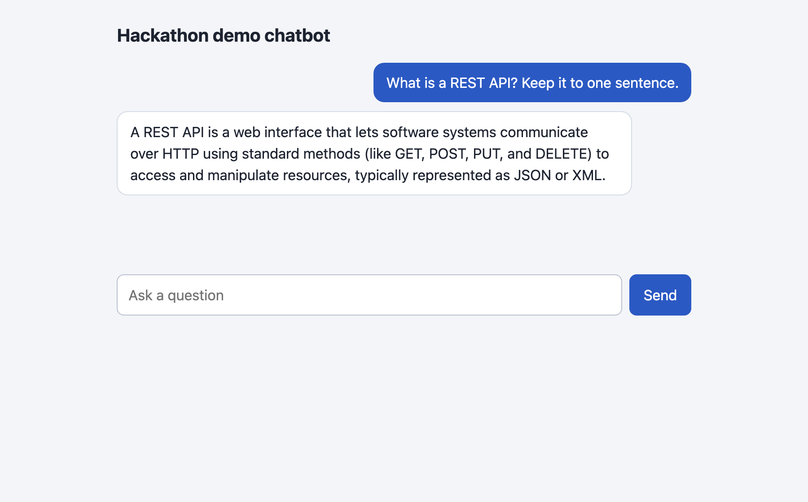
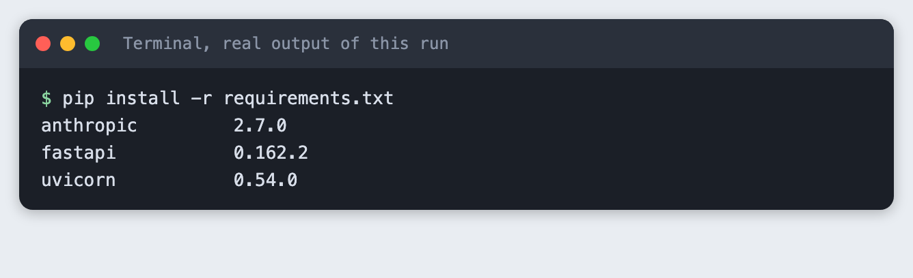
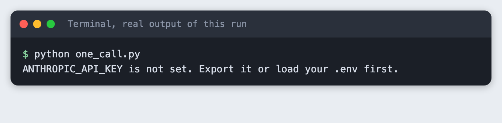
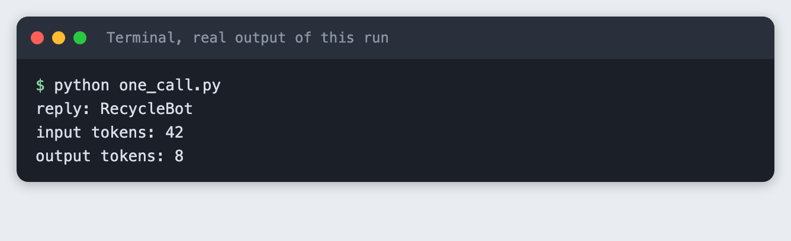
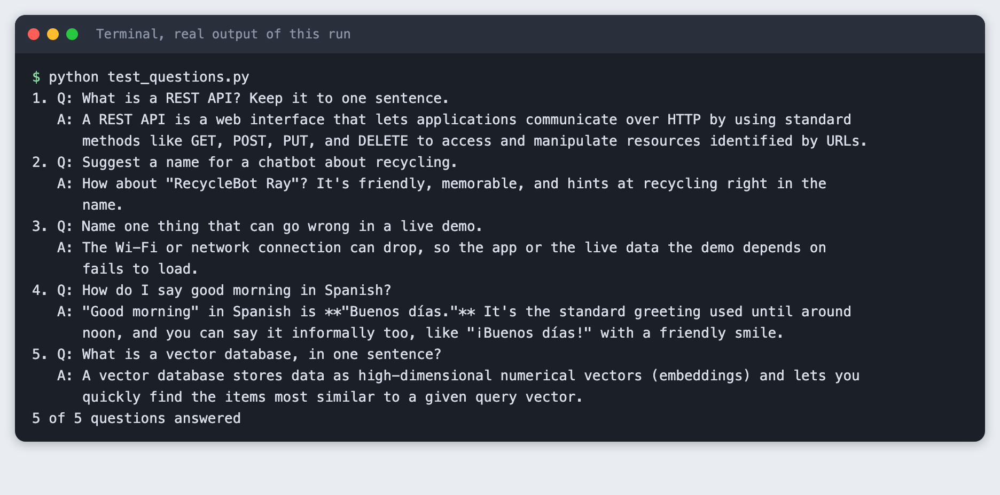

# Build a hackathon demo chatbot with an LLM API in an afternoon

You build a small web chatbot: a Python backend that calls a language model API, and one HTML page that talks to it. The backend serves the page, so there is one thing to run.

**Time:** about three hours. **Level:** beginner. **You need:** Python basics, Python 3.10 or newer, a browser, and an Anthropic API key. **Tested:** 10 November 2026 with Python 3.14.6, `anthropic` 2.7.0, `fastapi` 0.162.2 and `uvicorn` 0.54.0 on macOS.

Model replies differ from run to run. Your answers will not match the ones below word for word.

A chatbot is a project you can build in an afternoon, which suits the short time of an AI hackathon. See the [upcoming AI hackathons](/ai-hackathons/) to find an event to build it for.

## Why this matters

A demo has to work on stage, with a short build time and a short list of moving parts. This design has three files that matter: a script for the model call, a backend, and a page. Each can be checked on its own before the next is added. That is what keeps an afternoon build from turning into an evening of debugging.

## See it running first

This is the finished page, opened with a question already sent. The question and the answer are real output of the backend.



The rest of the tutorial builds it from nothing.

## Step 1: Set up the project and the key

Make a folder, create a virtual environment and activate it. The commands from here on assume it is active.

```bash
python3 -m venv .venv
```


Create `requirements.txt`:

```text
anthropic>=2.7.0
fastapi>=0.115
uvicorn>=0.30
```
*File: `requirements.txt`*

Install it. The output lists the versions used for this tutorial.

```bash
pip install -r requirements.txt
```



Put your key in a file named `.env` in the project folder. Copy the placeholder file and edit it:

```
ANTHROPIC_API_KEY=your_key_here
```
*File: `.env.example`*

Never paste a real key into code, a screenshot or a chat. Add `.env` to `.gitignore` if you use git. Load the file into your terminal session (macOS and Linux):

```bash
set -a; source .env; set +a
```

You can also run `export ANTHROPIC_API_KEY=...` yourself. The code reads the variable from the environment. If it is missing, the script stops with a message. This is what that looks like:



## Step 2: Make one call

Before any web code, prove the model call works. `one_call.py` sends one message and prints the reply and the token counts from `response.usage`. The model name and `max_tokens` sit in constants at the top. Keep `max_tokens` low for a demo: it caps the cost of one reply and the time a visitor waits.

```python
import os
import sys

from anthropic import Anthropic

from spend_log import log_usage

MODEL = "claude-haiku-5-5"
MAX_TOKENS = 200

if not os.environ.get("ANTHROPIC_API_KEY"):
    sys.exit("ANTHROPIC_API_KEY is not set. Export it or load your .env first.")

client = Anthropic()  # reads ANTHROPIC_API_KEY from the environment

response = client.messages.create(
    model=MODEL,
    max_tokens=MAX_TOKENS,
    messages=[{"role": "user", "content": "Suggest a name for a hackathon chatbot that answers questions about recycling. Reply with the name only."}],
)
log_usage("one_call.py", response)

# A reply is a list of blocks. Join the text blocks.
print("reply:", "".join(block.text for block in response.content if block.type == "text"))
print("input tokens:", response.usage.input_tokens)
print("output tokens:", response.usage.output_tokens)
```
*File: `one_call.py`*

```bash
python one_call.py
```



In this run the call used 42 input tokens and 8 output tokens. Yours will be close, not identical. If this step fails, fix it here. The web code cannot work without it.

## Step 3: Wrap the call in a web API

`app.py` is a FastAPI app with three routes. `POST /chat` takes a message and the earlier turns and returns the reply. `GET /health` answers when the server is up. `GET /` serves the page.

Two choices are worth a sentence each. The server keeps no conversation state: the page sends the history with every message, which means there is nothing to lose when you restart the server mid-demo. And if the model call fails, the browser gets a short fixed message, not the provider's error text.

The `?ask=` option on `GET /` opens the page with one question already answered. It exists so a screenshot tool can capture a finished conversation. Normal use is the form on the page.

```python
import json
import os
import sys
from functools import lru_cache
from pathlib import Path
from typing import Literal

import anthropic
from fastapi import FastAPI, HTTPException, Query
from fastapi.responses import HTMLResponse
from pydantic import BaseModel, Field

from spend_log import log_usage

MODEL = "claude-haiku-5-5"
MAX_TOKENS = 300
SYSTEM = "You are the helper bot in a hackathon demo. Answer in at most three short sentences."
PAGE = Path(__file__).with_name("index.html")

if not os.environ.get("ANTHROPIC_API_KEY"):
    sys.exit("ANTHROPIC_API_KEY is not set. Export it or load your .env first.")

client = anthropic.Anthropic()
app = FastAPI()


class Turn(BaseModel):
    role: Literal["user", "assistant"]
    content: str


class ChatRequest(BaseModel):
    message: str = Field(min_length=1, max_length=500)
    history: list[Turn] = Field(default=[], max_length=20)


@app.get("/health")
def health():
    return {"ok": True}


@app.post("/chat")
def chat(req: ChatRequest):
    messages = [turn.model_dump() for turn in req.history]
    messages.append({"role": "user", "content": req.message})
    try:
        response = client.messages.create(model=MODEL, max_tokens=MAX_TOKENS, system=SYSTEM, messages=messages)
    except anthropic.APIError:
        # Do not pass the provider's error text to the browser.
        raise HTTPException(status_code=502, detail="The model call failed. Check the server log.")
    log_usage("app.py", response)
    return {"reply": "".join(block.text for block in response.content if block.type == "text")}


@lru_cache
def demo_reply(question: str) -> str:
    return chat(ChatRequest(message=question))["reply"]


@app.get("/", response_class=HTMLResponse)
def index(ask: str = Query("", max_length=500)):
    # /?ask=... opens the page with one finished exchange, so a screenshot tool
    # can capture a conversation. Normal use is the form on the page.
    start = [{"role": "user", "content": ask}, {"role": "assistant", "content": demo_reply(ask)}] if ask else []
    return PAGE.read_text().replace("__START__", json.dumps(start).replace("<", "\\u003c"))
```
*File: `app.py`*

Start it in one terminal. The `--port 8031` choice is yours, any free port works:

```bash
uvicorn app:app --port 8031
```

## Step 4: Add the page

`index.html` is plain HTML and JavaScript with no build step. It keeps the history in a JavaScript array, posts to `/chat`, and adds each message to the page. It uses `textContent`, not `innerHTML`, so a model reply is shown as text and never run as markup. The same file is served by the backend, so there is no cross-origin setup.

```html
<!doctype html>
<html lang="en">
<head>
<meta charset="utf-8">
<meta name="viewport" content="width=device-width, initial-scale=1">
<title>Hackathon demo chatbot</title>
<style>
  body { font: 16px/1.5 system-ui, sans-serif; background: #f3f5f8; margin: 0; color: #1d2330; }
  main { max-width: 640px; margin: 0 auto; padding: 24px 16px; }
  h1 { font-size: 20px; margin: 0 0 16px; }
  #log { display: flex; flex-direction: column; gap: 10px; min-height: 220px; }
  .msg { padding: 10px 14px; border-radius: 12px; max-width: 85%; white-space: pre-wrap; }
  .user { align-self: flex-end; background: #2b59c3; color: #fff; }
  .assistant { align-self: flex-start; background: #fff; border: 1px solid #d5dbe5; }
  .error { align-self: flex-start; background: #fde8e8; border: 1px solid #f0b4b4; }
  form { display: flex; gap: 8px; margin-top: 16px; }
  input { flex: 1; padding: 10px 12px; font: inherit; border: 1px solid #b9c2d0; border-radius: 8px; }
  button { padding: 10px 16px; font: inherit; border: 0; border-radius: 8px; background: #2b59c3; color: #fff; cursor: pointer; }
  button:disabled { opacity: 0.6; cursor: wait; }
</style>
</head>
<body>
<main>
  <h1>Hackathon demo chatbot</h1>
  <div id="log"></div>
  <form id="form">
    <input id="text" autocomplete="off" maxlength="500" placeholder="Ask a question" required>
    <button id="send">Send</button>
  </form>
</main>
<script>
  const history = __START__;
  const log = document.getElementById("log");
  const form = document.getElementById("form");
  const text = document.getElementById("text");
  const send = document.getElementById("send");

  function show(role, content) {
    const div = document.createElement("div");
    div.className = "msg " + role;
    div.textContent = content; // textContent, so model output is never run as HTML
    log.appendChild(div);
  }

  history.forEach(turn => show(turn.role, turn.content));

  form.addEventListener("submit", async (event) => {
    event.preventDefault();
    const message = text.value.trim();
    if (!message) return;
    text.value = "";
    send.disabled = true;
    show("user", message);
    try {
      const res = await fetch("/chat", {
        method: "POST",
        headers: { "Content-Type": "application/json" },
        body: JSON.stringify({ message, history }),
      });
      if (!res.ok) throw new Error("Server said " + res.status);
      const data = await res.json();
      history.push({ role: "user", content: message }, { role: "assistant", content: data.reply });
      show("assistant", data.reply);
    } catch (err) {
      show("error", "Something went wrong: " + err.message);
    }
    send.disabled = false;
    text.focus();
  });
</script>
</body>
</html>
```
*File: `index.html`*

Open `http://127.0.0.1:8031/` in your browser, type a question and press Send. The screenshot at the top of this article shows the page after one exchange. I did not drive the Send button in a browser for this tutorial; the same `/chat` route was exercised by the test in the next step.

## Step 5: Test with five questions

A demo fails on the question you did not try. `test_questions.py` sends five questions to the running server and checks that each gets a non-empty answer. Keep the server from Step 3 running and run this in a second terminal:

```python
import json
import sys
import textwrap
import time
import urllib.request

BASE = "http://127.0.0.1:8031"
QUESTIONS = [
    "What is a REST API? Keep it to one sentence.",
    "Suggest a name for a chatbot about recycling.",
    "Name one thing that can go wrong in a live demo.",
    "How do I say good morning in Spanish?",
    "What is a vector database, in one sentence?",
]


def wait_for_server(seconds=30):
    end = time.time() + seconds
    while time.time() < end:
        try:
            urllib.request.urlopen(BASE + "/health", timeout=2).read()
            return
        except OSError:
            time.sleep(0.5)
    sys.exit("The server did not answer on " + BASE)


def ask(question):
    body = json.dumps({"message": question}).encode()
    request = urllib.request.Request(BASE + "/chat", body, {"Content-Type": "application/json"})
    with urllib.request.urlopen(request, timeout=60) as res:
        return json.loads(res.read())["reply"]


wait_for_server()
answered = 0
for number, question in enumerate(QUESTIONS, 1):
    reply = ask(question)
    print(f"{number}. Q: {question}")
    print(textwrap.fill(reply, width=100, initial_indent="   A: ", subsequent_indent="      "))
    if reply.strip():
        answered += 1
print(f"{answered} of {len(QUESTIONS)} questions answered")
sys.exit(0 if answered == len(QUESTIONS) else 1)
```
*File: `test_questions.py`*

```bash
python test_questions.py
```



All five questions were answered in this run, and the script printed `5 of 5 questions answered`. The script checks that an answer exists. It does not check that the answer is correct, so read them yourself. In this run the answer to question four contains `**` marks. The model wrote them as Markdown bold, and the page shows model text as plain text, so they appear as stars. You can strip them or add a Markdown renderer.

## What to cut when time runs short

Cut in this order, from the part that matters least to the demo:

1. The `?ask=` shortcut and the `/health` route. The chat works without them.
2. The history. Send only the latest message and the bot answers each question alone.
3. The page. Show the `test_questions.py` output on a projector. It is a working demo of the backend.
4. Never cut the single-call script from Step 2. It is the fallback when everything else breaks.

## Troubleshooting

- **`ANTHROPIC_API_KEY is not set` when starting `uvicorn`.** Load the key in the same terminal you start the server from, then start it again.
- **`Address already in use`.** An old server is still running on port 8031. Stop it or pick another port, and change `BASE` in `test_questions.py` to match.
- **The test script says the server did not answer.** Start the server in the first terminal and check it prints no error. The script waits 30 seconds.
- **The page shows "Something went wrong".** Look at the terminal where `uvicorn` runs. The browser only gets a short message by design.
- **An authentication error from the API.** The key is wrong or revoked. Create a new one and update `.env`.

## Frequently asked questions

**Is a chatbot a good AI hackathon project for beginners?**

The tutorial is rated beginner and takes about three hours. It has three files that matter, and each can be checked alone. Not tested here: a run with real beginners.

**How do I keep an AI hackathon chatbot demo from breaking on stage?**

Keep the single-call script from Step 2 as a fallback. Test with several questions: all five were answered in this run. The server keeps no conversation state, and the browser gets a short fixed message when the model call fails.

**Which features should I cut when time runs out?**

Cut in this order: the `?ask=` shortcut and the `/health` route, then the history, then the page. Never cut the single-call script.

## What to try next

- Add a system prompt that gives the bot a personality that fits your demo.
- Stream the reply so text appears as it is written.
- Trim the history to the last few turns so long chats stay cheap.

## How this tutorial was tested

- Date: 10 November 2026. Python 3.14.6, `anthropic` 2.7.0, `fastapi` 0.162.2, `uvicorn` 0.54.0, macOS. The model is `claude-haiku-5-5`, set in the `MODEL` constant.
- The code in this article is copied from the project files by a script. The output and screenshots come from saved logs of real API calls.
- Every step was run from a clean folder, then replayed from an empty copy of the folder with no virtual environment. The replay passed. Model replies differed between the two runs, as expected.
- The page screenshot is a real Chrome screenshot of the running page. Terminal screenshots are rendered from the saved output of the run. They are not captures of a terminal window.
- Not run: typing into the page and pressing Send in a browser, Windows, Linux, and Python versions other than 3.14.6. The `source .env` line is for macOS and Linux shells.

