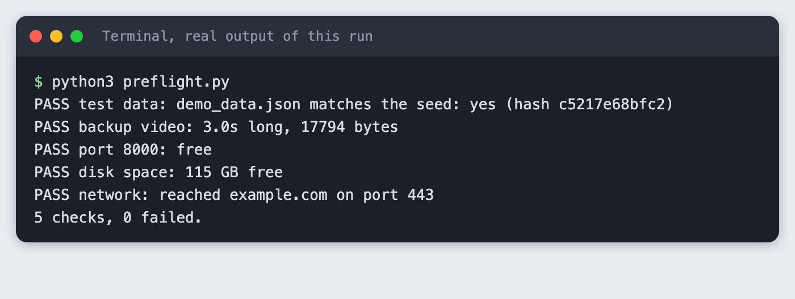
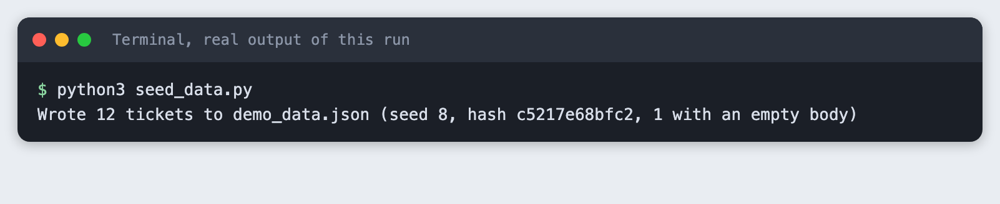
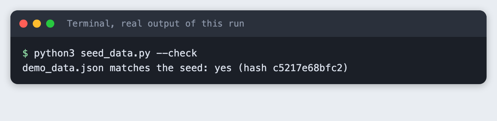
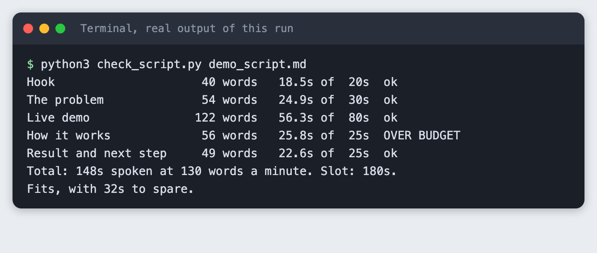
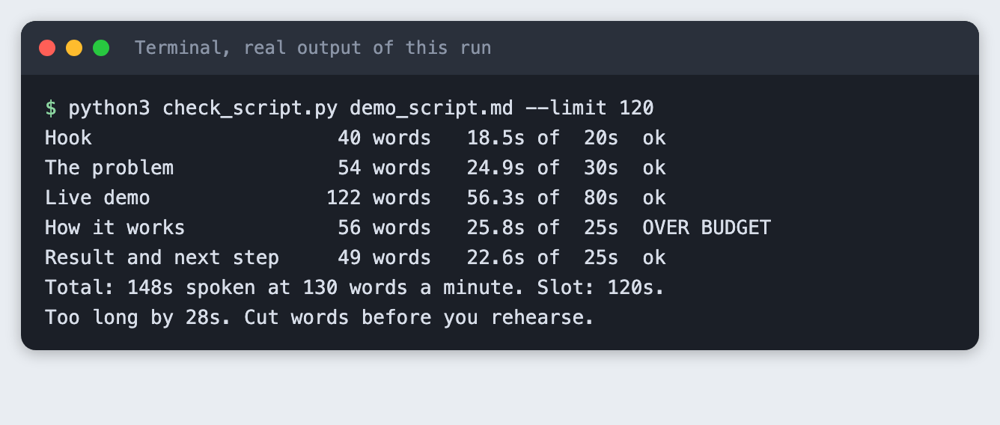
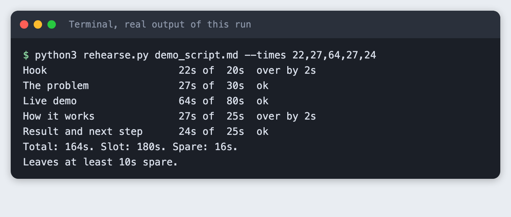
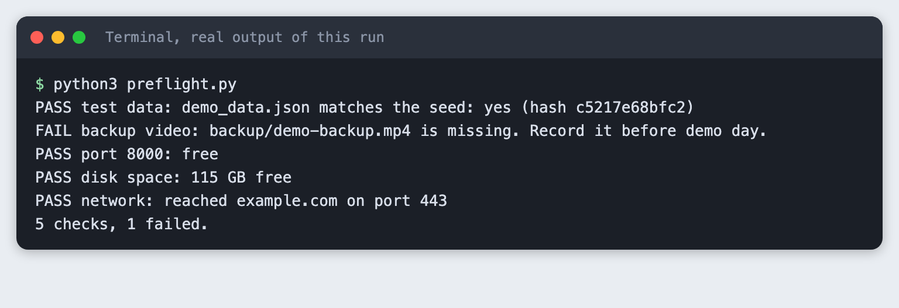
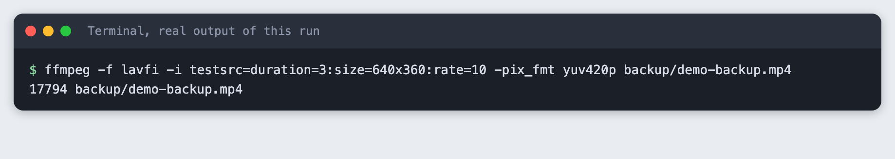

# Prepare a hackathon demo script and test data so nothing breaks

You build a timed three-minute demo script, a set of seeded test data, a rehearsal check and a preflight script that catches the failures that most often stop a demo.

**Time:** about 40 minutes. **Level:** beginner. **You need:** Python 3.10 or newer and a terminal. No packages and no API key. **Tested:** 11 November 2026 on macOS with Python 3.14.6. `ffmpeg` 8 or later is optional, for Step 6 only.

Most AI hackathon demos fail for small reasons, such as a missing file or a slow network, and a script and a checklist catch them. A demo is short, you cannot restart it, and the judges only see what happens in those minutes. Browse the [upcoming AI hackathons](/ai-hackathons/) to find your next slot, then use this to prepare for it.

The example project is a made-up app called Ticket Triage Assistant. Swap in your own story. The tools do not care what the app does.

## See it running first

This is the preflight check you will have at the end. It checks the test data, the backup video, the port, the disk and the network in one command.



The rest builds it from scratch.

## Step 1. Write the three-minute story

A story with five beats is easy to rehearse and easy to cut. Each beat has a time budget in its heading. Lines that start with `>` are notes about what is on screen and are not spoken. Write your own words and keep sentences short enough to say in one breath.

```markdown
# Demo script: Ticket Triage Assistant

Slot: 3 minutes. Speak at a steady pace and leave the last 10 seconds free.

## Hook (20s)
Every support team has the same Monday morning: forty new tickets and no idea which one is on fire. We built Ticket Triage Assistant so the urgent ones come to the top in seconds, before anyone has finished their coffee.
> On screen: the empty inbox, then the ticket list loading.

## The problem (30s)
Right now a person reads every ticket, guesses the priority and moves it by hand. A billing error and a question about dark mode look exactly the same in the queue. The slow part is not fixing the issue. It is finding the issue that matters, and while someone searches, the angry customer waits.
> On screen: two tickets side by side, same colour.

## Live demo (80s)
I will load our sample data now. There are twelve tickets, and I will not touch anything else. Watch the priority column fill in. The first ticket is a customer who was charged twice, and it is marked high. The next one is a question about changing a colour theme, and it is marked low. This ticket is written in French, and the assistant still reads it correctly. This one has an empty body, and instead of crashing it asks the customer for more detail. This one is very long, and it still fits on the screen. Now I sort by priority, and the three urgent tickets sit at the top. A support lead can start right there and ignore the noise.
> On screen: load sample data, priority column fills in, sort by priority.

## How it works (25s)
Each ticket goes to a language model with a short instruction and a fixed list of labels. The reply is checked against that list before we show it, so a strange answer never reaches the screen. If the model is slow, the ticket stays in a waiting state and the rest of the list keeps working.
> On screen: the architecture slide with three boxes.

## Result and next step (25s)
On our twelve sample tickets, the urgent ones were found in the first three rows. That is a small test, and we say so. Next we want to connect a real inbox and measure it on a week of tickets. Thank you, and we are happy to take questions.
> On screen: the sorted list and the team name.
```
*File: `demo_script.md`*

## Step 2. Seed the test data

Live data changes, and a demo cannot depend on it. This script writes 12 made-up tickets and uses a fixed random seed, so you get the same bytes every time. Four of the tickets are planned edge cases: an empty body, a non-English ticket, an emoji and a very long text. A fifth is a duplicate. These are the inputs that tend to break a first version, so they should be in your sample data on purpose.

```python
"""Write the same demo data every time, so the demo never depends on live data.

Twelve made-up support tickets. Five are planned edge cases that break demos:
an empty body, a very long body, a non-English ticket, an emoji, and a duplicate.
The random generator has a fixed seed, so two runs give identical bytes.
Use --check to rebuild in memory and compare with the file on disk.
"""
import argparse
import hashlib
import json
import random
import sys
from pathlib import Path

OUT = Path("demo_data.json")
SEED = 8
CUSTOMERS = ["Ada", "Ben", "Chen", "Dara", "Eli", "Fay", "Gus", "Hana"]
NORMAL = [
    ("Charged twice for one order", "I was charged twice for order 1042. Please refund one payment."),
    ("How do I change the colour theme?", "Is there a dark mode in the settings page?"),
    ("Export to CSV fails", "The export button shows an error after I pick a date range."),
    ("Cannot reset my password", "The reset email never arrives, I checked spam too."),
    ("Invoice shows the wrong address", "Our invoice still has our old office address."),
    ("App crashes on login", "After the last update the app closes as soon as I sign in."),
    ("Feature idea: weekly summary", "A weekly email with the ticket counts would help our team."),
]
EDGE = [
    ("Empty body", ""),
    ("Très lent le matin", "L'application est très lente le matin. Pouvez-vous regarder ?"),
    ("Thanks \U0001F389", "Everything works now \U0001F44D"),
    ("Long ticket", "The page freezes when I scroll. " * 40),
]


def build():
    rng = random.Random(SEED)
    rows = NORMAL + EDGE
    rows.append(NORMAL[0])  # a duplicate of the first ticket
    rng.shuffle(rows)
    return [
        {"id": i + 1, "customer": rng.choice(CUSTOMERS), "subject": s, "body": b}
        for i, (s, b) in enumerate(rows)
    ]


def dump(tickets):
    return json.dumps(tickets, indent=1, ensure_ascii=False) + "\n"


def digest(text):
    return hashlib.sha256(text.encode("utf-8")).hexdigest()[:12]


def main():
    ap = argparse.ArgumentParser()
    ap.add_argument("--check", action="store_true")
    args = ap.parse_args()
    text = dump(build())
    if args.check:
        if not OUT.is_file():
            print(f"Cannot find {OUT}. Run python3 seed_data.py first.")
            sys.exit(2)
        same = OUT.read_text(encoding="utf-8") == text
        print(f"{OUT} matches the seed: {'yes' if same else 'NO'} (hash {digest(text)})")
        sys.exit(0 if same else 1)
    OUT.write_text(text, encoding="utf-8")
    empty = sum(1 for t in json.loads(text) if not t["body"])
    print(f"Wrote {len(json.loads(text))} tickets to {OUT} (seed {SEED}, hash {digest(text)}, {empty} with an empty body)")


if __name__ == "__main__":
    main()
```
*File: `seed_data.py`*

Run it:

```bash
python3 seed_data.py
```



It wrote 12 tickets. The hash `c5217e68bfc2` identifies this exact file, and one ticket has an empty body.

Now check that a second build matches the file on disk:

```bash
python3 seed_data.py --check
```



If someone edits `demo_data.json` by hand before the demo, this check says no. That is the point.

## Step 3. Time the script before you rehearse

Counting words is a fast way to find a script that is too long. This tool counts the spoken words in each beat and converts them to seconds. The rate of 130 words a minute is an assumption, not a measured value. Time yourself reading one beat aloud and pass your own rate with `--wpm`.

```python
"""Estimate how long a demo script takes to say, beat by beat.

Beats are `## Name (20s)` headings. Lines starting with `>` are notes for the screen
and are not spoken, so they are not counted. The speaking rate is an assumption
(default 130 words a minute). Time yourself once and pass your own rate with --wpm.
"""
import argparse
import re
import sys
from pathlib import Path

BEAT = re.compile(r"^##\s+(.+?)\s*\((\d+)s\)\s*$")


def read_beats(path):
    beats = []
    for line in Path(path).read_text(encoding="utf-8").splitlines():
        m = BEAT.match(line.strip())
        if m:
            beats.append({"name": m.group(1), "budget": int(m.group(2)), "words": 0})
        elif beats and line.strip() and not line.startswith(">"):
            beats[-1]["words"] += len(line.split())
    return beats


def main():
    ap = argparse.ArgumentParser()
    ap.add_argument("script")
    ap.add_argument("--wpm", type=int, default=130, help="words you speak per minute")
    ap.add_argument("--limit", type=int, default=180, help="slot length in seconds")
    args = ap.parse_args()
    if not Path(args.script).is_file():
        print(f"Cannot find {args.script}")
        sys.exit(2)
    beats = read_beats(args.script)
    if not beats:
        print("No beats found. Use headings like: ## Hook (20s)")
        sys.exit(2)
    total = 0.0
    for b in beats:
        secs = b["words"] / args.wpm * 60
        total += secs
        flag = "OVER BUDGET" if secs > b["budget"] else "ok"
        print(f"{b['name']:<22} {b['words']:>4} words  {secs:5.1f}s of {b['budget']:>3}s  {flag}")
    print(f"Total: {total:.0f}s spoken at {args.wpm} words a minute. Slot: {args.limit}s.")
    if total > args.limit:
        print(f"Too long by {total - args.limit:.0f}s. Cut words before you rehearse.")
        sys.exit(1)
    print(f"Fits, with {args.limit - total:.0f}s to spare.")


if __name__ == "__main__":
    main()
```
*File: `check_script.py`*

Run it:

```bash
python3 check_script.py demo_script.md
```



The script is 148 seconds at 130 words a minute, which leaves 32 seconds in a 180-second slot. One beat, "How it works", is 25.8 seconds against a 25-second budget. The tool flags it. You can cut a sentence or move a few seconds from the live demo beat, which has room.

## Step 4. See what a short slot looks like

Many events give less than three minutes. Check the same script against a 120-second slot:

```bash
python3 check_script.py demo_script.md --limit 120
```



The tool exits with code 1 and says the script is 28 seconds too long. Cut words now, not on stage. Read the rules for your own event to find the real slot length.

## Step 5. Rehearse with a stopwatch

Estimates are only a start. Say the script aloud, time each beat on a phone and type the seconds into this tool.

```python
"""Compare your real rehearsal times with the plan.

Time each beat with a phone stopwatch, then pass the seconds in beat order:
    python3 rehearse.py demo_script.md --times 22,28,70,24,21
Each beat is compared with its budget, and the total with the slot.
"""
import argparse
import sys

from check_script import read_beats


def main():
    ap = argparse.ArgumentParser()
    ap.add_argument("script")
    ap.add_argument("--times", required=True, help="seconds per beat, comma separated")
    ap.add_argument("--limit", type=int, default=180)
    args = ap.parse_args()
    beats = read_beats(args.script)
    times = [float(t) for t in args.times.split(",")]
    if len(times) != len(beats):
        print(f"The script has {len(beats)} beats but you gave {len(times)} times.")
        sys.exit(2)
    for b, t in zip(beats, times):
        print(f"{b['name']:<22} {t:5.0f}s of {b['budget']:>3}s  {'ok' if t <= b['budget'] else 'over by %.0fs' % (t - b['budget'])}")
    total = sum(times)
    print(f"Total: {total:.0f}s. Slot: {args.limit}s. Spare: {args.limit - total:.0f}s.")
    if total > args.limit - 10:
        print("Less than 10s spare. Cut something before demo day.")
        sys.exit(1)
    print("Leaves at least 10s spare.")


if __name__ == "__main__":
    main()
```
*File: `rehearse.py`*

The times below are example numbers we typed in to show the output. They are not a measured rehearsal. Use your own.

```bash
python3 rehearse.py demo_script.md --times 22,27,64,27,24
```



The example total is 164 seconds, which leaves 16 seconds. The tool asks for at least 10 seconds spare, because a demo that runs to the last second has no room for one slow page load.

## Step 6. Check everything with a preflight script

A checklist you read is easy to skip. This script checks the things that can be checked: the test data, the backup video, whether the port is free, free disk space and whether the network is reachable. A failed network is a warning, because some demos are meant to run offline.

```python
"""Run the checks for the things that break demos, right before you present.

Each line is PASS, WARN or FAIL. Any FAIL exits with code 1.
"""
import shutil
import socket
import subprocess
import sys
from pathlib import Path

PORT = 8000
results = []


def check(name, status, detail):
    results.append(status)
    print(f"{status:<5}{name}: {detail}")


def data_file():
    p = Path("demo_data.json")
    if not p.is_file():
        return check("test data", "FAIL", "demo_data.json is missing. Run python3 seed_data.py")
    r = subprocess.run([sys.executable, "seed_data.py", "--check"], capture_output=True, text=True)
    check("test data", "PASS" if r.returncode == 0 else "FAIL", r.stdout.strip() or "does not match the seed")


def backup_video():
    p = Path("backup/demo-backup.mp4")
    if not p.is_file():
        return check("backup video", "FAIL", "backup/demo-backup.mp4 is missing. Record it before demo day.")
    size = p.stat().st_size
    if shutil.which("ffprobe"):
        r = subprocess.run(["ffprobe", "-v", "error", "-show_entries", "format=duration",
                            "-of", "default=nw=1:nk=1", str(p)], capture_output=True, text=True)
        try:
            secs = float(r.stdout.strip())
        except ValueError:
            return check("backup video", "FAIL", "ffprobe cannot read the file")
        return check("backup video", "PASS" if secs > 0 else "FAIL", f"{secs:.1f}s long, {size} bytes")
    check("backup video", "WARN", f"{size} bytes, ffprobe not found so the length was not checked")


def port_free():
    with socket.socket() as s:
        busy = s.connect_ex(("127.0.0.1", PORT)) == 0
    check(f"port {PORT}", "FAIL" if busy else "PASS", "something is already listening" if busy else "free")


def disk():
    free = shutil.disk_usage(".").free / 1e9
    check("disk space", "PASS" if free > 1 else "FAIL", f"{free:.0f} GB free")


def network():
    try:
        socket.create_connection(("example.com", 443), timeout=3).close()
        check("network", "PASS", "reached example.com on port 443")
    except OSError as e:
        check("network", "WARN", f"cannot reach example.com ({e.__class__.__name__}). Fine only if the demo is offline")


def main():
    for fn in (data_file, backup_video, port_free, disk, network):
        fn()
    failed = results.count("FAIL")
    print(f"{len(results)} checks, {failed} failed.")
    sys.exit(1 if failed else 0)


if __name__ == "__main__":
    main()
```
*File: `preflight.py`*

First run it with no backup video:

```bash
python3 preflight.py
```



Four checks pass and one fails: `backup/demo-backup.mp4` is missing. The script exits with code 1. This is the mistake the checklist exists to catch. The disk figure and the network line come from this computer and will differ on yours.

Record a backup video of your demo working and save it as `backup/demo-backup.mp4`. A screen recorder on your laptop works. This tutorial's tooling could not capture a desktop window, so it makes a three-second test pattern with `ffmpeg` instead. That file is a stand-in to prove the check works, not a real recording.

```bash
ffmpeg -f lavfi -i testsrc=duration=3:size=640x360:rate=10 -pix_fmt yuv420p backup/demo-backup.mp4
```



Run the preflight again:

```bash
python3 preflight.py
```

All five checks pass. The backup video line shows a length because `ffprobe`, which comes with `ffmpeg`, read the file. Without `ffprobe` the script prints a warning and checks only the file size.

## Step 7. Pack the checklist

Some things cannot be scripted, such as the charger and the screen sleep setting. Keep them in one short file and tick them in the room.

```markdown
# Demo day checklist

Run `python3 preflight.py` first. It covers the first four lines. Do the rest by hand.

- [ ] Test data matches the seed (`python3 seed_data.py --check`)
- [ ] Backup video exists and plays to the end
- [ ] The demo port is free and disk space is not low
- [ ] Network reached, or the demo is set up to run offline
- [ ] Laptop charger in the bag, battery above 80 percent
- [ ] Notifications off, other apps closed, screen sleep off
- [ ] Browser zoom raised so the back row can read it
- [ ] Script open on a second device or printed
- [ ] Every account and key the demo needs is signed in before you walk up
- [ ] You know which beat to cut if you are running over
```
*File: `checklist.md`*

## Troubleshooting

- **"Cannot find demo_script.md".** Run the commands from the project folder, or pass the full path.
- **"No beats found".** The heading must look like `## Hook (20s)`, with the seconds in brackets.
- **The preflight says the port is busy.** An old copy of your app is still running. Stop it, or change `PORT` in `preflight.py` to the port your demo uses.
- **The preflight warns that `ffprobe` is missing.** Install `ffmpeg`, or check the video length by playing it.
- **The seed check says NO.** The file was edited, or `seed_data.py` changed. Run `python3 seed_data.py` again.

## Frequently asked questions

**How long should an AI hackathon demo be?**

Use the length your event gives you. Many events publish a slot, so read the rules. In this test the script took 148 seconds at an assumed 130 words a minute and fit a 180-second slot, but it failed a 120-second slot by 28 seconds.

**Should I record a backup video for an AI hackathon?**

Yes. The preflight check failed when the backup video was missing, so the check treats it as a required item. The video is what you play if the network or the app fails. Record it before demo day and check that it plays to the end.

**What test data should I use in a hackathon demo?**

Fixed, made-up data that you generate with a seed, so it is the same every time. Include edge cases on purpose. Here that was an empty body, a French ticket, an emoji and a very long text. Do not use real customer data.

## What to try next

- Add a check to `preflight.py` for the API key your demo needs, without printing it.
- Time yourself reading each beat and pass your real rate with `--wpm`.
- Rehearse in front of one other person and write down the first question they ask.

## How this tutorial was tested

- Date: 11 November 2026. Python 3.14.6 on macOS. `ffmpeg` was used for the stand-in video only.
- The code in this article is copied from the project files by a script. The command output comes from saved logs of real runs.
- Every step was run from a clean folder, then replayed from an empty copy of the folder with no generated data. The replay passed.
- The rehearsal times in Step 5 are example numbers typed in by us, not a measured rehearsal. The 130 words a minute rate is an assumption.
- The backup video is a three-second test pattern, not a recording of a demo. No screen recording was made.
- Terminal screenshots are rendered from the saved output of the run. They are not captures of a terminal window.
- Not run: Windows, Linux, other Python versions, and the Ticket Triage Assistant app itself, which is only the example story. No event's own rules were checked.

