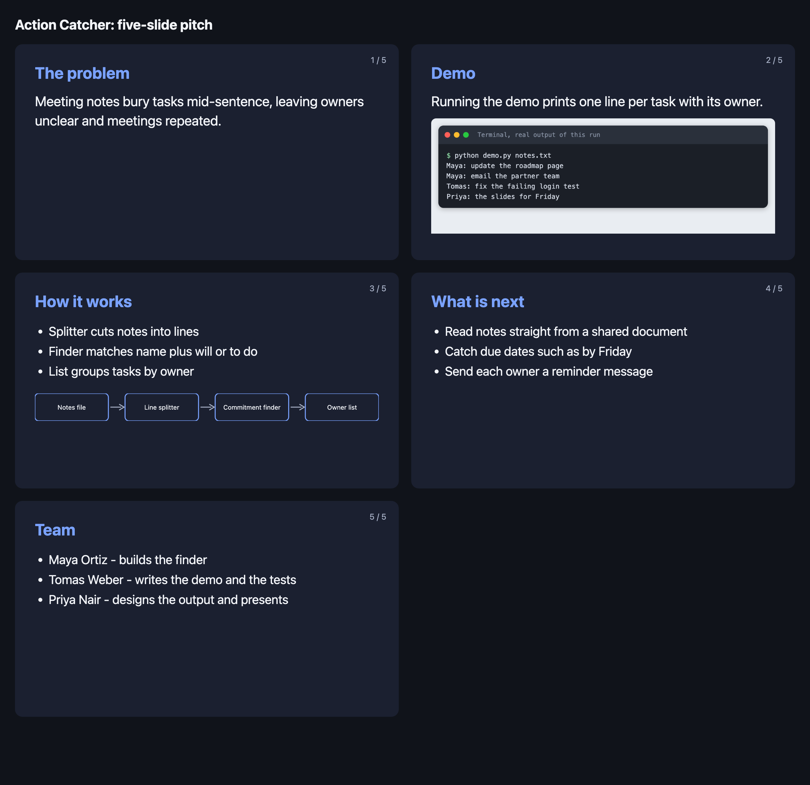
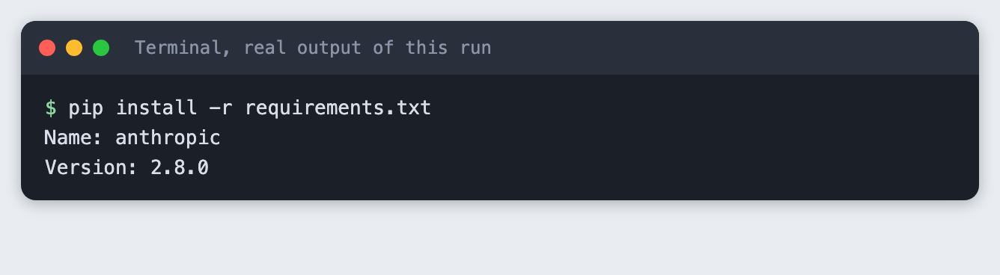
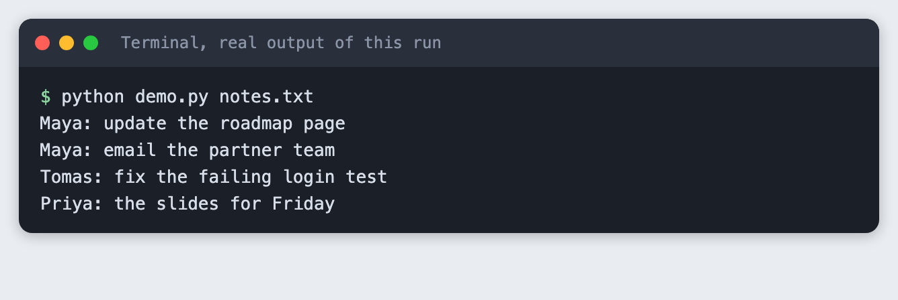
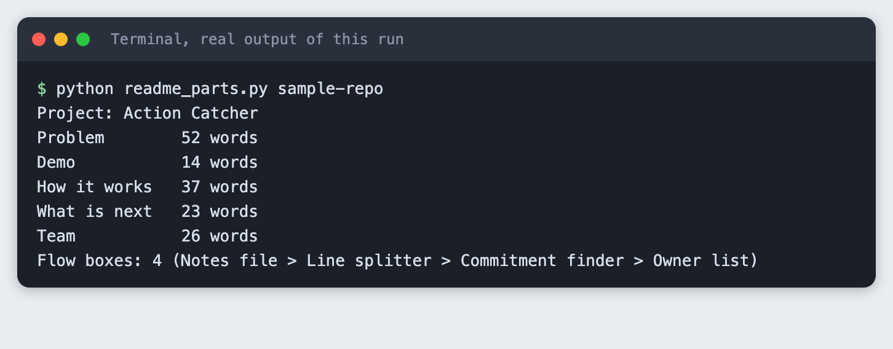
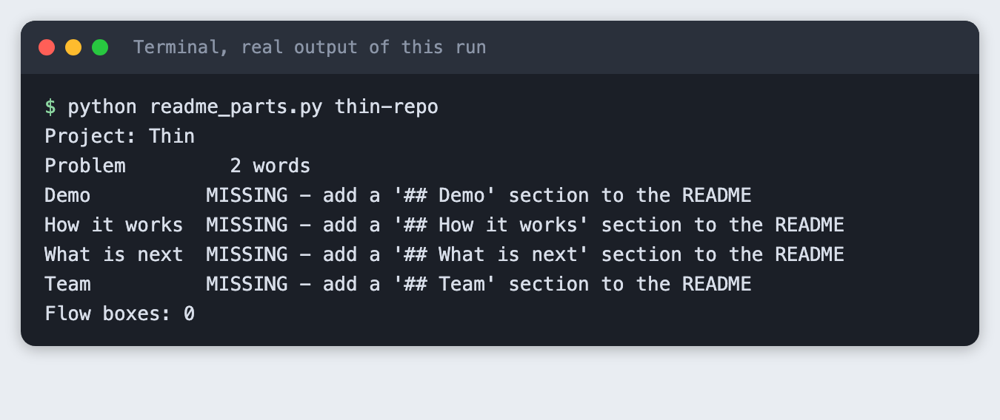
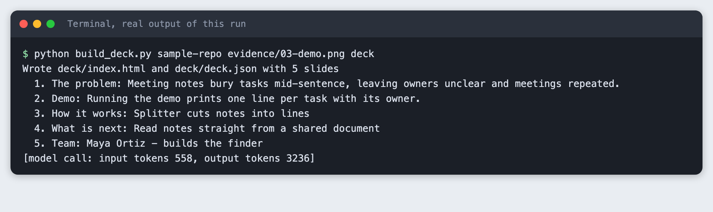
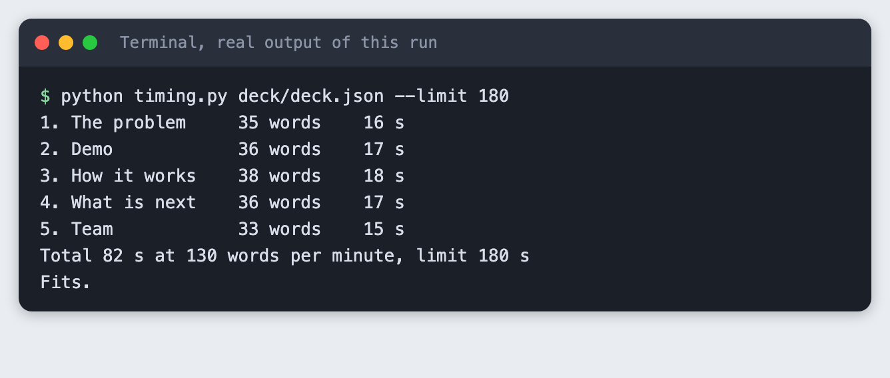
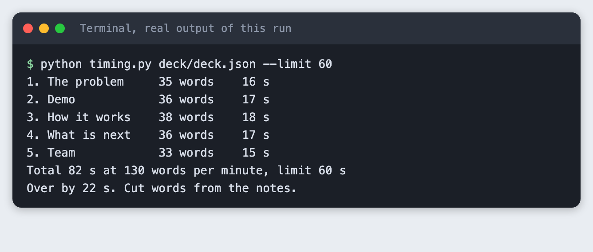

# Make a hackathon pitch deck from your repo in five slides

You build a Python tool that reads your project README, asks a model to tighten it into five slides with speaker notes, draws the architecture picture, and checks that the talk fits a time limit.

**Time:** about 30 minutes. **Level:** beginner. **You need:** Python 3.10 or newer, an Anthropic API key, Google Chrome (only to take the screenshot of the deck), and a project with a README. **Tested:** 11 November 2026 with Python 3.14.6 and the `anthropic` package 2.8.0 on macOS.

An AI hackathon pitch is short, so each slide has one job, and most of what you need is already in your README. If you plan to enter, see the [upcoming AI hackathons](/ai-hackathons/).

The model's wording changes on every run. Your slide text and token counts will not match this page exactly. The shape of the output will.

## Why this matters

A short pitch with one idea per slide is easier to follow than a long deck. A README that already names the problem, the steps and the team gives you the raw material. This is a design choice of this tutorial, not a tested claim about judges. Building the deck from the README also keeps the deck and the repo from telling two different stories.

## See it running first

This is the finished deck for a small example project called Action Catcher, which lists who agreed to do what in a meeting. The people in its README are made up.



The rest of the tutorial builds it from scratch.

## Step 1: Set up the project

Create a virtual environment. The commands from here on assume it is active.

```bash
python3 -m venv .venv
```


Create `requirements.txt` with one line:

```text
anthropic>=2.7.0
```
*File: `requirements.txt`*

Install it. The output shows the version used for this tutorial.

```bash
pip install -r requirements.txt
```



The tool also needs your API key in the `ANTHROPIC_API_KEY` environment variable. Put it in a `.env` file that is listed in `.gitignore`, and never paste it into a script. A `.env.example` with the variable name and no value is safe to share:

```
ANTHROPIC_API_KEY=your_key_here
```
*File: `.env.example`*

## Step 2: Write the README the deck is built from

The deck can only say what the README says. The tool looks for five headings: Problem, Demo, How it works, What is next and Team. It also looks for one line in How it works that starts with `Flow:` and lists boxes separated by `->`. That line becomes the architecture picture.

```markdown
# Action Catcher

Action Catcher reads the notes from a meeting and lists who agreed to do what.

## Problem

After a meeting, the notes hold the decisions, but the tasks are buried in the middle of sentences. People leave unsure who owns what, and the same meeting gets held again a week later. Action Catcher finds the lines where someone commits to a task and puts them in one short list.

## Demo

Run `python demo.py notes.txt` and it prints one line per task with the owner.

## How it works

Flow: Notes file -> Line splitter -> Commitment finder -> Owner list

The splitter cuts the notes into lines. The finder looks for a name followed by "will" or "to do". The list groups tasks by owner.

## What is next

- Read notes straight from a shared document
- Catch due dates such as "by Friday"
- Send each owner a reminder message

## Team

- Maya Ortiz - builds the finder
- Tomas Weber - writes the demo and the tests
- Priya Nair - designs the output and presents
```
*File: `sample-repo/README.md`*

Add a short demo to the project. Slide two needs a real screenshot of your project running, so there is something to take a picture of. The example reads a notes file and prints one line per task.

```python
import re
import sys
from collections import defaultdict

COMMIT = re.compile(r"^(?P<who>[A-Z][a-z]+)\s+(?:will|to do)\s+(?P<task>.+?)\.?$")


def find_actions(text):
    """Return {owner: [tasks]} for lines like 'Maya will update the page.'"""
    actions = defaultdict(list)
    for line in text.splitlines():
        match = COMMIT.match(line.strip())
        if match:
            actions[match["who"]].append(match["task"])
    return actions


if __name__ == "__main__":
    if len(sys.argv) != 2:
        sys.exit("usage: python demo.py notes.txt")
    for owner, tasks in find_actions(open(sys.argv[1]).read()).items():
        for task in tasks:
            print(f"{owner}: {task}")
```
*File: `sample-repo/demo.py`*

Run it. This output is the demo screenshot that goes on slide two.

```bash
python demo.py notes.txt
```



The output shows four tasks. It also shows a rough edge: the line "Priya to do the slides for Friday" becomes "the slides for Friday". The tool is a demo, not a product, and a pitch can show that honestly.

## Step 3: Pull the parts out of the README

Before any model call, split the README into sections with plain code. A pitch built from a model's guess about your project would drift from what the repo says. Splitting first also tells you what is missing.

```python
import re
import sys
from pathlib import Path

WANTED = ["Problem", "Demo", "How it works", "What is next", "Team"]


def split_sections(markdown):
    """Return {heading: text} for every '## heading' in the README."""
    sections, name, lines = {}, None, []
    for line in markdown.splitlines():
        match = re.match(r"^##\s+(.*?)\s*$", line)
        if match:
            if name:
                sections[name] = "\n".join(lines).strip()
            name, lines = match.group(1), []
        elif name:
            lines.append(line)
    if name:
        sections[name] = "\n".join(lines).strip()
    return sections


def title_of(markdown):
    match = re.search(r"^#\s+(.*?)\s*$", markdown, re.M)
    return match.group(1) if match else "Untitled project"


def flow_of(text):
    """Pull the 'Flow: a -> b -> c' line out of a section and return the boxes."""
    match = re.search(r"^Flow:\s*(.+)$", text, re.M)
    return [part.strip() for part in match.group(1).split("->")] if match else []


if __name__ == "__main__":
    readme = Path(sys.argv[1]) / "README.md"
    if not readme.is_file():
        sys.exit(f"Cannot find {readme}")
    text = readme.read_text()
    found = split_sections(text)
    print(f"Project: {title_of(text)}")
    for name in WANTED:
        body = found.get(name)
        if body is None:
            print(f"{name:<13} MISSING - add a '## {name}' section to the README")
        else:
            print(f"{name:<13} {len(body.split()):>3} words")
    flow = flow_of(found.get("How it works", ""))
    print(f"Flow boxes: {len(flow)}" + (f" ({' > '.join(flow)})" if flow else ""))
    if any(name not in found for name in WANTED):
        sys.exit(1)
```
*File: `readme_parts.py`*

Run it on the example.

```bash
python readme_parts.py sample-repo
```



The Problem section has 52 words, far too many for a slide. That is why the next step asks a model to shorten it. The flow line gave four boxes.

### What a mistake looks like

A README with only a Problem section has nothing to build four of the slides from. The script reports each missing heading and exits with code 1, so you fix the README before you spend an API call.

```bash
python readme_parts.py thin-repo
```



## Step 4: Build the five slides

This script sends the five sections to the model once and asks for JSON: one sentence for the problem, a caption for the demo, three short bullets each for how it works and what is next, the team lines, and speaker notes for each slide. The prompt tells the model to use only facts from the README and to add no numbers.

The script then writes `deck/index.html`, with the demo screenshot and the flow picture drawn as inline SVG from the `Flow:` line, and `deck/deck.json`, which holds the slide text and notes.

```python
import html
import json
import os
import re
import shutil
import sys
from pathlib import Path

from anthropic import Anthropic

from readme_parts import WANTED, flow_of, split_sections, title_of

MODEL = "claude-haiku-5-5"
MAX_TOKENS = 4000

PROMPT = """You turn a project README into text for a five-slide hackathon pitch.
Return only a JSON object, no other text, with these keys:
  "problem": one sentence of at most 20 words that states the problem
  "demo_caption": one sentence of at most 12 words about what the demo shows
  "how": a list of exactly 3 bullets, at most 8 words each
  "next": a list of exactly 3 bullets, at most 8 words each
  "team": a list with one string per person, in the form "Name - role"
  "notes": an object with keys problem, demo, how, next, team. Each value is
           what the speaker says on that slide, 25 to 40 words, first person plural.
Use only facts that are in the README. Do not add numbers or claims.

README sections:
"""


def ask_model(sections):
    client = Anthropic()
    body = "\n\n".join(f"## {name}\n{sections[name]}" for name in WANTED)
    response = client.messages.create(
        model=MODEL, max_tokens=MAX_TOKENS,
        messages=[{"role": "user", "content": PROMPT + body}],
    )
    text = "".join(block.text for block in response.content if block.type == "text")
    text = re.sub(r"^```(?:json)?|```$", "", text.strip(), flags=re.M).strip()
    return json.loads(text), response.usage


def slides_from(project, data, flow):
    return [
        {"id": "problem", "title": "The problem", "text": [data["problem"]], "notes": data["notes"]["problem"]},
        {"id": "demo", "title": "Demo", "text": [data["demo_caption"]], "image": "demo.png", "notes": data["notes"]["demo"]},
        {"id": "how", "title": "How it works", "text": data["how"], "flow": flow, "notes": data["notes"]["how"]},
        {"id": "next", "title": "What is next", "text": data["next"], "notes": data["notes"]["next"]},
        {"id": "team", "title": "Team", "text": data["team"], "notes": data["notes"]["team"]},
    ]


def flow_svg(flow):
    box_w, gap, h = 150, 34, 56
    width = len(flow) * box_w + (len(flow) - 1) * gap
    parts = [f'<svg viewBox="0 0 {width} {h}" class="flow" role="img" aria-label="{html.escape(" to ".join(flow))}">']
    for i, name in enumerate(flow):
        x = i * (box_w + gap)
        parts.append(f'<rect x="{x}" y="0" width="{box_w}" height="{h}" rx="8"/>')
        parts.append(f'<text x="{x + box_w / 2}" y="{h / 2 + 5}" text-anchor="middle">{html.escape(name)}</text>')
        if i < len(flow) - 1:
            ax = x + box_w + 4
            parts.append(f'<path d="M{ax} {h / 2} H{ax + gap - 12}" class="arrow"/>')
            parts.append(f'<path d="M{ax + gap - 16} {h / 2 - 6} L{ax + gap - 6} {h / 2} L{ax + gap - 16} {h / 2 + 6}" class="arrow"/>')
    parts.append("</svg>")
    return "".join(parts)


def slide_html(n, slide):
    items = "".join(f"<li>{html.escape(t)}</li>" for t in slide["text"])
    lead = f"<p class='lead'>{html.escape(slide['text'][0])}</p>" if len(slide["text"]) == 1 else f"<ul>{items}</ul>"
    extra = ""
    if "image" in slide:
        extra = f""
    if "flow" in slide:
        extra = flow_svg(slide["flow"])
    return (f"<section class='slide' id='slide-{n}'><span class='num'>{n} / 5</span>"
            f"<h2>{html.escape(slide['title'])}</h2>{lead}{extra}</section>")


CSS = """
:root{--bg:#10131a;--card:#1b2030;--ink:#f2f4f8;--muted:#a9b2c7;--accent:#7aa2ff}
*{box-sizing:border-box}body{margin:0;background:var(--bg);color:var(--ink);font:16px/1.4 system-ui,sans-serif;padding:24px}
h1{font-size:22px;margin:0 0 16px}
.grid{display:grid;grid-template-columns:repeat(2,1fr);gap:20px}
.slide{position:relative;aspect-ratio:16/9;background:var(--card);border-radius:12px;padding:28px 32px;overflow:hidden;display:flex;flex-direction:column}
.slide h2{margin:0 0 12px;font-size:26px;color:var(--accent)}
.num{position:absolute;right:20px;top:16px;color:var(--muted);font-size:13px}
.lead{font-size:22px;margin:0}
ul{margin:0;padding-left:22px;font-size:20px}li{margin:4px 0}
img{margin-top:12px;min-height:0;flex:1;object-fit:contain;object-position:left top;border-radius:8px}
.flow{margin-top:18px;width:100%}.flow rect{fill:none;stroke:var(--accent);stroke-width:2}
.flow text{fill:var(--ink);font-size:13px}.flow .arrow{stroke:var(--muted);stroke-width:2;fill:none}
"""


def main():
    if len(sys.argv) < 3 or len(sys.argv) > 4:
        sys.exit("usage: python build_deck.py <repo folder> <demo image> [out folder]")
    project, demo = Path(sys.argv[1]), Path(sys.argv[2])
    out = Path(sys.argv[3] if len(sys.argv) == 4 else "deck")
    if not os.environ.get("ANTHROPIC_API_KEY"):
        sys.exit("ANTHROPIC_API_KEY is not set. Export it or load your .env first.")
    if not demo.is_file():
        sys.exit(f"Cannot find the demo image {demo}")

    readme = (project / "README.md").read_text()
    sections = split_sections(readme)
    data, usage = ask_model(sections)
    slides = slides_from(project, data, flow_of(sections["How it works"]))

    out.mkdir(exist_ok=True)
    shutil.copy(demo, out / "demo.png")
    (out / "deck.json").write_text(json.dumps({"title": title_of(readme), "slides": slides}, indent=2))
    page = "".join(slide_html(i, s) for i, s in enumerate(slides, 1))
    (out / "index.html").write_text(
        f"<!doctype html><meta charset='utf-8'><title>{html.escape(title_of(readme))} pitch</title>"
        f"<style>{CSS}</style><h1>{html.escape(title_of(readme))}: five-slide pitch</h1><div class='grid'>{page}</div>")
    print(f"Wrote {out}/index.html and {out}/deck.json with {len(slides)} slides")
    for i, s in enumerate(slides, 1):
        print(f"  {i}. {s['title']}: {s['text'][0]}")
    print(f"[model call: input tokens {usage.input_tokens}, output tokens {usage.output_tokens}]")


if __name__ == "__main__":
    main()
```
*File: `build_deck.py`*

One setting needed care. The first attempt used `MAX_TOKENS = 900` and failed with a JSON error. The reply contained only a thinking block that used all 900 tokens, with no text in it. Raising the limit to 4000 fixed it. If you see "Expecting value: line 1 column 1" from `json.loads`, check `response.stop_reason` and the block types before you change the prompt.

Run it. The second argument is the demo image from Step 2.

```bash
python build_deck.py sample-repo evidence/03-demo.png deck
```

```text
Wrote deck/index.html and deck/deck.json with 5 slides
  1. The problem: Meeting notes bury tasks mid-sentence, leaving owners unclear and meetings repeated.
  2. Demo: Running the demo prints one line per task with its owner.
  3. How it works: Splitter cuts notes into lines
  4. What is next: Read notes straight from a shared document
  5. Team: Maya Ortiz - builds the finder
[model call: input tokens 558, output tokens 3236]
```



This run sent 558 input tokens and received 3236 output tokens. Your counts will differ.

## Step 5: Look at the deck

Serve the folder and open it in a browser. The page shows all five slides in a grid so you can check them at once.

```bash
python -m http.server 48109 --directory deck
```


Check each slide against the README. Slide one has one sentence. Slide two has the demo screenshot. Slide three has three bullets and the four-box flow. Slide four has three next steps taken from the README list. Slide five has the three team lines. If a slide says something your README does not, fix the README or the text, not the check.

## Step 6: Time the talk

Speaker notes are written for speaking, so the time is the word count divided by the speaking rate. The script uses 130 words per minute, a slow, clear pace. It is an assumption, so practise once with a timer and change the number to your own pace.

```python
import argparse
import json
import sys
from pathlib import Path

WORDS_PER_MINUTE = 130


def main():
    parser = argparse.ArgumentParser()
    parser.add_argument("deck_json")
    parser.add_argument("--limit", type=int, default=180, help="time limit in seconds")
    args = parser.parse_args()

    path = Path(args.deck_json)
    if not path.is_file():
        sys.exit(f"Cannot find {path}")
    slides = json.loads(path.read_text())["slides"]

    total = 0.0
    for i, slide in enumerate(slides, 1):
        words = len(slide["notes"].split())
        seconds = words / WORDS_PER_MINUTE * 60
        total += seconds
        print(f"{i}. {slide['title']:<14} {words:>3} words  {seconds:>4.0f} s")
    print(f"Total {total:.0f} s at {WORDS_PER_MINUTE} words per minute, limit {args.limit} s")
    if total > args.limit:
        print(f"Over by {total - args.limit:.0f} s. Cut words from the notes.")
        sys.exit(1)
    print("Fits.")


if __name__ == "__main__":
    main()
```
*File: `timing.py`*

Run it with a three-minute limit.

```bash
python timing.py deck/deck.json --limit 180
```



The five notes add up to 82 seconds, so a three-minute slot has room for the demo to run live. Check the rules of your event, because the time allowed differs.

### What a talk that is too long looks like

With a limit of 60 seconds the same deck fails, and the script says by how much.

```bash
python timing.py deck/deck.json --limit 60
```



## Troubleshooting

**`Address already in use` when I serve the deck.** Another program holds the port. Pass a different number to `python -m http.server`.

**`Expecting value: line 1 column 1` from `build_deck.py`.** The model reply had no text. Print `response.stop_reason`. If it is `max_tokens`, raise `MAX_TOKENS`.

**`ANTHROPIC_API_KEY is not set`.** Load your `.env` into the shell before you run the script.

**A slide has a bullet that is not in my README.** The prompt asks for README facts only, but a model can still add words. Read every slide before you present.

## Frequently asked questions

**How many slides do I need for an AI hackathon pitch?**

This tutorial uses five: problem, demo, how it works, what is next and team. The five spoken notes took about 82 seconds at 130 words per minute. Your event may set its own length, so check its rules.

**Do I need a pitch deck for an online AI hackathon?**

This tutorial did not test that, and the answer depends on the event. Read the submission rules. If a deck is allowed, the same five slides work as a short video script.

**What do judges want to see in an AI hackathon pitch?**

This tutorial cannot say what a particular judge wants. It builds the parts most pitches contain: the problem, a working demo, how it works, the plan after the event and the people. A real demo is the part you cannot build from the README alone, which is why Step 2 runs the project.

## What to try next

- Change the Flow line and rebuild to see how the picture changes with five or six boxes.
- Ask the model for a one-line title for each slide and compare it with the headings here.
- Replace the terminal image on slide two with a screenshot of your own app.

## How this tutorial was tested

- Date: 11 November 2026. Python 3.14.6, `anthropic` 2.8.0, macOS. The model is `claude-haiku-5-5`, set in the `MODEL` constant.
- The code in this article is copied from the project files by a script. The output and screenshots come from saved logs of a real API call.
- Every step was run from a clean folder, then replayed from an empty copy of the folder with no virtual environment. The replay passed. The model's wording differed between the two runs, as expected.
- Terminal screenshots are rendered from the saved output of the run. They are not captures of a terminal window. The deck screenshot is a real Chrome screenshot of the page.
- The example project and its team are made up for this tutorial.
- Not run: Windows, Linux, Python versions other than 3.14.6, exporting the deck to PowerPoint or PDF, and any browser other than Chrome.

