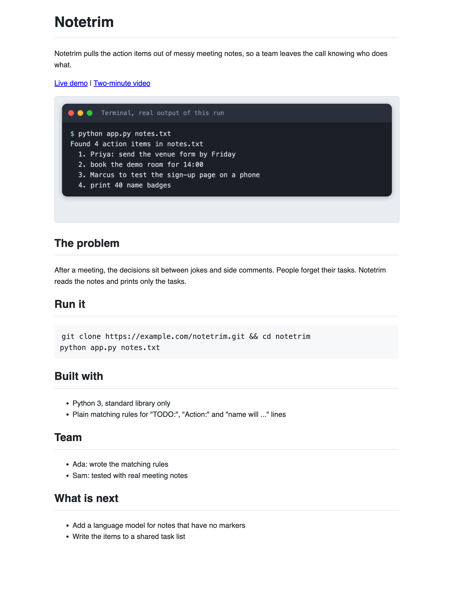
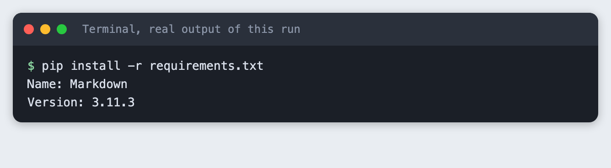
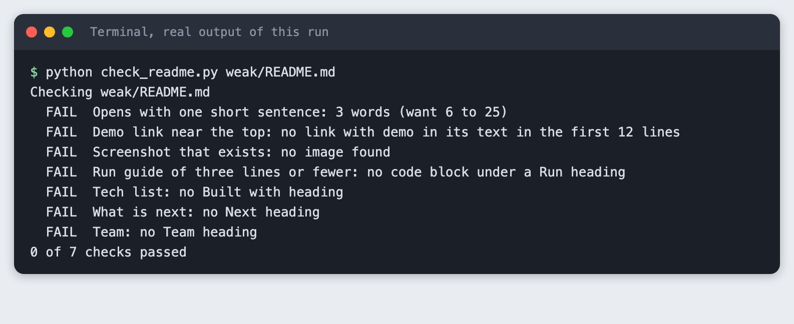
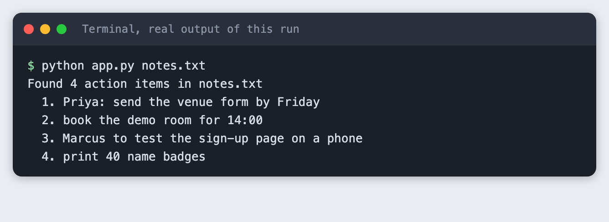
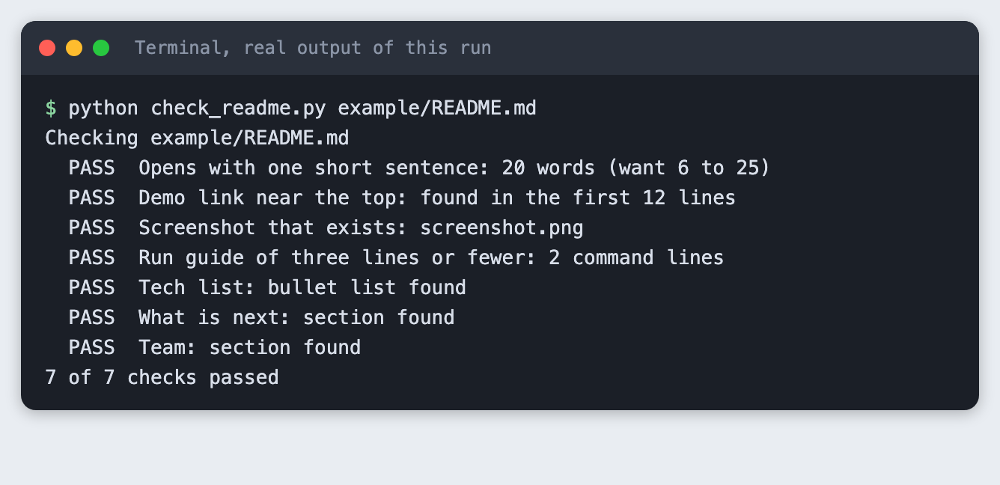
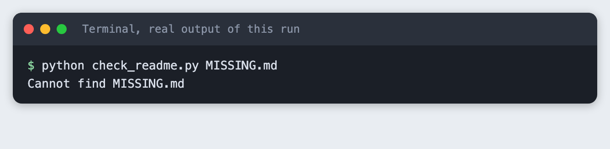

# Write a hackathon README that judges will read

You will write a README for a hackathon project, check it with a small Python script, and see it rendered the way a browser shows it. It takes about 30 minutes, needs no API key, and starts from a template you can copy.

**Level:** Beginner. **You need:** Python 3.10 or newer and a terminal. **Tested:** 11 November 2026 on macOS with Python 3.14 and `Markdown` 3.11.3. Windows commands were not run.

In an AI hackathon, the README is often the page a judge reads before they open your demo. Judges have many projects to go through, so this tutorial treats the opening 30 seconds as the time you have. That figure is our working assumption, not a measured number. If you are still choosing an event, see the [upcoming AI hackathons](/ai-hackathons/).

## Why the README matters

A judge sees the project through the README before they see it run. If the page does not say what the project is, where to try it and how to start it, they have to hunt. This tutorial uses a seven-point checklist we wrote ourselves. It is not any event's official rubric. Check your event's rules and judging criteria, and follow those first.

The seven points:

1. One short sentence at the top that says what the project does and for whom.
2. A demo link near the top.
3. A screenshot.
4. A run guide of three lines or fewer.
5. A list of what it is built with.
6. The team.
7. What you would build next.

## See it running first

This is the finished README for a small example project called Notetrim, rendered as a web page. It passes all seven checks. The rest of this tutorial builds it from scratch.



## Step 1. Create a virtual environment

The checker uses only Python's standard library. The page renderer needs one package, so use a virtual environment to keep it apart from the rest of your machine.

```bash
python3 -m venv .venv
```


Activate it. On macOS and Linux use `source .venv/bin/activate`. Every command below assumes it is active.

## Step 2. Install the Markdown package

`Markdown` turns a README into a web page, so you can look at it the way a judge's browser does.

```text
markdown>=3.6
```
*File: `requirements.txt`*

```bash
pip install -r requirements.txt
```



## Step 3. See what a weak README looks like

Most weak READMEs share one trait: they talk about the team's effort, not the reader's need. Here is one. It is written as a typical example, not copied from a real project.

```markdown
# notetool

Hackathon project 2026

## About

This is our project for the hackathon. We worked really hard on it over the weekend and learned a lot about Python. It was a great experience for the whole team and we hope you like it.

## Installation

Install the dependencies, set up the environment and then run the main file. See the docs for details.

## Credits

Thanks to the organisers.
```
*File: `weak/README.md`*

The checker reads a README and tests the seven points.

```python
"""Check a hackathon README against a seven-point checklist.

Usage: python check_readme.py path/to/README.md
Exit code 0 if every check passes, 1 if any fails, 2 if the file is missing.
"""
import re
import sys
from pathlib import Path

MIN_OPENING_WORDS = 6
MAX_OPENING_WORDS = 25
MAX_RUN_LINES = 3
DEMO_WITHIN_LINES = 12


def sections(lines):
    """Map each lowercase heading to the lines under it."""
    found, current = {}, None
    for line in lines:
        if m := re.match(r"^#{2,3}\s+(.*)", line):
            current = m.group(1).strip().lower()
            found[current] = []
        elif current:
            found[current].append(line)
    return found


def find_section(secs, *words):
    for name, body in secs.items():
        if any(w in name for w in words):
            return body
    return None


def opening_sentence(lines):
    """First paragraph of text after the title."""
    para = []
    for line in lines[1:]:
        if line.startswith("#"):
            if para:
                break
            continue
        if line.strip():
            para.append(line.strip())
        elif para:
            break
    return " ".join(para)


def run_block_lines(body):
    in_fence, cmds = False, []
    for line in body:
        if line.strip().startswith("```"):
            if in_fence:
                return cmds
            in_fence = True
        elif in_fence and line.strip():
            cmds.append(line.strip())
    return cmds if cmds else None


def check(path):
    text = path.read_text(encoding="utf-8")
    lines = text.splitlines()
    secs = sections(lines)
    results = []

    opening = opening_sentence(lines)
    words = len(opening.split())
    ok = MIN_OPENING_WORDS <= words <= MAX_OPENING_WORDS and opening.count(". ") == 0
    results.append((ok, "Opens with one short sentence",
                    f"{words} words (want {MIN_OPENING_WORDS} to {MAX_OPENING_WORDS})" if words else "no opening line"))

    top = "\n".join(lines[:DEMO_WITHIN_LINES])
    demo = re.search(r"\[[^\]]*demo[^\]]*\]\(https?://[^)]+\)", top, re.I)
    results.append((bool(demo), "Demo link near the top", f"found in the first {DEMO_WITHIN_LINES} lines" if demo else f"no link with demo in its text in the first {DEMO_WITHIN_LINES} lines"))

    img = re.search(r"!\[[^\]]*\]\(([^)]+)\)", text)
    img_ok = bool(img) and (img.group(1).startswith("http") or (path.parent / img.group(1)).is_file())
    results.append((img_ok, "Screenshot that exists", img.group(1) if img else "no image found"))

    run = find_section(secs, "run")
    cmds = run_block_lines(run) if run else None
    results.append((bool(cmds) and len(cmds) <= MAX_RUN_LINES, "Run guide of three lines or fewer",
                    f"{len(cmds)} command lines" if cmds else "no code block under a Run heading"))

    tech = find_section(secs, "built with", "tech")
    results.append((bool(tech and any(l.strip().startswith(("-", "*")) for l in tech)),
                    "Tech list", "bullet list found" if tech else "no Built with heading"))

    nxt = find_section(secs, "next")
    results.append((bool(nxt and "".join(nxt).strip()), "What is next", "section found" if nxt else "no Next heading"))

    team = find_section(secs, "team")
    results.append((bool(team and "".join(team).strip()), "Team", "section found" if team else "no Team heading"))
    return results


def main():
    if len(sys.argv) != 2:
        sys.exit("Usage: python check_readme.py path/to/README.md")
    path = Path(sys.argv[1])
    if not path.is_file():
        print(f"Cannot find {path}")
        sys.exit(2)
    results = check(path)
    print(f"Checking {path}")
    for ok, name, detail in results:
        print(f"  {'PASS' if ok else 'FAIL'}  {name}: {detail}")
    passed = sum(ok for ok, _, _ in results)
    print(f"{passed} of {len(results)} checks passed")
    sys.exit(0 if passed == len(results) else 1)


if __name__ == "__main__":
    main()
```
*File: `check_readme.py`*

Run it on the weak README:

```bash
python check_readme.py weak/README.md
```



All seven checks fail. The title line "Hackathon project 2026" is 3 words, so even the opening fails: the checker wants between 6 and 25. The command exits with code 1, so a script can use it as a gate.

## Step 4. Give the project something to show

The example project is a small script that pulls action items out of meeting notes. It uses plain matching rules, with no model and no network, so you can run it anywhere. Save this as `app.py` inside an `example/` folder:

```python
"""Pull action items out of meeting notes. Plain rules, no model, no network."""
import re
import sys
from pathlib import Path

MARKERS = re.compile(r"^\s*-?\s*(todo|action)\s*:\s*(.+)$", re.I)
WILL = re.compile(r"^\s*-\s*(\w+) will (.+)$", re.I)


def action_items(text):
    items = []
    for line in text.splitlines():
        if m := MARKERS.match(line):
            items.append(m.group(2).strip())
        elif m := WILL.match(line):
            items.append(f"{m.group(1)}: {m.group(2).strip().rstrip('.')}")
    return items


def main():
    if len(sys.argv) != 2:
        sys.exit("Usage: python app.py notes.txt")
    path = Path(sys.argv[1])
    if not path.is_file():
        sys.exit(f"Cannot find {path}")
    items = action_items(path.read_text(encoding="utf-8"))
    print(f"Found {len(items)} action items in {path.name}")
    for n, item in enumerate(items, 1):
        print(f"  {n}. {item}")


if __name__ == "__main__":
    main()
```
*File: `example/app.py`*

And this as `example/notes.txt`:

```text
Standup 4 June
- Priya will send the venue form by Friday.
- We liked the new logo.
TODO: book the demo room for 14:00
Action: Marcus to test the sign-up page on a phone
- Budget looks fine.
Todo: print 40 name badges
```
*File: `example/notes.txt`*

Run it from inside `example/`:

```bash
python app.py notes.txt
```



The notes file has seven lines and the script found 4 action items. A judge needs to see something like this output in your README, so a screenshot of the project working is worth more than a paragraph about it. The image above was saved as `example/screenshot.png` and is the one the README uses.

## Step 5. Write the README from the template

Start from this template. Each section answers one question a judge has.

```markdown
# Project name

One sentence: who has the problem, and what your project does about it.

[Live demo](https://example.com/your-demo) | [Demo video](https://example.com/your-video)


## The problem

Two or three sentences. Who is affected, and what do they do today?

## Run it

```bash
pip install -r requirements.txt
cp .env.example .env
python app.py
```

## Built with

- Language and framework
- Model or API, and what it is used for
- Anything else a judge would ask about

## Team

- Name, what they built

## What is next

- The next thing you would build
```
*File: `template/README.template.md`*

Here is the filled-in version for Notetrim. The opening sentence names the problem and the result. The demo links sit right under it. The run guide is two lines. The links use `example.com` because this is a made-up project.

```markdown
# Notetrim

Notetrim pulls the action items out of messy meeting notes, so a team leaves the call knowing who does what.

[Live demo](https://example.com/notetrim-demo) | [Two-minute video](https://example.com/notetrim-video)


## The problem

After a meeting, the decisions sit between jokes and side comments. People forget their tasks. Notetrim reads the notes and prints only the tasks.

## Run it

```bash
git clone https://example.com/notetrim.git && cd notetrim
python app.py notes.txt
```

## Built with

- Python 3, standard library only
- Plain matching rules for "TODO:", "Action:" and "name will ..." lines

## Team

- Ada: wrote the matching rules
- Sam: tested with real meeting notes

## What is next

- Add a language model for notes that have no markers
- Write the items to a shared task list
```
*File: `example/README.md`*

Check it:

```bash
python check_readme.py example/README.md
```



The opening is 20 words and all 7 checks pass. A passing check does not make the README good. It only means the parts a reader looks for are there. Read the text aloud and ask whether a stranger would understand the project.

## Step 6. Look at it the way a browser does

A README that reads well as text can still look cluttered as a page. This script renders it to HTML:

```python
"""Render a README to site/index.html so you can see it the way a judge's browser does.

Usage: python render_readme.py path/to/README.md
Local images next to the README are copied into site/.
"""
import shutil
import sys
from pathlib import Path

import markdown

CSS = """body{font:16px/1.55 -apple-system,Helvetica,Arial,sans-serif;max-width:760px;margin:24px auto;padding:0 20px;color:#1f2328}
h1,h2{border-bottom:1px solid #d8dee4;padding-bottom:.3em}pre{background:#f6f8fa;padding:12px;border-radius:6px;overflow:auto}
code{background:#f6f8fa;padding:2px 4px;border-radius:4px}img{max-width:100%;border:1px solid #d8dee4;border-radius:6px}"""


def main():
    src = Path(sys.argv[1])
    out = Path("site")
    out.mkdir(exist_ok=True)
    for f in src.parent.iterdir():
        if f.suffix.lower() in (".png", ".jpg", ".gif"):
            shutil.copy(f, out / f.name)
    body = markdown.markdown(src.read_text(encoding="utf-8"), extensions=["fenced_code"])
    (out / "index.html").write_text(
        f"<!doctype html><meta charset=utf-8><title>README</title><style>{CSS}</style>{body}", encoding="utf-8")
    print(f"Wrote {out / 'index.html'}")


if __name__ == "__main__":
    main()
```
*File: `render_readme.py`*

```bash
python render_readme.py example/README.md
```


The screenshot at the top of this tutorial shows the result. The sentence, the links and the screenshot all sit above the problem section, so someone who stops reading there has still learned what the project is.

## Step 7. Check what a wrong path looks like

Run the checker on a file that does not exist:

```bash
python check_readme.py MISSING.md
```



You get a one-line message and exit code 2, which is different from the code 1 a failed check gives.

## Troubleshooting

- **`ModuleNotFoundError: No module named 'markdown'`.** The virtual environment is not active, or the install did not finish. Activate it and run `pip install -r requirements.txt` again.
- **The checker says "no link with demo in its text".** The demo link must be a full `https://` link whose visible text contains the word "demo", and it must sit in the first 12 lines.
- **The screenshot check fails.** The image path is relative to the README. The file has to exist next to it.
- **The rendered page shows no image.** Run the render command from the project folder, because it copies images from next to the README into `site/`.

## Frequently asked questions

**What should an AI hackathon README include?**

One sentence on what the project does and for whom, a demo link, a screenshot, a run guide of three lines or fewer, what it is built with, the team and what comes next. In the test, the Notetrim README had all seven and passed 7 of 7 checks, while the weak one passed none.

**How long should a hackathon README be?**

Short enough that the key facts sit at the top. The Notetrim README keeps its opening sentence to 20 words and its run guide to 2 lines. Our checklist sets limits of 25 words and 3 lines. These are our own limits, not an event rule.

**Do judges read the code in an AI hackathon?**

It depends on the event, and this tutorial did not test it. Read your event's judging criteria. What you can control is making the README work for a reader who never opens the code.

## What to try next

- Run the checker on your own project's README and fix each failure.
- Add a check of your own, such as a link to a licence file.
- Replace the screenshot with a short demo video link.

## How this tutorial was tested

Every command and screenshot above comes from one real run on 11 November 2026. The code in the blocks is copied from the project files, not retyped. The steps were then run again from an empty folder, and all of them passed. Terminal screenshots are rendered from the saved output of the commands, in a terminal-style frame. They are not captures of a window. The rendered README page is a real Chrome screenshot of the running page. The checklist is our own and was not compared against any event's official rubric. Not run: Windows and Linux, other Python versions, and any real hackathon submission.

