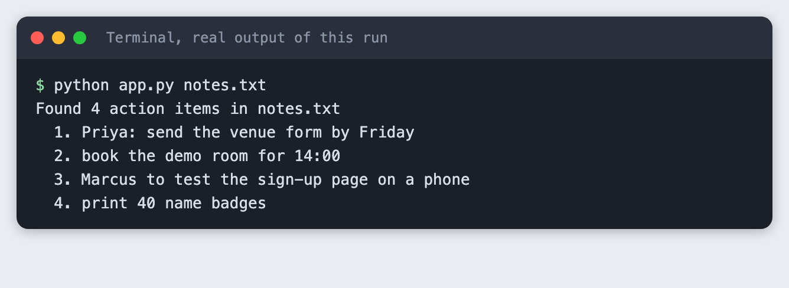

# Notetrim

Notetrim pulls the action items out of messy meeting notes, so a team leaves the call knowing who does what.

[Live demo](https://example.com/notetrim-demo) | [Two-minute video](https://example.com/notetrim-video)



## The problem

After a meeting, the decisions sit between jokes and side comments. People forget their tasks. Notetrim reads the notes and prints only the tasks.

## Run it

```bash
git clone https://example.com/notetrim.git && cd notetrim
python app.py notes.txt
```

## Built with

- Python 3, standard library only
- Plain matching rules for "TODO:", "Action:" and "name will ..." lines

## Team

- Ada: wrote the matching rules
- Sam: tested with real meeting notes

## What is next

- Add a language model for notes that have no markers
- Write the items to a shared task list
