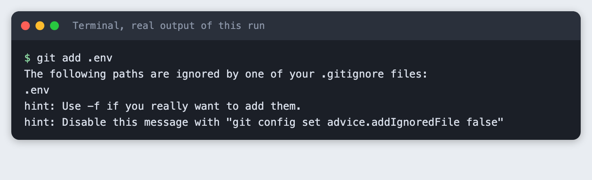
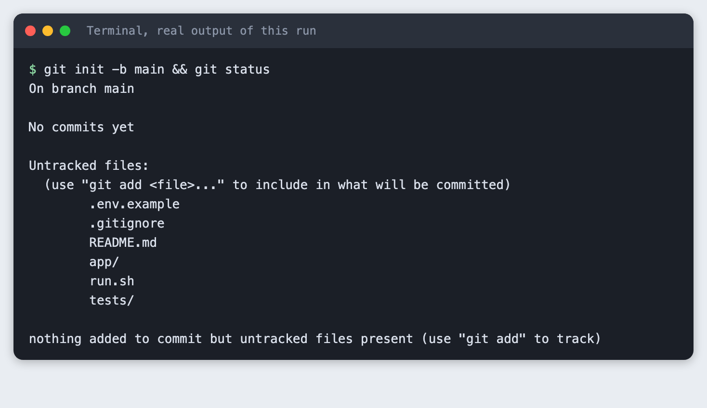
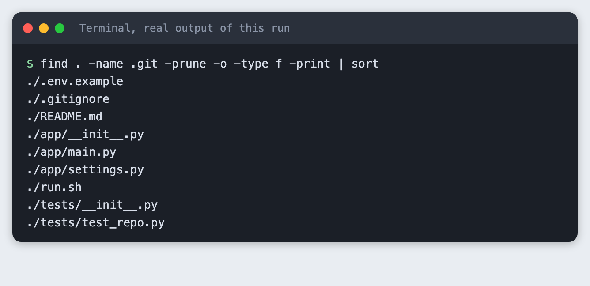
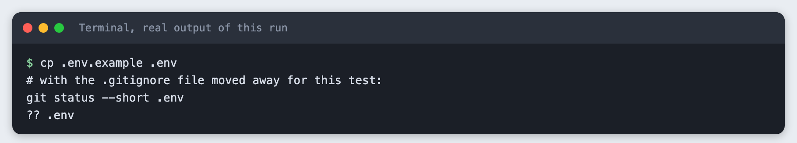
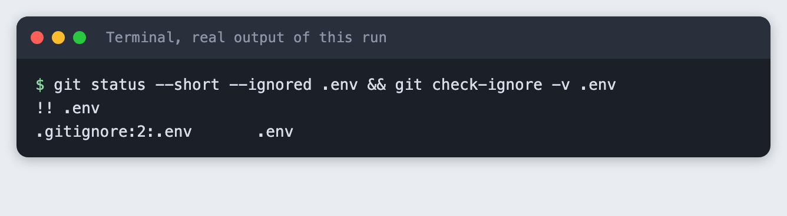
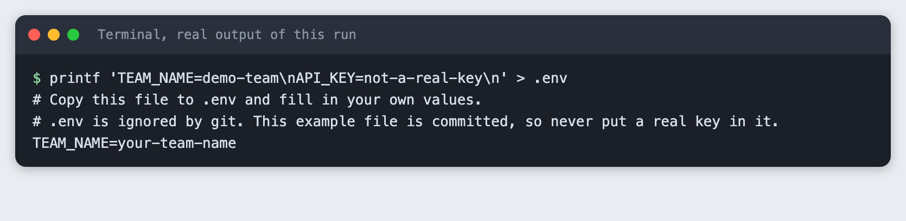
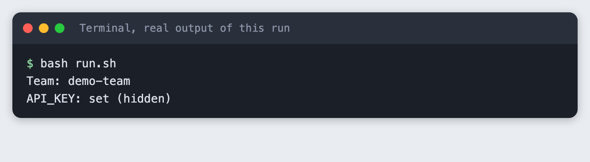
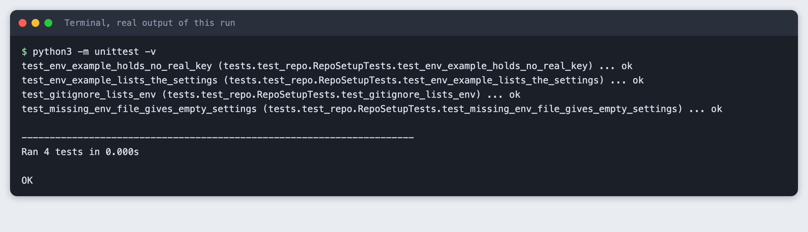
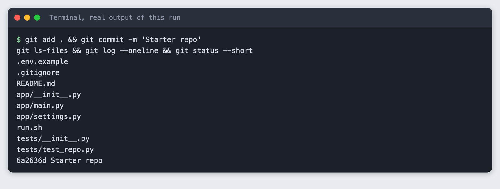

# Set up a hackathon project repo in 30 minutes

You will build a small starter repo for a hackathon team: a folder layout, an environment file that git refuses to track, a README stub, a run script and one passing check. It takes about 30 minutes and needs no API key.

**Level:** Beginner. **You need:** Git, Python 3.10 or newer and a terminal. **Tested:** 10 November 2026 on macOS with Git 2.50.1 and Python 3.14.6. Windows and Linux were not run.

The opening hour of an AI hackathon sets the pace for the rest, and a clean repo is a small thing to get right. A starter repo like this one keeps your key file out of git from the start. When you are ready to use it, see the [upcoming AI hackathons](/ai-hackathons/).

## Why set this up before writing model code

Most hackathon repos get a key leaked in the same way. Someone saves a key in a file, runs `git add .`, and the key is now in the history. Deleting the file later does not remove it from past commits. The fix costs two minutes at the start: keep keys in a file git ignores, and commit a copy with the names only.

## See it running first

By the end, git will refuse to add your `.env` file, even when you ask it to:



The rest of this tutorial builds the repo from scratch. Everything happens inside one local folder. Nothing is pushed anywhere.

## Step 1. Create the repo

Make a folder for the project, open a terminal in it, and start a repo:

```bash
git init -b main && git status
```



`-b main` names the branch. Git says there are no commits yet, and it lists the files it can see but does not track. The files in the screenshot are the ones this tutorial adds in the next steps, so you can create them before or after this command.

## Step 2. Add the folder layout

Keep the layout small. Code goes in `app/`, checks go in `tests/`, and the files that describe the project sit at the top.

```bash
find . -name .git -prune -o -type f -print | sort
```



You should see nine files. Create each one with the contents shown in the steps below.

## Step 3. Keep keys out of git

This step has two files. The `.gitignore` file lists what git must never track:

```
# Secrets: never commit these
.env

# Python
.venv/
__pycache__/
*.pyc
```
*File: `team-project/.gitignore`*

The `.env.example` file lists the names of the settings. It is committed, so it holds placeholder text only:

```
# Copy this file to .env and fill in your own values.
# .env is ignored by git. This example file is committed, so never put a real key in it.
TEAM_NAME=your-team-name
API_KEY=paste-your-key-here
```
*File: `team-project/.env.example`*

Your teammates copy `.env.example` to `.env` and fill in their own values. Now check that the rule works. First, here is what git does when the rule is missing. This test copies the example file to `.env`, moves `.gitignore` out of the way for one command, and puts it back:

```bash
cp .env.example .env
# with the .gitignore file moved away for this test:
git status --short .env
```



The `??` means git sees `.env` as a new file that the next `git add .` would pick up. That is the leak. Now with the rule in place:

```bash
git status --short --ignored .env && git check-ignore -v .env
```



`!!` means ignored. The `check-ignore -v` command says which rule did it: line 2 of `.gitignore`, the pattern `.env`. Use this command whenever you wonder why git skips a file.

Now try to add the file anyway:

```bash
git add .env
```


Git stops with exit code 1. The hint mentions `-f`, which forces the add. Do not use it for secrets. The `git add .` command your team will run a hundred times skips `.env` without a message.

Put your own values in `.env`. This tutorial uses fake ones:

```bash
printf 'TEAM_NAME=demo-team\nAPI_KEY=not-a-real-key\n' > .env
```



## Step 4. Add a README stub and a run script

The README stub gives a teammate who joins at hour three the two commands they need:

```markdown
# Team project

One sentence on what this project does. Replace it in the first hour.

## Run it

```
cp .env.example .env     # then edit .env
bash run.sh
```

## Check it

```
python3 -m unittest -v
```

## Layout

| Path | What it is |
| --- | --- |
| `app/` | The code |
| `tests/` | Checks, run before every push |
| `.env.example` | The names of the settings, with no real values |
| `run.sh` | One command to start the project |
```
*File: `team-project/README.md`*

The settings loader reads `.env` with no extra packages, so there is nothing to install:

```python
"""Read settings from the .env file, if there is one."""
from pathlib import Path


def load_env(path=".env"):
    """Return the NAME=value lines of a .env file as a dict. A missing file gives an empty dict."""
    settings = {}
    file = Path(path)
    if not file.is_file():
        return settings
    for line in file.read_text(encoding="utf-8").splitlines():
        line = line.strip()
        if line and not line.startswith("#") and "=" in line:
            name, value = line.split("=", 1)
            settings[name.strip()] = value.strip()
    return settings
```
*File: `team-project/app/settings.py`*

The entry point says whether the key is set. It never prints the key, so a screen share or a recorded demo cannot leak it:

```python
from app.settings import load_env


def main():
    settings = load_env()
    if not settings:
        print("No .env file found. Run: cp .env.example .env")
        raise SystemExit(1)
    print(f"Team: {settings.get('TEAM_NAME', '(not set)')}")
    # Say whether the key is there. Never print it.
    print("API_KEY: set (hidden)" if settings.get("API_KEY") else "API_KEY: missing")


if __name__ == "__main__":
    main()
```
*File: `team-project/app/main.py`*

The run script is one line, so everyone starts the project the same way:

```bash
#!/usr/bin/env bash
set -e
python3 -m app.main
```
*File: `team-project/run.sh`*

Run it:

```bash
bash run.sh
```



You should see the team name from your `.env` and the words `set (hidden)`. If `.env` is missing, the program prints how to create it.

## Step 5. Add one passing check

A single check that runs in a second is enough to start. This one confirms that `.env.example` lists the settings and holds no real key, that a missing `.env` does not crash the loader, and that `.gitignore` still lists `.env`. The last check catches a teammate who deletes the line by accident.

```python
import unittest
from pathlib import Path

from app.settings import load_env

ROOT = Path(__file__).resolve().parent.parent


class RepoSetupTests(unittest.TestCase):
    def test_env_example_lists_the_settings(self):
        names = load_env(ROOT / ".env.example")
        self.assertIn("TEAM_NAME", names)
        self.assertIn("API_KEY", names)

    def test_env_example_holds_no_real_key(self):
        self.assertEqual(load_env(ROOT / ".env.example")["API_KEY"], "paste-your-key-here")

    def test_missing_env_file_gives_empty_settings(self):
        self.assertEqual(load_env(ROOT / "no-such-file.env"), {})

    def test_gitignore_lists_env(self):
        lines = (ROOT / ".gitignore").read_text().splitlines()
        self.assertIn(".env", lines)


if __name__ == "__main__":
    unittest.main()
```
*File: `team-project/tests/test_repo.py`*

```bash
python3 -m unittest -v
```



Four checks ran and all passed. The timing line will differ on your machine.

## Step 6. Commit, and confirm .env is not in it

Commit everything and list what git tracks:

```bash
git add . && git commit -m 'Starter repo'
git ls-files && git log --oneline && git status --short
```



Nine files are tracked, and `.env` is not one of them. The commit hash in your output will differ. The `-c user.name` and `-c user.email` options in the saved command are placeholders for a throwaway repo. On your own machine, set your name and email once with `git config`, then type `git commit -m "Starter repo"`.

## Pushing and inviting the team

The last part of the usual setup is to create a remote repo on a hosting service, add it with `git remote add origin <address>`, run `git push -u origin main`, and invite teammates there. We did not run this part, because it needs an account and would put a repo online. Before you push, run `git ls-files` as in step 6. It must not list `.env`.

## Troubleshooting

**`.env` already shows as tracked.** The ignore rule only applies to files git does not track yet. If you committed `.env` earlier, run `git rm --cached .env`, commit, and then change the key at the provider, because it is in the history.

**`git check-ignore -v .env` prints nothing and exits with 1.** No rule matches. Check that the line in `.gitignore` is exactly `.env` with no spaces.

**`bash run.sh` says `No .env file found`.** Run `cp .env.example .env` in the project folder.

**The tests find no tests.** Run `python3 -m unittest -v` from the project folder, the one that contains `app/` and `tests/`. Both folders need an `__init__.py` file.

## Frequently asked questions

**What should an AI hackathon repo contain on day one?**

The repo built here has nine files: code in `app/`, checks in `tests/`, a `.gitignore`, a `.env.example`, a README stub and a one-line run script. It needs no API key.

**How do I keep API keys out of a hackathon repo?**

Keep keys in a `.env` file, list `.env` in `.gitignore`, and commit a `.env.example` that holds placeholder text only. In this tutorial, `git add .env` was refused with exit code 1 because the file is ignored.

**Should the whole team share one repo in a short AI hackathon?**

Not tested here. This tutorial built one repo in one local folder. It did not push the repo or invite teammates. A shared remote repo is the usual way for a team to work, and `git ls-files` should not list `.env` before you push.

## What to try next

- Add a `LICENSE` file and the name of each teammate to the README.
- Add a check that fails if any tracked file contains the text `API_KEY=` followed by a value other than the placeholder.
- Add a virtual environment and a `requirements.txt`. The `.gitignore` here already ignores `.venv/`.

## How this tutorial was tested

Tested on 10 November 2026 on macOS 26 with Git 2.50.1 and Python 3.14.6. The code and commands in this article are copied from the project files and the saved run, not retyped. The steps were replayed from an empty copy of the project folder, and all nine passed. The repo was created and committed in a throwaway folder and was never pushed.

The terminal images are rendered from the saved output of each command, with the label "real output of this run". They are not captures of a terminal window, because this Mac does not allow desktop capture for the tool.

Not run: Windows, Linux, the `git rm --cached` fix in Troubleshooting, pushing to a remote host, and inviting teammates. The git hint text in step 3 can differ between Git versions.

