# Get an alert when a new model appears on Hugging Face

You will build a small Python script that lists new models from the organisations you choose, leaves out copies and fine-tunes of other people's models, remembers what it has already reported, and writes a message to the terminal and to a text file. It takes about 40 minutes and needs no account and no API key.

**Level:** Intermediate. **You need:** Python 3.10 or newer, a terminal and an internet connection. **Tested:** 10 November 2026 on macOS with Python 3.14 and `requests` 2.34.2. The Windows activate command was not run.

Sponsors of an AI hackathon may point teams to new models, and an alert tells you when a publisher you follow posts one. See the [upcoming AI hackathons](/ai-hackathons/) to find a place to use it.

## Why this is worth a script

Hugging Face is where many open-weight models are published. The lists on the site mix official releases with quantised copies and fine-tunes uploaded by other people. A script that watches named publishers gives you a short list, and a state file means you hear about each model once.

## See it running first

By the end, one command prints a message like this:

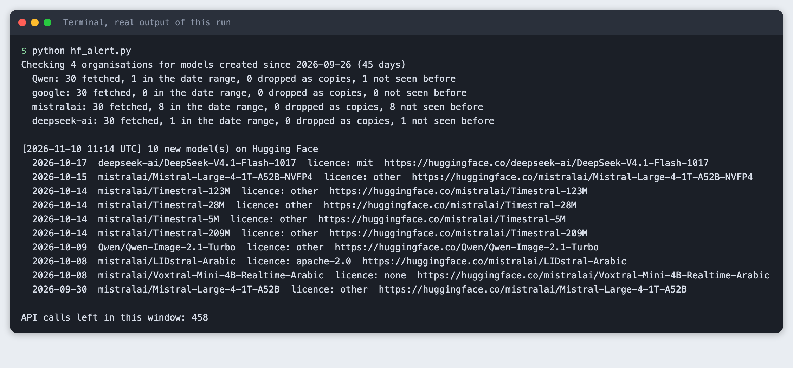

The models in the screenshot are what the API returned on 10 November 2026. Yours will differ, because the results depend on live data and on the date you run the script. The rest of this tutorial builds the script from scratch.

## Step 1. Create a virtual environment

Make a project folder, open a terminal in it, and run:

```bash
python3 -m venv .venv
```


Activate it with `source .venv/bin/activate` on macOS and Linux. Every command below assumes it is active.

## Step 2. Install requests

`requests` makes the web calls. It is the only package this project needs.

```text
requests>=2.31
```
*File: `requirements.txt`*

```bash
pip install -r requirements.txt
```

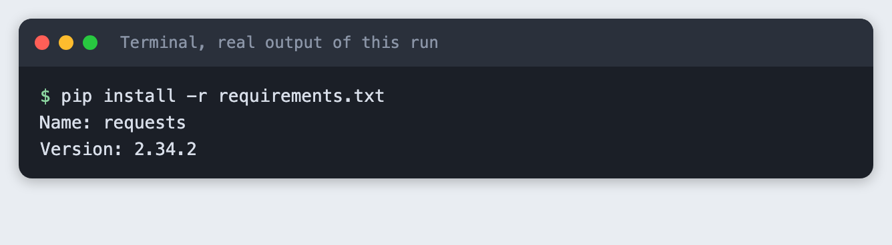

## Step 3. Call the public models API

The Hub has a public endpoint, `https://huggingface.co/api/models`. It needs no token for public models. We ask for one organisation at a time (`author`), newest first (`sort=createdAt`), and only 30 models (`limit`). We ask for four fields with `expand[]` and nothing else,.

The script follows three rules for being polite. It sends a User-Agent that says who is calling. It pauses one second after each call. It stops if the API answers with HTTP 429 (too many requests) instead of trying again. The API also reports how many calls you have left in the current window, in a header called `ratelimit`, and the script reads it so you can see it.

```python
"""Call Hugging Face's public models API politely."""
import re
import time

import requests

API = "https://huggingface.co/api/models"
HEADERS = {"User-Agent": "starfield-labs-tutorial/1.0"}
FIELDS = ["createdAt", "tags", "gated", "downloads"]
PAUSE = 1.0  # seconds between calls


class RateLimited(Exception):
    pass


def calls_left(response):
    """The API sends a header like: "api";r=499;t=222 (r = calls left, t = seconds to reset)."""
    match = re.search(r"r=(\d+)", response.headers.get("ratelimit", ""))
    return int(match.group(1)) if match else None


def newest_models(org, limit=30, session=None):
    """Return (models, calls_left) for the newest models of one organisation."""
    session = session or requests
    params = {"author": org, "sort": "createdAt", "direction": -1, "limit": limit, "expand[]": FIELDS}
    response = session.get(API, params=params, headers=HEADERS, timeout=30)
    if response.status_code == 429:
        raise RateLimited(f"Rate limited. Try again in about {response.headers.get('retry-after', 'a few')} seconds.")
    response.raise_for_status()
    time.sleep(PAUSE)
    return response.json(), calls_left(response)
```
*File: `hfapi.py`*

## Step 4. Look at what a model record contains

Before writing a filter, look at a real record. This script fetches 40 models from the publisher `unsloth`, which publishes many quantised copies of other people's models, and prints one that has a `base_model` tag. It prints only the tags that matter here.

```python
"""Print the fields the API gives for one model, so you can see what a filter has to work with."""
import json

from hfapi import newest_models

models, _ = newest_models("unsloth", limit=40)
model = next(m for m in models if any(t.startswith("base_model:") for t in m["tags"]))
model["tags"] = [t for t in model["tags"] if t.startswith(("base_model", "license", "gguf", "region"))]
print(json.dumps(model, indent=2))
```
*File: `show_one.py`*

```bash
python show_one.py
```

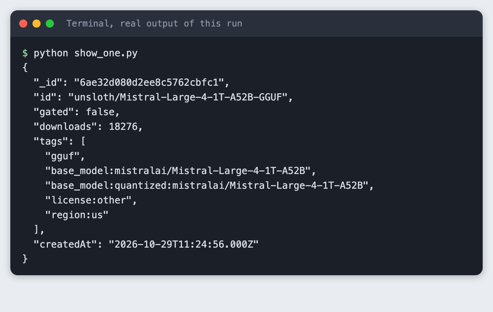

Three fields are useful. `createdAt` is the date for the date filter. `tags` carries the licence (`license:other`) and the base model. `gated` says whether you must ask for access. The `base_model` tag appears twice: once in a short form (`base_model:mistralai/Mistral-Large-4-1T-A52B`) and once with the relation (`base_model:quantized:...`). The relation can also be `finetune`, `adapter` or `merge`.

## Step 5. Pick a filter by comparing real results

We tried four rules on the newest 40 models of seven organisations. Each rule answers "should this model be dropped?". They are in `filters.py`:

```python
"""Rules that decide whether a model is a copy or a variant of someone else's model.

The Hub writes a tag such as  base_model:quantized:mistralai/Mistral-Large-4-1T-A52B
(or base_model:finetune:..., base_model:adapter:..., base_model:merge:...).
Older cards only have the short form  base_model:owner/name.
"""
from datetime import datetime, timedelta, timezone


def parse_created(text):
    return datetime.fromisoformat(text.replace("Z", "+00:00"))


def in_window(model, days, now=None):
    now = now or datetime.now(timezone.utc)
    return parse_created(model["createdAt"]) >= now - timedelta(days=days)


def base_models(model):
    """List of (relation, owner/name) pairs from the base_model tags. Relation is '' for the short form."""
    found = []
    for tag in model.get("tags", []):
        if not tag.startswith("base_model:"):
            continue
        parts = tag.split(":", 2)[1:]
        found.append(("", parts[0]) if len(parts) == 1 else (parts[0], parts[1]))
    return found


# Each rule answers: should this model be dropped? Used by compare_filters.py to test them side by side.
def rule_not_open_access(model, org):
    return bool(model.get("gated"))


def rule_any_base_model(model, org):
    return bool(base_models(model))


def rule_other_author_base(model, org):
    """Built on a model that another author owns: a copy, a quantised upload or a fine-tune of theirs."""
    return any(not name.startswith(org + "/") for _, name in base_models(model))


def rule_file_format_name(model, org):
    name = model["id"].lower()
    return any(word in name for word in ("gguf", "-awq", "-gptq", "-bnb", "-mlx"))


RULES = {
    "gated": rule_not_open_access,
    "any base_model": rule_any_base_model,
    "other-author base_model": rule_other_author_base,
    "format in name": rule_file_format_name,
}

CHOSEN = rule_other_author_base
```
*File: `filters.py`*

`compare_filters.py` counts what each rule would drop, using one call per organisation:

```python
"""Count what each candidate rule would drop for several organisations. Read-only, 7 API calls."""
import sys

from filters import RULES
from hfapi import newest_models

ORGS = ["Qwen", "google", "mistralai", "deepseek-ai", "microsoft", "meta-llama", "unsloth"]


def main():
    names = list(RULES)
    print(f"{'organisation':<13}{'fetched':>8}" + "".join(f"{n:>26}" for n in names))
    totals = {n: 0 for n in names}
    fetched_total = 0
    for org in ORGS:
        models, _ = newest_models(org, limit=40)
        counts = {n: sum(RULES[n](m, org) for m in models) for n in names}
        fetched_total += len(models)
        for n in names:
            totals[n] += counts[n]
        print(f"{org:<13}{len(models):>8}" + "".join(f"{counts[n]:>26}" for n in names))
    print(f"{'all':<13}{fetched_total:>8}" + "".join(f"{totals[n]:>26}" for n in names))
    print("\nEach number is how many of the newest 40 models the rule would drop.")


if __name__ == "__main__":
    sys.exit(main())
```
*File: `compare_filters.py`*

```bash
python compare_filters.py
```

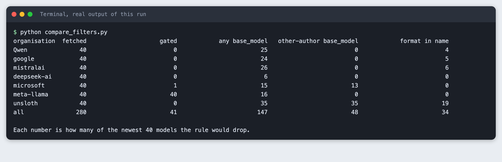

What the table shows:

- **`gated` does not find copies.** It dropped 41 of 280 models. 40 of those were `meta-llama`, where every one of the 40 models is gated although Meta published them. It dropped nothing from `unsloth`. Gating is about access, not about origin.
- **Any `base_model` tag is too wide.** It dropped 147 of 280, including 25 from `Qwen`, 24 from `google` and 26 from `mistralai`. Publishers tag their own quantised and instruction-tuned releases with a base model too, and you want those.
- **A `base_model` owned by someone else works for these seven organisations.** It dropped 35 of 40 from `unsloth` and none from `Qwen`, `google`, `mistralai`, `deepseek-ai` or `meta-llama`. It also dropped 13 of 40 from `microsoft`. We did not read those 13 one by one, so we cannot say how many are copies and how many are Microsoft's own fine-tunes of other publishers' models. For an alert that is a reasonable result, since both are derived models.
- **Looking for words like `gguf` in the name is unreliable.** It dropped 19 of 40 from `unsloth` but also 4 from `Qwen`, 5 from `google` and 6 from `mistralai`, which are official releases.

We chose the other-author rule (`rule_other_author_base`). It has one gap, which step 8 shows: a re-upload with no `base_model` tag passes through. The main protection is the list of organisations you watch.

Unit tests on fixed records keep the rule honest when you change it. This is the one step that does not call the API:

```python
import unittest
from datetime import datetime, timezone

from filters import base_models, in_window, rule_any_base_model, rule_other_author_base


def model(name, tags=(), created="2026-11-01T00:00:00.000Z"):
    return {"id": name, "tags": list(tags), "createdAt": created}


class FilterTests(unittest.TestCase):
    def test_other_author_quantised_copy_is_dropped(self):
        m = model("unsloth/X-GGUF", ["base_model:quantized:mistralai/X"])
        self.assertTrue(rule_other_author_base(m, "unsloth"))

    def test_own_quantised_release_is_kept(self):
        m = model("Qwen/X-FP8", ["base_model:Qwen/X", "base_model:quantized:Qwen/X"])
        self.assertFalse(rule_other_author_base(m, "Qwen"))
        self.assertTrue(rule_any_base_model(m, "Qwen"))

    def test_model_without_base_tag_is_kept(self):
        self.assertFalse(rule_other_author_base(model("google/Y"), "google"))

    def test_short_and_long_tag_forms_are_read(self):
        m = model("a/b", ["base_model:o/n", "base_model:finetune:o/n"])
        self.assertEqual(base_models(m), [("", "o/n"), ("finetune", "o/n")])

    def test_date_window(self):
        now = datetime(2026, 11, 10, tzinfo=timezone.utc)
        self.assertTrue(in_window(model("a/b", created="2026-11-01T00:00:00.000Z"), 10, now))
        self.assertFalse(in_window(model("a/b", created="2026-10-01T00:00:00.000Z"), 10, now))


if __name__ == "__main__":
    unittest.main()
```
*File: `tests/test_filters.py`*

```bash
python -m unittest discover -s tests -t . -v
```

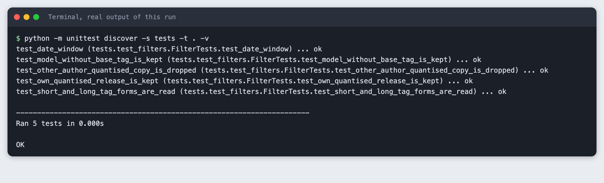

## Step 6. Write the alert script

The script reads `orgs.txt`, fetches each organisation, keeps models inside the date range, drops copies, and keeps only models not yet in `seen.json`. The state file is written to a temporary file and then renamed, so a crash cannot leave half a file. If an organisation returns no models, the script stops with exit code 2 and does not touch the state file. The message goes to the terminal and is appended to `alerts.txt`.

```text
# One Hugging Face organisation per line. Names are case sensitive.
Qwen
google
mistralai
deepseek-ai
```
*File: `orgs.txt`*

```python
"""List new models from chosen Hugging Face organisations and send a message about them."""
import argparse
import json
import os
import sys
from datetime import datetime, timedelta, timezone
from pathlib import Path

from filters import CHOSEN, in_window
from hfapi import RateLimited, newest_models


def read_orgs(path):
    lines = Path(path).read_text().splitlines()
    return [line.strip() for line in lines if line.strip() and not line.startswith("#")]


def load_seen(path):
    p = Path(path)
    return json.loads(p.read_text()) if p.exists() else {}


def save_seen(path, seen):
    tmp = f"{path}.tmp"
    Path(tmp).write_text(json.dumps(seen, indent=2, sort_keys=True))
    os.replace(tmp, path)


def licence(model):
    return next((t.split(":", 1)[1] for t in model["tags"] if t.startswith("license:")), "none")


def main():
    ap = argparse.ArgumentParser()
    ap.add_argument("--orgs", nargs="*", help="organisations; default is orgs.txt")
    ap.add_argument("--days", type=int, default=45)
    ap.add_argument("--limit", type=int, default=30)
    ap.add_argument("--state", default="seen.json")
    ap.add_argument("--message-file", default="alerts.txt")
    ap.add_argument("--keep-copies", action="store_true", help="do not drop models built on another author's model")
    args = ap.parse_args()

    orgs = args.orgs or read_orgs("orgs.txt")
    now = datetime.now(timezone.utc)
    since = (now - timedelta(days=args.days)).date()
    print(f"Checking {len(orgs)} organisations for models created since {since} ({args.days} days)")

    seen, new, left, bad = load_seen(args.state), [], None, []
    try:
        for org in orgs:
            models, left = newest_models(org, args.limit)
            if not models:
                bad.append(org)
                print(f"  {org}: no models found. Check the spelling, names are case sensitive.")
                continue
            recent = [m for m in models if in_window(m, args.days, now)]
            kept = recent if args.keep_copies else [m for m in recent if not CHOSEN(m, org)]
            fresh = [m for m in kept if m["id"] not in seen]
            note = "  (limit reached, raise --limit)" if len(recent) == len(models) else ""
            print(f"  {org}: {len(models)} fetched, {len(recent)} in the date range, "
                  f"{len(recent) - len(kept)} dropped as copies, {len(fresh)} not seen before{note}")
            new += fresh
    except RateLimited as err:
        print(err)
        return 3

    if bad:
        return 2

    new.sort(key=lambda m: m["createdAt"], reverse=True)
    if new:
        lines = [f"[{now:%Y-%m-%d %H:%M} UTC] {len(new)} new model(s) on Hugging Face"]
        for m in new:
            lines.append(f"  {m['createdAt'][:10]}  {m['id']}  licence: {licence(m)}  https://huggingface.co/{m['id']}")
        message = "\n".join(lines)
        with open(args.message_file, "a") as out:
            out.write(message + "\n")
        for m in new:
            seen[m["id"]] = m["createdAt"]
        save_seen(args.state, seen)
        print("\n" + message)
    else:
        print("\nNo new models since the last run.")
    print(f"\nAPI calls left in this window: {left}")
    return 0


if __name__ == "__main__":
    sys.exit(main())
```
*File: `hf_alert.py`*

## Step 7. Run it, then run it again

The initial run has an empty state file, so everything in the date range is new. The date range is 45 days by default.

```bash
python hf_alert.py
```

On 10 November 2026 the four organisations gave 1 model for `Qwen`, none for `google`, 8 for `mistralai` and 1 for `deepseek-ai`: 10 in all. Nothing was dropped as a copy: none of these ten carries a `base_model` tag that points to another author. The last line shows 458 calls left in the window.

Run it again with nothing changed:

```bash
python hf_alert.py
```

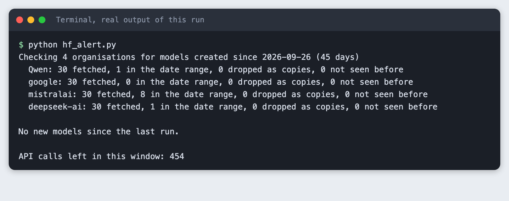

Each organisation still shows its models in the date range, but every one has been seen, so the script prints "No new models since the last run." That is the state file doing its job.

To see an alert for a single new model without waiting for a release, `forget.py` removes the newest entry from `seen.json`:

```python
"""Remove the newest entry from seen.json, to pretend that model has just appeared."""
import json

with open("seen.json") as f:
    seen = json.load(f)
newest = max(seen, key=seen.get)
del seen[newest]
with open("seen.json", "w") as f:
    json.dump(seen, f, indent=2, sort_keys=True)
print(f"Forgot {newest}")
```
*File: `forget.py`*

```bash
python forget.py
python hf_alert.py
```

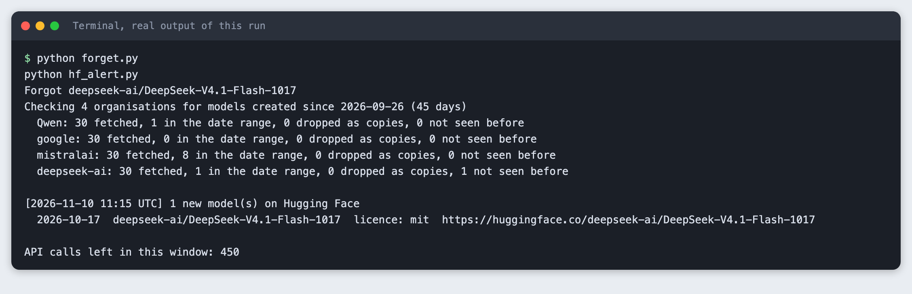

This time the script reports 1 new model, the entry that was forgotten. The text file keeps every message:

```bash
cat alerts.txt
head -5 seen.json
```

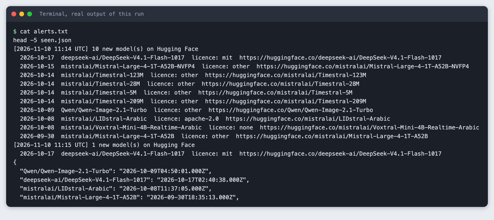

## Step 8. Watch a publisher full of copies

Now point the script at `unsloth` with a 14-day range. Separate state and message files keep this test away from your real ones.

```bash
python hf_alert.py --orgs unsloth --days 14 --state seen-unsloth.json --message-file alerts-unsloth.txt
```

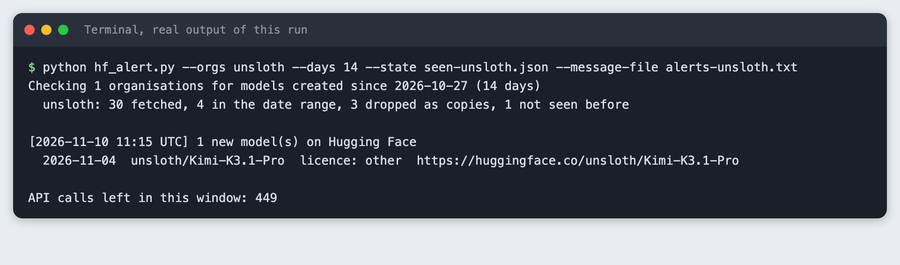

Four models were in the range, three were dropped as copies, and one was announced: `unsloth/Kimi-K3.1-Pro`. With `--keep-copies`, the filter is off:

```bash
python hf_alert.py --orgs unsloth --days 14 --keep-copies --state seen-keep.json --message-file alerts-keep.txt
```

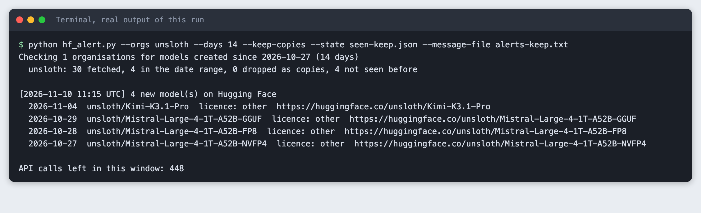

The three that the filter removed are `Mistral-Large-4-1T-A52B` uploads in GGUF, FP8 and NVFP4 formats, each tagged as derived from a `mistralai` model. `Kimi-K3.1-Pro` has no `base_model` tag, so the rule keeps it. We did not check whether it is a re-upload of someone else's model. This is the gap in the rule. If the publisher is not on your list, it never comes up.

## Step 9. What a mistake looks like

Organisation names are case sensitive. `qwen` is not `Qwen`, and the API answers with an empty list and no error:

```bash
python hf_alert.py --orgs qwen
```

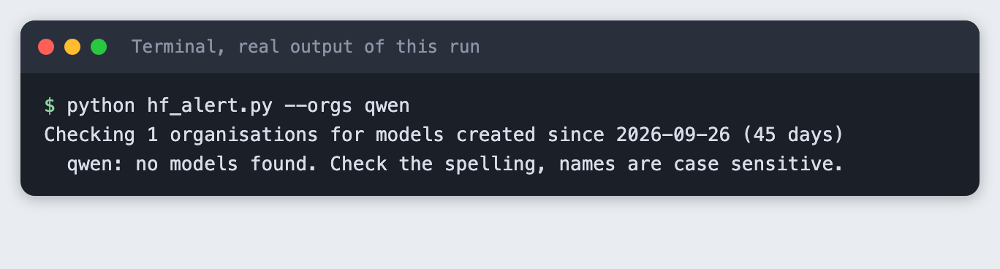

The script catches the empty list, tells you to check the spelling, and exits with code 2. A scheduler that checks exit codes will then see the failure.

## Step 10. Send the message somewhere else

The message is a plain string, so you can send it elsewhere. Many chat tools accept an HTTP POST with a small JSON body to a webhook address they give you. In `hf_alert.py` you would add one `requests.post(webhook_url, json={"text": message})` after the message is built, and keep the address in an environment variable, never in the code. This tutorial does not set up or run any webhook, and the step is untested here. Check your chat tool's own documentation for the body it expects.

## Step 11. Run it on a schedule

We did not install a schedule while writing this. These are the usual options for you to try.

On macOS and Linux, `cron` runs a command at set times. You edit your table with `crontab -e` and add a line with five time fields and a command. The command needs full paths, because cron does not activate your virtual environment: run the Python inside `.venv` directly and `cd` to the project folder first, since the script reads `orgs.txt` and `seen.json` from the current folder.

On macOS, `launchd` is the built-in alternative. You write a property list file in `~/Library/LaunchAgents` with the program, its arguments, the working directory and a `StartCalendarInterval`, then load it with `launchctl`.

Whichever you use, run the script by hand first, keep the pause and the small limit, and do not poll more often than you need.

## Troubleshooting

- **"no models found" for an organisation you know exists.** Check the capitalisation. The name in the URL on the model page is the one to use.
- **"Rate limited".** The API returned HTTP 429. Wait the time it names, and check the `ratelimit` header it sends (`r` is calls left, `t` is seconds to reset). Lower `--limit` or call less often.
- **Nothing is reported although you know a model is new.** The model may be older than `--days`, may be tagged as built on another author's model, or may already be in `seen.json`. Delete `seen.json` to start again.
- **`ModuleNotFoundError: filters` when running the tests.** Run the command from the project folder, with `-t .`.

## Frequently asked questions

**How do I find new open models for a hackathon?**

Watch named publishers through the public Hugging Face models API, newest first. On 10 November 2026 the four organisations in the tutorial gave 10 models within a 45-day range.

**Can I use the Hugging Face API without a token?**

Yes, for public models. The calls in this tutorial used no token and no account. The API reports how many calls you have left in a `ratelimit` header, and 458 were left at the end of the run.

**How do I avoid copies and fine-tunes in a model list?**

Drop a model when its `base_model` tag points to another author. For `unsloth` over 14 days, 4 models were in range and 3 were dropped. The rule has a gap: a re-upload with no `base_model` tag passes through.

## What to try next

- Add `--skip-own-variants` for your own organisation's GGUF and FP8 uploads, using the relation in the tag (`quantized`, `adapter`).
- Add a `--json` option that writes each message as one JSON line, for other programs to read.
- Keep a count per day in `seen.json` and print a weekly summary.

## How this tutorial was tested

The code on this page is copied from the project files by a script, and every output and image comes from a real run on 10 November 2026 on macOS with Python 3.14. All steps ran from a clean state and were replayed from an empty copy of the folder. The API calls were real. They used no key and no account.

The screenshots of terminal steps are rendered from the saved output of each command. They are not captures of a terminal window, because this Mac blocks desktop screen capture for this tool.

Not run: Windows and Linux, the chat webhook, `cron` and `launchd`. Results change with the date and with what publishers upload. Model names and licences in the screenshots belong to their publishers and come from the Hub's public API.

