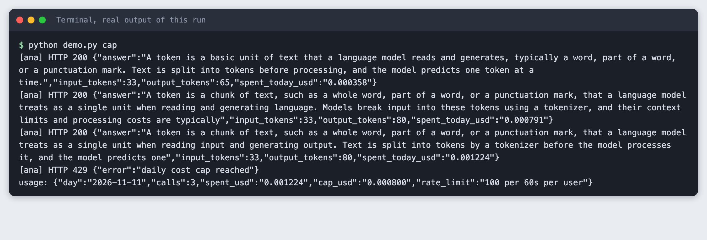
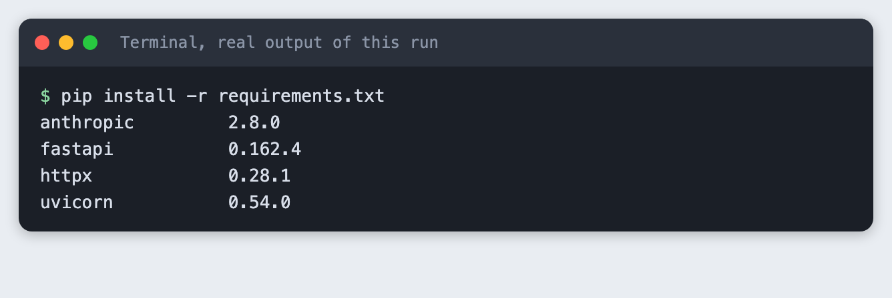
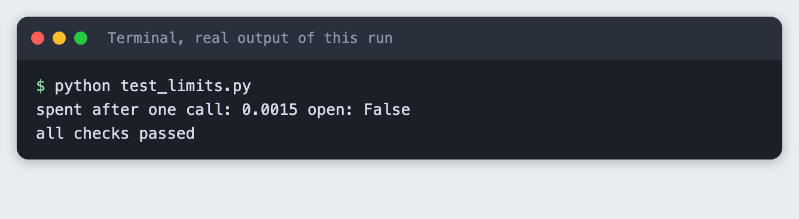
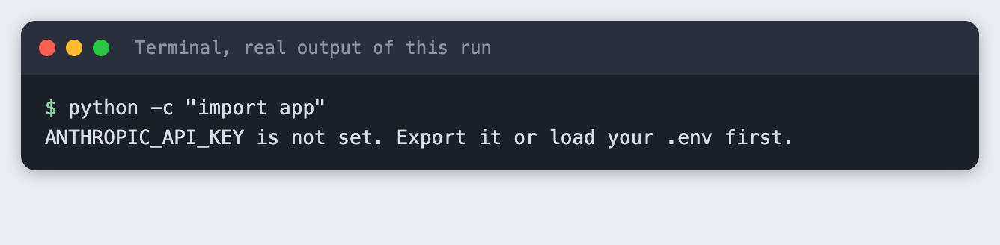
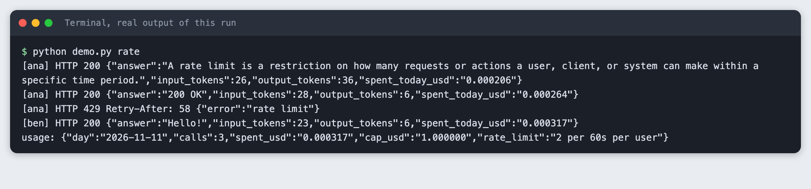
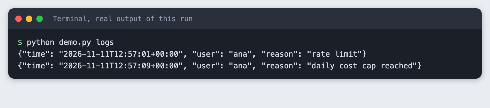
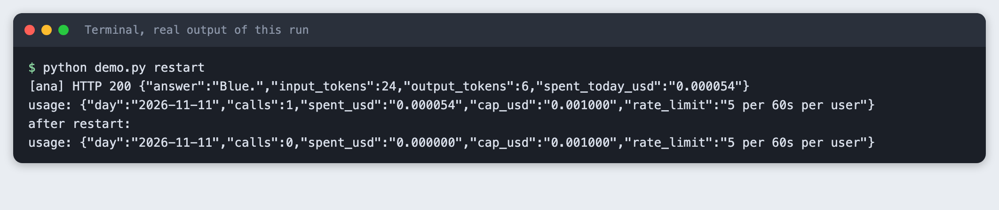
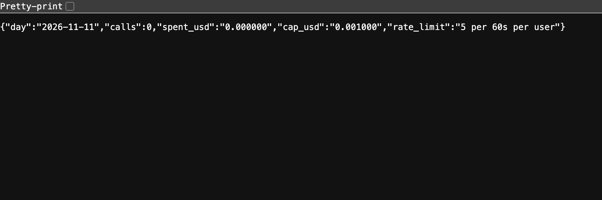

# Add rate limiting and a daily spending cap to an LLM endpoint in Python

You build a FastAPI endpoint that limits how often each user can call a language model, adds up the real cost of each call, and answers with HTTP 429 once a daily cap is reached.

**Time:** about 45 minutes. **Level:** intermediate. **You need:** Python basics, Python 3.10 or newer, and an Anthropic API key. **Tested:** 11 November 2026 with Python 3.14.6, `anthropic` 2.8.0, `fastapi` 0.162.4, `uvicorn` 0.54.0 and `httpx` 0.28.1 on macOS.

Model replies differ from run to run. Your words, token counts and costs will not match the output below exactly. The shape of the output will.

Once an AI hackathon demo link is public, anyone can use it, and a spending cap keeps a surprise bill away. If you are preparing a project, see the [upcoming AI hackathons](/ai-hackathons/).

## Why this matters

A public endpoint that calls a paid API spends your money for every visitor. Two guards cover two different risks. A request limit stops one user from hammering the endpoint. A cost cap stops the total, whoever the callers are. This tutorial builds both, and it ends with a list of what they do not protect against.

## See it running first

This is the cost cap tripping on real calls. The cap in this run is set to $0.0008, a very small number chosen so a few cheap calls reach it. The fourth request gets HTTP 429.



The rest of the tutorial builds it from scratch.

## Step 1: Set up the project

Make a folder, create a virtual environment and activate it.

```bash
python3 -m venv .venv
```


Create `requirements.txt`:

```text
anthropic>=2.7.0
fastapi>=0.115
uvicorn>=0.30
httpx>=0.27
```
*File: `requirements.txt`*

Install it. The output lists the versions used for this tutorial. FastAPI and the other packages installed on Python 3.14.6 without extra steps.

```bash
pip install -r requirements.txt
```



Put your key in a `.env` file from this template, and load it into your terminal with `set -a; source .env; set +a`. Never paste a real key into code or a screenshot.

```
ANTHROPIC_API_KEY=your_key_here
```
*File: `.env.example`*

## Step 2: Write the two guards

The guards live in `limits.py`, apart from the web code, so they can be checked without a server and without an API call.

`RateLimiter` keeps a list of recent request times for each user. A request is allowed if the user has made fewer than `limit` requests in the last `window` seconds. Otherwise it returns how many seconds to wait, which becomes the `Retry-After` header.

`DailyCap` adds up the spend for one UTC day and starts again at zero when the date changes. The cost of a call comes from the token counts the API returns, multiplied by a price. The prices at the top of the file are an assumption: they are example numbers chosen for this tutorial, not published prices. Look up the current prices for your model and change them before you trust any dollar figure.

The cap is checked before a call and the real cost is added after it. So one call can carry the total past the cap. The cap is a stop, not an exact ceiling.

```python
"""Two guards for an LLM endpoint: a per-user request limit and a daily cost cap.

Both keep their counters in memory. They are lost when the process restarts.
"""
import threading
import time
from collections import defaultdict, deque
from datetime import datetime, timezone

# ASSUMPTION: example prices in US dollars per million tokens, chosen for this tutorial.
# They are not published facts. Check the current price list for your model and change them.
EXAMPLE_INPUT_PRICE_PER_MILLION = 1.00
EXAMPLE_OUTPUT_PRICE_PER_MILLION = 5.00


def cost_usd(input_tokens, output_tokens):
    """Cost of one call from the token counts the API returned, at the example prices above."""
    return (input_tokens * EXAMPLE_INPUT_PRICE_PER_MILLION + output_tokens * EXAMPLE_OUTPUT_PRICE_PER_MILLION) / 1_000_000


class RateLimiter:
    """Sliding window: at most `limit` requests per user in the last `window` seconds."""

    def __init__(self, limit, window, clock=time.monotonic):
        self.limit, self.window, self.clock = limit, window, clock
        self.hits = defaultdict(deque)
        self.lock = threading.Lock()

    def allow(self, user):
        """Return 0 if the request is allowed (and count it), else seconds to wait."""
        with self.lock:
            now = self.clock()
            q = self.hits[user]
            while q and now - q[0] >= self.window:
                q.popleft()
            if len(q) >= self.limit:
                return max(1, int(self.window - (now - q[0])) + 1)
            q.append(now)
            return 0


class DailyCap:
    """Total spend per UTC day. The total resets when the date changes."""

    def __init__(self, cap_usd, today=lambda: datetime.now(timezone.utc).date()):
        self.cap_usd, self.today = cap_usd, today
        self.day, self.spent, self.calls = today(), 0.0, 0
        self.lock = threading.Lock()

    def _roll(self):
        if self.today() != self.day:
            self.day, self.spent, self.calls = self.today(), 0.0, 0

    def is_open(self):
        with self.lock:
            self._roll()
            return self.spent < self.cap_usd

    def add(self, amount):
        with self.lock:
            self._roll()
            self.spent += amount
            self.calls += 1
            return self.spent
```
*File: `limits.py`*

## Step 3: Check the guards with fixed numbers

`test_limits.py` uses a fake clock and a fake date. It checks that the third request in a window waits, that another user has its own count, that the window passes, and that a new day resets the total. A test with fixed numbers is a good extra, but it does not replace the real calls later.

```python
"""Checks with fixed numbers and a fake clock. No API call is made."""
from datetime import date

from limits import DailyCap, RateLimiter, cost_usd

now = [0.0]
r = RateLimiter(limit=2, window=60, clock=lambda: now[0])
assert r.allow("a") == 0 and r.allow("a") == 0
assert r.allow("a") > 0, "third request in the window must wait"
assert r.allow("b") == 0, "another user has its own count"
now[0] = 61
assert r.allow("a") == 0, "the window has passed"

day = [date(2026, 1, 1)]
c = DailyCap(0.001, today=lambda: day[0])
assert c.is_open()
c.add(cost_usd(1000, 100))
print("spent after one call:", round(c.spent, 6), "open:", c.is_open())
assert not c.is_open(), "1000 input and 100 output tokens go over $0.001"
day[0] = date(2026, 1, 2)
assert c.is_open() and c.spent == 0, "a new day resets the total"
print("all checks passed")
```
*File: `test_limits.py`*

```bash
python test_limits.py
```



One call of 1000 input tokens and 100 output tokens costs $0.0015 at the example prices, which is over a $0.001 cap.

## Step 4: Build the endpoint

`app.py` has two routes. `POST /ask` sends a question to the model. `GET /usage` shows the counters. The order inside `/ask` matters. The request limit runs first, then the cap check, and only then the paid call, so a blocked request costs nothing.

Settings come from environment variables with small defaults. The user is the `X-User` header, or the client address if the header is missing. Every blocked call is appended to `blocked.log` with the time, the user and the reason.

The call turns thinking off and uses `max_tokens` of 80. In an earlier test with thinking on and a low `max_tokens`, `claude-haiku-5-5` could return only a thinking block and no text. The code also joins only the text blocks and falls back to "(empty reply)", so an empty reply does not crash the endpoint. A reply cut at 80 tokens ends mid-sentence, as the screenshots show.

```python
import json
import os
import sys
from datetime import datetime, timezone
from pathlib import Path

from anthropic import Anthropic
from fastapi import FastAPI, Header, HTTPException, Request
from fastapi.responses import JSONResponse
from pydantic import BaseModel, Field

from limits import DailyCap, RateLimiter, cost_usd

if not os.environ.get("ANTHROPIC_API_KEY"):
    sys.exit("ANTHROPIC_API_KEY is not set. Export it or load your .env first.")

MODEL = os.environ.get("TUTORIAL_MODEL", "claude-haiku-5-5")
MAX_TOKENS = 80
# Very small on purpose, so the tutorial can reach the cap with a few real calls.
RATE_LIMIT = int(os.environ.get("RATE_LIMIT", "5"))        # requests per user per window
RATE_WINDOW = int(os.environ.get("RATE_WINDOW", "60"))     # seconds
DAILY_CAP_USD = float(os.environ.get("DAILY_CAP_USD", "0.001"))
BLOCKED_LOG = Path(os.environ.get("BLOCKED_LOG", Path(__file__).with_name("blocked.log")))

app = FastAPI()
client = Anthropic()
limiter = RateLimiter(RATE_LIMIT, RATE_WINDOW)
cap = DailyCap(DAILY_CAP_USD)


class Question(BaseModel):
    question: str = Field(min_length=1, max_length=500)


def block(user, reason, status, headers=None):
    """Log the blocked call, then answer with the status code the client should see."""
    line = {"time": datetime.now(timezone.utc).isoformat(timespec="seconds"), "user": user, "reason": reason}
    with open(BLOCKED_LOG, "a") as f:
        f.write(json.dumps(line) + "\n")
    return JSONResponse({"error": reason}, status_code=status, headers=headers)


@app.post("/ask")
def ask(body: Question, request: Request, x_user: str | None = Header(default=None)):
    user = x_user or request.client.host
    wait = limiter.allow(user)
    if wait:
        return block(user, "rate limit", 429, {"Retry-After": str(wait)})
    if not cap.is_open():
        return block(user, "daily cost cap reached", 429)

    response = client.messages.create(
        model=MODEL, max_tokens=MAX_TOKENS, thinking={"type": "disabled"},
        system="Answer in one short sentence.",
        messages=[{"role": "user", "content": body.question}],
    )
    spent = cap.add(cost_usd(response.usage.input_tokens, response.usage.output_tokens))
    answer = "".join(b.text for b in response.content if b.type == "text") or "(empty reply)"
    return {"answer": answer, "input_tokens": response.usage.input_tokens,
            "output_tokens": response.usage.output_tokens, "spent_today_usd": f"{spent:.6f}"}


@app.get("/usage")
def usage():
    return {"day": str(cap.day), "calls": cap.calls, "spent_usd": f"{cap.spent:.6f}",
            "cap_usd": f"{cap.cap_usd:.6f}", "rate_limit": f"{RATE_LIMIT} per {RATE_WINDOW}s per user"}
```
*File: `app.py`*

If the key is missing, the app stops at start-up with a clear message. This is what that mistake looks like:

```bash
python -c "import app"
```



## Step 5: Reject over the per-user limit

`demo.py` starts the real server on port 8136 and sends real requests. This run sets the limit to 2 requests per 60 seconds and a high cap, so only the limit can block.

```python
"""Start the real server on port 8136, send real requests, print what a client sees.

Usage: python demo.py rate | cap | restart | logs
"""
import os
import subprocess
import sys
import time
from pathlib import Path

import httpx

PORT = 8136
BASE = f"http://127.0.0.1:{PORT}"
LOG = Path(__file__).with_name("blocked.log")


def start(extra_env):
    env = {**os.environ, **extra_env}
    proc = subprocess.Popen([sys.executable, "-m", "uvicorn", "app:app", "--port", str(PORT), "--log-level", "warning"], env=env)
    for _ in range(60):
        try:
            httpx.get(f"{BASE}/usage", timeout=1)
            return proc
        except httpx.HTTPError:
            time.sleep(0.5)
    proc.terminate()
    sys.exit("server did not start")


def ask(user, question):
    r = httpx.post(f"{BASE}/ask", json={"question": question}, headers={"X-User": user}, timeout=60)
    extra = f" Retry-After: {r.headers['Retry-After']}" if "Retry-After" in r.headers else ""
    print(f"[{user}] HTTP {r.status_code}{extra} {r.text}")
    return r


def usage():
    print("usage:", httpx.get(f"{BASE}/usage").text)


def main():
    mode = sys.argv[1]
    if mode == "logs":
        print(LOG.read_text() if LOG.exists() else "no blocked calls logged")
        return
    if mode == "rate":
        LOG.unlink(missing_ok=True)  # start the blocked-call log fresh
        server = start({"RATE_LIMIT": "2", "RATE_WINDOW": "60", "DAILY_CAP_USD": "1"})
    elif mode == "cap":
        server = start({"RATE_LIMIT": "100", "DAILY_CAP_USD": "0.0008"})
    elif mode == "restart":
        server = start({})
    else:
        sys.exit(__doc__)
    try:
        if mode == "rate":
            for q in ("What is a rate limit?", "Name one HTTP status code.", "Say hello."):
                ask("ana", q)
            ask("ben", "Say hello.")
            usage()
        elif mode == "cap":
            for i in range(10):
                if ask("ana", "In two sentences, what is a token in a language model?").status_code == 429:
                    break
            usage()
        else:
            ask("ana", "Name one colour.")
            usage()
            server.terminate()
            server.wait()
            server = start({})
            print("after restart:")
            usage()
    finally:
        server.terminate()
        server.wait()


main()
```
*File: `demo.py`*

```bash
python demo.py rate
```

```text
[ana] HTTP 200 {"answer":"A rate limit is a restriction on how many requests or actions a user, client, or system can make within a specific time period.","input_tokens":26,"output_tokens":36,"spent_today_usd":"0.000206"}
[ana] HTTP 200 {"answer":"200 OK","input_tokens":28,"output_tokens":6,"spent_today_usd":"0.000264"}
[ana] HTTP 429 Retry-After: 58 {"error":"rate limit"}
[ben] HTTP 200 {"answer":"Hello!","input_tokens":23,"output_tokens":6,"spent_today_usd":"0.000317"}
usage: {"day":"2026-11-11","calls":3,"spent_usd":"0.000317","cap_usd":"1.000000","rate_limit":"2 per 60s per user"}
```



User `ana` gets two answers, then HTTP 429 with `Retry-After: 58` and the body `{"error":"rate limit"}`. User `ben` still gets an answer, because his count is separate. Only three calls reached the model. The counters show 3 calls and a spend of $0.000317.

## Step 6: Stop at the daily cost cap

This run sets the cap to $0.0008 and the request limit high. The same question is asked until the endpoint answers 429. Each answer costs about $0.0004 at the example prices.

```bash
python demo.py cap
```

```text
[ana] HTTP 200 {"answer":"A token is a basic unit of text that a language model reads and generates, typically a word, part of a word, or a punctuation mark. Text is split into tokens before processing, and the model predicts one token at a time.","input_tokens":33,"output_tokens":65,"spent_today_usd":"0.000358"}
[ana] HTTP 200 {"answer":"A token is a chunk of text, such as a whole word, part of a word, or a punctuation mark, that a language model treats as a single unit when reading and generating language. Models break input into these tokens using a tokenizer, and their context limits and processing costs are typically","input_tokens":33,"output_tokens":80,"spent_today_usd":"0.000791"}
[ana] HTTP 200 {"answer":"A token is a chunk of text, such as a whole word, part of a word, or a punctuation mark, that a language model treats as a single unit when reading input and generating output. Text is split into tokens by a tokenizer before the model processes it, and the model predicts one","input_tokens":33,"output_tokens":80,"spent_today_usd":"0.001224"}
[ana] HTTP 429 {"error":"daily cost cap reached"}
usage: {"day":"2026-11-11","calls":3,"spent_usd":"0.001224","cap_usd":"0.000800","rate_limit":"100 per 60s per user"}
```

After the second call the total is $0.000791, just under the cap, so a third call is allowed. It brings the total to $0.001224, which is over the cap. The fourth request gets HTTP 429 with `{"error":"daily cost cap reached"}`. That is the 429 a client sees, and the model is not called for it. The total ended $0.000424 above the cap, which is the one-call overshoot described in Step 2.

## Step 7: Read the blocked-call log

Each block was written to `blocked.log` as one JSON line, so you can count blocked calls and see which user caused them.

```bash
python demo.py logs
```



## Step 8: See a restart wipe the counters

The counters are Python objects in memory. This step makes one call, stops the server, starts it again and reads the usage.

```bash
python demo.py restart
```



Before the restart the usage shows 1 call. After it, 0 calls. A restart gives every user a fresh limit and a fresh cap. Anyone who can crash or redeploy your service resets your protection.

## Step 9: Run the server yourself

Start the server on port 8136 and open the usage page in a browser.

```bash
python -m uvicorn app:app --port 8136
```



A fresh server shows 0 calls, a cap of $0.001000 and the default limit of 5 requests per 60 seconds per user. To make a call yourself, use `curl -X POST http://127.0.0.1:8136/ask -H "Content-Type: application/json" -H "X-User: ana" -d '{"question": "Say hello."}'`.

## Security review: what this does not protect against

This is a teaching example. It is not a complete defence, and it is not security advice for your production system. Have someone review a real deployment.

- **Spoofed users.** The user is a header the client sends. Anyone can change it and get a fresh limit each time. Use a signed-in identity for a real limit.
- **Shared addresses.** Without the header the limit falls back to the client address. People behind one office or school network share it, and one heavy user blocks the others. Behind a proxy, the address you see may be the proxy's.
- **Restarts and several processes.** Counters are in memory. A restart clears them (Step 8). Two copies of the server each keep their own counters, so the real limit is doubled. A shared store such as a database is the usual fix.
- **One call of overshoot.** The cap is checked before the call. Several calls started at the same moment can all pass the check, so the total can go over by more than one call.
- **Prices go stale.** The cost is a calculation from example prices. If the real price is higher, the real spend is higher than the cap says. The cap does not read your provider's bill. Set a spending limit in your provider account as well.
- **Other attacks.** Nothing here covers authentication, abuse of other routes, large request bodies beyond the 500-character question limit, or prompt content. The blocked-call log stores the user name, so treat it as personal data if the names are real.

## Troubleshooting

- **`ANTHROPIC_API_KEY is not set`.** The variable is not in the terminal you are running from. Run the `set -a; source .env; set +a` line again there.
- **`address already in use` on port 8136.** An earlier server is still running. Stop it, or change the port in the command and in `demo.py`.
- **The cap never trips.** Replies are short, so each call costs little. Lower `DAILY_CAP_USD`, or ask a question with a longer answer.
- **The reply is empty.** With thinking on and a low `max_tokens`, a reply can hold only a thinking block. The code here turns thinking off and handles an empty reply.
- **The 429 shows up too early.** The default limit is 5 requests per 60 seconds per user. Raise `RATE_LIMIT` for your own tests.

## Frequently asked questions

**How do I stop people running up my API bill?**

Use two guards. Limit requests per user so one person cannot flood the endpoint, and keep a daily cost total from the token counts the API returns, so the endpoint stops at a set amount. In the test, the cap of $0.0008 stopped the endpoint on the fourth request.

**What limit should a demo have?**

The tutorial did not find a right number, because it depends on your price and your audience. It used 2 requests per minute to show the 429, and a default of 5 per minute. Start low, read the blocked-call log, and raise the limit if real users are blocked.

**How do I log blocked calls?**

Write one line each time you return 429, with the time, the user and the reason. The app does this in `blocked.log`. In the test the log held one rate limit line and one daily cost cap reached line.

## What to try next

- Keep the counters in a database or Redis so a restart does not clear them.
- Limit by signed-in user instead of a header.
- Return the remaining budget in a response header so a client can show it.

## How this tutorial was tested

- Date: 11 November 2026. Python 3.14.6, `anthropic` 2.8.0, `fastapi` 0.162.4, `uvicorn` 0.54.0, `httpx` 0.28.1, macOS. The model is `claude-haiku-5-5`.
- The code in this article is copied from the project files by a script. The output and screenshots come from saved logs of real API calls and a real running server on port 8136.
- Every step was run from a clean folder, then replayed from an empty copy of the folder with no virtual environment. The replay passed. Model replies and costs differed slightly between the two runs (for example the cap run ended at $0.001229 on the replay), as expected.
- A full run makes 7 model calls with at most 80 output tokens each, well under one cent at the example prices.
- Terminal screenshots are rendered from the saved output of the run. They are not captures of a terminal window. The Step 9 screenshot is a real browser capture of the running page.
- The prices in `limits.py` are example numbers, not published prices. They were not checked against a price list.
- Not run: Windows, Linux, Python versions other than 3.14.6, more than one server process, requests from many different addresses, a proxy in front of the server, and a long-running server across a UTC date change (the date reset is checked only with a fake date in `test_limits.py`).

