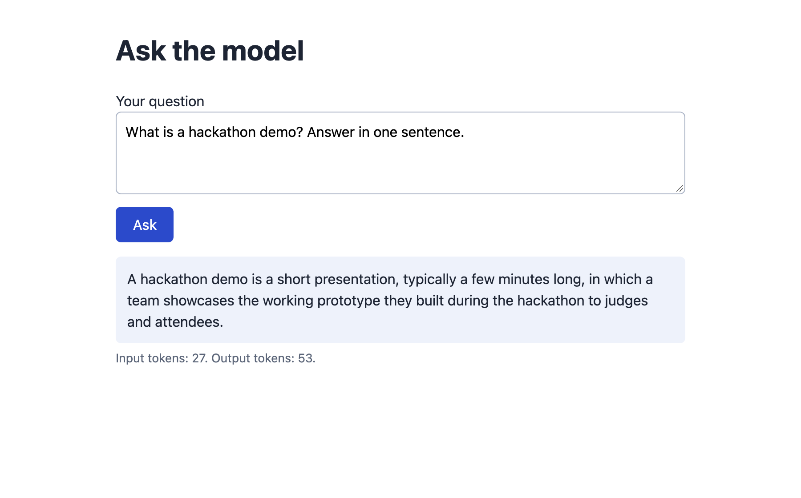
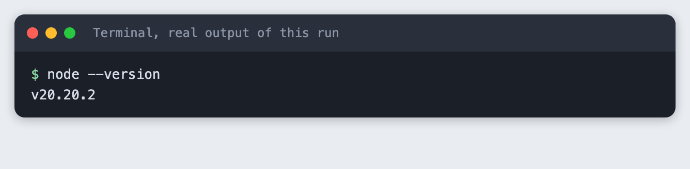
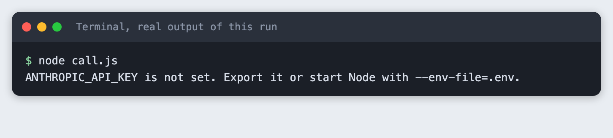
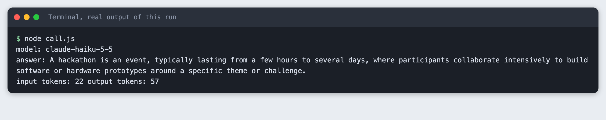
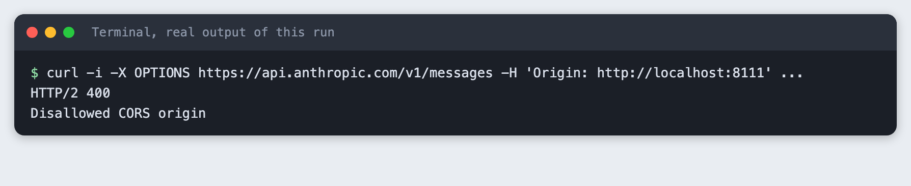
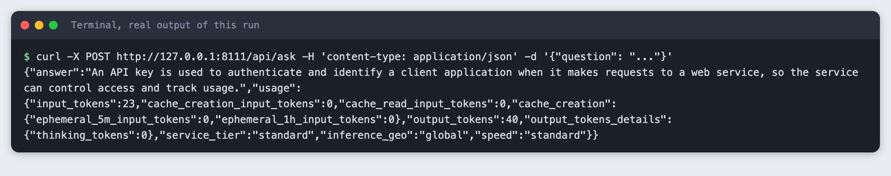
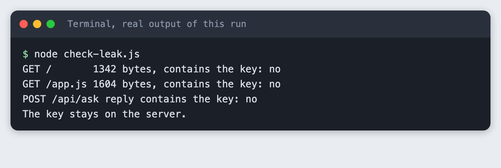
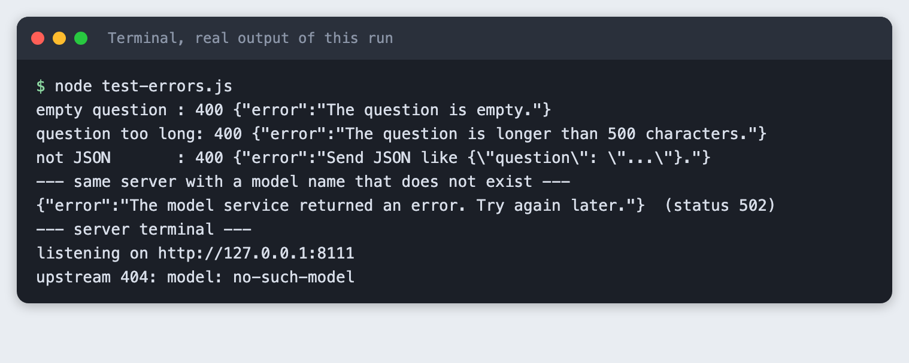

# Call an LLM from JavaScript and show the answer on a web page

You build a small web app: a page with a text box, and a Node server that sends the question to a language model and returns the answer. The API key stays on the server.

**Time:** about 30 minutes. **Level:** beginner. **You need:** basic JavaScript, Node 20.6 or newer, and an Anthropic API key. **Tested:** 11 November 2026 with Node v20.20.2 on macOS. There are no npm packages to install.

Model replies differ from run to run. Your answers and token counts will not match the output below exactly. The shape of the output will.

Many AI hackathon teams build in JavaScript, and a common mistake is putting the API key in the browser. Anyone who opens the page can read it. This tutorial shows the working pattern and a check that proves the key is not in the page. If you plan to enter one, see the [upcoming AI hackathons](/ai-hackathons/).

## Why this matters

Browser code is public. Every file the browser downloads can be read by the person using it, and every request it sends can be copied. A key that sits in that code can be copied too, and whoever has it can make calls that you pay for. The fix is a small server between the page and the API. The page talks to your server, and only your server knows the key.

## See it running first

This is the finished page. The text box was filled and sent by the page itself, and the answer came back through the server.



The rest of the tutorial builds it from scratch.

## Step 1: Make the call from Node

Start in Node, with no page. This shows what a call to the API is: one HTTPS request with the key in a header, and a JSON reply. `fetch` is built into Node 20, so nothing needs installing.

```bash
node --version
```



The key is read from the environment, not written in the code. Copy the placeholder file, put your key in it, and keep it out of version control:

```
ANTHROPIC_API_KEY=your_key_here
```
*File: `.env.example`*

If the variable is missing, the script stops with a clear message. This is what that looks like:



Here is the call. The `MODEL` constant is at the top so you can change it in one place. The reply holds a list of content blocks, so the script joins the ones of type `text`.

```javascript
// Step 1: call the model from Node. The key comes from the environment, not from the code.
const MODEL = process.env.MODEL || "claude-haiku-5-5";

const apiKey = process.env.ANTHROPIC_API_KEY;
if (!apiKey) {
  console.error("ANTHROPIC_API_KEY is not set. Export it or start Node with --env-file=.env.");
  process.exit(1);
}

const response = await fetch("https://api.anthropic.com/v1/messages", {
  method: "POST",
  headers: {
    "content-type": "application/json",
    "x-api-key": apiKey,
    "anthropic-version": "2023-06-01",
  },
  body: JSON.stringify({
    model: MODEL,
    max_tokens: 150,
    messages: [{ role: "user", content: "In one sentence, what is a hackathon?" }],
  }),
});

const data = await response.json();
if (!response.ok) {
  console.error(`The API returned ${response.status}: ${data.error?.message}`);
  process.exit(1);
}

// A reply is a list of blocks. Join the text blocks.
const answer = data.content.filter((b) => b.type === "text").map((b) => b.text).join("");
console.log("model:", data.model);
console.log("answer:", answer);
console.log("input tokens:", data.usage.input_tokens, "output tokens:", data.usage.output_tokens);
```
*File: `call.js`*

Run it with the key loaded from `.env`:

```bash
node --env-file=.env call.js
```



You should see a one-sentence answer. In this run the call used 22 input tokens and 57 output tokens. Yours will differ a little.

## Step 2: See why the browser must not make this call

The obvious next move is to paste the same `fetch` into a script on the page. Do not. The key would be in a file the browser downloads, and anyone could read it in the browser's developer tools.

The API also tells browsers to stay away. A browser sends a preflight request before it makes a call to another site, and the reply decides whether the call goes ahead. This is what the API answered when the request claimed to come from a page on `localhost:8111`:

```bash
curl -i -X OPTIONS https://api.anthropic.com/v1/messages -H 'Origin: http://localhost:8111' ...
```



The reply is `HTTP/2 400` with `Disallowed CORS origin`. A browser would stop here. I did not test whether the API offers a setting that lets browsers through. Even if it does, the key would then sit in the page, which is the problem. The server in the next step avoids it.

## Step 3: Move the key to a small server

The server does four things. It reads the key once at start-up and refuses to run without it. It serves the page. It exposes one endpoint, `POST /api/ask`, that takes a question and returns the answer. It checks the question before it spends a call: it must not be empty and must not be longer than 500 characters. The key is only used inside `ask()`, and it is never sent to the browser.

```javascript
// A small server. It holds the key, serves the page, and exposes one endpoint: POST /api/ask.
import { createServer } from "node:http";
import { readFile } from "node:fs/promises";

const MODEL = process.env.MODEL || "claude-haiku-5-5";
const PORT = Number(process.env.PORT || 8111);
const MAX_QUESTION = 500;

const apiKey = process.env.ANTHROPIC_API_KEY;
if (!apiKey) {
  console.error("ANTHROPIC_API_KEY is not set. Export it or start Node with --env-file=.env.");
  process.exit(1);
}

const FILES = {
  "/": ["index.html", "text/html; charset=utf-8"],
  "/app.js": ["app.js", "text/javascript; charset=utf-8"],
};

function send(res, status, body, type = "application/json") {
  res.writeHead(status, { "content-type": type });
  res.end(typeof body === "string" ? body : JSON.stringify(body));
}

async function readJson(req) {
  let raw = "";
  for await (const chunk of req) {
    raw += chunk;
    if (raw.length > 10_000) throw new Error("body too large");
  }
  return JSON.parse(raw || "{}");
}

async function ask(question) {
  const upstream = await fetch("https://api.anthropic.com/v1/messages", {
    method: "POST",
    headers: {
      "content-type": "application/json",
      "x-api-key": apiKey, // only the server ever sees this
      "anthropic-version": "2023-06-01",
    },
    body: JSON.stringify({
      model: MODEL,
      max_tokens: 200,
      messages: [{ role: "user", content: question }],
    }),
  });
  const data = await upstream.json();
  return { upstream, data };
}

const server = createServer(async (req, res) => {
  const url = new URL(req.url, "http://localhost");

  if (req.method === "GET" && FILES[url.pathname]) {
    const [file, type] = FILES[url.pathname];
    return send(res, 200, await readFile(new URL(file, import.meta.url), "utf8"), type);
  }

  if (req.method === "GET" && url.pathname === "/hold.js") {
    // Only used by the screenshot run, see app.js.
    return setTimeout(() => send(res, 200, "", "text/javascript"), 6000);
  }

  if (req.method === "POST" && url.pathname === "/api/ask") {
    let question;
    try {
      question = String((await readJson(req)).question ?? "").trim();
    } catch {
      return send(res, 400, { error: "Send JSON like {\"question\": \"...\"}." });
    }
    if (!question) return send(res, 400, { error: "The question is empty." });
    if (question.length > MAX_QUESTION) {
      return send(res, 400, { error: `The question is longer than ${MAX_QUESTION} characters.` });
    }
    try {
      const { upstream, data } = await ask(question);
      if (!upstream.ok) {
        // Log the detail on the server. Tell the browser only what it needs.
        console.error(`upstream ${upstream.status}: ${data.error?.message}`);
        return send(res, 502, { error: "The model service returned an error. Try again later." });
      }
      const answer = data.content.filter((b) => b.type === "text").map((b) => b.text).join("");
      return send(res, 200, { answer, usage: data.usage });
    } catch (err) {
      console.error("request failed:", err.message);
      return send(res, 502, { error: "Could not reach the model service." });
    }
  }

  send(res, 404, { error: "Not found." });
});

server.listen(PORT, "127.0.0.1", () => console.log(`listening on http://127.0.0.1:${PORT}`));
```
*File: `server.js`*

Start it:

```bash
node --env-file=.env server.js
```

You should see `listening on http://127.0.0.1:8111`. The server listens on `127.0.0.1`, so only your own machine can reach it. In a second terminal, call the endpoint the way the page will:

```bash
curl -X POST http://127.0.0.1:8111/api/ask -H 'content-type: application/json' -d '{"question": "..."}'
```



The reply has two fields. `answer` is the text. `usage` is what the API reported for the call. In this run it shows 23 input tokens and 40 output tokens.

## Step 4: Check the key is not in the page

Do not take this on trust. `check-leak.js` fetches the two files a browser receives, `/` and `/app.js`, and one reply from the endpoint, and looks for the key in each. It reads the key from the environment and never prints it.

```javascript
// Fetch what a browser would receive and look for the key in it. The key is never printed.
const key = process.env.ANTHROPIC_API_KEY;
if (!key) {
  console.error("ANTHROPIC_API_KEY is not set. Export it or start Node with --env-file=.env.");
  process.exit(1);
}
const base = "http://127.0.0.1:8111";
let leaked = false;
for (const path of ["/", "/app.js"]) {
  const body = await (await fetch(base + path)).text();
  const found = body.includes(key);
  console.log(`GET ${path.padEnd(7)} ${body.length} bytes, contains the key: ${found ? "YES" : "no"}`);
  if (found) leaked = true;
}
const answer = await (await fetch(base + "/api/ask", {
  method: "POST", headers: { "content-type": "application/json" },
  body: JSON.stringify({ question: "Say hello in three words." }),
})).text();
console.log(`POST /api/ask reply contains the key: ${answer.includes(key) ? "YES" : "no"}`);
console.log(leaked ? "LEAK: the key is in the page." : "The key stays on the server.");
process.exit(leaked ? 1 : 0);
```
*File: `check-leak.js`*

With the server running, run it:

```bash
node --env-file=.env check-leak.js
```



All three lines say `no`, and the last line reads `The key stays on the server.` The script exits with an error if it ever finds the key, so you can run it as a check after you change the code.

This covers what the server sends to the browser. It does not cover other places a key can leak, such as a public repository, a log file or a screenshot. Keep `.env` out of git, and do not paste it into chat.

## Step 5: Call the endpoint from the page

The page is a text box, a button and two boxes for the answer and for errors. The browser code sends the question to `/api/ask` on your own server. There is no key in either file.

```html
<!doctype html>
<html lang="en">
<head>
  <meta charset="utf-8">
  <meta name="viewport" content="width=device-width, initial-scale=1">
  <title>Ask the model</title>
  <style>
    body { font: 16px/1.5 system-ui, sans-serif; max-width: 640px; margin: 2rem auto; padding: 0 1rem; color: #1d2433; }
    textarea { width: 100%; box-sizing: border-box; font: inherit; padding: .6rem; border: 1px solid #aab3c5; border-radius: 6px; }
    button { margin-top: .5rem; font: inherit; padding: .5rem 1.2rem; border: 0; border-radius: 6px; background: #2b4acb; color: #fff; cursor: pointer; }
    button:disabled { opacity: .6; cursor: wait; }
    #answer { margin-top: 1rem; padding: .8rem; background: #eef2fb; border-radius: 6px; white-space: pre-wrap; }
    #error { margin-top: 1rem; padding: .8rem; background: #fdecec; color: #8a1c1c; border-radius: 6px; }
    #meta { color: #5b6578; font-size: .85rem; margin-top: .4rem; }
    [hidden] { display: none; }
  </style>
</head>
<body>
  <h1>Ask the model</h1>
  <label for="question">Your question</label>
  <textarea id="question" rows="3" maxlength="500">What is a hackathon demo, in one sentence?</textarea>
  <button id="send">Ask</button>
  <div id="error" role="alert" hidden></div>
  <div id="answer" hidden></div>
  <div id="meta"></div>
  <script src="/app.js"></script>
</body>
</html>
```
*File: `index.html`*

```javascript
// Browser code. It talks to our own server at /api/ask. There is no key anywhere in this file.
const box = document.getElementById("question");
const button = document.getElementById("send");
const answerEl = document.getElementById("answer");
const errorEl = document.getElementById("error");
const metaEl = document.getElementById("meta");

async function ask() {
  errorEl.hidden = true;
  answerEl.hidden = true;
  metaEl.textContent = "";
  button.disabled = true;
  try {
    const res = await fetch("/api/ask", {
      method: "POST",
      headers: { "content-type": "application/json" },
      body: JSON.stringify({ question: box.value }),
    });
    const data = await res.json();
    if (!res.ok) throw new Error(data.error || `Request failed (${res.status})`);
    answerEl.textContent = data.answer;
    answerEl.hidden = false;
    metaEl.textContent = `Input tokens: ${data.usage.input_tokens}. Output tokens: ${data.usage.output_tokens}.`;
  } catch (err) {
    errorEl.textContent = err.message;
    errorEl.hidden = false;
  } finally {
    button.disabled = false;
  }
}

button.addEventListener("click", ask);

// Optional: /?ask=... fills the box and asks once, so a run can be repeated without typing.
const preset = new URLSearchParams(location.search).get("ask");
if (preset) {
  // Only for the screenshot run: a script the server answers after 6 seconds keeps the page
  // "loading", so a tool that captures the page at load time sees the answer.
  document.head.append(Object.assign(document.createElement("script"), { src: "/hold.js" }));
  box.value = preset;
  ask();
}
```
*File: `app.js`*

Open `http://127.0.0.1:8111/`, type a question and press Ask. The button is disabled while the request runs, so a double click does not send two calls.

The `?ask=` part at the end of `app.js` fills the box and asks once when the address has `?ask=...` in it. It makes the run repeatable for the screenshot at the top of this article. The `/hold.js` line next to it keeps the page in a loading state for six seconds. It exists only so a tool that takes a picture of the page at load time waits for the answer. You can delete both from your own copy.

## Step 6: Show errors

Things go wrong in three ways: the person sends something the server will not accept, the model service returns an error, or the network fails. The page should say something useful in each case, and it should not show details that help an attacker or confuse a reader.

The server returns `400` with a short message for a bad question. For a failure on the model side it returns `502` and a general message, and writes the detail to its own log. The page shows whatever `error` text the server sent.

`test-errors.js` sends three bad requests to the running server:

```javascript
// Send three bad requests to the running server and print what the browser would get.
const base = "http://127.0.0.1:8111";
async function post(label, body) {
  const res = await fetch(base + "/api/ask", { method: "POST", headers: { "content-type": "application/json" }, body });
  console.log(`${label}: ${res.status} ${await res.text()}`);
}
await post("empty question ", JSON.stringify({ question: "   " }));
await post("question too long", JSON.stringify({ question: "x".repeat(501) }));
await post("not JSON       ", "this is not json");
```
*File: `test-errors.js`*

The runner then starts the server a second time with `MODEL=no-such-model`, so the API rejects the call. This is a real error from the real API, not a mock.

```bash
node test-errors.js
```



Read the output in two parts. The three bad requests get `400` and a clear message each. The bad model name gets `502` and the message `The model service returned an error. Try again later.` The browser does not see the real reason. The server terminal shows it: `upstream 404: model: no-such-model`. You read the detail on the server and the visitor reads a short message.

## Troubleshooting

- **`ANTHROPIC_API_KEY is not set`.** Node did not load your `.env`. Start it with `node --env-file=.env server.js`. This flag needs Node 20.6 or newer. Run `node --version` to check.
- **The page loads but the answer never appears.** Open the browser's developer tools and look at the Network tab for the `/api/ask` request. A `502` means the server reached the API and the API refused. Read the server terminal for the reason.
- **`address already in use`.** Something else is using port 8111. Stop the other copy of the server, or start this one with `PORT=8112 node --env-file=.env server.js` and open that port instead. `check-leak.js` and `test-errors.js` expect 8111, so edit the `base` address in them if you change the port.
- **The page shows the raw JSON of a file instead of the page.** While building this tutorial the first version of `server.js` did this. `readFile` returns bytes, and `send()` turned them into JSON. The fix is to read the file as text with `"utf8"`, as the code above does.
- **The key is in a file you committed.** Treat it as leaked. Create a new key in your Anthropic account, delete the old one, and keep `.env` out of git.

## Frequently asked questions

**Can I call an LLM API directly from the browser?**

Not as built here, and you should not. The API answered a browser-style preflight request with `HTTP/2 400` and `Disallowed CORS origin`. A key placed in browser code can be read by anyone who opens the page. Use a small server as in Step 3.

**How do I hide an API key in a hackathon web app?**

Keep it on a server, load it from the environment, and send the browser only the answer. The check in Step 4 fetched the page, the script and an endpoint reply, and the key was in none of them. Keep `.env` out of git too.

**Is JavaScript or Python better for an AI hackathon?**

This tutorial did not compare them. It built the server in JavaScript, and the same pattern, with the key held on the server and one endpoint for the page, works in any language. Choose the one your team already knows.

## What to try next

- Add a system prompt on the server so the answers keep a set tone, and a `max_tokens` setting you choose.
- Limit how often one visitor can call `/api/ask`, since each call costs money.
- Stream the answer to the page as it is written, instead of waiting for the whole reply.

## How this tutorial was tested

- Date: 11 November 2026. Node v20.20.2, macOS. No npm packages. The model is `claude-haiku-5-5`, set in the `MODEL` constant.
- The code in this article is copied from the project files by a script. The output and screenshots come from saved logs and a real browser run of real API calls.
- Every step was run from a clean folder, then replayed from an empty copy of the folder. The replay passed. Model replies differed between the two runs, as expected.
- The terminal screenshots are rendered from the saved output of the run. They are not captures of a terminal window. The page screenshot is a real Chrome screenshot of the running page.
- Not run: Windows, Linux, and Node versions other than 20.20.2. The `--env-file` flag is not in older Node versions. Other browsers were not tried. I did not test whether the API has an opt-in for browser calls.

