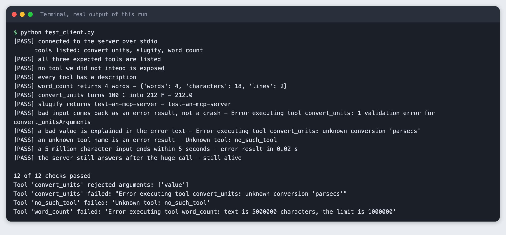
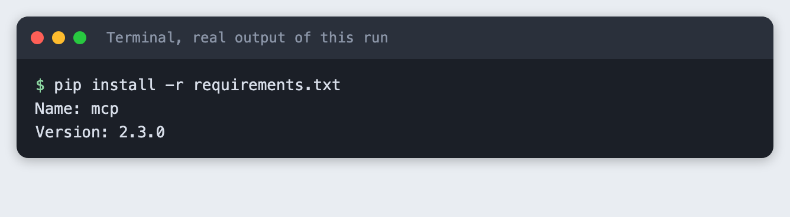
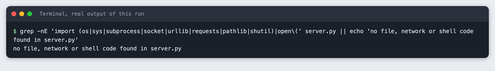
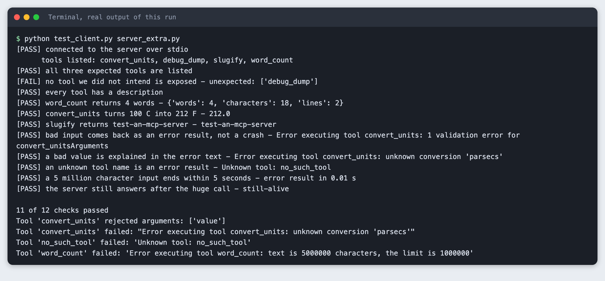

# Test an MCP server with a client before you trust it

You will build a small MCP server in Python, then write a test client that starts it, lists its tools, calls each one, sends bad input, and prints a pass or fail checklist. It takes about 30 minutes and needs no API key.

**Level:** Intermediate. **You need:** Python 3.10 or newer, a terminal and an internet connection for the install. **Tested:** 10 November 2026 on macOS with Python 3.14 and the `mcp` package 2.3.0. The Windows activate command was not run.

An AI hackathon project may expose its tools through an MCP server, and a test client shows whether yours works before demo day. See the [upcoming AI hackathons](/ai-hackathons/) if you want a project to try it on.

## Why test a server with a client

A server that starts without an error may still not work. The only way to know what it offers is to connect to it the way a real program would, ask what it has, and use it. A test client does that the same way every time, and it can check things you would forget by hand: that no extra tool is exposed, that bad input gives a clear error, and that a very large input does not hang the server.

## The terms, in plain words

These are the words used in the SDK's own documentation and code.

- **MCP** is the Model Context Protocol, a standard way for an AI application to ask a program what it can do and to use it.
- A **server** is the program that offers abilities. Ours is `server.py`.
- A **client** is the program that connects to a server and uses what it offers. Ours is `test_client.py`.
- A **tool** is one ability a server offers, such as counting words. The server describes each tool by name, description and input shape.
- A **transport** is the way the two sides exchange messages.
- **stdio** is the transport used here. The client starts the server as a child process and the two talk through the server's standard input and output. There is no port and no network.

One consequence of stdio: the server's standard output carries the protocol, so a stray `print()` in a server can corrupt the conversation. The SDK's documentation says to use the `logging` module, which writes to standard error, instead.

## See it running first

By the end, one command gives you a checklist like this:



The rest of this tutorial builds it from scratch.

## Step 1. Create a project folder and a virtual environment

Make a folder, open a terminal in it, and run:

```bash
python3 -m venv .venv
```


Activate it with `source .venv/bin/activate` on macOS and Linux. Every command below assumes it is active.

## Step 2. Install the MCP SDK

The package is called `mcp` on PyPI. It contains both the server side and the client side, so one install covers the whole tutorial.

```text
mcp>=2.3
```
*File: `requirements.txt`*

```bash
pip install -r requirements.txt
```



This tutorial uses the 2.x names `MCPServer` and `Client`. Earlier releases may use different names, so check the version line above if an import fails.

## Step 3. Write the server

The server has three tools. Each is a plain Python function with type hints. The SDK builds the input description from the hints and the docstring, so you do not write a schema.

The tools are chosen to be safe: they only work on the text or number they are given. None of them reads a file, opens a network connection or runs a command. That matters, because you are about to let a program you wrote run code on request.

Two details came from testing, not from the first draft:

- To send a message the caller can read, raise `ToolError`. The SDK's source code says that nothing from an unexpected exception reaches the client, so a plain `ValueError` reached the client as only "Error executing tool", with no reason. Our first run used `ValueError` and the "bad value" check failed for that reason, so the reason is not hidden by accident: it is how the SDK treats an unexpected exception.
- `word_count` refuses text longer than 1,000,000 characters. A limit you choose gives the caller a clear message.

```python
"""A small MCP server with three safe tools. It reads no files and uses no network or shell."""
from mcp.server import MCPServer
from mcp.server.mcpserver.exceptions import ToolError

MAX_CHARS = 1_000_000

mcp = MCPServer("labs-demo")


@mcp.tool()
def word_count(text: str) -> dict[str, int]:
    """Count the words, characters and lines in a piece of text."""
    if len(text) > MAX_CHARS:
        raise ToolError(f"text is {len(text)} characters, the limit is {MAX_CHARS}")
    return {"words": len(text.split()), "characters": len(text), "lines": len(text.splitlines())}


FACTORS = {"km_to_miles": 0.621371, "miles_to_km": 1.609344, "kg_to_lb": 2.204623, "lb_to_kg": 0.453592}


@mcp.tool()
def convert_units(value: float, conversion: str) -> float:
    """Convert a number. conversion is one of: km_to_miles, miles_to_km, kg_to_lb, lb_to_kg, c_to_f, f_to_c."""
    if conversion == "c_to_f":
        return round(value * 9 / 5 + 32, 2)
    if conversion == "f_to_c":
        return round((value - 32) * 5 / 9, 2)
    if conversion not in FACTORS:
        raise ToolError(f"unknown conversion '{conversion}'")
    return round(value * FACTORS[conversion], 2)


@mcp.tool()
def slugify(title: str) -> str:
    """Turn a title into a lower-case, hyphenated web address part."""
    words = "".join(c.lower() if c.isalnum() else " " for c in title).split()
    return "-".join(words)


if __name__ == "__main__":
    mcp.run()  # stdio is the default transport
```
*File: `server.py`*

`mcp.run()` uses stdio unless you pass another transport. If you run `python server.py` by hand it prints nothing and waits for a client. That is normal.

## Step 4. Check the server file for risky code

A short search is a cheap guard. It does not prove the file is safe, but it catches the common slip of importing something that reaches outside the process.

```bash
grep -nE 'import (os|sys|subprocess|socket|urllib|requests|pathlib|shutil)|open\(' server.py || echo 'no file, network or shell code found in server.py'
```



## Step 5. Write the test client

The client starts the server as a subprocess with `StdioServerParameters`, then connects with `Client`. It uses `sys.executable`, the Python that is running the client, so the server runs in the same virtual environment. Each check prints `PASS` or `FAIL`, and the script exits with 1 if any check fails, so a build system can use it.

The checks cover what the row asks for:

1. The server starts and the client connects.
2. The tool list is exactly the three tools we meant to build.
3. Each tool works on good input.
4. Bad input, a bad value, and an unknown tool name each come back as an error result.
5. A 5 million character input ends within 5 seconds, either by answering or by an error.
6. The server still answers afterwards.

A tool error is not an exception in the client. The SDK's client documentation says a failing tool call returns normally with `is_error` set to true and the message in `content`. So the client checks `is_error` rather than wrapping each call in `try`. The time limit uses `read_timeout_seconds`, and the script also measures how long the call took.

```python
"""Start an MCP server over stdio, connect to it, and print a pass or fail checklist.

Usage: python test_client.py [server_file]
"""
import asyncio
import sys
import time

from mcp import Client, StdioServerParameters

EXPECTED_TOOLS = {"word_count", "convert_units", "slugify"}
TIME_LIMIT = 5.0
results = []


def check(name, ok, detail=""):
    results.append(ok)
    print(f"[{'PASS' if ok else 'FAIL'}] {name}" + (f" - {detail}" if detail else ""))


def text_of(result):
    return " ".join(block.text for block in result.content if block.type == "text")


async def main(server_file):
    params = StdioServerParameters(command=sys.executable, args=[server_file])
    async with Client(params, read_timeout_seconds=TIME_LIMIT) as client:
        check("connected to the server over stdio", True)

        tools = (await client.list_tools()).tools
        names = {t.name for t in tools}
        print("      tools listed:", ", ".join(sorted(names)))
        check("all three expected tools are listed", EXPECTED_TOOLS <= names)
        check("no tool we did not intend is exposed", names <= EXPECTED_TOOLS,
              f"unexpected: {sorted(names - EXPECTED_TOOLS)}" if names - EXPECTED_TOOLS else "")
        check("every tool has a description", all(t.description for t in tools))

        r = await client.call_tool("word_count", {"text": "one two three\nfour"})
        check("word_count returns 4 words", not r.is_error and r.structured_content["words"] == 4,
              str(r.structured_content))

        r = await client.call_tool("convert_units", {"value": 100, "conversion": "c_to_f"})
        check("convert_units turns 100 C into 212 F", not r.is_error and r.structured_content["result"] == 212,
              text_of(r))

        r = await client.call_tool("slugify", {"title": "Test an MCP Server!"})
        check("slugify returns test-an-mcp-server", text_of(r) == "test-an-mcp-server", text_of(r))

        r = await client.call_tool("convert_units", {"value": "abc", "conversion": "c_to_f"})
        check("bad input comes back as an error result, not a crash", r.is_error,
              text_of(r).splitlines()[0])

        r = await client.call_tool("convert_units", {"value": 1, "conversion": "parsecs"})
        check("a bad value is explained in the error text", r.is_error and "unknown conversion" in text_of(r),
              text_of(r))

        r = await client.call_tool("no_such_tool", {})
        check("an unknown tool name is an error result", r.is_error, text_of(r))

        start = time.monotonic()
        try:
            r = await client.call_tool("word_count", {"text": "x " * 2_500_000})
            outcome = "error result" if r.is_error else "answered"
        except TimeoutError:
            outcome = "timed out"
        took = time.monotonic() - start
        check(f"a 5 million character input ends within {TIME_LIMIT:.0f} seconds", took < TIME_LIMIT,
              f"{outcome} in {took:.2f} s")

        r = await client.call_tool("slugify", {"title": "Still alive"})
        check("the server still answers after the huge call", text_of(r) == "still-alive", text_of(r))


try:
    asyncio.run(main(sys.argv[1] if len(sys.argv) > 1 else "server.py"))
except Exception as exc:
    while hasattr(exc, "exceptions"):
        exc = exc.exceptions[0]
    check("the run finished without an exception", False, f"{type(exc).__name__}: {exc}")

print(f"\n{sum(results)} of {len(results)} checks passed")
sys.exit(0 if all(results) else 1)
```
*File: `test_client.py`*

## Step 6. Run the checklist

```bash
python test_client.py
```


All 12 checks passed. Three things to read in that output.

- The bad-input check shows the SDK's own message for a wrong type: one validation error for `convert_unitsArguments`. The model or program that called the tool can read it and fix its next call.
- The 5 million character call came back as an error result in 0.02 seconds. The server refused it before doing any work, and the error text names the limit of 1000000.
- The four `Tool ... failed` lines at the end are the server's own log lines. They go to standard error, not into the protocol, and they appear after the checklist in this saved log. Timings and exact wording can differ on your machine.

## Step 7. See what a failure looks like

A test is only useful if it can fail. `server_extra.py` is the same server with one extra tool, `debug_dump`, that someone left in by mistake.

```python
"""The same server plus one tool nobody planned. Used to show the client catching it."""
from server import mcp


@mcp.tool()
def debug_dump() -> str:
    """Left in by mistake."""
    return "internal state"


if __name__ == "__main__":
    mcp.run()
```
*File: `server_extra.py`*

```bash
python test_client.py server_extra.py
```



The tool list now shows four tools, the unexpected-tool check fails by name, and the result is 11 of 12 checks passed with exit code 1. Every other check still passes, which is why the list check is separate: nothing else would have noticed.

## Troubleshooting

**The bad-value check fails and the error says only "Error executing tool".** The tool raised an ordinary exception such as `ValueError`. Raise `ToolError` with a message when you want the caller to see the reason.

**`ImportError: cannot import name 'MCPServer'`.** You may have an older `mcp` release, since this tutorial was written against 2.3.0. Run `pip install -U -r requirements.txt` and check the version.

**The client behaves oddly or fails after connecting.** Look for a `print()` in the server. Standard output is the protocol channel and a stray print can corrupt it, so use `logging` or `print(..., file=sys.stderr)`.

**The test crashes with a long `ExceptionGroup`.** Python raises an `ExceptionGroup` when several tasks fail together. The script unwraps the first one and prints it as a failed check, so you see the underlying error.

## Frequently asked questions

**What is an MCP server in a hackathon project?**

MCP is the Model Context Protocol, a standard way for an AI application to ask a program what it can do and to use it. The server in this tutorial offers three tools and talks to the client over stdio.

**How do I test an MCP server?**

Write a client that starts the server, lists its tools, calls each one, sends bad input and sends a very large input. In this tutorial all 12 checks passed. With one extra `debug_dump` tool added, 11 of 12 passed and the script exited with code 1.

**Is it safe to connect an unknown MCP server?**

Not tested here. The tutorial tested only its own server, whose three tools do not read files, open network connections or run commands. Read the tool list of any server before you connect to it.

## What to try next

- Add a check that every tool's input description lists the arguments you expect.
- Start the server with `mcp.run(transport="streamable-http")` and point `Client` at its URL. The same checks should pass over a different transport.
- Run the test client in your build system and fail the build on a non-zero exit.

## How this tutorial was tested

Run on 10 November 2026 on macOS with Python 3.14 and `mcp` 2.3.0. The code in this article is copied from the project files, and the commands and output are the saved results of real runs, not typed by hand. All steps were run from a clean state and again from an empty copy of the folder, and passed both times. The step in Step 7 is meant to exit with code 1.

The images are terminal-style pictures rendered from the saved output of each run. They are not captures of a terminal window.

Not run: Windows and Linux, the SDK's own inspector (`mcp dev`, which is documented as opening the server in the MCP Inspector, a browser tool; we did not try it, and it was left out so the tutorial needs no extra tools or logins), and the HTTP transports.

