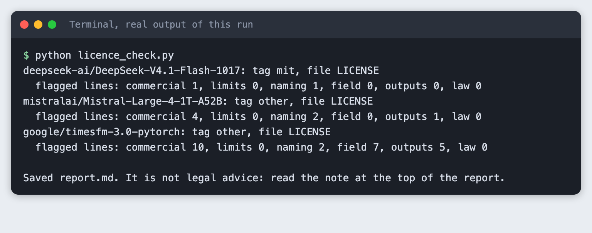
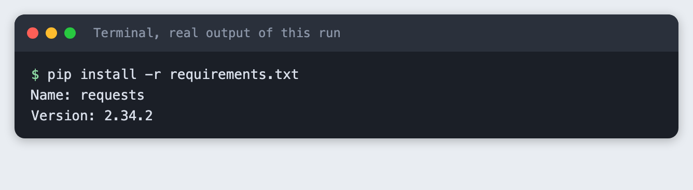
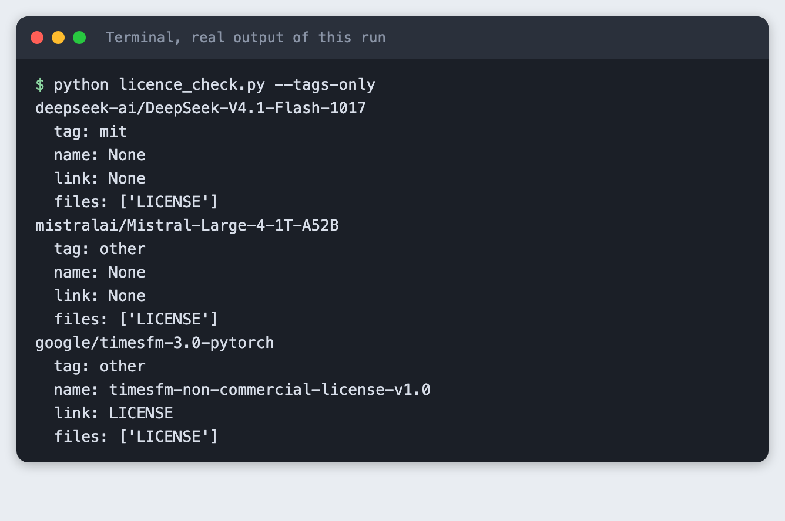
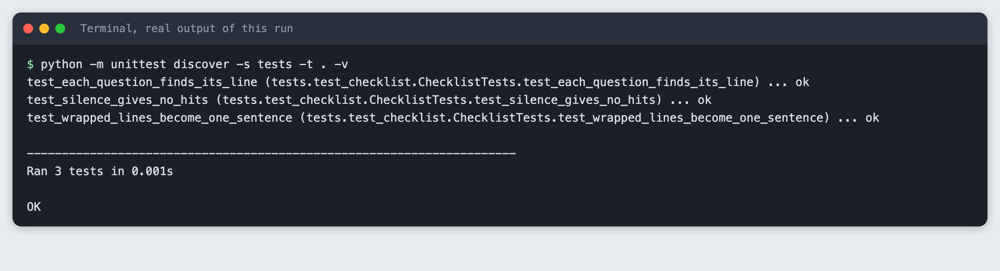
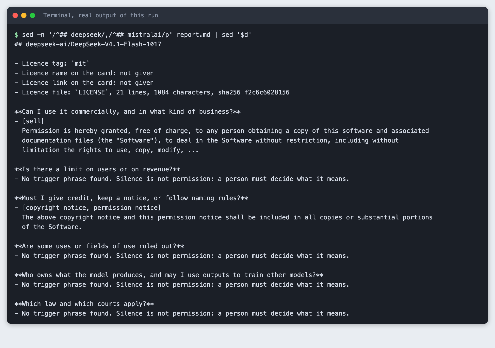
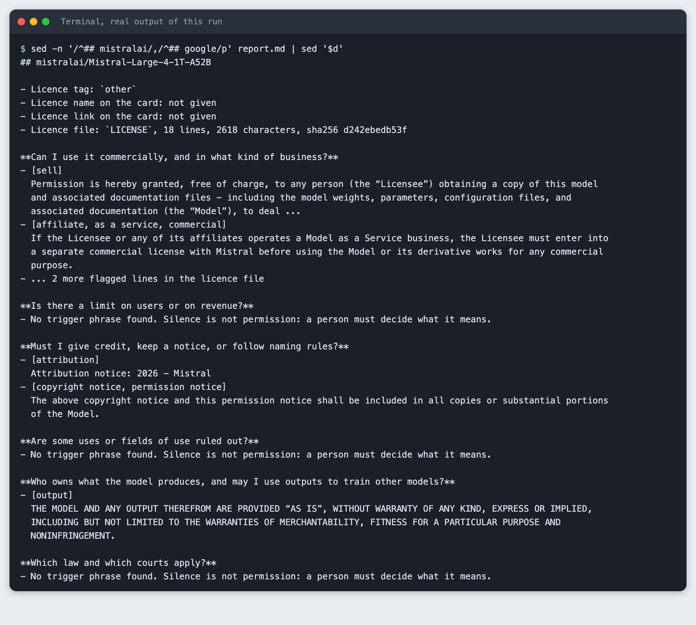
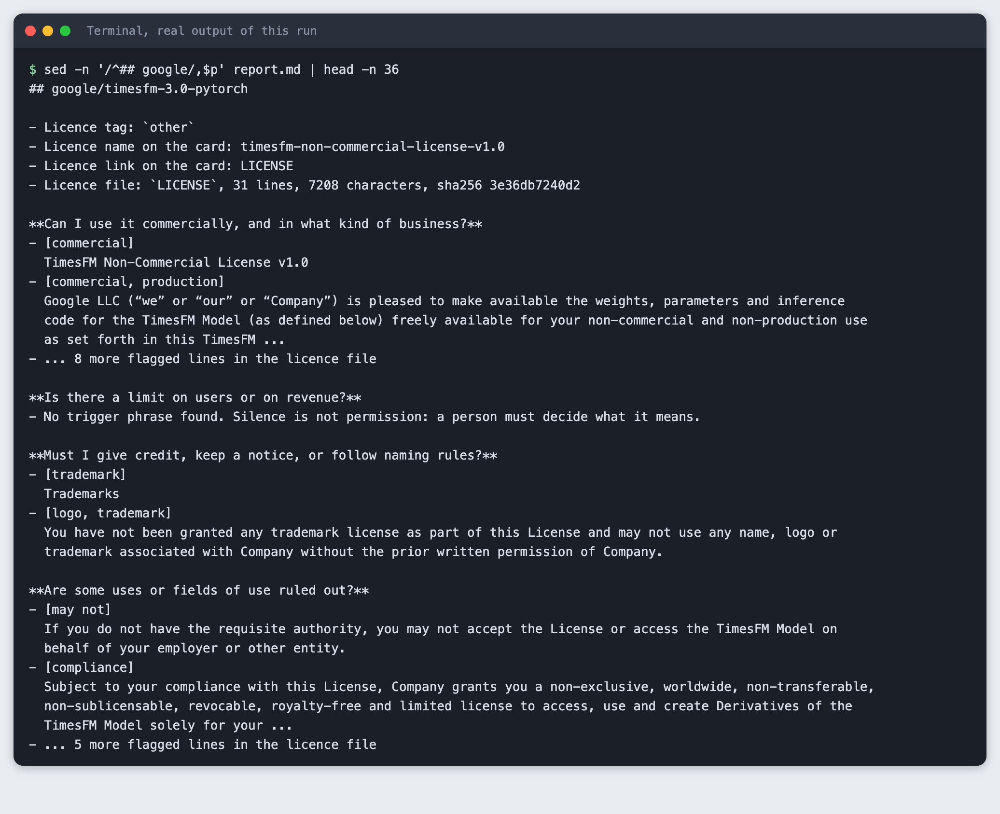
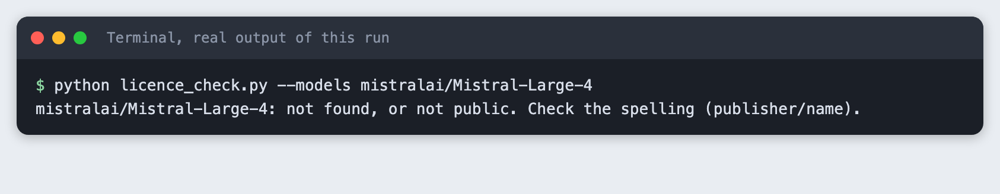

# Check a model's licence with a script and a checklist

You will build a Python script that reads the licence field of public Hugging Face models, fetches each licence file, flags the lines that bear on six checklist questions, and saves a short report. It takes about 40 minutes and needs no account and no API key.

**Important:** the script marks text for a person to read. It does not tell you whether you may use a model, and it is not legal advice. Get a lawyer's view before you rely on a licence.

**Level:** Beginner. **You need:** Python 3.10 or newer, a terminal and an internet connection. **Tested:** 10 November 2026 on macOS with Python 3.14 and `requests` 2.34.2. The Windows activate command was not run.

Before you build an AI hackathon project on a model, check its licence, because some licences limit commercial use or require a credit. Then see the [upcoming AI hackathons](/ai-hackathons/) and pick one to build for.

## Why a licence tag is not enough

Every model page on Hugging Face has a licence tag. For some models the tag is a standard name such as `mit`. For others it is just `other`, which tells you only that the terms are custom and live in a file. Two models with the tag `other` can have very different terms. This tutorial checks three real models and shows how far a tag gets you and where you have to read.

The three models, from three publishers, are `deepseek-ai/DeepSeek-V4.1-Flash-1017` (tag `mit`), `mistralai/Mistral-Large-4-1T-A52B` (tag `other`) and `google/timesfm-3.0-pytorch` (tag `other`). We chose them on 10 November 2026 to cover a plain tag and two custom ones. Licences and files can change, so check the current files before you rely on anything here.

## See it running first

By the end, one command checks all three models and saves a report:



The numbers in the screenshot are the number of licence sentences that contain a trigger phrase for each question. A high number is not a bad sign and a low number is not a good one. The rest of this tutorial builds the script from scratch.

## Step 1. Create a virtual environment

Make a project folder, open a terminal in it, and run:

```bash
python3 -m venv .venv
```


Activate it with `source .venv/bin/activate` on macOS and Linux. Every command below assumes it is active.

## Step 2. Install requests

```text
requests>=2.31
```
*File: `requirements.txt`*

```bash
pip install -r requirements.txt
```



## Step 3. Read the licence fields from the public API

The Hub's public API gives a model's record at `https://huggingface.co/api/models/<publisher>/<name>`. It needs no token for public models. The record has a list of tags (one looks like `license:mit`), the card data (which may name the licence and link to it), and the list of files in the repository. A raw file can be read from `https://huggingface.co/<publisher>/<name>/raw/main/<file>`. The Hub redirects this address to its cache, and `requests` follows the redirect.

The code sends a User-Agent that says who is calling, pauses one second after every call, caps a file at 200,000 characters, and stops on HTTP 429 (too many requests). The Hub answers HTTP 401 for a model name that does not exist, so the code treats 401 and 404 the same way.

```python
"""Read public model metadata and raw files from Hugging Face. No token."""
import time

import requests

HEADERS = {"User-Agent": "starfield-labs-tutorial/1.0"}
PAUSE = 1.0  # seconds between calls
MAX_CHARS = 200_000


class NotFound(Exception):
    pass


def _get(url):
    response = requests.get(url, headers=HEADERS, timeout=30)
    time.sleep(PAUSE)
    if response.status_code in (401, 404):  # the Hub answers 401 for a name that does not exist
        raise NotFound(url)
    if response.status_code == 429:
        raise SystemExit("Rate limited by Hugging Face. Wait a few minutes and try again.")
    response.raise_for_status()
    return response


def model_info(model_id):
    """The model's public record: tags, card data and the list of files."""
    return _get(f"https://huggingface.co/api/models/{model_id}").json()


def raw_file(model_id, filename):
    """Text of one file on the main branch (the Hub redirects to its cache; requests follows)."""
    return _get(f"https://huggingface.co/{model_id}/raw/main/{filename}").text[:MAX_CHARS]
```
*File: `hfapi.py`*

The models to check go in a text file:

```text
# One Hugging Face model id per line: publisher/name
deepseek-ai/DeepSeek-V4.1-Flash-1017
mistralai/Mistral-Large-4-1T-A52B
google/timesfm-3.0-pytorch
```
*File: `models.txt`*

## Step 4. Look at the tags, the names and the files

Here is the first half of `licence_check.py` in use. The `--tags-only` option prints the licence fields and stops.

```bash
python licence_check.py --tags-only
```



The tags are `mit` for DeepSeek and `other` for the other two. Only Google's card gives a licence name (`timesfm-non-commercial-license-v1.0`) and a link. Mistral's card gives neither, so for that model the file is the only place to learn the terms. All three repositories have a file called `LICENSE`.

## Step 5. Write the checklist

The checklist is six questions a person must answer. Each has a pattern of trigger phrases. A sentence that matches is shown to the reader. The patterns are deliberately broad, so expect lines that match for the wrong reason.

```python
"""The checklist: six questions a person must answer, and phrases that point to lines worth reading.

A phrase match means "read this line". It does not mean the licence allows or forbids anything.
"""
import re

CHECKLIST = [
    ("commercial", "Can I use it commercially, and in what kind of business?",
     r"commercial|production|revenue|\bsell\b|royalt|\bfees?\b|as a service|affiliate"),
    ("limits", "Is there a limit on users or on revenue?",
     r"monthly active|\bMAU\b|\d[\d,.]*\s*(million|billion)|annual (revenue|income)|more than \d|exceed|threshold"),
    ("naming", "Must I give credit, keep a notice, or follow naming rules?",
     r"attribution|copyright notice|permission notice|include a copy|built with|\bprefix|trademark|\blogo\b"),
    ("field", "Are some uses or fields of use ruled out?",
     r"acceptable use|prohibit|may not|will not|must not|\bnot use\b|military|weapon|illegal|\bharm|export|comply|compliance"),
    ("outputs", "Who owns what the model produces, and may I use outputs to train other models?",
     r"\boutputs?\b|generated by|results? generated"),
    ("law", "Which law and which courts apply?",
     r"governed by|governing law|jurisdiction|laws of the|courts? of|arbitration|\bvenue\b"),
]


def sentences(text):
    """Split licence text into sentence-sized lines so that wrapped paragraphs read as one line."""
    found = []
    for paragraph in re.split(r"\n\s*\n|\n(?=[A-Z“\"])", text):
        flat = re.sub(r"\s+", " ", paragraph).strip()
        found += [s.strip() for s in re.split(r"(?<=[.;:])\s+(?=[A-Z“\"(])", flat) if s.strip()]
    return found


def run_checklist(text):
    """For each question, the sentences that contain a trigger phrase and the phrases found."""
    lines = sentences(text)
    result = {}
    for key, _question, pattern in CHECKLIST:
        rx = re.compile(pattern, re.I)
        hits = []
        for line in lines:
            phrases = sorted({m.group(0).lower() for m in rx.finditer(line)})
            if phrases:
                hits.append((line, phrases))
        result[key] = hits
    return result
```
*File: `checklist.py`*

Licence files wrap lines in the middle of sentences, so the code first joins each paragraph and splits it into sentences. Unit tests on fixed text check this and check that silence gives no hits. The text in the test is invented, not taken from any licence.

```python
import unittest

from checklist import run_checklist, sentences

SAMPLE = """Example Licence v1.

You may use the Model for non-commercial research only. Companies with more than 700 million monthly
active users must ask us for a licence. You must keep this copyright notice. This agreement is governed by
the laws of Ruritania."""


class ChecklistTests(unittest.TestCase):
    def test_wrapped_lines_become_one_sentence(self):
        self.assertIn("Companies with more than 700 million monthly active users must ask us for a licence.", sentences(SAMPLE))

    def test_each_question_finds_its_line(self):
        result = run_checklist(SAMPLE)
        self.assertTrue(any("non-commercial" in line for line, _ in result["commercial"]))
        self.assertTrue(any("700 million" in line for line, _ in result["limits"]))
        self.assertTrue(any("copyright notice" in line for line, _ in result["naming"]))
        self.assertTrue(any("Ruritania" in line for line, _ in result["law"]))

    def test_silence_gives_no_hits(self):
        self.assertEqual(run_checklist(SAMPLE)["outputs"], [])


if __name__ == "__main__":
    unittest.main()
```
*File: `tests/test_checklist.py`*

```bash
python -m unittest discover -s tests -t . -v
```



## Step 6. Write the script that fetches, checks and reports

For each model the script reads the licence fields, fetches the first licence file it finds, runs the checklist and adds a section to `report.md`. It shows at most two lines per question and truncates long ones, with a count of the rest. A question with no match says "Silence is not permission". That sentence is there because a licence that does not mention outputs, or law, or limits, has not answered the question.

```python
"""Pull a model's licence field, fetch its licence file, run the checklist and save a short report."""
import argparse
import hashlib
import sys
import textwrap
from pathlib import Path

from checklist import CHECKLIST, run_checklist
from hfapi import NotFound, model_info, raw_file

NOTE = ("This report marks lines of licence text for a person to read. It is not legal advice and it does not say "
        "whether you may use a model. Get a lawyer's view before you rely on a licence.")
SHOW = 2      # lines shown per question
WIDTH = 260   # characters per line


def read_models(path):
    lines = Path(path).read_text().splitlines()
    return [line.strip() for line in lines if line.strip() and not line.startswith("#")]


def licence_fields(info):
    """The licence tag, plus the name and link the model card may give."""
    tag = next((t.split(":", 1)[1] for t in info.get("tags", []) if t.startswith("license:")), "none")
    card = info.get("cardData") or {}
    files = [s["rfilename"] for s in info.get("siblings", []) if s["rfilename"].upper().startswith(("LICENSE", "LICENCE"))]
    return {"tag": tag, "name": card.get("license_name"), "link": card.get("license_link"), "files": files}


def short(line):
    return line if len(line) <= WIDTH else line[:WIDTH].rsplit(" ", 1)[0] + " ..."


def check_model(model_id):
    info = model_info(model_id)
    fields = licence_fields(info)
    text = raw_file(model_id, fields["files"][0]) if fields["files"] else ""
    return fields, text


def report_section(model_id, fields, text):
    out = [f"## {model_id}", "",
           f"- Licence tag: `{fields['tag']}`",
           f"- Licence name on the card: {fields['name'] or 'not given'}",
           f"- Licence link on the card: {fields['link'] or 'not given'}"]
    if not text:
        out += ["- Licence file: none found in this repository. Read the model card and any link above.", ""]
        return out
    digest = hashlib.sha256(text.encode()).hexdigest()[:12]
    out += [f"- Licence file: `{fields['files'][0]}`, {len(text.splitlines())} lines, {len(text)} characters, sha256 {digest}", ""]
    result = run_checklist(text)
    for key, question, _ in CHECKLIST:
        hits = result[key]
        out.append(f"**{question}**")
        if not hits:
            out.append("- No trigger phrase found. Silence is not permission: a person must decide what it means.")
        for line, phrases in hits[:SHOW]:
            out.append(f"- [{', '.join(phrases)}]")
            out += textwrap.wrap(short(line), 112, initial_indent="  ", subsequent_indent="  ")
        if len(hits) > SHOW:
            out.append(f"- ... {len(hits) - SHOW} more flagged lines in the licence file")
        out.append("")
    return out


def main():
    ap = argparse.ArgumentParser()
    ap.add_argument("--models", nargs="*", help="model ids; default is models.txt")
    ap.add_argument("--tags-only", action="store_true", help="print the licence fields and stop")
    ap.add_argument("--report", default="report.md")
    args = ap.parse_args()

    report = ["# Licence check report", "", NOTE, ""]
    for model_id in args.models or read_models("models.txt"):
        try:
            fields, text = check_model(model_id)
        except NotFound:
            print(f"{model_id}: not found, or not public. Check the spelling (publisher/name).")
            return 2
        if args.tags_only:
            print(f"{model_id}\n  tag: {fields['tag']}\n  name: {fields['name']}\n  link: {fields['link']}\n  files: {fields['files']}")
            continue
        counts = {k: len(v) for k, v in run_checklist(text).items()}
        print(f"{model_id}: tag {fields['tag']}, file {fields['files'][0] if fields['files'] else 'none'}")
        print("  flagged lines: " + ", ".join(f"{k} {v}" for k, v in counts.items()))
        report += report_section(model_id, fields, text)
    if not args.tags_only:
        Path(args.report).write_text("\n".join(report) + "\n")
        print(f"\nSaved {args.report}. It is not legal advice: read the note at the top of the report.")
    return 0


if __name__ == "__main__":
    sys.exit(main())
```
*File: `licence_check.py`*

## Step 7. Run it

```bash
python licence_check.py
```

The three counts to compare are the lines for `commercial`: 1 for DeepSeek, 4 for Mistral and 10 for Google. The question for `limits` found nothing in any of the three files, and neither did `law`. For Google, `field` found 7 and `outputs` found 5. The script ends by saying again that the report is not legal advice.

## Step 8. Read the report: the plain tag

The report is a text file. This is the section for DeepSeek, whose tag is `mit`. The licence file is 21 lines and 1,084 characters.

```bash
sed -n '/^## deepseek/,/^## mistralai/p' report.md | sed '$d'
```



Two sentences are flagged. The first matched the word "sell" in the grant. The second says the copyright and permission notice must be included in copies. The other four questions have no match. For this model the checklist is short because the file is short, but a person still has to decide what "no match" means for outputs, law and limits.

## Step 9. Read the report: a custom tag with a business-model condition

Now the Mistral section. The tag is `other`, the file is 18 lines and 2,618 characters, and the licence names itself in its first line.

```bash
sed -n '/^## mistralai/,/^## google/p' report.md | sed '$d'
```



The flagged sentence under the commercial question is the one to read slowly. It says that a licensee, or an affiliate of the licensee, that operates a Model as a Service business must enter into a separate commercial licence with Mistral before using the model or its derivative works for any commercial purpose. It is the kind of condition a tag cannot show. Whether it applies to your product, and what "Model as a Service" covers, is for a person to decide, and the file defines that phrase in its own words.

The line under outputs matched the word "output" in a warranty disclaimer, not in a clause about who owns outputs. That is a false positive, and it shows why the script prints the sentence and not just a yes or a no. The file has no sentence the script flagged for outputs ownership, so a person must decide what that silence means.

## Step 10. Read the report: a custom tag with a non-commercial name

Last, the first 36 lines of Google's section. The licence name on the card says non-commercial, and the file is 31 lines and 7,208 characters. Only the start of the report is shown, because the full section is longer.

```bash
sed -n '/^## google/,$p' report.md | head -n 36
```



Eight more commercial lines and five more field-of-use lines are in the report file and not in this screenshot. Some matches are noise. The sentence flagged for "compliance" is the grant itself. Read the licence file for what the terms mean.

The three reports show the difference between three models that look similar at a glance. A tag of `mit` came with a short file with a copyright notice condition. The two `other` tags led to a file with a condition on one kind of business and a file whose name says non-commercial. You would not have known either from the tag.

## Step 11. What a mistake looks like

A model name that does not exist stops the script with exit code 2:

```bash
python licence_check.py --models mistralai/Mistral-Large-4
```



The message says "not found, or not public" because the Hub gives the same answer for both. Check the spelling, `publisher/name`.

## The checklist for a person

After the script, a person answers these, with the licence file open:

1. Commercial use: is it allowed for my kind of product and my kind of business?
2. User or revenue limits: is there a threshold above which I need another licence?
3. Attribution and naming: what notice must I keep, and may I use the publisher's name or logo?
4. Field of use: are any uses ruled out, or does an acceptable use policy apply?
5. Outputs: who owns what the model produces, and may I use it to train another model?
6. Law and courts: which law governs, and where would a dispute go?

Then get a lawyer's view before you rely on the answers. The script cannot do that step, and neither can this tutorial.

## Troubleshooting

- **"not found, or not public".** Check the spelling. The name in the page address is the one to use.
- **No licence file found.** Some repositories have no `LICENSE` file and point to a link on the card instead. The script says so and does not follow links to other sites. Read the link yourself.
- **A gated or private model.** The script uses no token, so it can only read public records.
- **A match that has nothing to do with the question.** The patterns are broad. Read the sentence, not just the label.

## Frequently asked questions

**Can I use any open model in an AI hackathon?**

No. The tutorial checked three models. DeepSeek's tag was `mit`, with a short file that asks you to keep the copyright notice. The Mistral file asks a Model as a Service business to get a separate commercial licence, and the Google licence name says non-commercial. Read the file for each model.

**What does a custom model licence mean?**

A tag of `other` tells you only that the terms are custom and live in a file. Two models with the tag `other` had different terms in this tutorial.

**Do I need a lawyer to read a model licence?**

Not tested here. The script only marks text for a person to read. It is not legal advice, and a lawyer did not review the licences in this tutorial. Get a lawyer's view before you rely on a licence.

## What to try next

- Add a pattern for a question your company asks, such as data retention.
- Check the model card (`README.md`) as well as the licence file, since some publishers put terms there.
- Compare the sha256 value in the report on a later date to see whether a licence file changed.

## How this tutorial was tested

The code on this page is copied from the project files by a script, and every output and image comes from real runs on 10 November 2026 on macOS with Python 3.14. All steps ran from a clean state and were replayed from an empty copy of the folder. The calls to the Hub's public API and raw files were real and used no key.

The screenshots of terminal steps are rendered from the saved output of each command. They are not captures of a terminal window, because this Mac blocks desktop screen capture for this tool.

Not run: Windows and Linux, and a model that has no licence file. Licence text in the screenshots belongs to its publishers and is shown as short excerpts for illustration. The licences were not reviewed by a lawyer.

