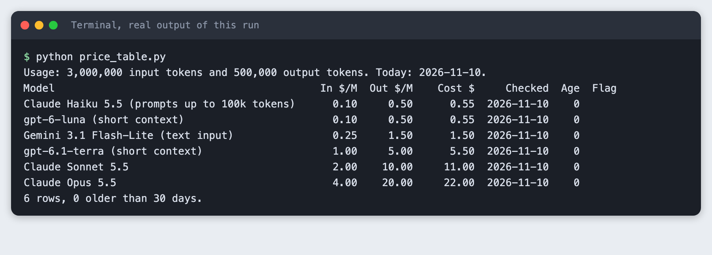
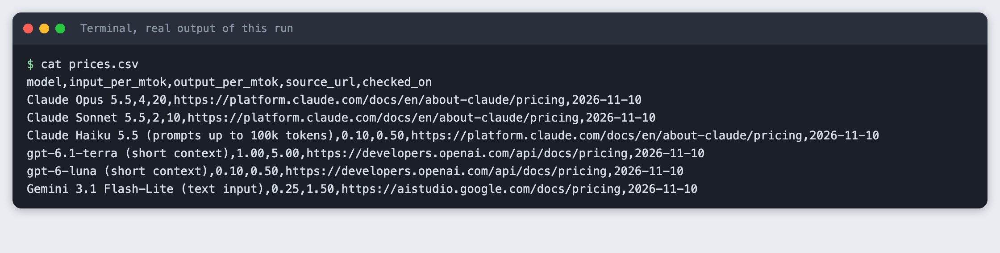
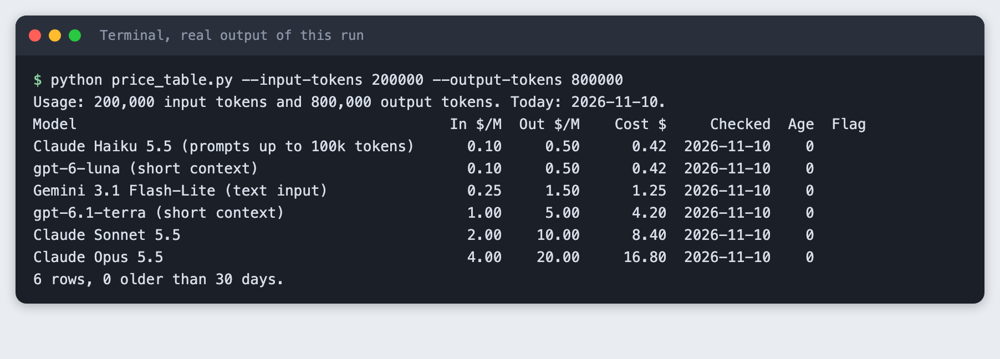
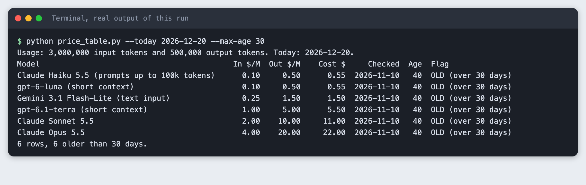
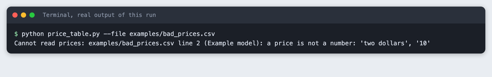
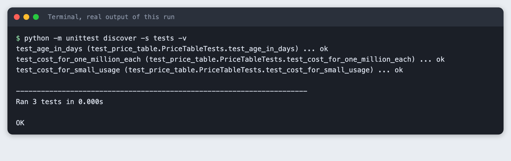

# Build a model price table from public price lists

You will build a small Python tool that reads a price file you keep by hand, works out what your usage would cost on each model, prints a table and flags prices that have gone stale. It takes about 40 minutes and needs no API key.

**Level:** Intermediate. **You need:** Python 3.10 or newer and a terminal. **Tested:** 10 November 2026 on macOS with Python 3.14.6. The tool uses only the Python standard library. The Windows activate command was not run.

Credits can run out quickly in an AI hackathon, so a price table helps you pick a model your budget can carry. See the [upcoming AI hackathons](/ai-hackathons/) if you want a project to use it on.

## Why keep the file by hand

Provider price pages change, and they list many variants of each model. A tool that scrapes them breaks quietly. A short file you edit yourself is slower to update, but every number in it has a link and a date, so anyone can check it. The tool's job is the arithmetic and a warning when a row is old.

## See it running first

By the end the tool prints a table like this:



The prices are the ones we read on 10 November 2026. Prices change, so yours will differ if you read the pages on another day. The rest of this tutorial builds the tool from scratch.

## Step 1. Create a virtual environment

Make a folder, open a terminal in it, and run:

```bash
python3 -m venv .venv
```


Activate it with `source .venv/bin/activate` on macOS and Linux. Every command below assumes it is active. The tool needs no packages, so there is no `requirements.txt`.

## Step 2. Make the price file

One row per model and price. The columns are the model name, dollars per million input tokens, dollars per million output tokens, the address of the page where you read the price, and the date you read it.

We read each price on the provider's own public pricing page on 10 November 2026, one page at a time, and copied the number. We chose six models from three providers. We left out any model whose price we could not read on the provider's page. Two notes on what the numbers mean:

- Some models have more than one price. Claude Haiku 5.5 costs more for prompts over 100,000 tokens, and the gpt-6 models have a long-context price. The name in the first column says which price the row holds.
- The Gemini 3.1 Flash-Lite page lists a text, image and video input price and a separate audio price. The row holds the text price.

Cached input, batch and other discounts are not in the file.

```
model,input_per_mtok,output_per_mtok,source_url,checked_on
Claude Opus 5.5,4,20,https://platform.claude.com/docs/en/about-claude/pricing,2026-11-10
Claude Sonnet 5.5,2,10,https://platform.claude.com/docs/en/about-claude/pricing,2026-11-10
Claude Haiku 5.5 (prompts up to 100k tokens),0.10,0.50,https://platform.claude.com/docs/en/about-claude/pricing,2026-11-10
gpt-6.1-terra (short context),1.00,5.00,https://developers.openai.com/api/docs/pricing,2026-11-10
gpt-6-luna (short context),0.10,0.50,https://developers.openai.com/api/docs/pricing,2026-11-10
Gemini 3.1 Flash-Lite (text input),0.25,1.50,https://aistudio.google.com/docs/pricing,2026-11-10
```
*File: `prices.csv`*

```bash
cat prices.csv
```



The OpenAI address is `developers.openai.com`. The older `openai.com/api/pricing` address refused our request with an error 403, so we did not use it. The Google address `ai.google.dev/gemini-api/docs/pricing` forwards to `aistudio.google.com/docs/pricing`, and the file uses the page it forwards to.

## Step 3. Load the file and compute a cost

Money needs exact decimals, so the code uses Python's `Decimal` and not floats. The loader checks every row and stops with the line number if something is wrong. The cost is `input price x input tokens / 1,000,000` plus the same for output.

```python
"""Load prices.csv, cost a usage you choose, print a table, flag old rows."""
import argparse
import csv
import sys
from datetime import date
from decimal import Decimal, InvalidOperation

COLUMNS = ["model", "input_per_mtok", "output_per_mtok", "source_url", "checked_on"]


def load_prices(path):
    """Read the CSV into a list of dicts with real numbers and a real date."""
    rows = []
    with open(path, newline="", encoding="utf-8") as f:
        reader = csv.DictReader(f)
        missing = [c for c in COLUMNS if c not in (reader.fieldnames or [])]
        if missing:
            raise ValueError(f"{path}: missing column(s): {', '.join(missing)}")
        for n, row in enumerate(reader, start=2):  # line 1 is the header
            try:
                rows.append({
                    "model": row["model"].strip(),
                    "input": Decimal(row["input_per_mtok"]),
                    "output": Decimal(row["output_per_mtok"]),
                    "source_url": row["source_url"].strip(),
                    "checked_on": date.fromisoformat(row["checked_on"].strip()),
                })
            except InvalidOperation:
                raise ValueError(f"{path} line {n} ({row['model']}): a price is not a number: "
                                 f"{row['input_per_mtok']!r}, {row['output_per_mtok']!r}") from None
            except ValueError as err:
                raise ValueError(f"{path} line {n} ({row['model']}): {err}") from None
            if not rows[-1]["source_url"].startswith("https://"):
                raise ValueError(f"{path} line {n} ({row['model']}): source_url must start with https://")
    return rows


def cost(row, input_tokens, output_tokens):
    """Dollars for this usage. Prices are per million tokens."""
    million = Decimal(1_000_000)
    return row["input"] * Decimal(input_tokens) / million + row["output"] * Decimal(output_tokens) / million


def age_days(row, today):
    return (today - row["checked_on"]).days


def render(rows, input_tokens, output_tokens, max_age, today):
    lines = [f"Usage: {input_tokens:,} input tokens and {output_tokens:,} output tokens. Today: {today}.",
             f"{'Model':<46}{'In $/M':>8}{'Out $/M':>9}{'Cost $':>10}{'Checked':>12}{'Age':>5}  Flag"]
    for row in sorted(rows, key=lambda r: cost(r, input_tokens, output_tokens)):
        age = age_days(row, today)
        flag = f"OLD (over {max_age} days)" if age > max_age else ""
        lines.append(f"{row['model']:<46}{row['input']:>8.2f}{row['output']:>9.2f}"
                     f"{cost(row, input_tokens, output_tokens):>10.2f}{row['checked_on'].isoformat():>12}{age:>5}  {flag}".rstrip())
    old = sum(1 for r in rows if age_days(r, today) > max_age)
    lines.append(f"{len(rows)} rows, {old} older than {max_age} days.")
    return "\n".join(lines)


def main():
    p = argparse.ArgumentParser(description=__doc__)
    p.add_argument("--file", default="prices.csv")
    p.add_argument("--input-tokens", type=int, default=3_000_000, help="input tokens you use")
    p.add_argument("--output-tokens", type=int, default=500_000, help="output tokens you use")
    p.add_argument("--max-age", type=int, default=30, help="flag rows checked more than this many days ago")
    p.add_argument("--today", type=date.fromisoformat, default=date.today(), help="pretend today is YYYY-MM-DD")
    a = p.parse_args()
    try:
        rows = load_prices(a.file)
    except (OSError, ValueError) as err:
        print(f"Cannot read prices: {err}", file=sys.stderr)
        sys.exit(1)
    print(render(rows, a.input_tokens, a.output_tokens, a.max_age, a.today))


if __name__ == "__main__":
    main()
```
*File: `price_table.py`*

Run it with the default usage of 3,000,000 input tokens and 500,000 output tokens:

```bash
python price_table.py
```

The table is sorted by cost, lowest first. Check one row by hand. Claude Sonnet 5.5 costs $2 per million input tokens and $10 per million output tokens: 3 x 2 + 0.5 x 10 = 6 + 5 = $11.00. The table says 11.00. The age is 0 days for every row because we read every price today.

Two rows come out at the same cost, 0.55, because their prices match.

## Step 4. Use your own numbers

Your usage is not ours. Pass your own token counts:

```bash
python price_table.py --input-tokens 200000 --output-tokens 800000
```



The order stays the same here, but the costs change: Claude Sonnet 5.5 comes to 8.40 and Claude Opus 5.5 to 16.80. Output tokens cost more than input tokens on every row, so a usage with more output costs more per token.

## Step 5. Flag old rows

A price you read two months ago may be wrong now. The tool compares each `checked_on` date with today and marks rows older than `--max-age` days, 30 by default. Nothing is old yet, so to see the flag we tell the tool to pretend today is 20 December 2026. That is a test of the flag, not a real date.

```bash
python price_table.py --today 2026-12-20 --max-age 30
```



All six rows are 40 days old and all six are flagged. A flagged row is a reminder to open the source address, read the price again, and change the date in the file.

## Step 6. See what a mistake looks like

A typo in the price file should stop the tool, not produce a wrong table. This file has the words "two dollars" where a number belongs:

```
model,input_per_mtok,output_per_mtok,source_url,checked_on
Example model,two dollars,10,https://example.com/pricing,2026-11-10
```
*File: `examples/bad_prices.csv`*

```bash
python price_table.py --file examples/bad_prices.csv
```



The tool exits with code 1 and names the file, the line and the model. The same happens for a missing column, a bad date, or a source address that does not start with `https://`.

## Step 7. Check the sum on fixed numbers

The prices in the file change over time, so a check on them would break. This check uses fixed numbers that are not real prices, so it always gives the same answer:

```python
import unittest
from datetime import date
from decimal import Decimal

from price_table import age_days, cost

ROW = {"model": "Example", "input": Decimal("2"), "output": Decimal("10"), "checked_on": date(2026, 10, 1)}


class PriceTableTests(unittest.TestCase):
    def test_cost_for_one_million_each(self):
        self.assertEqual(cost(ROW, 1_000_000, 1_000_000), Decimal("12"))

    def test_cost_for_small_usage(self):
        self.assertEqual(cost(ROW, 500_000, 100_000), Decimal("2"))

    def test_age_in_days(self):
        self.assertEqual(age_days(ROW, date(2026, 10, 31)), 30)


if __name__ == "__main__":
    unittest.main()
```
*File: `tests/test_price_table.py`*

```bash
python -m unittest discover -s tests -v
```



Three checks ran and passed.

## Troubleshooting

**The costs look ten times too small.** The prices are per million tokens. Enter token counts, not millions: `--input-tokens 3000000`, not 3.

**`Cannot read prices ... line 2`.** The message names the line. Open the file at that line. A comma inside a model name splits the row, so put quotes around names that contain a comma.

**Nothing is flagged.** The flag needs a `checked_on` date older than `--max-age`. Try `--max-age 0` to see rows read before today.

## Frequently asked questions

**How do I compare model prices for a hackathon?**

Keep a price file with a source link and a date on every row, enter your expected token counts, and let the tool work out the cost. With 3,000,000 input tokens and 500,000 output tokens, Claude Sonnet 5.5 at $2 and $10 per million comes to $11.00.

**Where do I find model prices?**

Read them on the provider's own public pricing page. This tutorial read six models from three providers on 10 November 2026 and saved the page address next to each price.

**How often do model prices change?**

Not tested here. The prices were read on one day only. Prices do change, which is why the tool flags any row older than 30 days by default.

## What to try next

- Add a column for the date a price page last changed, if the provider shows one.
- Write the table to a CSV with `csv.writer` so you can open it in a spreadsheet.
- Add a second usage and print both costs side by side.

## How this tutorial was tested

Tested on 10 November 2026 on macOS 26 with Python 3.14.6. The code and commands are copied from the project files and the saved run, not retyped. The steps were replayed from an empty copy of the project folder, and all seven passed.

The prices were read with a web fetch tool that returns a summary of each public page, one page per provider. The OpenAI and Google rows were read a second time with a request for the exact table text. The Anthropic rows were checked against the full table text the fetch returned. Check each price against its source address on the day you publish or use it.

The terminal images are rendered from the saved output of each command, with the label "real output of this run". They are not captures of a terminal window, because this Mac does not allow desktop capture for the tool.

Not run: Windows, Linux, and the `--max-age 0` tip. The flag step uses a pretend date. Any output that shows today's date or age depends on the day you run it.

