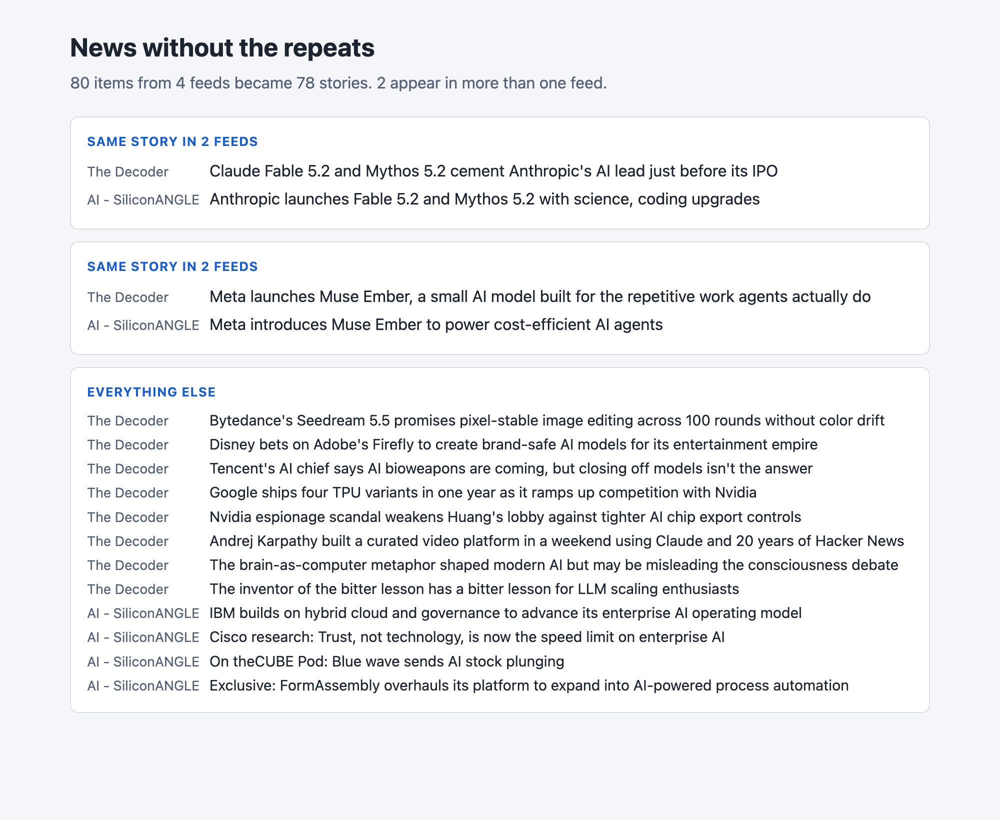
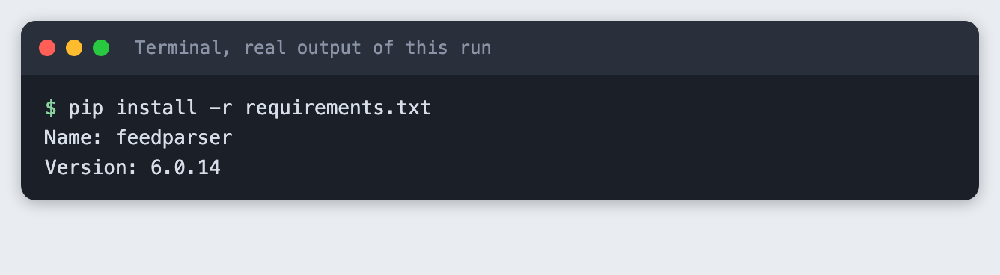
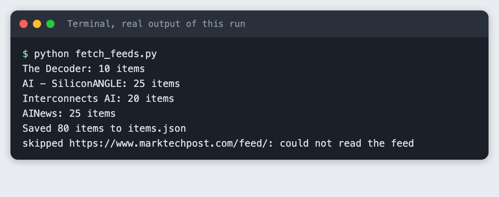
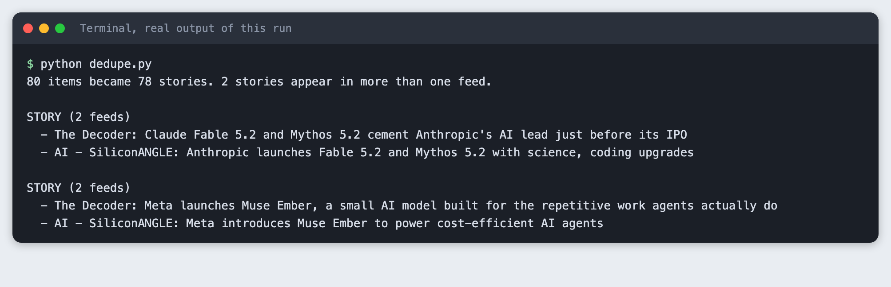
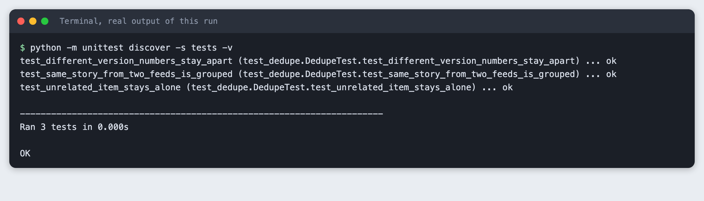

# Remove duplicate stories from many news feeds

You will build a small Python tool that reads several public news feeds, finds headlines about the same story, and shows the result on a local web page. It takes about 45 minutes and needs no API key.

**Level:** Intermediate. **You need:** Python 3.10 or newer, a terminal, an internet connection and a browser. **Tested:** 10 November 2026 on macOS with Python 3.14 and `feedparser` 6.0.14. The Windows activate command was not run.

A feed reader that shows each story once is a small project you can finish in an AI hackathon, with a demo anyone understands. See the [upcoming AI hackathons](/ai-hackathons/) for a place to build it.

## Why remove repeats

When five outlets cover the same model release, a feed reader shows you five items. You want one, with the other four as extra reading. Doing this by headline needs no AI model. It needs a clear rule for "same story", and a way to check that the rule works.

## See it running first

By the end the tool shows a page like this:



The headlines in the screenshot are from the feeds on 10 November 2026. Yours will be different, because feeds change every day. The rest of this tutorial builds the tool from scratch.

## Step 1. Create a project folder and a virtual environment

Make a folder, open a terminal in it, and run:

```bash
python3 -m venv .venv
```


Activate it with `source .venv/bin/activate` on macOS and Linux. Every command below assumes it is active.

## Step 2. Install feedparser

`feedparser` reads RSS and Atom feeds, the public lists of recent posts that most news sites publish. It is the only package this project needs.

```text
feedparser>=6.0
```
*File: `requirements.txt`*

```bash
pip install -r requirements.txt
```



## Step 3. Read the feeds

Put one feed address per line in `feeds.txt`. These are public feeds that publishers offer for exactly this use:

```text
https://the-decoder.com/feed/
https://www.marktechpost.com/feed/
https://siliconangle.com/category/ai/feed/
https://www.interconnects.ai/feed
https://news.smol.ai/rss.xml
```
*File: `feeds.txt`*

The script below reads each feed, keeps the 25 newest items from it, and saves only the source name, title, link and date. It does not download the articles themselves. If a feed cannot be read, it prints a `skipped` line and carries on, so one broken feed does not stop the run.

```python
import json
import sys
from pathlib import Path

import feedparser

MAX_PER_FEED = 25


def main() -> int:
    urls = [u.strip() for u in Path("feeds.txt").read_text().splitlines() if u.strip()]
    items = []
    for url in urls:
        feed = feedparser.parse(url, agent="labs-tutorial-news-dedupe/1.0")
        if feed.bozo and not feed.entries:
            print(f"skipped {url}: could not read the feed", file=sys.stderr)
            continue
        source = feed.feed.get("title", url)
        for entry in feed.entries[:MAX_PER_FEED]:
            items.append({"source": source, "title": entry.get("title", "").strip(),
                          "link": entry.get("link", ""), "published": entry.get("published", "")})
        print(f"{source}: {min(len(feed.entries), MAX_PER_FEED)} items")
    Path("items.json").write_text(json.dumps(items, indent=2), encoding="utf-8")
    print(f"Saved {len(items)} items to items.json")
    return 0 if items else 1


if __name__ == "__main__":
    sys.exit(main())
```
*File: `fetch_feeds.py`*

```bash
python fetch_feeds.py
```



Four feeds worked and gave 80 items. The MarkTechPost feed could not be read, so the script skipped it. We do not know why, and we did not try to get around it. The tool is built to cope with a feed it cannot read. Leave the line in `feeds.txt` to see the skip, or remove it.

## Step 4. Group headlines about the same story

Two headlines about one story rarely share many words. "Meta launches Muse Ember, a small AI model built for the repetitive work agents actually do" and "Meta introduces Muse Ember to power cost-efficient AI agents" share only a few. The rule here is simple:

1. Lower-case each headline and keep its words, without small words such as "the" and "of".
2. Score two headlines by the share of their words they have in common.
3. Group headlines from different feeds when the score is 0.25 or higher.

One more rule matters. If both headlines contain version numbers and none match, they are never grouped. In our first run, a headline about version 5.1 scored the same 0.25 against a headline about 5.2. That is two different releases, not one story.

```python
import json
import re
import sys
from pathlib import Path

STOPWORDS = {"a", "an", "and", "as", "at", "for", "from", "in", "into", "is", "it", "of", "on", "or",
             "the", "to", "with", "new", "its", "how", "what", "this", "that", "by", "your"}
THRESHOLD = 0.25


def words(title: str) -> set[str]:
    found = re.findall(r"[a-z0-9.]+", title.lower())
    return {w.strip(".") for w in found if w.strip(".") not in STOPWORDS and len(w.strip(".")) > 1}


def versions(a: set[str]) -> set[str]:
    return {w for w in a if any(ch.isdigit() for ch in w)}


def similarity(a: set[str], b: set[str]) -> float:
    if not a or not b:
        return 0.0
    if versions(a) and versions(b) and not versions(a) & versions(b):
        return 0.0
    return len(a & b) / len(a | b)


def group(items: list[dict], threshold: float = THRESHOLD) -> list[list[dict]]:
    parent = list(range(len(items)))

    def find(i: int) -> int:
        while parent[i] != i:
            parent[i] = parent[parent[i]]
            i = parent[i]
        return i

    sets = [words(item["title"]) for item in items]
    for i in range(len(items)):
        for j in range(i + 1, len(items)):
            if items[i]["source"] != items[j]["source"] and similarity(sets[i], sets[j]) >= threshold:
                parent[find(j)] = find(i)
    groups: dict[int, list[dict]] = {}
    for i, item in enumerate(items):
        groups.setdefault(find(i), []).append(item)
    return sorted(groups.values(), key=len, reverse=True)


def main() -> int:
    items = json.loads(Path("items.json").read_text())
    groups = group(items)
    repeated = [g for g in groups if len(g) > 1]
    print(f"{len(items)} items became {len(groups)} stories. {len(repeated)} stories appear in more than one feed.\n")
    for g in repeated:
        print(f"STORY ({len(g)} feeds)")
        for item in g:
            print(f"  - {item['source']}: {item['title']}")
        print()
    return 0


if __name__ == "__main__":
    sys.exit(main())
```
*File: `dedupe.py`*

The threshold is 0.25 because we tried 0.5 first and it found nothing: every pair of real headlines scored below 0.3. Pick the number by looking at real pairs, not by guessing.

Run it:

```bash
python dedupe.py
```



On this run 80 items became 78 stories, and two stories appeared in two feeds each. Both groups are correct. One is Anthropic's Fable 5.2 and Mythos 5.2 release. The other is Meta's Muse Ember.

## Step 5. Test the rule on fixed headlines

Live feeds change, so they make a poor test. A test with fixed headlines gives the same answer every time. These three checks cover the cases that matter: a repeated story is grouped, two different versions stay apart, and an unrelated item stays alone.

```python
import sys
import unittest
from pathlib import Path

sys.path.insert(0, str(Path(__file__).resolve().parent.parent))
from dedupe import group

ITEMS = [
    {"source": "Feed A", "title": "Meta launches Muse Ember, a small AI model built for the real world"},
    {"source": "Feed B", "title": "Meta introduces Muse Ember to power cost-efficient AI agents"},
    {"source": "Feed A", "title": "Acme releases Atlas 2.0 with a longer context window"},
    {"source": "Feed B", "title": "Acme releases Atlas 1.0 with a longer context window"},
    {"source": "Feed C", "title": "A weekly reading list on open models"},
]


class DedupeTest(unittest.TestCase):
    def setUp(self):
        self.groups = group(ITEMS)
        self.titles = [{i["title"] for i in g} for g in self.groups]

    def test_same_story_from_two_feeds_is_grouped(self):
        self.assertTrue(any(len(t) == 2 and ITEMS[0]["title"] in t and ITEMS[1]["title"] in t for t in self.titles))

    def test_different_version_numbers_stay_apart(self):
        for t in self.titles:
            self.assertFalse(ITEMS[2]["title"] in t and ITEMS[3]["title"] in t)

    def test_unrelated_item_stays_alone(self):
        self.assertIn({ITEMS[4]["title"]}, self.titles)


if __name__ == "__main__":
    unittest.main(verbosity=2)
```
*File: `tests/test_dedupe.py`*

```bash
python -m unittest discover -s tests -v
```



Run these tests every time you change the threshold or the word list.

## Step 6. Show the groups on a web page

The last script uses only Python's standard library. It reads `items.json`, groups the headlines, and serves a page at `http://127.0.0.1:8011/`. Repeated stories come first. Each headline links to the publisher's own page.

```python
import json
from html import escape
from http.server import BaseHTTPRequestHandler, HTTPServer
from pathlib import Path

from dedupe import group

PORT = 8011
STYLE = """
body{font:16px/1.5 system-ui,sans-serif;margin:0;background:#f4f6f9;color:#1c2430}
main{max-width:860px;margin:0 auto;padding:28px 20px}
h1{font-size:1.6rem;margin:0 0 4px} .sub{color:#566275;margin:0 0 22px}
.story{background:#fff;border:1px solid #d8dee7;border-radius:8px;padding:14px 16px;margin:0 0 12px}
.story h2{font-size:.8rem;text-transform:uppercase;letter-spacing:.05em;color:#1f5fbf;margin:0 0 8px}
.story a{display:block;color:#1c2430;text-decoration:none;margin:4px 0}
.story a span{display:inline-block;min-width:9em;color:#566275;font-size:.85rem}
.single a{margin:2px 0;font-size:.92rem}
"""


def page() -> str:
    items = json.loads(Path("items.json").read_text())
    groups = group(items)
    repeated = [g for g in groups if len(g) > 1]
    singles = [g[0] for g in groups if len(g) == 1]
    out = [f"<style>{STYLE}</style><main><h1>News without the repeats</h1>",
           f"<p class='sub'>{len(items)} items from {len({i['source'] for i in items})} feeds became {len(groups)} stories. "
           f"{len(repeated)} appear in more than one feed.</p>"]
    for g in repeated:
        links = "".join(f"<a href='{escape(i['link'])}'><span>{escape(i['source'])}</span>{escape(i['title'])}</a>" for i in g)
        out.append(f"<div class='story'><h2>Same story in {len(g)} feeds</h2>{links}</div>")
    out.append("<div class='story single'><h2>Everything else</h2>")
    out += [f"<a href='{escape(i['link'])}'><span>{escape(i['source'])}</span>{escape(i['title'])}</a>" for i in singles[:12]]
    out.append("</div></main>")
    return "".join(out)


class Handler(BaseHTTPRequestHandler):
    def do_GET(self):
        body = page().encode("utf-8")
        self.send_response(200)
        self.send_header("Content-Type", "text/html; charset=utf-8")
        self.send_header("Content-Length", str(len(body)))
        self.end_headers()
        self.wfile.write(body)

    def log_message(self, *args):
        pass


if __name__ == "__main__":
    print(f"Open http://127.0.0.1:{PORT}/")
    HTTPServer(("127.0.0.1", PORT), Handler).serve_forever()
```
*File: `app.py`*

Start it with `python app.py`, then open the address in your browser. The tool saved this screenshot from the running page:


Press Control and C in the terminal to stop the server.

## Troubleshooting

- **`ModuleNotFoundError: No module named 'feedparser'`.** The virtual environment is not active. Activate it and run `pip install -r requirements.txt`.
- **A feed prints `skipped`.** The feed could not be read. Check the address in a browser. If the publisher blocks automated requests, remove the line.
- **No repeated stories.** Different feeds may not cover the same news today. Run `python fetch_feeds.py` again later, or add more feeds. You can also lower `THRESHOLD`, but check the groups by eye after each change.
- **Two different stories are grouped.** Raise `THRESHOLD`, or add the shared word to `STOPWORDS`.

## Frequently asked questions

**How do I find duplicate headlines?**

Lower-case each headline, drop small words, and score two headlines by the share of words they have in common. Group headlines from different feeds when the score is 0.25 or higher. Never group two headlines whose version numbers differ.

**Do I need an AI model to remove duplicates?**

No. This tool uses word overlap and needs no API key. On 10 November 2026 it turned 80 items into 78 stories, and two stories appeared in two feeds each. Embeddings were not tested here.

**How do I test a grouping rule?**

Use fixed headlines, so the answer is the same every time. The tutorial has three checks: a repeated story is grouped, two different versions stay apart, and an unrelated item stays alone. Run them after every change to the threshold.

## What to try next

- Show how many feeds carried each story.
- Run `fetch_feeds.py` every hour and keep what you have seen.
- Replace the word-overlap score with embeddings and compare the groups.

## How this tutorial was tested

Every command and screenshot above comes from one real run on 10 November 2026. The code in the blocks is copied from the project files. The six steps were then run again from an empty folder, and all of them passed. Terminal screenshots show the saved output of each command in a terminal-style frame. The page screenshot is a real browser screenshot of the running app.

