# Build a streaming chat page in Next.js

You build a chat page in Next.js that streams answers from the Anthropic API as they are written, keeps the conversation history, has a Stop button, and shows a clear message when something fails.

**Time:** about 45 minutes. **Level:** intermediate. **You need:** JavaScript and React basics, Node 20.9 or newer, an Anthropic API key, and Google Chrome if you want to run the browser steps. **Tested:** 11 November 2026 with Node 20.20.2, Next.js 16.4.6, React 19.3.1, `@anthropic-ai/sdk` 1.8.0 and Chrome 157 on macOS. Every package version is pinned to an exact version in `package.json`, because versions change fast. Check them again before you copy this into a new project.

A chat page is a common screen to put in front of a room when you demo an AI hackathon project. A Stop button and readable errors take a few extra minutes and stop the demo from freezing in front of a room. If you are looking for a project to build this into, see the [upcoming AI hackathons](/ai-hackathons/).

Model replies differ from run to run. Your words, chunk counts and timings will not match the output below. The shape of the output will.

## Why this matters

A language model writes an answer a few words at a time. If the page waits for the whole answer, the reader stares at nothing. Streaming shows the words as they arrive. In this project the first words reached the test script after about 1.4 seconds, and the whole short answer was done at about 1.7 seconds, so the wait for first text is the part the reader feels.

Streaming also brings problems that a plain request does not have. The user may want to stop. The connection may fail before the first word, or halfway. Most tutorials leave those out. This one builds them in.

## See it running first

This is the finished page in Chrome. It has sent two messages. The second question, "Which of those three...", only makes sense because the page sends the earlier messages with it.

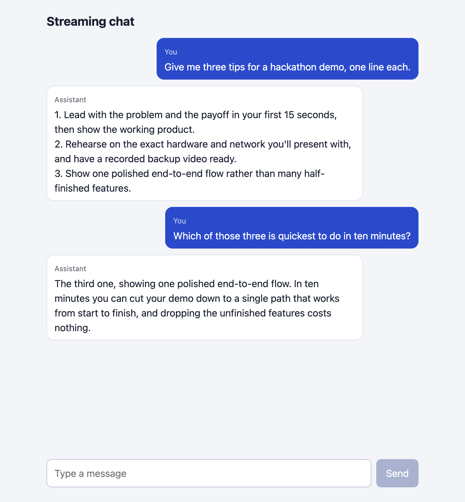

The rest of the tutorial builds it from nothing.

## Step 1: Set up the project

Create a folder and put this `package.json` in it. The versions have no `^` or `~`, so everyone who follows the tutorial installs the same code. `puppeteer-core` is only used by the test scripts in later steps.

```json
{
  "name": "nextjs-streaming-chat",
  "private": true,
  "scripts": {
    "dev": "next dev -p 8129",
    "build": "next build",
    "start": "next start -p 8129"
  },
  "dependencies": {
    "@anthropic-ai/sdk": "1.8.0",
    "next": "16.4.6",
    "react": "19.3.1",
    "react-dom": "19.3.1"
  },
  "devDependencies": {
    "puppeteer-core": "25.17.0"
  },
  "engines": { "node": ">=20.9.0" }
}
```
*File: `package.json`*

Install and build. The `npm ls` lines in the output show what was installed.

```bash
npm install
```

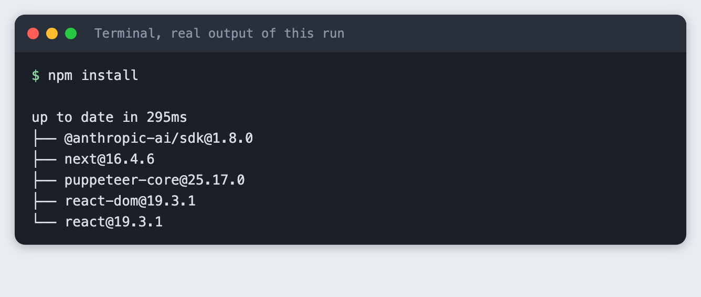

The page, layout and styles come in Step 3. For the build below, the finished files are already in the folder.

## Step 2: Add a route that streams

The browser must never hold your API key. The route handler runs on the server, reads the key from `process.env`, and passes the browser only the answer text.

Three choices in this file are worth reading before you copy it:

- **Check the body at the edge.** The route accepts 1 to 20 messages, each a `user` or `assistant` message under 2000 characters, starting and ending with a user message. The browser is not trusted, so the route rebuilds each message with only `role` and `content`.
- **Use `messages.create` with `stream: true`.** The call resolves once the API has accepted the request. A bad key fails there, so the route can return a proper error status before any text is streamed. I checked this with a wrong key in Step 7: the route answered with a clear error instead of an empty stream.
- **Close the call to the API when the browser leaves.** `cancel()` runs when the browser drops the connection, which is what Stop does. It aborts the request to the API too, so the model stops working on an answer nobody will read.

`thinking: { type: "disabled" }` is copied from the Python version of this idea in `stream-llm-answers`. I did not test the route without it.

```javascript
import Anthropic from "@anthropic-ai/sdk";

const MODEL = "claude-haiku-5-5";
const MAX_TOKENS = 300;
const MAX_MESSAGES = 20;
const MAX_CHARS = 2000;

function fail(status, message) {
  return Response.json({ error: message }, { status });
}

// Check the body at the edge: the browser is not trusted.
function parseMessages(body) {
  const list = body?.messages;
  if (!Array.isArray(list) || list.length === 0 || list.length > MAX_MESSAGES) return null;
  for (const m of list) {
    if (m?.role !== "user" && m?.role !== "assistant") return null;
    if (typeof m.content !== "string" || m.content.length === 0 || m.content.length > MAX_CHARS) return null;
  }
  if (list[0].role !== "user" || list.at(-1).role !== "user") return null;
  return list.map(({ role, content }) => ({ role, content }));
}

export async function POST(request) {
  // The key is read here, on the server. It is never sent to the browser.
  if (!process.env.ANTHROPIC_API_KEY) {
    return fail(500, "ANTHROPIC_API_KEY is not set on the server.");
  }
  const messages = parseMessages(await request.json().catch(() => null));
  if (!messages) return fail(400, "Send 1 to 20 messages that start and end with a user message.");

  const upstream = new AbortController();
  request.signal.addEventListener("abort", () => upstream.abort());

  const client = new Anthropic();
  let events;
  try {
    // The call resolves once the API has accepted the request, so a bad key or a
    // bad request fails here, before any bytes are streamed.
    events = await client.messages.create(
      { model: MODEL, max_tokens: MAX_TOKENS, thinking: { type: "disabled" }, messages, stream: true },
      { signal: upstream.signal },
    );
  } catch (err) {
    if (upstream.signal.aborted) return new Response(null, { status: 499 });
    if (err instanceof Anthropic.APIError) {
      console.log(`api error: status ${err.status}`);
      return fail(502, `The model call failed (status ${err.status}).`);
    }
    throw err;
  }

  const encoder = new TextEncoder();
  let chunks = 0;
  const body = new ReadableStream({
    async start(controller) {
      try {
        for await (const event of events) {
          if (event.type === "content_block_delta" && event.delta.type === "text_delta") {
            controller.enqueue(encoder.encode(event.delta.text));
            chunks += 1;
          } else if (event.type === "message_delta") {
            console.log(`done: ${chunks} chunks, output tokens ${event.usage.output_tokens}`);
          }
        }
        controller.close();
      } catch (err) {
        if (upstream.signal.aborted) return;
        console.log(`stream error after ${chunks} chunks`);
        controller.error(err);
      }
    },
    cancel() {
      // The browser went away or the user pressed Stop. Close the call to the API too.
      console.log(`client left after ${chunks} chunks, upstream request aborted`);
      upstream.abort();
    },
  });

  return new Response(body, { headers: { "content-type": "text/plain; charset=utf-8", "cache-control": "no-store" } });
}
```
*File: `app/api/chat/route.js`*

The model name and the limits are constants at the top. The model used here is `claude-haiku-5-5`, a small model chosen to keep the runs cheap.

Build the app:

```bash
npm run build
```

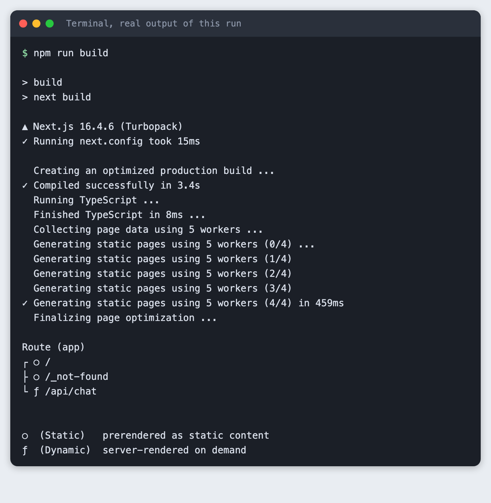

The route list at the bottom shows `/api/chat` as dynamic, meaning it runs on each request. The page itself is static. From here on the steps use the built app (`npm start`) so that the first request is not slowed by compiling. While you edit, `npm run dev` does the same job with reloads. I did not run the dev server for this tutorial.

### Try the route without a page

Before there is a page, call the route from a script. `scripts/call-route.mjs` posts one question and prints when each piece of the answer arrives.

```
// Call the route handler directly and print when each piece of the answer arrives.
// usage: node scripts/call-route.mjs [--bad]
const URL = "http://127.0.0.1:8129/api/chat";
const bad = process.argv.includes("--bad");
const body = bad
  ? { messages: [{ role: "assistant", content: "I start the conversation." }] }
  : { messages: [{ role: "user", content: "In two short sentences, why should a demo show an answer as it is written?" }] };

const start = performance.now();
const res = await fetch(URL, { method: "POST", headers: { "content-type": "application/json" }, body: JSON.stringify(body) });
console.log(`status ${res.status}, content-type ${res.headers.get("content-type")}`);
if (!res.ok) {
  console.log("body:", await res.text());
  process.exit(bad ? 0 : 1);
}
const decoder = new TextDecoder();
let n = 0;
let text = "";
for await (const value of res.body) {
  n += 1;
  const piece = decoder.decode(value, { stream: true });
  text += piece;
  if (n <= 6) console.log(`chunk ${n} at ${Math.round(performance.now() - start)} ms: ${JSON.stringify(piece)}`);
}
console.log(`... ${n} chunks in all, last at ${Math.round(performance.now() - start)} ms`);
console.log("full answer:", text);
process.exit(n > 1 ? 0 : 1);
```
*File: `scripts/call-route.mjs`*

`scripts/with-server.sh` starts the built app on port 8129, runs the command you give it, stops the app, and prints the lines the route wrote to its log.

```bash
#!/bin/sh
# Start the production server on port 8129, run the command given, stop the server,
# then print the lines the route handler wrote to its log.
# usage: scripts/with-server.sh node scripts/call-route.mjs
./node_modules/.bin/next start -p 8129 > server.log 2>&1 &
PID=$!
for i in $(seq 1 60); do
  curl -s -o /dev/null http://127.0.0.1:8129/ && break
  sleep 0.5
done
"$@"
STATUS=$?
kill $PID 2>/dev/null
wait $PID 2>/dev/null
echo "--- server log"
grep -E '^(done|client left|api error|stream error)' server.log || echo "(no route log lines)"
exit $STATUS
```
*File: `scripts/with-server.sh`*

First, see what a missing key looks like. This run has no key in its environment. The script exits with code 1, which is what the step expects.

```bash
node scripts/call-route.mjs
```

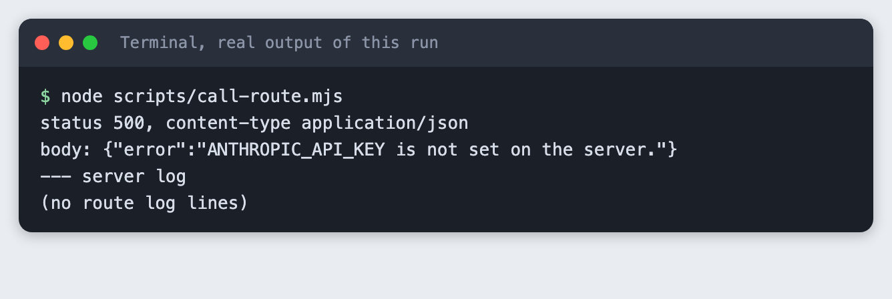

The route answers with status 500 and a message that names the variable. The page will show this text later, so it says what to fix.

Next, send a body the page would never send, to see the validation. This one starts with an assistant message.

```bash
node scripts/call-route.mjs --bad
```

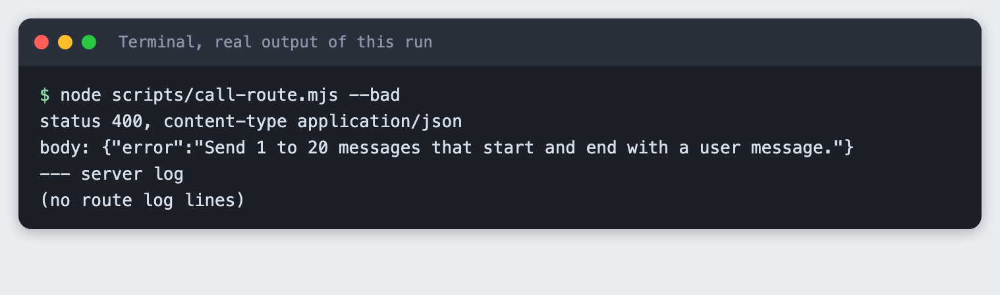

Now the real call with a key. Put your key in a `.env` file (copy `.env.example`) and load it into the terminal:

```
ANTHROPIC_API_KEY=your_key_here
```
*File: `.env.example`*

```bash
set -a; source .env; set +a
```

Never paste a real key into code, a screenshot or a chat.

```bash
node scripts/call-route.mjs
```

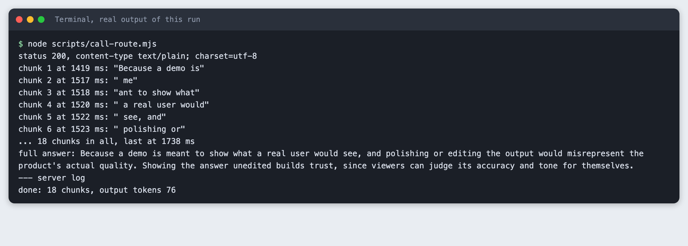

Read the lines that start with `chunk`. The first piece arrived at 1419 ms and was the words "Because a demo is". The next five arrived within 6 ms of each other, and the 18th and last piece arrived at 1738 ms. The answer was not one block. The last line of the server log shows 76 output tokens. The route counts text pieces, not tokens, so the two numbers differ.

## Step 3: Build the chat list

The page is one client component. It keeps the messages in state. Each time a piece arrives, it replaces the last assistant message with the longer text. To send a new question, it sends the whole list again, since the API remembers nothing between calls. That is why the second answer in the first screenshot can refer to "those three".

```javascript
"use client";

import { useEffect, useRef, useState } from "react";

export default function Chat() {
  const [messages, setMessages] = useState([]);
  const [input, setInput] = useState("");
  const [busy, setBusy] = useState(false);
  const [error, setError] = useState(null);
  const controllerRef = useRef(null);
  const historyRef = useRef([]);
  const endRef = useRef(null);

  useEffect(() => {
    endRef.current?.scrollIntoView({ block: "end" });
  }, [messages]);

  // Send `history` (ending with a user message) and stream the answer into a new assistant message.
  async function run(history) {
    historyRef.current = history;
    const controller = new AbortController();
    controllerRef.current = controller;
    setError(null);
    setBusy(true);
    setMessages([...history, { role: "assistant", content: "" }]);
    let answer = "";
    try {
      const res = await fetch("/api/chat", {
        method: "POST",
        headers: { "content-type": "application/json" },
        body: JSON.stringify({ messages: history.map(({ role, content }) => ({ role, content })) }),
        signal: controller.signal,
      });
      if (!res.ok) {
        const data = await res.json().catch(() => ({}));
        throw new Error(data.error ?? `The request failed (status ${res.status}).`);
      }
      const reader = res.body.getReader();
      const decoder = new TextDecoder();
      while (true) {
        const { done, value } = await reader.read();
        if (done) break;
        answer += decoder.decode(value, { stream: true });
        setMessages([...history, { role: "assistant", content: answer }]);
      }
    } catch (err) {
      if (err.name === "AbortError") {
        // Stop pressed: keep what arrived, and mark it.
        setMessages(answer ? [...history, { role: "assistant", content: answer, stopped: true }] : history);
      } else {
        setError(answer ? "The answer was cut off. " + err.message : err.message);
        setMessages(answer ? [...history, { role: "assistant", content: answer }] : history);
      }
    } finally {
      setBusy(false);
      controllerRef.current = null;
    }
  }

  function send(event) {
    event.preventDefault();
    const text = input.trim();
    if (!text || busy) return;
    setInput("");
    run([...messages.filter((m) => m.content), { role: "user", content: text }]);
  }

  return (
    <main>
      <h1>Streaming chat</h1>
      <div id="log" aria-live="polite">
        {messages.length === 0 && <p className="hint">Ask a question to start.</p>}
        {messages.map((m, i) => (
          <div key={i} className={`msg ${m.role}`}>
            <span className="who">{m.role === "user" ? "You" : "Assistant"}</span>
            <p>
              {m.content || "..."}
              {m.stopped && <em className="tag"> [stopped]</em>}
            </p>
          </div>
        ))}
        <div ref={endRef} />
      </div>
      {error && (
        <div id="error" role="alert">
          <span>{error}</span>
          <button id="retry" type="button" onClick={() => run(historyRef.current)} disabled={busy}>
            Try again
          </button>
        </div>
      )}
      <form onSubmit={send}>
        <input
          id="input"
          value={input}
          onChange={(e) => setInput(e.target.value)}
          placeholder="Type a message"
          maxLength={2000}
          autoComplete="off"
        />
        {busy ? (
          <button id="stop" type="button" onClick={() => controllerRef.current?.abort()}>
            Stop
          </button>
        ) : (
          <button id="send" type="submit" disabled={!input.trim()}>
            Send
          </button>
        )}
      </form>
    </main>
  );
}
```
*File: `app/page.js`*

The styles are plain CSS:

```css
:root { color-scheme: light; }
* { box-sizing: border-box; }
body { margin: 0; font: 16px/1.5 system-ui, sans-serif; background: #f3f5f9; color: #1a2030; }
main { max-width: 640px; margin: 0 auto; padding: 20px 16px 24px; display: flex; flex-direction: column; min-height: 100vh; }
h1 { font-size: 20px; margin: 0 0 12px; }
#log { flex: 1; display: flex; flex-direction: column; gap: 10px; padding-bottom: 12px; }
.hint { color: #667; }
.msg { max-width: 85%; padding: 8px 12px; border-radius: 12px; background: #fff; border: 1px solid #dde2ec; }
.msg.user { align-self: flex-end; background: #2b4acb; color: #fff; border-color: #2b4acb; }
.msg p { margin: 2px 0 0; white-space: pre-wrap; }
.who { font-size: 12px; opacity: 0.7; }
.tag { font-size: 13px; opacity: 0.7; }
#error { display: flex; gap: 12px; align-items: center; justify-content: space-between; padding: 10px 12px; margin-bottom: 10px; border-radius: 8px; background: #fdecea; border: 1px solid #e5a29b; color: #7a1c14; }
form { display: flex; gap: 8px; }
input { flex: 1; padding: 10px 12px; font: inherit; border: 1px solid #b9c1d3; border-radius: 8px; }
button { padding: 10px 16px; font: inherit; border: 0; border-radius: 8px; background: #2b4acb; color: #fff; cursor: pointer; }
button:disabled { background: #a9b2cf; cursor: default; }
#stop { background: #b3261e; }
#retry { padding: 6px 12px; background: #7a1c14; }
```
*File: `app/globals.css`*

And the layout:

```javascript
import "./globals.css";

export const metadata = { title: "Streaming chat" };

export default function RootLayout({ children }) {
  return (
    <html lang="en">
      <body>{children}</body>
    </html>
  );
}
```
*File: `app/layout.js`*

Open the built app before any chat. This screenshot is taken by the runner from the running app.

```bash
./node_modules/.bin/next start -p 8129
```

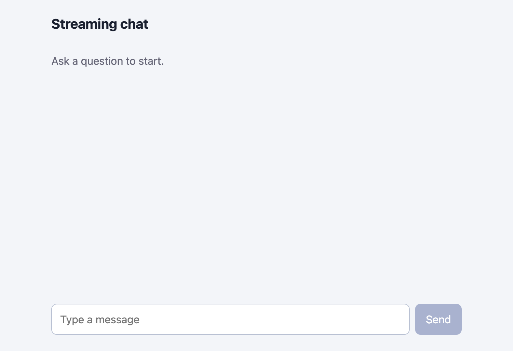

Now drive the page the way a person would. `scripts/drive.mjs` opens the page in Chrome with `puppeteer-core`, types a question, clicks Send, and saves screenshots. It takes the first screenshot while the answer is still arriving.

```
// Drive the real page in Chrome, the way a person would, and save screenshots.
// usage: node scripts/drive.mjs chat | stop | error
import puppeteer from "puppeteer-core";
import { mkdirSync } from "node:fs";

const CHROME = process.env.CHROME_BIN ?? "/Applications/Google Chrome.app/Contents/MacOS/Google Chrome";
const scenario = process.argv[2];
mkdirSync("evidence", { recursive: true });
mkdirSync("images", { recursive: true });

const browser = await puppeteer.launch({ executablePath: CHROME, headless: true });
const page = await browser.newPage();
await page.setViewport({ width: 760, height: 820, deviceScaleFactor: 2 });
await page.goto("http://127.0.0.1:8129/", { waitUntil: "networkidle0" });

const t0 = Date.now();
const ms = () => `${Date.now() - t0} ms`;
const shot = async (name) => {
  await page.screenshot({ path: `evidence/shot-${name}.png` });
  await page.screenshot({ path: `images/shot-${name}.png` });
  console.log(`saved screenshot ${name}`);
};
const ask = async (text) => {
  await page.type("#input", text);
  await page.click("#send");
};
const lastAnswer = () =>
  page.$$eval(".msg.assistant p", (ps) => (ps.length ? ps[ps.length - 1].textContent : ""));
const sleep = (n) => new Promise((r) => setTimeout(r, n));

try {
  if (scenario === "chat") {
    await ask("Give me three tips for a hackathon demo, one line each.");
    await page.waitForFunction(() => document.querySelector("#stop") && (document.querySelector(".msg.assistant p")?.textContent.length ?? 0) > 25, { timeout: 30000 });
    console.log(`at ${ms()}: Stop button visible, answer so far: ${JSON.stringify(await lastAnswer())}`);
    await shot("streaming");
    await page.waitForSelector("#send", { timeout: 60000 });
    console.log(`at ${ms()}: answer finished, ${(await lastAnswer()).length} characters`);
    await ask("Which of those three is quickest to do in ten minutes?");
    await page.waitForSelector("#stop", { timeout: 30000 });
    await page.waitForSelector("#send", { timeout: 60000 });
    const count = await page.$$eval(".msg", (m) => m.length);
    console.log(`at ${ms()}: second answer finished`);
    console.log(`messages on page: ${count}`);
    console.log(`second answer: ${JSON.stringify(await lastAnswer())}`);
    await shot("history");
  } else if (scenario === "stop") {
    await ask("Write a story of about 250 words about a robot at a hackathon.");
    await page.waitForFunction(() => (document.querySelector(".msg.assistant p")?.textContent.length ?? 0) > 60, { timeout: 30000 });
    await page.click("#stop");
    await page.waitForSelector("#send", { timeout: 10000 });
    const atStop = (await lastAnswer()).length;
    console.log(`clicked Stop: ${atStop} characters on screen, Send button is back`);
    await sleep(2500);
    const later = (await lastAnswer()).length;
    console.log(`2.5 seconds later: ${later} characters (${later === atStop ? "no more text arrived" : "text kept arriving"})`);
    console.log(`marked as stopped: ${(await page.$$eval(".tag", (t) => t.length)) === 1}`);
    await shot("stopped");
    await sleep(500);
  } else if (scenario === "error") {
    await ask("Hello");
    await page.waitForSelector("#error", { timeout: 30000 });
    console.log(`error shown: ${JSON.stringify(await page.$eval("#error span", (e) => e.textContent))}`);
    console.log(`Try again button present: ${(await page.$("#retry")) !== null}`);
    console.log(`you can still type: ${await page.$eval("#input", (i) => !i.disabled)}`);
    await shot(process.argv[3] ?? "error");
  } else {
    throw new Error(`unknown scenario ${scenario}`);
  }
} catch (err) {
  console.log(`FAILED at ${ms()}: ${err.message}`);
  await shot(`failed-${scenario}`).catch(() => {});
  process.exitCode = 1;
} finally {
  await browser.close();
}
```
*File: `scripts/drive.mjs`*

```bash
node scripts/drive.mjs chat
```

```text
at 2018 ms: Stop button visible, answer so far: "1. Lead with the problem and the payoff in your first 15 seconds, then show the working product."
saved screenshot streaming
at 2429 ms: answer finished, 281 characters
at 4005 ms: second answer finished
messages on page: 4
second answer: "The third one, showing one polished end-to-end flow. In ten minutes you can cut your demo down to a single path that works from start to finish, and dropping the unfinished features costs nothing."
saved screenshot history
--- server log
done: 31 chunks, output tokens 92
done: 16 chunks, output tokens 61
```

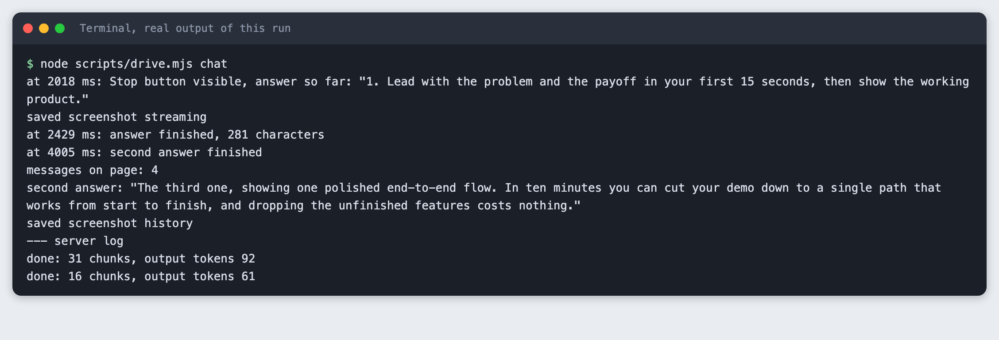

This is the page in the middle of the first answer. The red Stop button replaced Send, and the answer so far is on screen.

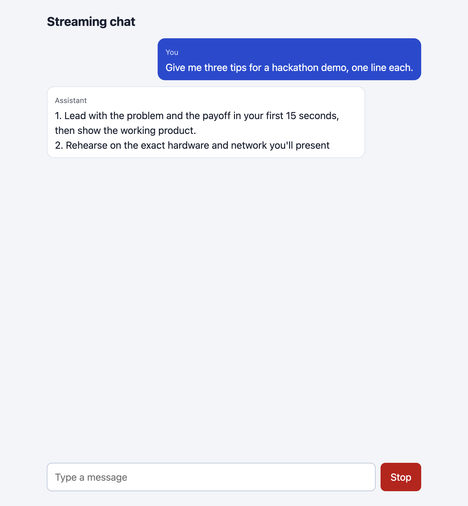

The log says the Stop button was visible at 2018 ms with part of the first tip on screen, and the first answer finished with 281 characters. After the second question the page held 4 messages. The server log shows the two calls: 31 chunks and 92 output tokens for the first, 16 chunks and 61 for the second. Your numbers will differ.

## Step 4: Add a stop button

While an answer is streaming, the Send button is replaced by Stop. Stop calls `abort()` on the `AbortController` that was passed to `fetch`. The `fetch` rejects with an `AbortError`, and the page keeps the text that has arrived and marks it `[stopped]`. The text stays in the history, so the next question includes it.

The test asks for a long story, waits until there is some text, and clicks Stop.

```bash
node scripts/drive.mjs stop
```

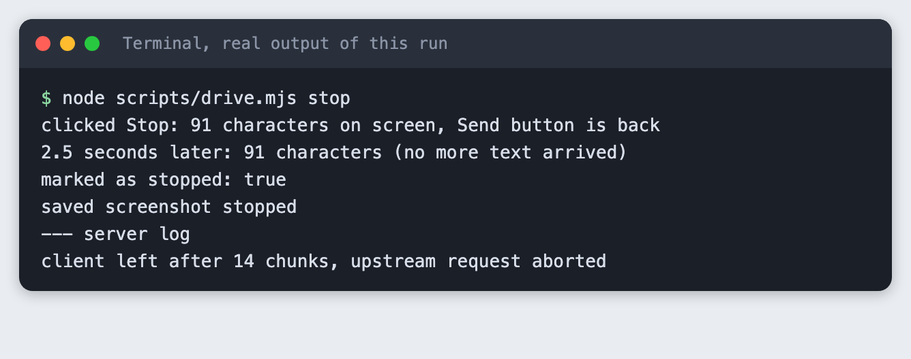

There are two proofs here. Two and a half seconds after the click, the page still had 91 characters, so the text really stopped. And the server log says `client left after 14 chunks, upstream request aborted`, so the route noticed and closed its call to the API. Without the `cancel()` handler in the route the page would stop, but the model would keep generating and you would keep paying for it.

![Chat page after Stop: a half-written story with the [stopped] tag and the Send button back](images/shot-stopped.png)

## Step 5: Handle errors

The page shows an error in a red banner with a Try again button, keeps the user's question in the list, and leaves the text box usable. The route returns a short message for each failure, and the page shows that message as it is.

The page has two paths. If nothing has arrived, the empty assistant message is removed and the error is shown. If part of an answer arrived and then the connection failed, the page keeps the part and says the answer was cut off. Try again sends the same history again.

Two failures were run for real. First, a server with no key:

```bash
node scripts/drive.mjs error
```

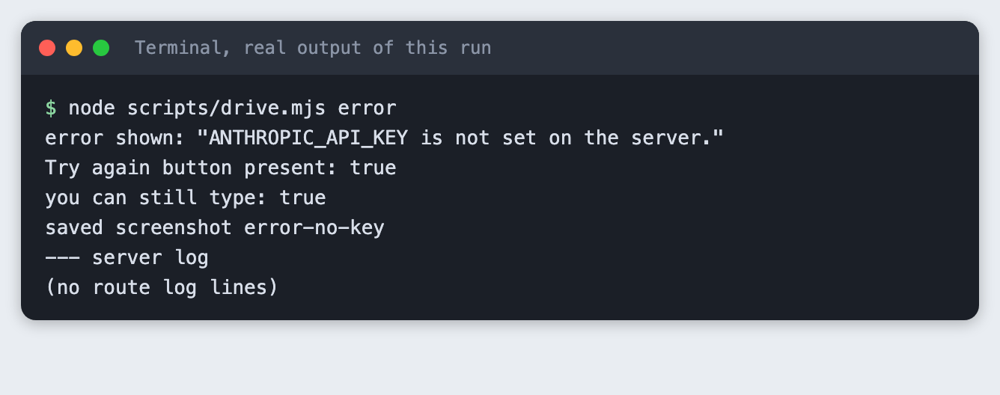

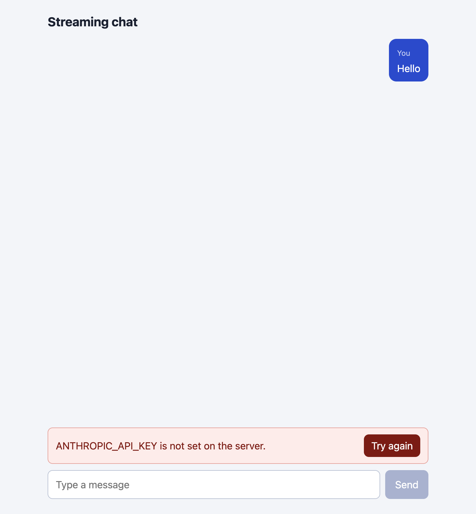

Second, a server with a key the API refuses. The key `not-a-real-key` is a made-up string, so the API answered with status 401:

```bash
ANTHROPIC_API_KEY=not-a-real-key node scripts/drive.mjs error
```

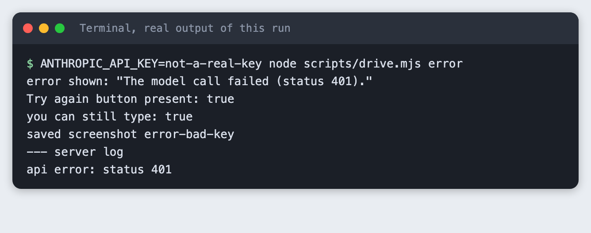

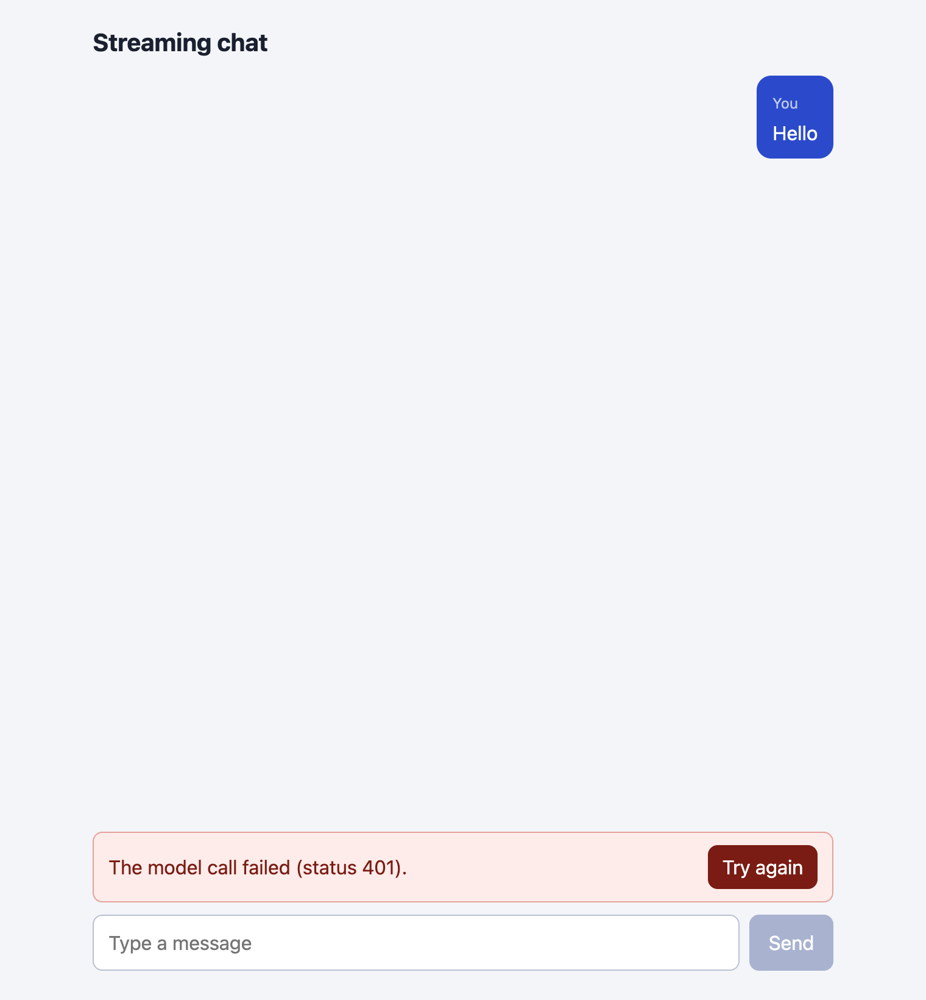

The route logs the status and shows the browser only "The model call failed (status 401)." The raw API message does not reach the page. For a demo that is the right amount of detail. In your own project you may want to log more on the server.

Not run: clicking Try again, and the "cut off" path, where the connection fails halfway through an answer.

### Check that the key stayed on the server

One last check. This script looks through every file the browser can download from `.next/static` for the key value and for the variable name.

```bash
node scripts/check-leak.mjs
```

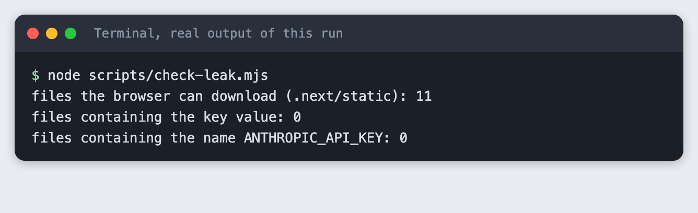

None of the 11 files contains either. This is a check of this build, not a security review. Anything you import into a client component ends up in those files, so run the check again after you change the code.

## Troubleshooting

- **`ANTHROPIC_API_KEY is not set on the server.`** The server did not get the variable. Run `set -a; source .env; set +a` in the same terminal you start the server from, or use a `.env.local` file, which Next.js loads itself.
- **`The model call failed (status 401).`** The key is wrong or revoked. Create a new one in your Anthropic account and restart the server. The server reads the variable when it starts.
- **`Send 1 to 20 messages that start and end with a user message.`** The route refused the body. After 20 messages the page will hit this. Trim the oldest messages in the page before you send.
- **Stop works on the page but the server log has no `client left` line.** The route must have the `cancel()` handler. Without it the call to the API runs to the end.
- **A screenshot or test cuts off the bottom of the chat.** The test window was too short for the conversation. `scripts/drive.mjs` sets the window height. Raise it.

## Frequently asked questions

**Is Next.js good for an AI hackathon project?**

It worked for this one. A route handler holds the key and streams the answer, and one page file holds the whole chat. You can build and run it with two commands. The tutorial did not compare it with other frameworks.

**How do I add a stop button to a chat?**

Pass an `AbortController` signal to `fetch`, and call `abort()` when the user clicks Stop. Keep the text that has arrived. In the test, 91 characters stayed on screen and no more arrived. Close the API call on the server too, in the stream's `cancel()` handler.

**How do I show an error in a chat UI?**

Make the route return a short message and a status code for each failure, and show that message in a banner with a way to retry. The tutorial ran two: a missing key and a wrong key. Check for errors before you start streaming, so you can return a real status code.

## What to try next

- Add a Try again test: break the key, send, fix it, click Try again.
- Trim the history in the page after 20 messages, or by token count.
- Show a small "typing" marker while the page waits for the first piece.

## How this tutorial was tested

- Date: 11 November 2026. Node 20.20.2, Next.js 16.4.6, React 19.3.1, `@anthropic-ai/sdk` 1.8.0, `puppeteer-core` 25.17.0, Google Chrome 157, macOS. The model is `claude-haiku-5-5`, set in the `MODEL` constant of the route.
- The code in this article is copied from the project files by a script. The output comes from saved logs of real API calls on a running app.
- Every step was run from a clean state, then replayed from an empty copy of the folder with a fresh `npm install`. Model replies differed between the runs, as expected.
- Screenshots of terminal steps are rendered from the saved output of the run. They are not captures of a terminal window. The images named `shot-*.png` and the empty-page image are real screenshots taken by Chrome from the running page.
- The built app (`npm start`) was used for every step.
- Not run: `npm run dev`, Windows, Linux, browsers other than Chrome, Node versions other than 20.20.2, clicking Try again, a failure halfway through an answer, and a mobile screen size.

