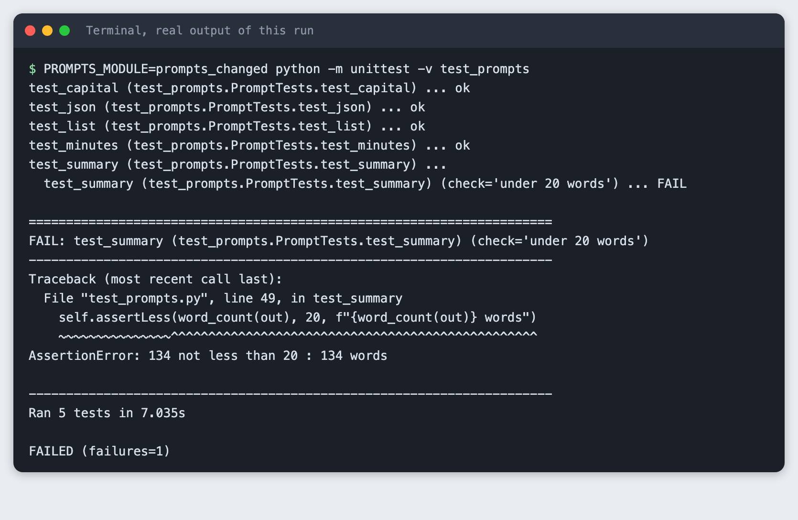
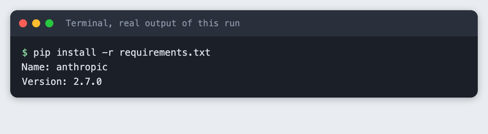
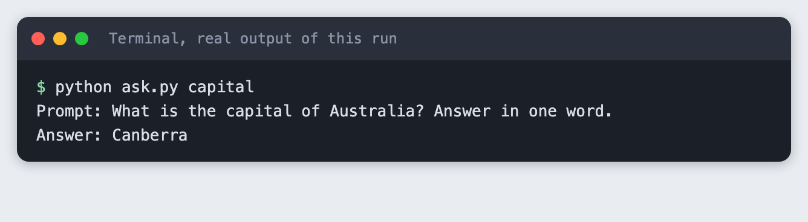
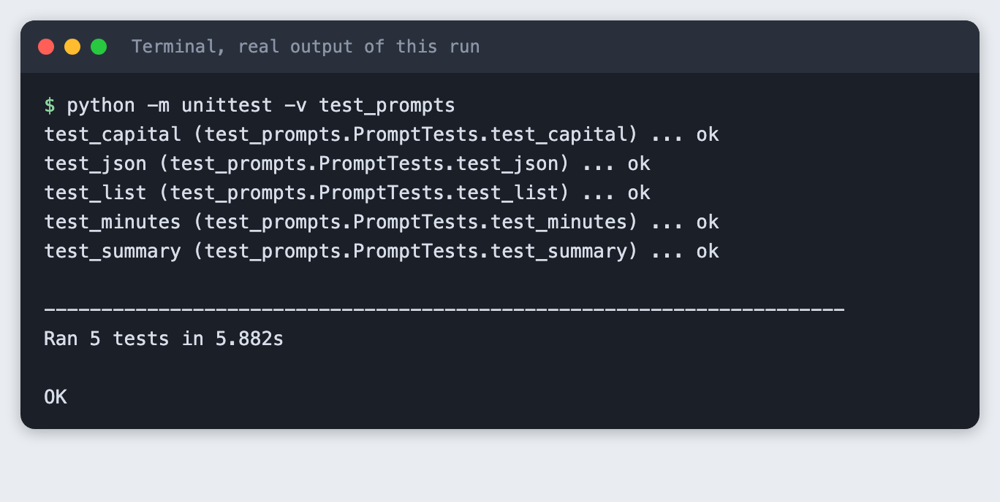
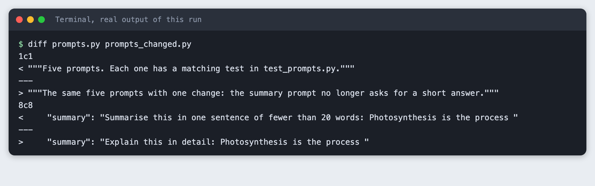
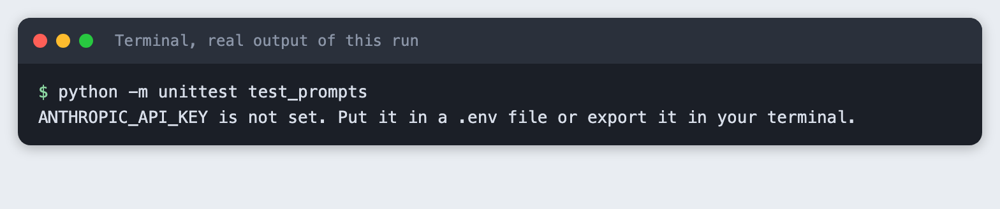
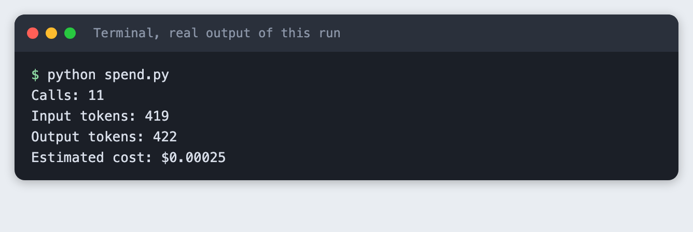

# Write prompts as tests: build a tiny prompt test file

You will build a test file that sends five prompts to the Claude API and checks each answer by rule: expected facts, format and length. Then you will change one prompt and watch a check fail. It takes about 30 minutes.

**Level:** Intermediate. **You need:** Python 3.10 or newer, a terminal, and an Anthropic API key. **Tested:** 10 November 2026 on macOS with Python 3.14.6 and `anthropic` 2.7.0, using the model `claude-haiku-5-5`. The Windows commands were not run.

A prompt change at midnight can break a demo in an AI hackathon, and a small test file shows what it broke. See the [upcoming AI hackathons](/ai-hackathons/) for a place to use it.

## Why treat a prompt like code

When you edit a function, a test tells you what the edit broke. A prompt has no such safety net by default. You change a word, the answer to one question looks fine, and a different question quietly gets worse. A small file of prompts with checks gives you the same signal: run it before and after a change and read what failed.

The checks here are rules, not opinions. A rule can say that the answer must name Canberra, must be valid JSON, or must be shorter than 20 words. Rules cannot judge tone or quality. They catch the failures that are easy to define.

## See it running first

By the end you will run the tests against a changed prompt and see this:



Four tests pass and one check fails, and the failure message says which check and why. Model output varies between runs, so the exact numbers on your machine may differ. The rest of this tutorial builds the file from scratch.

## Step 1. Create a virtual environment

A virtual environment keeps this project's packages apart from the rest of your machine. Make a folder, open a terminal in it, and run:

```bash
python3 -m venv .venv
```


Activate it. On macOS and Linux use `source .venv/bin/activate`. On Windows use `.venv\Scripts\activate`. Every command below assumes the environment is active.

## Step 2. Install the SDK and set your key

The only package is the official Anthropic Python SDK. The tests use `unittest`, which comes with Python.

```text
anthropic>=2.7.0
```
*File: `requirements.txt`*

```bash
pip install -r requirements.txt
```



Create a file named `.env` in the project folder with your own key, or export the variable in your terminal. Never paste a key into code. The project ships a `.env.example` that shows the format:

```
ANTHROPIC_API_KEY=your_key_here
```
*File: `.env.example`*

## Step 3. Write a helper that sends a prompt

`llm.py` sends one prompt and returns the text. It keeps the model name in a `MODEL` constant and sets `max_tokens` to 300 so a long answer cannot run up the bill. It turns thinking off with `thinking={"type": "disabled"}` so the answers are plain text. After every call it writes a line to `spend.log` with the input and output tokens from the response's `usage` field.

```python
"""One small helper that sends a prompt to the model and logs the tokens used."""
import os, sys, time
from pathlib import Path

import anthropic

MODEL = "claude-haiku-5-5"
MAX_TOKENS = 300
SPEND_LOG = Path("spend.log")


def get_client():
    if not os.environ.get("ANTHROPIC_API_KEY") and Path(".env").is_file():
        for line in Path(".env").read_text().splitlines():
            if line.startswith("ANTHROPIC_API_KEY="):
                os.environ["ANTHROPIC_API_KEY"] = line.split("=", 1)[1].strip()
    if not os.environ.get("ANTHROPIC_API_KEY"):
        print("ANTHROPIC_API_KEY is not set. Put it in a .env file or export it in your terminal.")
        sys.exit(2)
    return anthropic.Anthropic()


def ask(prompt):
    response = get_client().messages.create(
        model=MODEL,
        max_tokens=MAX_TOKENS,
        thinking={"type": "disabled"},  # plain answers, no reasoning tokens
        messages=[{"role": "user", "content": prompt}],
    )
    with SPEND_LOG.open("a") as log:
        log.write(f"{time.strftime('%Y-%m-%dT%H:%M:%S')} {MODEL} in={response.usage.input_tokens} out={response.usage.output_tokens}\n")
    return "".join(b.text for b in response.content if b.type == "text").strip()
```
*File: `llm.py`*

## Step 4. List the prompts

Each prompt asks for something you can check by rule. Keeping the prompts in their own file means the tests can load a changed copy later without touching the test code. The prompts ask for a one-word answer, a JSON object, three lines, a short summary and a bare number.

```python
"""Five prompts. Each one has a matching test in test_prompts.py."""

PROMPTS = {
    "capital": "What is the capital of Australia? Answer in one word.",
    "json": "Give the chemical symbol and atomic number of gold as a JSON object with the keys "
            "symbol and number. Return only the JSON, with no code fence and no other text.",
    "list": "Name the three primary colours of light, one per line, with no numbers or bullets.",
    "summary": "Summarise this in one sentence of fewer than 20 words: Photosynthesis is the process "
               "plants use to turn sunlight, water and carbon dioxide into sugar and oxygen.",
    "minutes": "How many minutes are in 3 hours? Answer with the number only.",
}
```
*File: `prompts.py`*

Send one of them to see the raw answer:

```python
"""Send one of the prompts and print the answer: python ask.py capital"""
import sys

from llm import ask
from prompts import PROMPTS

name = sys.argv[1]
print(f"Prompt: {PROMPTS[name]}")
print(f"Answer: {ask(PROMPTS[name])}")
```
*File: `ask.py`*

```bash
python ask.py capital
```



## Step 5. Write the checks

Each test sends one prompt and then checks the answer by rule. There are three kinds of rule here:

- **Expected facts.** The answer to the capital prompt must contain "canberra". The JSON must have symbol `Au` and number `79`. The list must mention red, green and blue.
- **Format.** The JSON prompt must return something `json.loads` accepts. The list must have exactly three non-empty lines. The minutes prompt must return exactly `180`.
- **Length.** The capital answer must be at most three words. The summary must be under 20 words.

Tests that check several things use `subTest`, so one failed check does not hide the others, and every assertion carries the model's answer in its failure message. The file reads the prompts from the module named in the `PROMPTS_MODULE` variable, and uses `prompts` when it is not set.

```python
"""Prompt tests. Each test sends one prompt and checks the answer by rule.

Run:  python -m unittest -v test_prompts
Test another set of prompts:  PROMPTS_MODULE=prompts_changed python -m unittest -v test_prompts
"""
import importlib, json, os, unittest

from llm import ask, get_client

PROMPTS = importlib.import_module(os.environ.get("PROMPTS_MODULE", "prompts")).PROMPTS
get_client()  # exits with a clear message when there is no key


def word_count(text):
    return len(text.split())


class PromptTests(unittest.TestCase):
    def test_capital(self):
        out = ask(PROMPTS["capital"])
        with self.subTest(check="names Canberra"):
            self.assertIn("canberra", out.lower(), f"got: {out!r}")
        with self.subTest(check="at most 3 words"):
            self.assertLessEqual(word_count(out), 3, f"got: {out!r}")

    def test_json(self):
        out = ask(PROMPTS["json"])
        try:
            data = json.loads(out)
        except json.JSONDecodeError:
            self.fail(f"not valid JSON, got: {out!r}")
        with self.subTest(check="symbol is Au"):
            self.assertEqual(data.get("symbol"), "Au", f"got: {out!r}")
        with self.subTest(check="number is 79"):
            self.assertEqual(data.get("number"), 79, f"got: {out!r}")

    def test_list(self):
        out = ask(PROMPTS["list"])
        lines = [line for line in out.splitlines() if line.strip()]
        with self.subTest(check="three lines"):
            self.assertEqual(len(lines), 3, f"got: {out!r}")
        for colour in ("red", "green", "blue"):
            with self.subTest(check=f"mentions {colour}"):
                self.assertIn(colour, out.lower(), f"got: {out!r}")

    def test_summary(self):
        out = ask(PROMPTS["summary"])
        with self.subTest(check="under 20 words"):
            self.assertLess(word_count(out), 20, f"{word_count(out)} words")
        with self.subTest(check="mentions sunlight or light"):
            self.assertIn("light", out.lower(), f"got: {out!r}")
        with self.subTest(check="mentions sugar or glucose"):
            self.assertTrue(any(w in out.lower() for w in ("sugar", "glucose")), f"got: {out!r}")

    def test_minutes(self):
        out = ask(PROMPTS["minutes"])
        self.assertEqual(out.strip().rstrip("."), "180", f"got: {out!r}")


if __name__ == "__main__":
    unittest.main()
```
*File: `test_prompts.py`*

## Step 6. Run the five tests

```bash
python -m unittest -v test_prompts
```



All five tests passed in this run, so each answer met its rules. Each run makes five API calls, one per prompt.

## Step 7. Change one prompt

Now change one thing and run the same tests. `prompts_changed.py` is a copy of `prompts.py` where the summary prompt no longer asks for a short answer. This is the whole change:

```bash
diff prompts.py prompts_changed.py
```



The first difference is only the file's comment. The second is the prompt: "Summarise this in one sentence of fewer than 20 words" became "Explain this in detail".

## Step 8. Watch the check fail

Run the tests again with `PROMPTS_MODULE` pointing at the changed file. The output goes through a filter that removes the folder path from the traceback, so the image shows `test_prompts.py` and not where the project lives on this machine.

```bash
PROMPTS_MODULE=prompts_changed python -m unittest -v test_prompts
```


```text
test_capital (test_prompts.PromptTests.test_capital) ... ok
test_json (test_prompts.PromptTests.test_json) ... ok
test_list (test_prompts.PromptTests.test_list) ... ok
test_minutes (test_prompts.PromptTests.test_minutes) ... ok
test_summary (test_prompts.PromptTests.test_summary) ... 
  test_summary (test_prompts.PromptTests.test_summary) (check='under 20 words') ... FAIL

======================================================================
FAIL: test_summary (test_prompts.PromptTests.test_summary) (check='under 20 words')
----------------------------------------------------------------------
Traceback (most recent call last):
  File "test_prompts.py", line 49, in test_summary
    self.assertLess(word_count(out), 20, f"{word_count(out)} words")
    ~~~~~~~~~~~~~~~^^^^^^^^^^^^^^^^^^^^^^^^^^^^^^^^^^^^^^^^^^^^^^^^^
AssertionError: 134 not less than 20 : 134 words

----------------------------------------------------------------------
Ran 5 tests in 7.035s

FAILED (failures=1)
```

Four tests still passed. The summary test failed the check named "under 20 words", and the message says the answer had 134 words. The checks for the facts, light and sugar or glucose, did not fail on this run. That is what a test is for: it tells you which rule broke, not just that something did. A failing length check after you removed the length instruction is the expected result, and the test would also catch the same failure if the change had been an accident.

## Step 9. What a missing key looks like

If no key is set, the test file stops when it loads and says why. Here the step runs without a key on purpose:

```bash
python -m unittest test_prompts
```



The exit code is 2. Create the `.env` file or export the variable in the same terminal you run the tests from.

## Step 10. Check what it cost

`spend.py` adds up `spend.log` and turns the totals into a dollar estimate with the prices for this model, which were 0.10 dollars per million input tokens and 0.50 dollars per million output tokens when this was tested. Check the provider's price page for current prices.

```python
"""Add up spend.log. Prices are dollars per million tokens for the demo model."""
INPUT_PER_M, OUTPUT_PER_M = 0.10, 0.50  # check the provider's price page before you rely on these

calls = tin = tout = 0
for line in open("spend.log"):
    parts = dict(p.split("=") for p in line.split()[2:])
    calls += 1
    tin += int(parts["in"])
    tout += int(parts["out"])
cost = tin * INPUT_PER_M / 1e6 + tout * OUTPUT_PER_M / 1e6
print(f"Calls: {calls}")
print(f"Input tokens: {tin}")
print(f"Output tokens: {tout}")
print(f"Estimated cost: ${cost:.5f}")
```
*File: `spend.py`*

```bash
python spend.py
```



This run made 11 calls: one for `ask.py`, five for the passing run and five for the changed run.

## Troubleshooting

**"ANTHROPIC_API_KEY is not set".** Add the key to `.env` in the folder you run the tests from, or export it in the same terminal.

**A test fails on a prompt you did not change.** Model output varies between runs. A check that depends on exact wording, such as "the answer must be exactly 180", can fail when the model adds a full stop or a word. Read the answer in the failure message, then decide whether the prompt or the rule needs to change.

**The JSON test fails.** The model may wrap the JSON in a code fence or add a sentence. Ask for JSON only in the prompt, as `prompts.py` does, and keep the test strict so that a change in format shows up.

## Frequently asked questions

**How do I test a prompt automatically?**

Send each prompt to the model and check the answer by rule: expected facts, format and length. Here all five tests passed, and after one prompt was changed, the check "under 20 words" failed because the answer had 134 words.

**Can I test model output when it changes every run?**

Rules still work when the wording changes, but a rule that needs exact text can fail. The check for exactly `180` can fail if the model adds a full stop. Running each prompt three times was not tested here.

**How many prompt tests are enough for a hackathon?**

Not tested here. This tutorial used five prompts, each with its own rule. The right number depends on your project.

## What to try next

- Add a sixth prompt for something your own project needs, with one fact check and one length check.
- Run each prompt three times and fail the test only if two out of three runs break a rule.
- Keep `spend.log` open while you work and set yourself a call budget before a long session.

## How this tutorial was tested

The tutorial was run on 10 November 2026 on macOS with Python 3.14.6, `anthropic` 2.7.0 and the model `claude-haiku-5-5`. The code blocks are copied from the project files, and the output blocks are the saved output of the real run. The steps were replayed from an empty copy of the folder. Screenshots are terminal-style images rendered from the saved output of each command. They are not captures of a terminal window. Not run: Windows and Linux, and any model other than `claude-haiku-5-5`.

