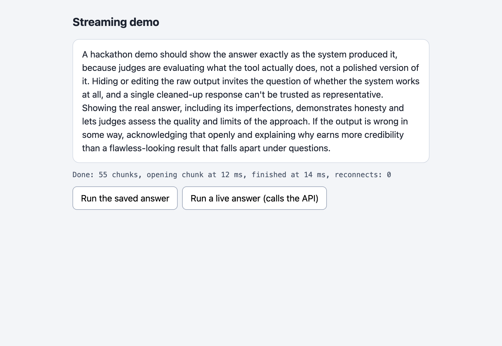
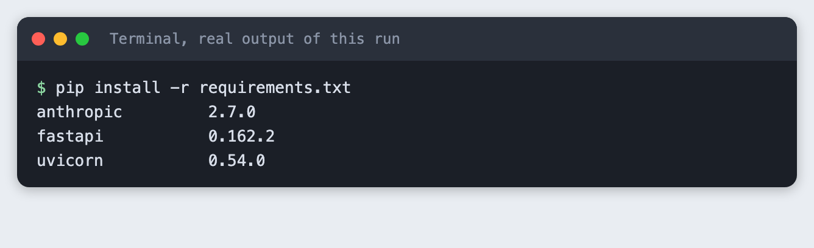
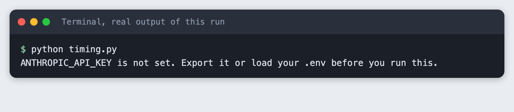
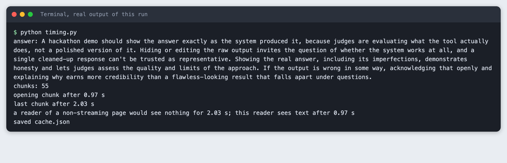
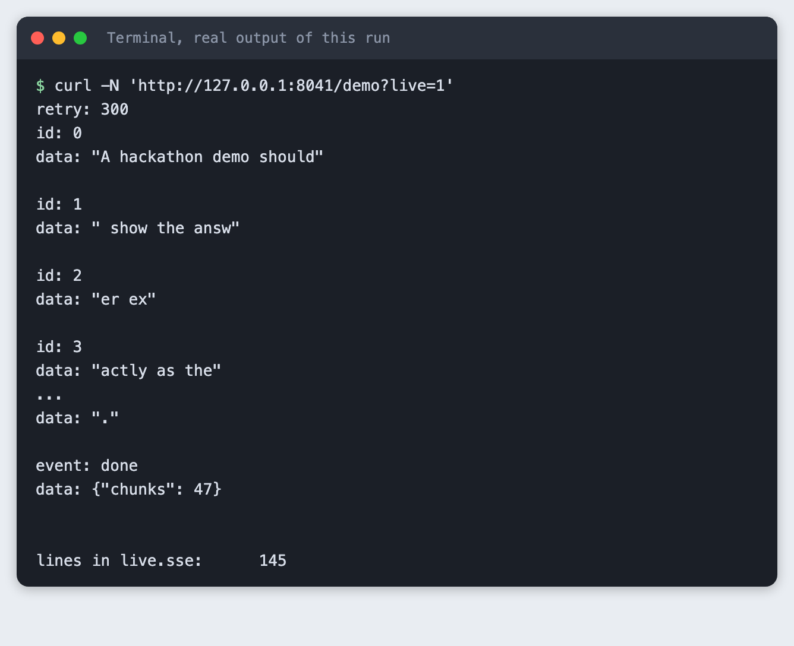
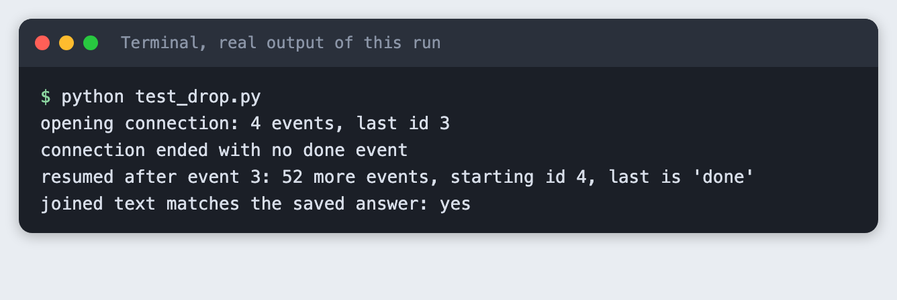
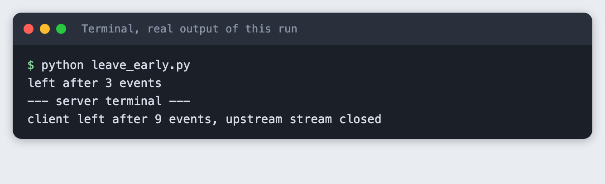

# Add streaming so your hackathon demo feels fast

You build a small FastAPI server that streams a Claude answer to a web page piece by piece, a page that shows the text arriving, and a way to carry on when the connection drops.

**Time:** about two hours. **Level:** intermediate. **You need:** Python 3.10 or newer, a browser, an Anthropic API key, and the habit of running a small FastAPI app (the [demo chatbot tutorial](../hackathon-demo-chatbot/article.md) covers it). **Tested:** 10 November 2026 with Python 3.14.6, `anthropic` 2.7.0, `fastapi` 0.162.2 and `uvicorn` 0.54.0 on macOS.

Model replies and timings differ from run to run. Your numbers will not match the ones below.

Judges at an AI hackathon watch your demo for a few minutes, and an answer that appears word by word feels faster than one that arrives all at once. Streaming does not make the model finish sooner. It shows the reader something sooner, and Step 1 measures the gap. If you are still choosing an event, see the [upcoming AI hackathons](/ai-hackathons/).

## Why this matters

A demo with a blank box and a spinner feels slow even when the model is not. A streamed answer starts to appear as soon as the model writes its opening words. The price is a second thing that can break on stage: a long-lived connection. This tutorial covers both the speed-up and the failure.

## See it running

This is the finished page. It replays a saved answer, so opening it costs nothing. The rest of the tutorial builds it from scratch.



## Step 1: Stream one answer and time it

Start with the model call alone, before any web code. `client.messages.stream(...)` returns a stream, and `stream.text_stream` yields the text in pieces as the API sends them. The script notes when each piece arrived, saves them to `cache.json`, and prints the wait for the opening piece against the wait for the whole answer.

Settings sit in `prompt.py`. The prompt is fixed on purpose: the server never sends a visitor's text to the API, so a stranger cannot spend your credit. `thinking={"type": "disabled"}` turns off extended thinking so the stream is text only. The API docs list this setting as accepted by `claude-haiku-5-5`.

```python
MODEL = "claude-haiku-5-5"
MAX_TOKENS = 300
PROMPT = "In four short sentences, explain why a hackathon demo should show an answer as it is written."
```
*File: `prompt.py`*

```python
"""Budget helper, not part of the lesson: one line per API call in spend.log."""
from datetime import datetime, timezone
from pathlib import Path


def log_usage(script, response):
    stamp = datetime.now(timezone.utc).isoformat(timespec="seconds")
    line = f"{stamp} {script} in={response.usage.input_tokens} out={response.usage.output_tokens}\n"
    with open(Path(__file__).with_name("spend.log"), "a") as f:
        f.write(line)
```
*File: `spend_log.py`*

```python
"""Stream one answer from the model and time it. Saves the chunks to cache.json."""
import json
import os
import sys
import time

from anthropic import Anthropic

from prompt import MAX_TOKENS, MODEL, PROMPT
from spend_log import log_usage

if not os.environ.get("ANTHROPIC_API_KEY"):
    sys.exit("ANTHROPIC_API_KEY is not set. Export it or load your .env before you run this.")

client = Anthropic()
chunks = []
start = time.perf_counter()

with client.messages.stream(
    model=MODEL,
    max_tokens=MAX_TOKENS,
    thinking={"type": "disabled"},
    messages=[{"role": "user", "content": PROMPT}],
) as stream:
    for text in stream.text_stream:
        chunks.append({"t": round(time.perf_counter() - start, 3), "text": text})
    final = stream.get_final_message()

log_usage("timing.py", final)

opening, last = chunks[0]["t"], chunks[-1]["t"]
print("answer:", "".join(c["text"] for c in chunks))
print(f"chunks: {len(chunks)}")
print(f"opening chunk after {opening:.2f} s")
print(f"last chunk after {last:.2f} s")
print(f"a reader of a non-streaming page would see nothing for {last:.2f} s; this reader sees text after {opening:.2f} s")

with open("cache.json", "w") as f:
    json.dump({"prompt": PROMPT, "chunks": chunks}, f)
print("saved cache.json")
```
*File: `timing.py`*

Create the environment and install the packages.

```bash
python3 -m venv .venv
```


```text
anthropic>=2.7.0
fastapi>=0.115
uvicorn>=0.30
```
*File: `requirements.txt`*

```bash
pip install -r requirements.txt
```



Put your key in a file named `.env`. Copy the placeholder file and edit it:

```
ANTHROPIC_API_KEY=your_key_here
```
*File: `.env.example`*

Never paste a real key into code, a screenshot or a chat. Load the file into your terminal session (macOS and Linux):

```bash
set -a; source .env; set +a
```

Without the key, the script stops with a message:



Now run it. This makes one real API call.

```bash
python timing.py
```

```text
answer: A hackathon demo should show the answer exactly as the system produced it, because judges are evaluating what the tool actually does, not a polished version of it. Hiding or editing the raw output invites the question of whether the system works at all, and a single cleaned-up response can't be trusted as representative. Showing the real answer, including its imperfections, demonstrates honesty and lets judges assess the quality and limits of the approach. If the output is wrong in some way, acknowledging that openly and explaining why earns more credibility than a flawless-looking result that falls apart under questions.
chunks: 55
opening chunk after 0.97 s
last chunk after 2.03 s
a reader of a non-streaming page would see nothing for 2.03 s; this reader sees text after 0.97 s
saved cache.json
```



In this run the opening chunk arrived after 0.97 s and the last after 2.03 s. A page that waits for the whole answer shows nothing for 2.03 s. A page that streams shows text after 0.97 s. Your numbers will differ. A screenshot is a single frame, so it cannot show text arriving. These two timings are the evidence for streaming.

## Step 2: Send the chunks from the server

The browser has a built-in way to read a stream of server messages, `EventSource`, and it expects the server-sent events format. Each event is a few `field: value` lines ended by a blank line. The server sends:

- `id`: the number of the chunk, so a client can say where it stopped.
- `data`: the text as a JSON string, so spaces and line breaks survive.
- `event: done` at the end, so the client can tell a finished answer from a cut one.
- `retry: 300` on the opening event, which asks the browser to reconnect after 300 ms.

`/demo` has two modes. Plain `/demo` replays the saved chunks with their recorded gaps and makes no API call. It is what you rehearse with, and what the screenshot tool opens. `/demo?live=1` makes one real call. The live route is capped at five calls per server process, and the file shows what happens when the key is missing.

```python
import asyncio
import json
import os
from pathlib import Path

import anthropic
from fastapi import FastAPI, Header, Query
from fastapi.responses import HTMLResponse, JSONResponse, StreamingResponse

from prompt import MAX_TOKENS, MODEL, PROMPT
from spend_log import log_usage

MAX_LIVE_CALLS = 5  # per server process: a cap on what a stray visitor can spend
HERE = Path(__file__).parent

app = FastAPI()
live_calls = 0


def sse(data, event=None, event_id=None):
    """Format one server-sent event. The data is JSON so spaces and newlines survive."""
    lines = []
    if event_id == 0:
        lines.append("retry: 300")  # ask the browser to reconnect after 300 ms, not its default
    if event_id is not None:
        lines.append(f"id: {event_id}")
    if event:
        lines.append(f"event: {event}")
    lines.append(f"data: {json.dumps(data)}")
    return "\n".join(lines) + "\n\n"


def load_cache():
    return json.loads((HERE / "cache.json").read_text())


async def replay(start, speed, drop_after):
    """Send the saved chunks with their recorded gaps. No API call."""
    cache = load_cache()
    chunks = cache["chunks"]
    previous = chunks[start - 1]["t"] if start else 0.0
    for i in range(start, len(chunks)):
        if drop_after is not None and start == 0 and i >= drop_after:
            return  # end the response early, with no done event
        await asyncio.sleep(max(0.0, chunks[i]["t"] - previous) * speed)
        previous = chunks[i]["t"]
        yield sse(chunks[i]["text"], event_id=i)
    yield sse({"chunks": len(chunks)}, event="done")


async def live():
    """Stream a fixed-prompt answer from the API. One call per request."""
    client = anthropic.AsyncAnthropic()
    sent = 0
    try:
        async with client.messages.stream(
            model=MODEL,
            max_tokens=MAX_TOKENS,
            thinking={"type": "disabled"},
            messages=[{"role": "user", "content": PROMPT}],
        ) as stream:
            async for text in stream.text_stream:
                yield sse(text, event_id=sent)
                sent += 1
            log_usage("app.py", await stream.get_final_message())
        yield sse({"chunks": sent}, event="done")
    except asyncio.CancelledError:
        # The browser went away. Leaving the "async with" block closes the upstream stream.
        print(f"client left after {sent} events, upstream stream closed", flush=True)
        raise
    except anthropic.APIError:
        yield sse({"message": "The model call failed."}, event="problem")


@app.get("/health")
def health():
    return {"ok": True}


@app.get("/demo")
async def demo(
    live_answer: bool = Query(False, alias="live"),
    speed: float = Query(1.0, ge=0, le=5),
    drop_after: int | None = Query(None, ge=0),
    last_event_id: str | None = Header(None),
):
    global live_calls
    headers = {"Cache-Control": "no-store", "X-Accel-Buffering": "no"}
    if not live_answer:
        start = int(last_event_id) + 1 if last_event_id is not None else 0
        return StreamingResponse(replay(start, speed, drop_after), media_type="text/event-stream", headers=headers)
    if last_event_id is not None:
        # A live answer cannot be resumed, and a new call would cost money. A 409 stops the browser retrying.
        return JSONResponse({"detail": "A live answer cannot be resumed. Run it again."}, status_code=409)
    if not os.environ.get("ANTHROPIC_API_KEY"):
        return JSONResponse({"detail": "ANTHROPIC_API_KEY is not set."}, status_code=503)
    if live_calls >= MAX_LIVE_CALLS:
        return JSONResponse({"detail": "Live call limit reached for this server."}, status_code=429)
    live_calls += 1
    return StreamingResponse(live(), media_type="text/event-stream", headers=headers)


@app.get("/", response_class=HTMLResponse)
def index():
    return (HERE / "index.html").read_text()
```
*File: `app.py`*

Start the server and ask for a live answer with `curl`. This makes one real API call. The saved output below shows the opening and closing events.

```bash
curl -N 'http://127.0.0.1:8041/demo?live=1'
```

```text
retry: 300
id: 0
data: "A hackathon demo should"

id: 1
data: " show the answ"

id: 2
data: "er ex"

id: 3
data: "actly as the"
...
data: "."

event: done
data: {"chunks": 47}


lines in live.sse:      145
```



Each `data:` line is a small piece of the answer, cut where the model sent it. The stream ends with `event: done` and the number of chunks. Not every piece is a whole word, and the page does not need it to be.

## Step 3: Read the chunks in the page

The page opens an `EventSource`, appends each piece to a box with `textContent` (never `innerHTML`, since model text is not trusted), and keeps count. It also records when the opening chunk arrived. Opening the page with `?speed=0` replays the saved answer with no gaps, so the whole answer lands in a few milliseconds. That is why the screenshot at the top of this article shows a finished answer. Without `speed=0` the saved answer arrives with its recorded gaps, and the live button streams a real answer.

```html
<!doctype html>
<html lang="en">
<head>
<meta charset="utf-8">
<meta name="viewport" content="width=device-width, initial-scale=1">
<title>Streaming demo</title>
<style>
  body { font: 16px/1.5 system-ui, sans-serif; background: #f3f5f8; margin: 0; color: #1d2330; }
  main { max-width: 640px; margin: 0 auto; padding: 24px 16px; }
  h1 { font-size: 20px; margin: 0 0 16px; }
  #answer { background: #fff; border: 1px solid #d5dbe5; border-radius: 12px; padding: 14px 16px; min-height: 140px; white-space: pre-wrap; }
  #status { margin: 12px 0; font: 13px/1.4 ui-monospace, Menlo, monospace; color: #4a5568; }
  button { font: inherit; padding: 8px 14px; border-radius: 8px; border: 1px solid #9aa5b8; background: #fff; cursor: pointer; }
  .row { display: flex; gap: 8px; margin-top: 12px; }
</style>
</head>
<body>
<main>
  <h1>Streaming demo</h1>
  <div id="answer" aria-live="polite"></div>
  <div id="status">Press a button to start.</div>
  <div class="row">
    <button id="cached">Run the saved answer</button>
    <button id="live">Run a live answer (calls the API)</button>
  </div>
</main>
<script>
const params = new URLSearchParams(location.search);
const answer = document.getElementById("answer");
const status = document.getElementById("status");
let source = null;

function run(live) {
  if (source) source.close();
  answer.textContent = "";
  let chunks = 0, reconnects = 0, openAt = null;
  const t0 = performance.now();
  const query = new URLSearchParams();
  if (live) query.set("live", "1");
  if (params.has("speed")) query.set("speed", params.get("speed"));
  if (params.has("drop")) query.set("drop_after", "5");
  status.textContent = "Waiting for the opening chunk...";
  source = new EventSource("/demo?" + query);
  source.onmessage = (e) => {
    if (openAt === null) openAt = performance.now() - t0;
    answer.textContent += JSON.parse(e.data);
    chunks += 1;
    status.textContent = `Receiving: ${chunks} chunks, opening chunk at ${Math.round(openAt)} ms`;
  };
  source.addEventListener("done", () => {
    source.close();
    const total = Math.round(performance.now() - t0);
    status.textContent = `Done: ${chunks} chunks, opening chunk at ${Math.round(openAt)} ms, finished at ${total} ms, reconnects: ${reconnects}`;
  });
  source.addEventListener("problem", () => { source.close(); status.textContent = "The model call failed. Run it again."; });
  source.onerror = () => {
    if (source.readyState === EventSource.CLOSED) {
      status.textContent = `Connection lost after ${chunks} chunks. The text so far is kept. Run it again.`;
    } else {
      reconnects += 1;
      status.textContent = `Connection dropped after ${chunks} chunks. Reconnecting...`;
    }
  };
}

document.getElementById("cached").onclick = () => run(false);
document.getElementById("live").onclick = () => run(true);
if (params.has("speed")) run(false);  // lets a screenshot tool open the page already running
</script>
</body>
</html>
```
*File: `index.html`*

Start the server and open the page in your browser.

```bash
uvicorn app:app --port 8041
```

Open `http://127.0.0.1:8041/` and press the buttons. The left button replays the saved answer from `cache.json`. The second makes one real call for each press.

## Step 4: Handle a dropped connection

A stream can end early: a phone leaves Wi-Fi, a laptop sleeps, a proxy closes an idle connection. From the client side, the symptom is the same: the response ends and no `done` event arrived. The answer is half on screen.

`EventSource` reconnects by itself and sends the id of the last event it got in a `Last-Event-ID` header. The server reads that header, and for a saved answer it carries on from the next chunk. `test_drop.py` does by hand what the browser does: it reads four events, notices the missing `done`, asks again with the last id, and checks that the joined text equals the saved answer. The server ends the response cleanly after four events when you pass `drop_after=4`, which a real network drop does not, but the client sees the same thing.

```python
"""Drop the connection after 4 events, then resume with Last-Event-ID, like a browser does."""
import json
import sys
import urllib.error
import urllib.request

BASE = "http://127.0.0.1:8041/demo"


def read_events(url, last_id=None):
    """Return a list of (event_id, event_name, data) read until the response ends."""
    headers = {"Last-Event-ID": str(last_id)} if last_id is not None else {}
    events = []
    with urllib.request.urlopen(urllib.request.Request(url, headers=headers), timeout=30) as response:
        block = {}
        for raw in response:
            line = raw.decode().rstrip("\n")
            if line:
                key, _, value = line.partition(": ")
                block[key] = value
            elif block:
                events.append((block.get("id"), block.get("event", "message"), json.loads(block["data"])))
                block = {}
    return events


opening = read_events(f"{BASE}?speed=0&drop_after=4")
texts = [d for _, name, d in opening if name == "message"]
print(f"opening connection: {len(texts)} events, last id {opening[-1][0]}")
if any(name == "done" for _, name, _ in opening):
    sys.exit("expected the connection to end early")
print("connection ended with no done event")

last_id = opening[-1][0]
rest = read_events(f"{BASE}?speed=0&drop_after=4", last_id=last_id)
print(f"resumed after event {last_id}: {len(rest)} more events, starting id {rest[0][0]}, last is '{rest[-1][1]}'")

texts += [d for _, name, d in rest if name == "message"]
saved = "".join(c["text"] for c in json.load(open("cache.json"))["chunks"])
same = "".join(texts) == saved
print(f"joined text matches the saved answer: {'yes' if same else 'no'}")
sys.exit(0 if same else 1)
```
*File: `test_drop.py`*

```bash
python test_drop.py
```

```text
opening connection: 4 events, last id 3
connection ended with no done event
resumed after event 3: 52 more events, starting id 4, last is 'done'
joined text matches the saved answer: yes
```



A live answer cannot be resumed. The model would have to write it again, and that is a second paid call that may not match the earlier one. The server answers a live reconnect with status 409, which makes the browser stop retrying, and the page keeps the text it has and asks the reader to run it again. I did not run that 409 path in the saved evidence.

There is a cost on the other side too. If the reader leaves while a live answer is still coming, you want the upstream call to stop. In `app.py` the `async with` block around the stream closes the upstream connection when the server cancels the generator. `leave_early.py` opens a live stream and closes it after three events:

```python
"""Open a live stream, read 3 events, then close the connection."""
import urllib.request

with urllib.request.urlopen("http://127.0.0.1:8041/demo?live=1", timeout=30) as response:
    events = 0
    for raw in response:
        if raw.startswith(b"data:"):
            events += 1
            if events == 3:
                break
print("left after 3 events")
```
*File: `leave_early.py`*

```bash
python leave_early.py
```

```text
left after 3 events
--- server terminal ---
client left after 9 events, upstream stream closed
```



The server noticed the loss only after it had already sent more events than the script read, because the data sits in socket buffers. That is why the count in the server line is higher than 3. The saved output shows the server logged that the upstream stream was closed. It does not show what the API billed for the cut call. That call is not in `spend.log`, which logs only finished answers.

## Questions people ask

**Does streaming make an AI hackathon demo better?** It does not shorten the total time. In the saved run the whole answer took 2.03 s and the text started to appear at 0.97 s. What changes is how long the page looks empty. Whether judges prefer that is a judgement I did not test.

**What happens to a streamed answer if the connection drops?** The stream ends without a `done` event. For a saved answer, the browser reconnects and the server continues from the next chunk, as in Step 4. A live answer cannot continue where it stopped, so the page keeps the text it has and asks for a new run.

**Can I add streaming late in an AI hackathon?** The change touches two places: the model call becomes `client.messages.stream`, and the page reads an `EventSource` instead of waiting for one response. Keep the old non-streaming route until the streamed one works, and keep a saved answer for the demo path.

## Troubleshooting

- **`ANTHROPIC_API_KEY is not set` from `timing.py`.** Load the key in the same terminal you run the script from.
- **`/demo` fails with a missing `cache.json`.** Run `python timing.py` once. It writes the file the saved route replays.
- **The live button returns an error after a few presses.** The server allows five live calls for each run of `uvicorn`. Restart it to reset the count.
- **The page shows text all at once.** Check the URL for `speed=0`, which removes the recorded gaps. The server sends `X-Accel-Buffering: no`, which asks nginx not to hold back the stream. I did not test behind a proxy.
- **`Address already in use`.** An old server is still running on port 8041. Stop it or choose another port.

## What to try next

- Show a typing cursor until the `done` event arrives.
- Save each finished live answer to `cache.json` so your rehearsal route stays current.
- Add a timeout on the page that shows the saved answer if no chunk arrives in a few seconds.

## How this tutorial was tested

- Date: 10 November 2026. Python 3.14.6, `anthropic` 2.7.0, `fastapi` 0.162.2, `uvicorn` 0.54.0, macOS. The model is `claude-haiku-5-5`, set in `prompt.py`.
- The code in this article is copied from the project files by a script. Output and screenshots come from saved logs of real runs, with real API calls in Steps 1, 2 and 4.
- Every step was run from a clean folder, then replayed from an empty copy of the folder with no virtual environment. The replay passed. Model text and timings differed between runs, as expected.
- The page screenshot is a real Chrome screenshot of the running page, opened with `?speed=0`. Terminal screenshots are rendered from the saved output of the run. They are not captures of a terminal window.
- Not run in the saved evidence: pressing the buttons in a browser, the live button, the 409 and 429 responses of the live route, and the missing-key response of `/demo?live=1`. I checked the browser reconnect once, outside the saved steps, by opening the page in headless Chrome with `?speed=0&drop=1`. Its status line showed one reconnect and a finished answer. That check is not in the evidence folder.
- Not run: Windows, Linux, browsers other than Chrome, and Python versions other than 3.14.6.

