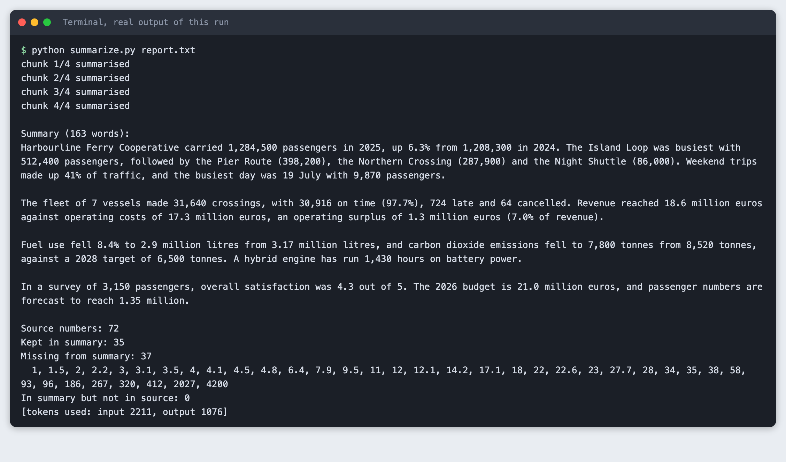
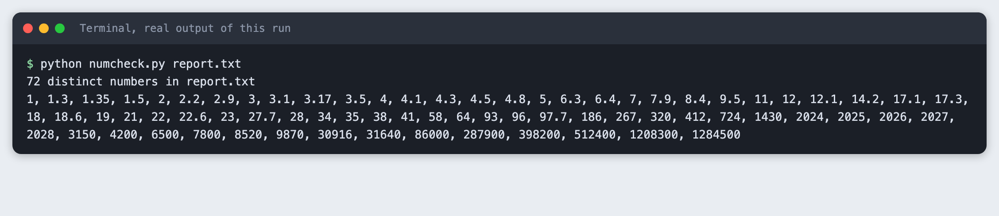
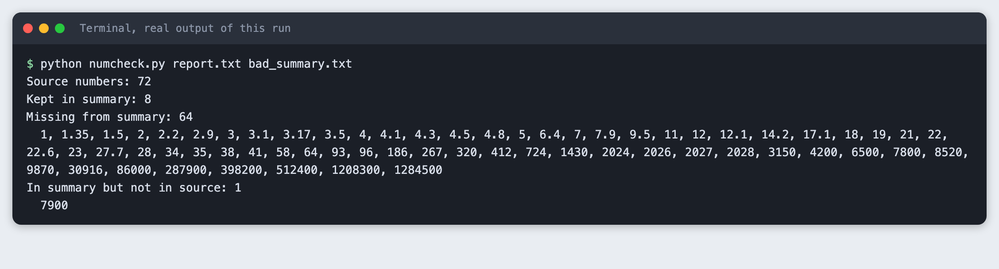
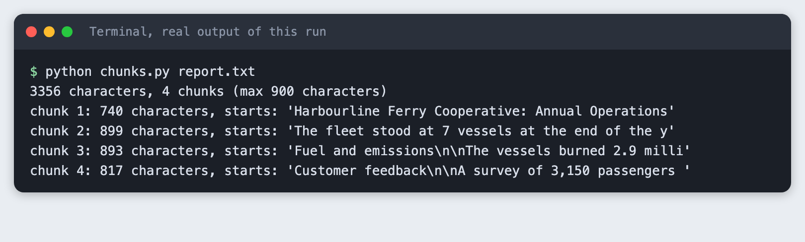
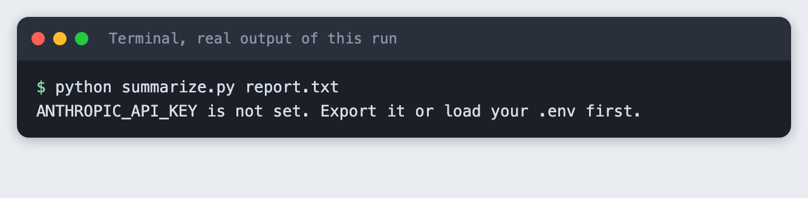
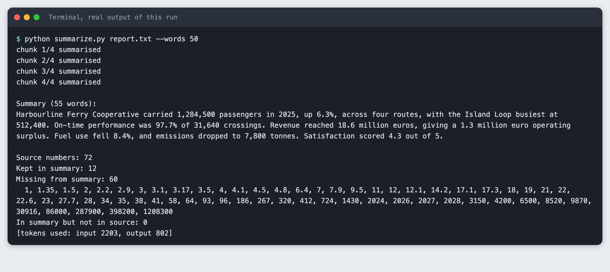
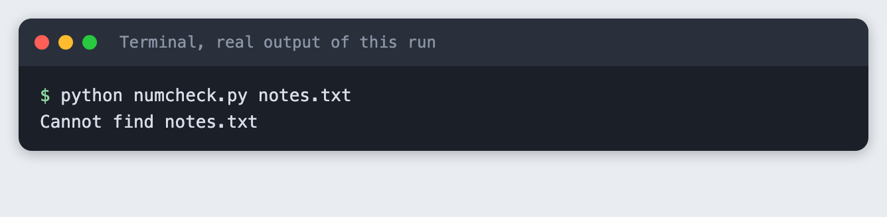

# Summarise a long article with an LLM without losing the numbers

You build a Python script that splits a long text into chunks, summarises each chunk, merges the results, and then lists every number from the source that the summary dropped or changed.

**Time:** about 40 minutes. **Level:** intermediate. **You need:** Python basics, Python 3.10 or newer, and an Anthropic API key. **Tested:** 11 November 2026 with Python 3.14.6 and the `anthropic` package 2.8.0 on macOS.

Model replies differ from run to run. Your counts of kept and missing numbers will not match the output below. The shape of the output will.

A summary that changes a number is a risk in any AI hackathon demo, and a simple check can catch it. If you are planning a project, see the [upcoming AI hackathons](/ai-hackathons/).

## Why this matters

A summary is short on purpose, so it leaves things out. For prose that is the point. For a report full of figures, a missing or altered figure can change the meaning, and the text still reads well. You cannot see the gap by reading the summary alone. A program can: pull the numbers out of the source, pull the numbers out of the summary, and compare the two lists.

## See it running first

This is the finished script summarising a made-up annual report with 72 distinct numbers. The summary is followed by a check that lists the numbers it did not keep.



The rest of the tutorial builds it from nothing.

## Step 1: Set up the project

Create a virtual environment. The commands from here on assume it is active (`source .venv/bin/activate`).

```bash
python3 -m venv .venv
```


Create `requirements.txt` with one line:

```text
anthropic>=2.7.0
```
*File: `requirements.txt`*

```bash
pip install -r requirements.txt
```

```text
Name: anthropic
Version: 2.8.0
```

Put your key in a file named `.env`. Copy the placeholder file and edit it:

```
ANTHROPIC_API_KEY=your_key_here
```
*File: `.env.example`*

Never paste a real key into code, a screenshot or a chat. Load the file into your terminal session on macOS or Linux:

```bash
set -a; source .env; set +a
```

## Step 2: Write a source text with many numbers

The tutorial uses `report.txt`, an annual report for a ferry cooperative. The cooperative and every figure in it are made up for this tutorial. It has dates, percentages, decimals, numbers with commas and numbers in the millions. Use your own text if you prefer. The checker only needs plain text.

You can read the whole file in the project folder. It is 3,356 characters long.

## Step 3: Extract the numbers

The checker is the part that does not depend on a model, so build and test it first. A number here is a run of digits with optional commas and an optional decimal part. `numcheck.py` removes the commas, so `1,284,500` and `1284500` count as the same number. It also drops trailing zeros after a decimal point, so `7.0` and `7` match. It skips a number that follows a letter or a dot, such as the 3 in `Q3`, because that digit is part of a name.

```python
import re
import sys
from pathlib import Path

# A number is digits with optional comma groups and decimals. A letter or dot
# right before it (as in Q3 or v2.1) means it is part of a name, so it is skipped.
NUMBER = re.compile(r"(?<![\w.])\d[\d,]*(?:\.\d+)?")


def extract_numbers(text):
    """Return the set of numbers in text, with commas removed: '1,284,500' -> '1284500'."""
    found = set()
    for match in NUMBER.findall(text):
        value = match.rstrip(",").replace(",", "")
        if "." in value:
            value = value.rstrip("0").rstrip(".")  # 7.0 and 7 are the same number
        found.add(value)
    return found


def compare(source, summary):
    """Return (kept, missing, not_in_source) as sorted lists of number strings."""
    src, out = extract_numbers(source), extract_numbers(summary)
    order = lambda values: sorted(values, key=float)
    return order(src & out), order(src - out), order(out - src)


def report(source, summary):
    kept, missing, extra = compare(source, summary)
    total = len(kept) + len(missing)
    print(f"Source numbers: {total}")
    print(f"Kept in summary: {len(kept)}")
    print(f"Missing from summary: {len(missing)}")
    if missing:
        print("  " + ", ".join(missing))
    print(f"In summary but not in source: {len(extra)}")
    if extra:
        print("  " + ", ".join(extra))


def read(path):
    file = Path(path)
    if not file.is_file():
        sys.exit(f"Cannot find {path}")
    return file.read_text(encoding="utf-8")


if __name__ == "__main__":
    if len(sys.argv) == 2:
        values = sorted(extract_numbers(read(sys.argv[1])), key=float)
        print(f"{len(values)} distinct numbers in {sys.argv[1]}")
        print(", ".join(values))
    elif len(sys.argv) == 3:
        report(read(sys.argv[1]), read(sys.argv[2]))
    else:
        sys.exit("Usage: python numcheck.py SOURCE [SUMMARY]")
```
*File: `numcheck.py`*

Run it on the report:

```bash
python numcheck.py report.txt
```



The report holds 72 distinct numbers. Note the word "distinct": the script compares sets, so a number that appears three times counts once. A summary that keeps one of three mentions of 2025 passes for that number.

## Step 4: Compare against a summary you wrote

Before you involve a model, test the comparison on a summary with known faults. `bad_summary.txt` is a short summary written by hand. It rounds 1,284,500 to "about 1.3 million" and it says emissions fell to 7,900 tonnes, where the report says 7,800.

```bash
python numcheck.py report.txt bad_summary.txt
```



The checker reports 8 kept and 64 missing. It also reports `7900` under "In summary but not in source". That line is the one that catches a changed number: the changed figure shows up as new, and the original shows up as missing. A rounded figure is reported the same way, because "1.3 million" is not "1,284,500". Whether a rounded number is a fault is your call. The checker only shows the difference.

## Step 5: Split the text into chunks

A text that is longer than the model's input limit cannot go in one call, and a long input in a single call can also lose detail. The usual fix is to split it, summarise each part, then merge the parts. `chunks.py` splits on blank lines and packs whole paragraphs into chunks of up to a set size. It never cuts inside a paragraph, because a cut can separate a number from the words that explain it.

```python
import sys
from pathlib import Path


def split_text(text, max_chars):
    """Split on blank lines, then pack whole paragraphs into chunks of up to max_chars.

    A paragraph longer than max_chars becomes its own chunk. It is not cut in the
    middle, because a cut can separate a number from the words that explain it.
    """
    chunks, current = [], ""
    for paragraph in (p.strip() for p in text.split("\n\n")):
        if not paragraph:
            continue
        if current and len(current) + 2 + len(paragraph) > max_chars:
            chunks.append(current)
            current = paragraph
        else:
            current = f"{current}\n\n{paragraph}" if current else paragraph
    if current:
        chunks.append(current)
    return chunks


if __name__ == "__main__":
    if len(sys.argv) < 2:
        sys.exit("Usage: python chunks.py FILE [MAX_CHARS]")
    if not Path(sys.argv[1]).is_file():
        sys.exit(f"Cannot find {sys.argv[1]}")
    text = Path(sys.argv[1]).read_text(encoding="utf-8")
    max_chars = int(sys.argv[2]) if len(sys.argv) > 2 else 900
    parts = split_text(text, max_chars)
    print(f"{len(text)} characters, {len(parts)} chunks (max {max_chars} characters)")
    for number, part in enumerate(parts, 1):
        print(f"chunk {number}: {len(part)} characters, starts: {part[:48]!r}")
```
*File: `chunks.py`*

```bash
python chunks.py report.txt
```



The report is 3,356 characters, and with a limit of 900 characters it comes out as 4 chunks. This report is short enough to fit in one call, so the chunk size here is set small to show the method. This tutorial did not test a text that is longer than a model's input limit.

## Step 6: Summarise, merge and check

`summarize.py` asks for a summary of each chunk in at most 60 words, joins those summaries, and asks for one merged summary. Both prompts carry the same rule: keep every number exactly as written, and do not round, convert or recompute. Then it runs the checker from Step 3 on the source and the merged summary.

```python
import argparse
import os
import sys
from pathlib import Path

from anthropic import Anthropic

from chunks import split_text
from numcheck import read, report

MODEL = "claude-haiku-5-5"
MAX_TOKENS = 600
RULES = "Keep every number exactly as written in the text. Do not round, convert or recompute any number."


def reply_text(response):
    """Join the text blocks. A reply can also hold other blocks, such as a thinking block."""
    return "".join(block.text for block in response.content if block.type == "text")


def ask(client, prompt, usage):
    response = client.messages.create(
        model=MODEL,
        max_tokens=MAX_TOKENS,
        thinking={"type": "disabled"},  # with thinking on, a small max_tokens can be spent before any text
        messages=[{"role": "user", "content": prompt}],
    )
    usage[0] += response.usage.input_tokens
    usage[1] += response.usage.output_tokens
    text = reply_text(response).strip()
    if not text:
        sys.exit(f"The model returned no text (stop reason: {response.stop_reason}).")
    return text


def main():
    parser = argparse.ArgumentParser()
    parser.add_argument("file")
    parser.add_argument("--max-chars", type=int, default=900, help="size of each chunk")
    parser.add_argument("--words", type=int, default=150, help="length of the final summary")
    args = parser.parse_args()

    if not os.environ.get("ANTHROPIC_API_KEY"):
        sys.exit("ANTHROPIC_API_KEY is not set. Export it or load your .env first.")
    text = read(args.file)
    client = Anthropic()
    usage = [0, 0]

    parts = split_text(text, args.max_chars)
    partials = []
    for number, part in enumerate(parts, 1):
        prompt = f"Summarise this part of a report in at most 60 words. {RULES}\n\n{part}"
        partials.append(ask(client, prompt, usage))
        print(f"chunk {number}/{len(parts)} summarised")

    merged = "\n\n".join(partials)
    prompt = (
        f"These are summaries of consecutive parts of one report. Merge them into one summary "
        f"of at most {args.words} words. {RULES}\n\n{merged}"
    )
    summary = ask(client, prompt, usage)
    Path("summary.txt").write_text(summary + "\n", encoding="utf-8")

    print(f"\nSummary ({len(summary.split())} words):\n{summary}\n")
    report(text, summary)
    print(f"[tokens used: input {usage[0]}, output {usage[1]}]")


if __name__ == "__main__":
    main()
```
*File: `summarize.py`*

First, see what a missing key looks like. Run the script in a terminal where the variable is not set:

```bash
python summarize.py report.txt
```



Now run it with the key loaded:

```bash
python summarize.py report.txt
```

```text
chunk 1/4 summarised
chunk 2/4 summarised
chunk 3/4 summarised
chunk 4/4 summarised

Summary (163 words):
Harbourline Ferry Cooperative carried 1,284,500 passengers in 2025, up 6.3% from 1,208,300 in 2024. The Island Loop was busiest with 512,400 passengers, followed by the Pier Route (398,200), the Northern Crossing (287,900) and the Night Shuttle (86,000). Weekend trips made up 41% of traffic, and the busiest day was 19 July with 9,870 passengers.

The fleet of 7 vessels made 31,640 crossings, with 30,916 on time (97.7%), 724 late and 64 cancelled. Revenue reached 18.6 million euros against operating costs of 17.3 million euros, an operating surplus of 1.3 million euros (7.0% of revenue).

Fuel use fell 8.4% to 2.9 million litres from 3.17 million litres, and carbon dioxide emissions fell to 7,800 tonnes from 8,520 tonnes, against a 2028 target of 6,500 tonnes. A hybrid engine has run 1,430 hours on battery power.

In a survey of 3,150 passengers, overall satisfaction was 4.3 out of 5. The 2026 budget is 21.0 million euros, and passenger numbers are forecast to reach 1.35 million.

Source numbers: 72
Kept in summary: 35
Missing from summary: 37
  1, 1.5, 2, 2.2, 3, 3.1, 3.5, 4, 4.1, 4.5, 4.8, 6.4, 7.9, 9.5, 11, 12, 12.1, 14.2, 17.1, 18, 22, 22.6, 23, 27.7, 28, 34, 35, 38, 58, 93, 96, 186, 267, 320, 412, 2027, 4200
In summary but not in source: 0
[tokens used: input 2211, output 1076]
```

The summary has 163 words and keeps 35 of the 72 numbers. 37 are missing and none are invented. Look at the list of missing numbers. It includes the 4 from "4 routes" in the source, and the 2027 date for the new vessel. The model did what the prompt asked for the numbers it kept: the checker found no changed figure in this run. It did not keep everything, and the prompt asking it to do so did not change that.

## Step 7: Ask for a shorter summary

A shorter limit leaves less room for numbers. Run the same script with a limit of 50 words and compare:

```bash
python summarize.py report.txt --words 50
```



The summary has 55 words and keeps 12 numbers. 60 are missing. In the replay the counts moved the other way (see the tested note), so treat any one run as a sample, not a rule. The model also wrote "four routes" with a word, so the source's 4 counts as missing even though the fact survived. That is a limit of the checker: it reads digits, not number words. It would also flag "1.3 million euros" if the source said "1,300,000 euros".

The word limit was 50 and the summary has 55 words. The model did not hold to the limit exactly in this run, so check the length yourself if it matters.

## Step 8: What a mistake looks like

Give the checker a file name that does not exist:

```bash
python numcheck.py notes.txt
```



The script stops with a one-line message and a non-zero exit code, so a calling script can tell it failed.

## Troubleshooting

- **The summary says it cannot see any text, and the check reports every number missing.** This happened while building this tutorial. The model was called with a `max_tokens` of 600, and the reply held a thinking block and no text, with stop reason `max_tokens`. The checker then reported 0 kept numbers, which looked like a bad summary but was an empty one. The script now passes `thinking={"type": "disabled"}` and exits with a message if a reply has no text. I tested that this fixes the run. I did not test other models.
- **`ImportError` or odd errors after you name a file `numbers.py`.** `numbers` is the name of a module in Python's standard library. A file with that name in your project can replace it. This tutorial's checker is called `numcheck.py` for that reason.
- **`ANTHROPIC_API_KEY is not set`.** The variable is not in the terminal you are running from. Run `set -a; source .env; set +a` in that terminal again.
- **A number shows as missing but is in the summary.** Check the form. The checker does not read number words, and it does not convert "1.3 million" into 1300000.

## Frequently asked questions

**Why do LLM summaries change numbers?**

A summary is short, so the model chooses what to keep, and it may round or write a figure another way. In the runs for this tutorial the merged summary kept 35 of 72 numbers at 163 words and 12 at 55 words. No number was changed in those runs, and the hand-written summary showed what a change looks like to the checker.

**How do I summarise a text longer than the context window?**

Split it on paragraph breaks into chunks, summarise each chunk, and merge the chunk summaries with one more call. `chunks.py` and `summarize.py` do this. The report here was short enough for one call, so the chunking was shown but a text over the limit was not tested.

**How do I check a summary automatically?**

Extract the numbers from the source and the summary with a regular expression, and compare the two sets. `numcheck.py` reports numbers kept, numbers missing, and numbers in the summary that are not in the source. It does not read number words or convert units.

## What to try next

- Send the missing numbers back to the model and ask it to add the important ones, then run the check again.
- Compare numbers with their unit or label, so that a figure moved to the wrong sentence is caught.
- Handle number words such as "four" and forms such as "1.3 million".

## How this tutorial was tested

- Date: 11 November 2026. Python 3.14.6, `anthropic` 2.8.0, macOS. The model is `claude-haiku-5-5`, set in the `MODEL` constant.
- The code in this article is copied from the project files by a script. The output and screenshots come from saved logs of real API calls.
- Every step was run from a clean folder, then replayed from an empty copy of the folder with no virtual environment. The replay passed. Model summaries differed between the two runs, as expected: in the replay the default run kept 14 numbers and the 50-word run kept 30, where the numbers above are from the saved evidence run.
- Terminal screenshots are rendered from the saved output of the run. They are not captures of a terminal window.
- Not run: Windows, Linux, Python versions other than 3.14.6, a text longer than a model's input limit, and models other than `claude-haiku-5-5`.

