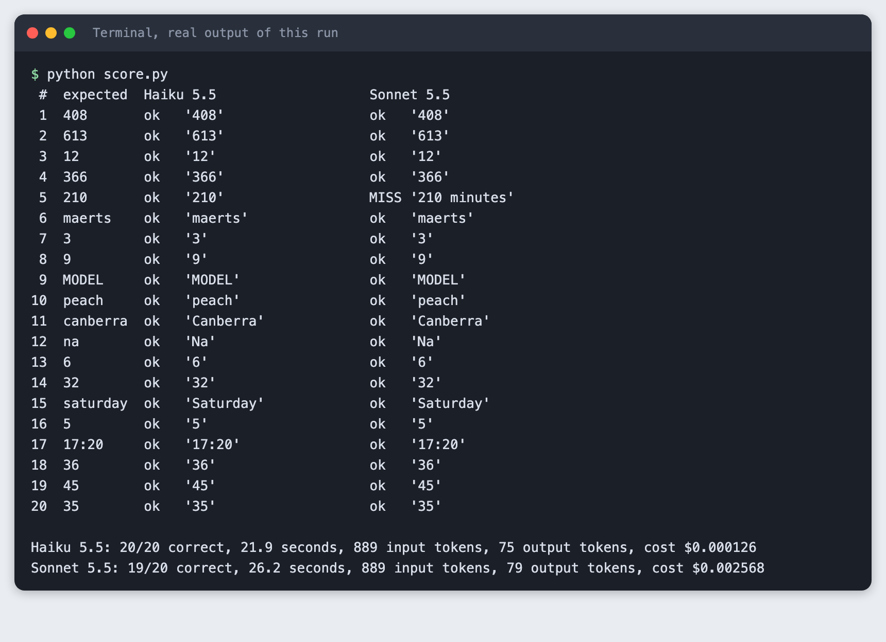
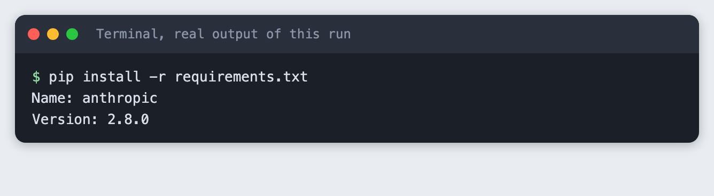
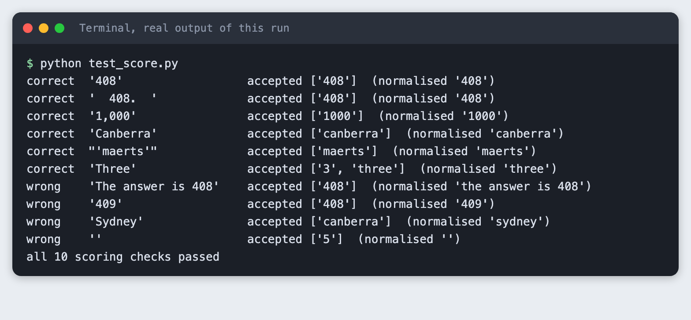
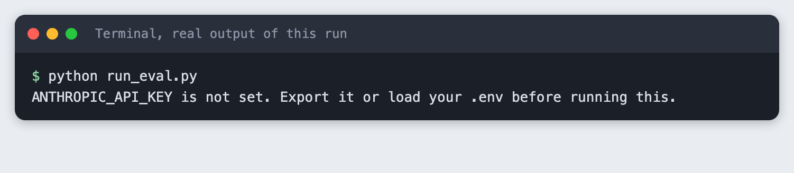
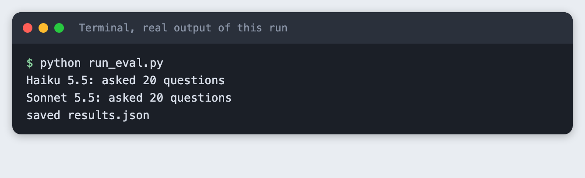
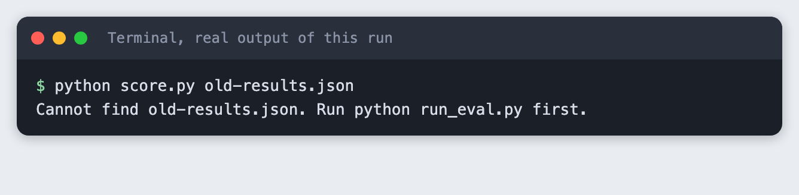

# Test a new model with your own 20 questions

You build a Python script that asks 20 questions with known answers to two models, scores the replies by a fixed rule, and records the cost and time of each model.

**Time:** about 40 minutes. **Level:** intermediate. **You need:** Python basics, Python 3.10 or newer, and an Anthropic API key. **Tested:** 11 November 2026 with Python 3.14.6 and the `anthropic` package 2.8.0 on macOS.

Model replies and timings differ from run to run. Your numbers will not match the output below exactly. The shape of the output will.

Sponsors announce new models during an AI hackathon, and your own questions tell you whether a model fits your project. If you are choosing a model for a build, see the [upcoming AI hackathons](/ai-hackathons/).

## Why this matters

A vendor chart tells you how a model did on someone else's questions. Your project has its own questions. Twenty questions with answers you can check take under an hour to write, cost a fraction of a cent to run, and give you a number you can repeat. The scoring rule matters as much as the questions, so this tutorial keeps the rule small and shows every line of it.

## See it running first

This is the finished report. Two models answered the same 20 questions. Each row shows the accepted answer and whether each model matched it.



The rest of the tutorial builds it from scratch.

## Step 1: Set up the project

Make a folder, create a virtual environment and activate it. The commands from here on assume it is active.

```bash
python3 -m venv .venv
```


Create `requirements.txt` with one line:

```text
anthropic>=2.7.0
```
*File: `requirements.txt`*

Install it. The output below shows the version used for this tutorial.

```bash
pip install -r requirements.txt
```



## Step 2: Write 20 questions with checkable answers

Pick questions where a program can decide right or wrong. Here every question has a short answer: a number, a word, or a time. Each entry lists the answers you accept. Some questions allow two forms, such as `3` and `three`.

The questions mix easy facts with a few that need a step of reasoning, such as the bat-and-ball question and the train arrival time. Use your own questions for your own project. These are only examples.

```json
[
  {"id": 1,  "question": "What is 17 * 24?", "accept": ["408"]},
  {"id": 2,  "question": "What is 1,000 minus 387?", "accept": ["613"]},
  {"id": 3,  "question": "What is the square root of 144?", "accept": ["12"]},
  {"id": 4,  "question": "How many days are there in a leap year?", "accept": ["366"]},
  {"id": 5,  "question": "How many minutes are there in 3.5 hours?", "accept": ["210"]},
  {"id": 6,  "question": "Reverse the word 'stream'. Reply with the reversed word only.", "accept": ["maerts"]},
  {"id": 7,  "question": "How many times does the letter 'r' appear in the word 'strawberry'?", "accept": ["3", "three"]},
  {"id": 8,  "question": "How many letters are in the word 'hackathon'?", "accept": ["9", "nine"]},
  {"id": 9,  "question": "Write the word 'model' in capital letters.", "accept": ["MODEL"]},
  {"id": 10, "question": "Which word comes first in alphabetical order: 'pear', 'peach', 'plum'?", "accept": ["peach"]},
  {"id": 11, "question": "What is the capital city of Australia?", "accept": ["canberra"]},
  {"id": 12, "question": "What is the chemical symbol for sodium?", "accept": ["na"]},
  {"id": 13, "question": "How many sides does a hexagon have?", "accept": ["6", "six"]},
  {"id": 14, "question": "What is the next number in this series: 2, 4, 8, 16, ?", "accept": ["32"]},
  {"id": 15, "question": "If today is Wednesday, what day of the week is it 10 days later?", "accept": ["saturday"]},
  {"id": 16, "question": "A bat and a ball cost $1.10 together. The bat costs $1.00 more than the ball. How many cents does the ball cost? Reply with the number only.", "accept": ["5"]},
  {"id": 17, "question": "A train leaves at 14:45 and the trip takes 2 hours 35 minutes. At what time does it arrive? Use the 24-hour format HH:MM.", "accept": ["17:20"]},
  {"id": 18, "question": "What is 15% of 240?", "accept": ["36"]},
  {"id": 19, "question": "Convert the binary number 101101 to decimal.", "accept": ["45"]},
  {"id": 20, "question": "What is the sum of the digits of 98765?", "accept": ["35"]}
]
```
*File: `questions.json`*

## Step 3: Write the scoring rule

The rule is exact match after cleaning. The program lowercases the reply, trims spaces, drops quote marks and one final full stop, and removes thousands commas inside numbers. The reply is correct only if the result equals one of the accepted answers, cleaned the same way. No model judges another model, and no part of a reply is searched for the answer.

This rule is strict on purpose. A reply of `210 minutes` does not match `210`. That keeps the score checkable by anyone, and you will see below that it changes a result. If your project can live with extra words, loosen the rule and write down how.

```python
"""Score saved answers against the accepted answers in questions.json. No model is involved.

The rule: normalise the reply, then it is correct only if it equals one of the accepted answers.
Normalising means: lower case, trim spaces, drop a final full stop, drop quotes, drop thousands commas."""
import json
import re
import sys


def normalise(text):
    text = text.strip().lower().strip("\"'`")
    text = text.rstrip(".").strip()
    return re.sub(r"(?<=\d),(?=\d{3})", "", text)


def is_correct(answer, accept):
    return normalise(answer) in {normalise(a) for a in accept}


def score(results_by_model, questions):
    """Return {model: {"correct": n, "marks": [bool, ...]}} for answers shaped like results.json."""
    out = {}
    for model, rows in results_by_model.items():
        marks = [is_correct(rows[str(q["id"])]["answer"], q["accept"]) for q in questions]
        out[model] = {"correct": sum(marks), "marks": marks}
    return out


def report(data, questions):
    models = list(data["models"])
    scores = score({m: data["models"][m]["answers"] for m in models}, questions)
    print(f"{'#':>2}  {'expected':<10}" + "".join(f"{data['models'][m]['label']:<28}" for m in models))
    for i, q in enumerate(questions):
        cells = ""
        for m in models:
            row = data["models"][m]["answers"][str(q["id"])]
            mark = "ok  " if scores[m]["marks"][i] else "MISS"
            cells += f"{mark} {row['answer'].strip()[:22]!r:<23}"
        print(f"{q['id']:>2}  {q['accept'][0]:<10}{cells}")
    print()
    for m in models:
        d = data["models"][m]
        print(f"{d['label']}: {scores[m]['correct']}/{len(questions)} correct, "
              f"{d['seconds']:.1f} seconds, {d['input_tokens']} input tokens, "
              f"{d['output_tokens']} output tokens, cost ${d['cost_usd']:.6f}")


if __name__ == "__main__":
    path = sys.argv[1] if len(sys.argv) > 1 else "results.json"
    try:
        data = json.load(open(path))
    except FileNotFoundError:
        sys.exit(f"Cannot find {path}. Run python run_eval.py first.")
    report(data, json.load(open("questions.json")))
```
*File: `score.py`*

The rule is the part of this tutorial most worth checking by hand, so test it on fixed answers before any model is involved. This step makes no API call.

```bash
python test_score.py
```



The four wrong cases show what the rule does not forgive: extra words around the answer, a wrong number, a wrong word and an empty reply.

## Step 4: Describe the two models

The script needs each model's name and its price per million tokens, so it can turn token counts into dollars. Prices change. Copy the real numbers from the provider's price page on the day you run this. The two models are `claude-haiku-5-5` and `claude-sonnet-5-5`.

The `thinking` setting is how each model is told not to think before it answers. The two models name that setting differently, so each carries its own value. The point is to compare short answers fairly.

```python
"""The two models and their prices in US dollars per million tokens.
Check the provider's pricing page before you rely on these numbers."""

MODELS = {
    # "thinking" is how each model is told not to think before it answers. The two models name it differently.
    "claude-haiku-5-5": {"label": "Haiku 5.5", "input": 0.10, "output": 0.50, "thinking": {"type": "disabled"}},
    "claude-sonnet-5-5": {"label": "Sonnet 5.5", "input": 2.00, "output": 10.00, "thinking": {"type": "between_tools"}},
}
MAX_TOKENS = 200


def cost_usd(model, input_tokens, output_tokens):
    price = MODELS[model]
    return (input_tokens * price["input"] + output_tokens * price["output"]) / 1_000_000
```
*File: `models.py`*

## Step 5: Store the key outside the code

Put your key in a file named `.env` in the project folder. Copy the placeholder file and edit it:

```
ANTHROPIC_API_KEY=your_key_here
```
*File: `.env.example`*

Then load it into your shell with `set -a; source .env; set +a`. Keep `.env` out of git. The project `.gitignore` already lists it. Never paste a key into a chat or a screenshot.

## Step 6: Run the questions on both models

The script sends each question with one extra line, "Reply with only the final answer. No explanation, no working." It asks one model's 20 questions, then the other's, one call at a time, so the timings do not compete for the same connection. It saves every raw answer, the tokens and the seconds to `results.json`.

```python
"""Ask every question to both models and save the raw answers, tokens and time to results.json."""
import json
import os
import sys
import time

import anthropic

from models import MAX_TOKENS, MODELS, cost_usd
from spend_log import log_usage

INSTRUCTION = "Reply with only the final answer. No explanation, no working."


def ask(client, model, question):
    start = time.perf_counter()
    response = client.messages.create(
        model=model,
        max_tokens=MAX_TOKENS,
        thinking=MODELS[model]["thinking"],
        messages=[{"role": "user", "content": f"{question}\n\n{INSTRUCTION}"}],
    )
    seconds = time.perf_counter() - start
    log_usage("run_eval.py", model, response.usage)
    answer = "".join(b.text for b in response.content if b.type == "text")
    return {"answer": answer, "seconds": seconds,
            "input_tokens": response.usage.input_tokens, "output_tokens": response.usage.output_tokens}


def main():
    if not os.environ.get("ANTHROPIC_API_KEY"):
        sys.exit("ANTHROPIC_API_KEY is not set. Export it or load your .env before running this.")
    questions = json.load(open("questions.json"))
    client = anthropic.Anthropic()
    data = {"models": {}}
    for model in MODELS:  # one model after the other, one question after the other
        rows = {str(q["id"]): ask(client, model, q["question"]) for q in questions}
        totals = {k: sum(r[k] for r in rows.values()) for k in ("seconds", "input_tokens", "output_tokens")}
        data["models"][model] = {"label": MODELS[model]["label"], "answers": rows, **totals,
                                 "cost_usd": cost_usd(model, totals["input_tokens"], totals["output_tokens"])}
        print(f"{MODELS[model]['label']}: asked {len(rows)} questions")
    json.dump(data, open("results.json", "w"), indent=2)
    print("saved results.json")


if __name__ == "__main__":
    main()
```
*File: `run_eval.py`*

If the key is missing, the script stops with a plain message instead of a long error:

```bash
python run_eval.py
```



Now run it with the key loaded.

```bash
python run_eval.py
```



The runner does not print the answers. They are in `results.json`, ready for the scorer.

## Step 7: Score and compare

`score.py` reads `results.json` and `questions.json`, applies the rule and prints a table plus one totals line per model.

```bash
python score.py
```

```text
 #  expected  Haiku 5.5                   Sonnet 5.5                  
 1  408       ok   '408'                  ok   '408'                  
 2  613       ok   '613'                  ok   '613'                  
 3  12        ok   '12'                   ok   '12'                   
 4  366       ok   '366'                  ok   '366'                  
 5  210       ok   '210'                  MISS '210 minutes'          
 6  maerts    ok   'maerts'               ok   'maerts'               
 7  3         ok   '3'                    ok   '3'                    
 8  9         ok   '9'                    ok   '9'                    
 9  MODEL     ok   'MODEL'                ok   'MODEL'                
10  peach     ok   'peach'                ok   'peach'                
11  canberra  ok   'Canberra'             ok   'Canberra'             
12  na        ok   'Na'                   ok   'Na'                   
13  6         ok   '6'                    ok   '6'                    
14  32        ok   '32'                   ok   '32'                   
15  saturday  ok   'Saturday'             ok   'Saturday'             
16  5         ok   '5'                    ok   '5'                    
17  17:20     ok   '17:20'                ok   '17:20'                
18  36        ok   '36'                   ok   '36'                   
19  45        ok   '45'                   ok   '45'                   
20  35        ok   '35'                   ok   '35'                   

Haiku 5.5: 20/20 correct, 21.9 seconds, 889 input tokens, 75 output tokens, cost $0.000126
Sonnet 5.5: 19/20 correct, 26.2 seconds, 889 input tokens, 79 output tokens, cost $0.002568
```

What the run showed:

- Haiku 5.5 got 20 of 20. Sonnet 5.5 got 19 of 20.
- The one miss was question 5. Sonnet 5.5 replied `210 minutes`. The number is right, but under the strict rule it is wrong. With a looser rule both models would have scored 20 of 20. This is why the rule must be written down before you read the results.
- Each model sent 889 input tokens. Haiku 5.5 produced 75 output tokens and Sonnet 5.5 produced 79.
- Haiku 5.5 cost $0.000126 and Sonnet 5.5 cost $0.002568, from the prices in `models.py`. Sonnet 5.5 cost about 20 times as much for the 20 questions.
- Time for the 20 calls was 21.9 seconds for Haiku 5.5 and 26.2 seconds for Sonnet 5.5. Timing depends on your network and the load at the time, so repeat it before you rely on it.

Twenty easy questions cannot separate two capable models. Both did well, and the one difference came from formatting, not knowledge. Add harder questions from your own project before you decide.

If you point the scorer at a file that does not exist, it says so:

```bash
python score.py old-results.json
```



## Step 8: Write down the result

Keep a short note next to the results. Use these lines as a template and fill in your own numbers:

- Date, model names, and the price per million tokens you used.
- The scoring rule, in one sentence, and the date you wrote it.
- Score per model, cost per model, seconds per model.
- Every miss and why it was a miss, so a reader can see if the rule or the model caused it.
- What you did not test.

## Troubleshooting

- **`ANTHROPIC_API_KEY is not set`.** The key is not in your shell. Run `set -a; source .env; set +a` in the same terminal, then run the script again.
- **An authentication error from the API.** The key is wrong or revoked. Create a new one in your Anthropic account and update `.env`.
- **A model's answer is right but marked wrong.** Open `results.json` and compare the raw reply with the accepted answers. Either add the form to `accept` or loosen the rule, and note the change.
- **The model name is not found.** Model names change. Check the current names in the provider's documentation and update `models.py`.
- **A reply is cut off or empty.** The script limits each reply to 200 tokens. Raise `MAX_TOKENS` in `models.py` if your questions need longer answers.

## Frequently asked questions

**How do I know if a new model fits my project?**

Write questions from your own project with answers a program can check, run them on the new model and on the one you use now, and compare the scores, cost and time. In this test one model scored 20 of 20 and the other 19 of 20, and the difference came from a reply with extra words.

**How many test questions do I need?**

This tutorial used 20, which is enough to see the method work and to spot formatting problems. It was not enough to separate two capable models, because both scored almost the same. The test did not find a number to recommend. Add questions until the results stop changing when you add more.

**Can I trust a model leaderboard for my hackathon idea?**

A leaderboard measures someone else's questions. This tutorial did not test any leaderboard. It shows how to measure your own questions, which is the only score that reflects your project.

## What to try next

- Add 10 harder questions from your own project and see whether the two models separate.
- Run the same 20 questions three times and check how much the score and time move.
- Add a second scoring rule that accepts a number inside a longer reply, and compare both scores.

## How this tutorial was tested

- Date: 11 November 2026. Python 3.14.6, `anthropic` 2.8.0, macOS. The models are `claude-haiku-5-5` and `claude-sonnet-5-5`.
- The code in this article is copied from the project files by a script. The output and screenshots come from saved logs of real API calls.
- Every step was run from a clean folder, then replayed from an empty copy of the folder with no virtual environment. The replay passed. In the replay the totals were again 20 of 20 and 19 of 20, with different timings, as expected.
- Terminal screenshots are rendered from the saved output of the run. They are not captures of a terminal window.
- Not run: Windows, Linux, Python versions other than 3.14.6, models other than the two named, and more than one run of the 20 questions per pass. The prices in `models.py` were not checked against a live price page on the test date.

