# Answer questions from your own notes with Chroma and Claude

You build a small chatbot that reads a folder of markdown notes, stores them in a local Chroma vector store, finds the chunks closest to a question, and asks `claude-haiku-5-5` to answer from those chunks only. The answer cites file names. When the notes do not contain the answer, it says "not in the notes".

**Time:** about 45 minutes, plus a model download of about 79 MB. **Level:** intermediate. **You need:** Python basics, Python 3.10 or newer, and an Anthropic API key. **Tested:** 12 November 2026 with Python 3.14.6, `chromadb` 1.5.9, `anthropic` 2.8.0 and `onnxruntime` 1.31.1 on macOS.

Model replies differ from run to run. Your wording, token counts and distances may not match the output below. The shape of the output will.

A team in an AI hackathon builds up notes fast: who owns what, which tools, what can go wrong. A chatbot that answers from those notes and shows its source file saves a teammate a search at 02:00. When you are ready to try it on a real project, see the [upcoming AI hackathons](/ai-hackathons/).

## Why this matters

A model that answers from memory can make up a plausible fact about your project. Retrieval narrows the job. You find the few passages that look relevant, give only those to the model, and tell it to use nothing else. Citations let you check each claim against a file. A fixed phrase for "the notes do not say" gives your code, and your teammates, something to rely on.

## See it running first

This is the finished chatbot answering a question from nine made-up notes. The retrieved files are listed, then the answer, with the file it came from.

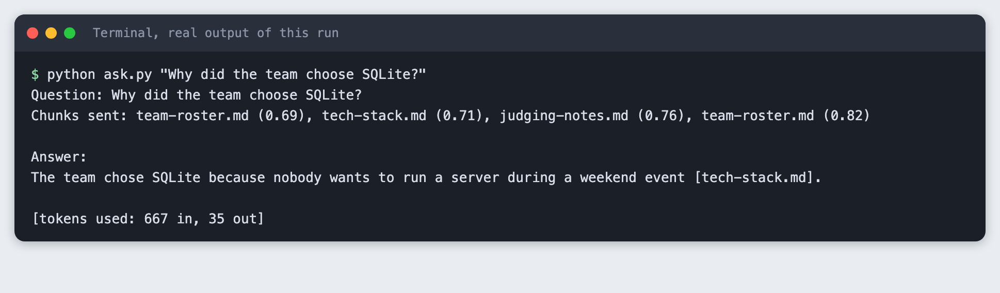

The rest of the tutorial builds it from nothing.

## Step 1: Set up the project

Create a virtual environment. The lines from here on assume it is active (`source .venv/bin/activate`).

```bash
python3 -m venv .venv
```

Create `requirements.txt`:

```text
chromadb>=1.0
anthropic>=2.7.0
```
*File: `requirements.txt`*

```bash
pip install -r requirements.txt
```

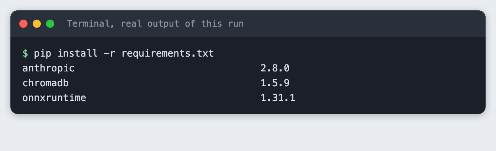

Put your key in a file named `.env`. Copy the placeholder and edit it:

```
# Copy this file to .env and fill it in. Never paste a key in chat.
ANTHROPIC_API_KEY=your_key_here
```
*File: `.env.example`*

Never paste a real key into code, a screenshot or a chat. Load the file into your terminal session on macOS or Linux:

```bash
set -a; source .env; set +a
```

## Step 2: Write the notes

The tutorial uses nine short notes about a made-up team called Lantern Fox, who are building a tide-alert app called TideTable. The team and every fact in the notes are invented for this tutorial. Use your own notes if you prefer. Any folder of `.md` files works.

```bash
ls notes
```

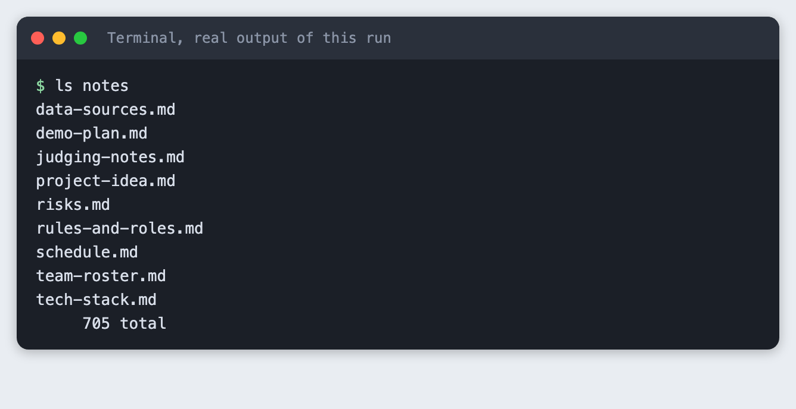

The notes total 705 words. Each one covers a single topic, such as `risks.md` or `schedule.md`. One topic per file keeps a file name useful as a citation.

## Step 3: Check the licence and the download size

Chroma embeds text for you with a default local model, `all-MiniLM-L6-v2`, so you write no embedding code. Before you rely on it, check what it costs you. The model is downloaded to your machine on the earliest run, so look at the size and the licence.

Check the Chroma version and the licence in its package metadata.

```bash
pip show -v chromadb | grep -E '^Version|License'
```

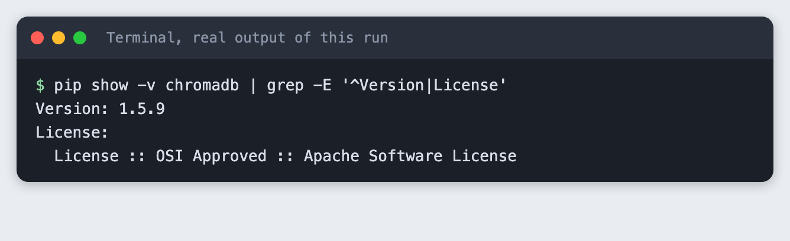

Then ask the server for the size of the model archive.

```bash
curl -sIL https://chroma-onnx-models.s3.amazonaws.com/all-MiniLM-L6-v2/onnx.tar.gz | grep -i "^content-length"
```

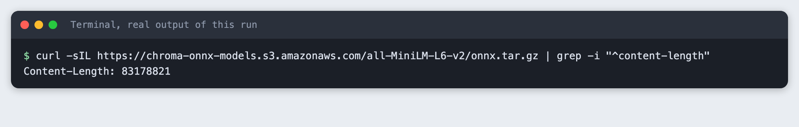

The package metadata lists the Apache Software License for `chromadb`. The model archive is 83,178,821 bytes, about 79 MiB. The model card for `all-MiniLM-L6-v2` on Hugging Face lists the licence as Apache-2.0 (checked on 12 November 2026). That is well under 500 MB, so this tutorial uses the default. If you need a different model, pass your own embedding function to Chroma. The tutorial `embeddings-search-python` in this collection uses a different local model with the `fastembed` package.

The model downloads from a Chroma-hosted address on Amazon S3. The size is the same everywhere. The time is not: the download took about five minutes on the connection used for this tutorial.

## Step 4: Download the model once

Do this as its own step so a slow download does not hide inside a later one. `warm_up.py` asks the default embedding function for one vector, which makes Chroma fetch and load the model.

```python
"""Load Chroma's default embedding model. The first call downloads it, later calls reuse it."""
from chromadb.utils.embedding_functions import DefaultEmbeddingFunction

vectors = DefaultEmbeddingFunction()(["warm up"])
print(f"Model ready: all-MiniLM-L6-v2, vectors of {len(vectors[0])} numbers")
```
*File: `warm_up.py`*

```bash
python warm_up.py
```

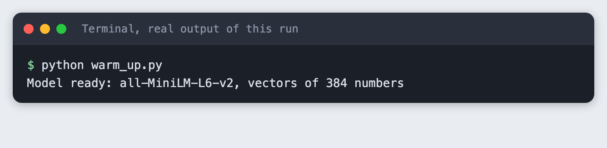

Each piece of text becomes a list of 384 numbers. The progress bar goes to stderr, and the step hides it so the output stays readable. Remove `2>/dev/null` if you want to watch the download.

## Step 5: Split the notes and store them in Chroma

Chroma stores the text, a vector for it, and metadata you attach. Retrieval works on chunks, so each note is split first. `chunk_note` in `kb.py` splits on blank lines and packs whole paragraphs into chunks of up to 400 characters. It adds the note's heading to every chunk, so a chunk that says "She owns the API" still says which note it came from.

```python
"""Shared pieces: where the notes live, the Chroma collection, the chunker."""
from pathlib import Path

import chromadb

HERE = Path(__file__).parent
NOTES_DIR = HERE / "notes"
DB_DIR = HERE / "chroma_db"
COLLECTION = "team_notes"
MAX_CHARS = 400


def chunk_note(text, max_chars=MAX_CHARS):
    """Split a note on blank lines, then pack whole paragraphs up to max_chars.

    The first line of a note is its heading. It is added to every chunk so a chunk
    still says what it is about when it is read on its own.
    """
    heading, _, body = text.partition("\n")
    paragraphs = [p.strip() for p in body.split("\n\n") if p.strip()]
    chunks, current = [], ""
    for p in paragraphs:
        if current and len(current) + len(p) + 2 > max_chars:
            chunks.append(current)
            current = p
        else:
            current = f"{current}\n\n{p}" if current else p
    if current:
        chunks.append(current)
    return [f"{heading.strip()}\n\n{c}" for c in chunks]


def get_client():
    return chromadb.PersistentClient(path=str(DB_DIR))
```
*File: `kb.py`*

`ingest.py` reads every note, builds one id per chunk (the file name and a chunk number) and stores the chunk with its file name as metadata. It deletes and recreates the collection each time, so running it twice leaves the same data, not duplicates. The collection uses cosine distance, where a smaller number means closer.

```python
"""Read every .md file in notes/, split it into chunks, store the chunks in Chroma.

No embedding code here: Chroma embeds the text with its default local model.
The script rebuilds the collection each time, so running it twice gives the same result.
"""
import sys

from kb import COLLECTION, NOTES_DIR, chunk_note, get_client


def main():
    files = sorted(NOTES_DIR.glob("*.md"))
    if not files:
        sys.exit(f"No .md files found in {NOTES_DIR.name}/")

    client = get_client()
    try:
        client.delete_collection(COLLECTION)
    except Exception:
        pass  # first run: nothing to delete
    collection = client.create_collection(COLLECTION, metadata={"hnsw:space": "cosine"})

    ids, documents, metadatas = [], [], []
    for path in files:
        for n, chunk in enumerate(chunk_note(path.read_text(encoding="utf-8")), start=1):
            ids.append(f"{path.name}#{n}")
            documents.append(chunk)
            metadatas.append({"source": path.name, "chunk": n})

    collection.add(ids=ids, documents=documents, metadatas=metadatas)
    print(f"Read {len(files)} notes, stored {collection.count()} chunks in chroma_db/")


if __name__ == "__main__":
    main()
```
*File: `ingest.py`*

```bash
python ingest.py
```


Nine notes became 13 chunks. Run it again:

```bash
python ingest.py
```

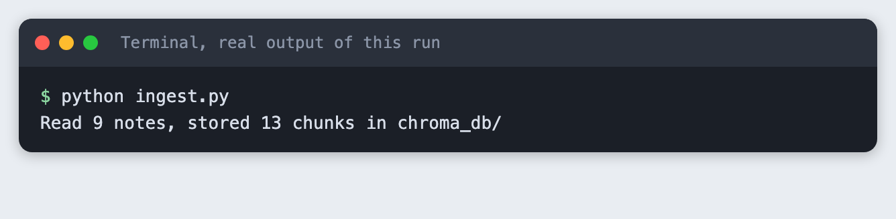

The count is still 13.

## Step 6: Retrieve chunks for a question

`search.py` asks Chroma for the four closest chunks and prints each with its file name and distance. It makes no model call and needs no key, so test retrieval on its own before you add the model.

```python
"""Print the chunks closest to a question. No model call, no key needed."""
import sys
import textwrap

from kb import COLLECTION, get_client


def retrieve(question, k=4):
    """Return a list of (source, distance, text) for the k closest chunks."""
    collection = get_client().get_collection(COLLECTION)
    result = collection.query(query_texts=[question], n_results=k)
    return [
        (meta["source"], dist, doc)
        for meta, dist, doc in zip(result["metadatas"][0], result["distances"][0], result["documents"][0])
    ]


def main():
    if len(sys.argv) < 2:
        sys.exit('Usage: python search.py "your question"')
    question = sys.argv[1]
    print(f"Question: {question}\n")
    for rank, (source, dist, text) in enumerate(retrieve(question), start=1):
        first_line = textwrap.shorten(text.split("\n\n", 1)[1], width=100, placeholder="...")
        print(f"{rank}. {source}  distance {dist:.3f}")
        print(f"   {first_line}")


if __name__ == "__main__":
    main()
```
*File: `search.py`*

```bash
python search.py "Who is cleaning the tide data?"
```

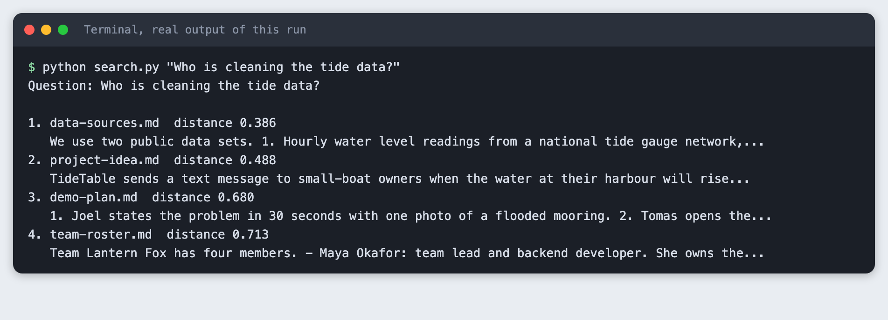

The closest chunk is `data-sources.md` at a distance of 0.386. The question asks who cleans the tide data. The right name, Priya, is in `schedule.md` and `team-roster.md` too, and only `team-roster.md` came back, in fourth place at 0.713. Retrieval works on meaning, not on exact words, and it is not exact. That is why the script sends four chunks and not one.

## Step 7: Ask the model, with rules

`ask.py` wraps the retrieved chunks in `<note file="...">` tags, so the model can see each file name. The instructions say four things: use only the excerpts, cite the file after each fact, reply with exactly "not in the notes" if the answer is missing, and keep it short. The call turns thinking off, so a small `max_tokens` is spent on the answer.

```python
"""Answer a question from the notes only, with file-name citations."""
import os
import sys

from anthropic import Anthropic

from search import retrieve

MODEL = "claude-haiku-5-5"
NOT_FOUND = "not in the notes"

INSTRUCTIONS = f"""You answer questions about a hackathon team using only the note excerpts below.
Rules:
- Use only facts that appear in the excerpts. Do not use outside knowledge.
- After each fact, cite the file it came from in square brackets, for example [risks.md].
- If the excerpts do not contain the answer, reply with exactly: {NOT_FOUND}
- Keep the answer to three sentences or fewer."""


def build_prompt(question, chunks):
    blocks = [f'<note file="{source}">\n{text}\n</note>' for source, _, text in chunks]
    return f"{INSTRUCTIONS}\n\n" + "\n\n".join(blocks) + f"\n\nQuestion: {question}"


def main():
    if len(sys.argv) < 2:
        sys.exit('Usage: python ask.py "your question"')
    if not os.environ.get("ANTHROPIC_API_KEY"):
        sys.exit("ANTHROPIC_API_KEY is not set. Load your .env file first.")

    question = sys.argv[1]
    chunks = retrieve(question, k=4)
    print(f"Question: {question}")
    print("Chunks sent: " + ", ".join(f"{s} ({d:.2f})" for s, d, _ in chunks) + "\n")

    response = Anthropic().messages.create(
        model=MODEL,
        max_tokens=300,
        thinking={"type": "disabled"},
        messages=[{"role": "user", "content": build_prompt(question, chunks)}],
    )
    answer = "".join(b.text for b in response.content if b.type == "text").strip()
    if not answer:
        sys.exit(f"The model returned no text (stop reason: {response.stop_reason}).")
    print("Answer:")
    print(answer)
    print(f"\n[tokens used: {response.usage.input_tokens} in, {response.usage.output_tokens} out]")


if __name__ == "__main__":
    main()
```
*File: `ask.py`*

First, see what a missing key looks like. Run the script where the variable is not set:

```bash
python ask.py "Why did the team choose SQLite?"
```

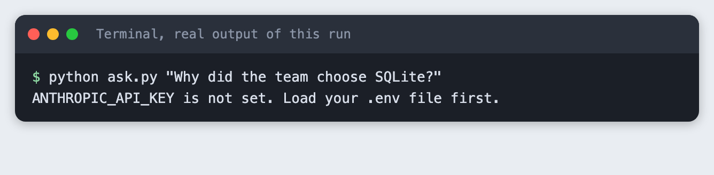

Now run it with the key loaded:

```bash
python ask.py "Why did the team choose SQLite?"
```

```text
Question: Why did the team choose SQLite?
Chunks sent: team-roster.md (0.69), tech-stack.md (0.71), judging-notes.md (0.76), team-roster.md (0.82)

Answer:
The team chose SQLite because nobody wants to run a server during a weekend event [tech-stack.md].

[tokens used: 667 in, 35 out]
```

The answer is one sentence with a citation to `tech-stack.md`. The retrieved list shows that the closest chunk was `team-roster.md` at 0.69, and the chunk with the answer was second at 0.71. The model still found it, because all four chunks were in the prompt. The run used 667 input tokens and 35 output tokens.

## Step 8: A question that needs two notes

```bash
python ask.py "Who will text during the demo, and what limits the text messages?"
```

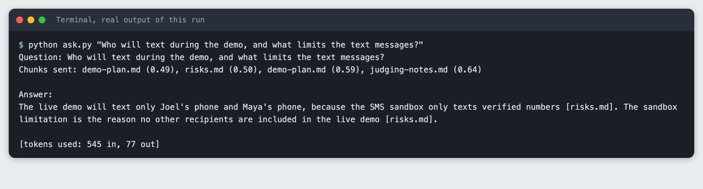

The answer combines the names of the phones with the reason for the limit. Both citations point to `risks.md`, because the chunk with the names was retrieved from `risks.md`. The model also added a second sentence that repeats the limit. Check long answers like this against the notes: citations show where to look, they do not prove the claim.

## Step 9: A question the notes cannot answer

The notes say nothing about food. Chroma still returns four chunks, because a nearest-neighbour search always returns the nearest ones, however far away.

```bash
python ask.py "How much did the team spend on food during the event?"
```

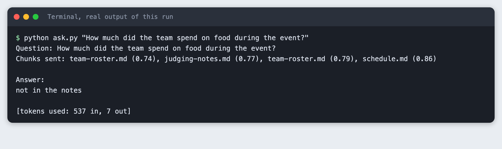

The model replied with exactly "not in the notes". The distances are 0.74 to 0.86, higher than the 0.39 to 0.49 seen for the closest chunks in the other questions. You could add a distance cut-off and skip the model call when no chunk is close enough. This tutorial did not test a cut-off, so any number would be a guess for your own notes.

## Step 10: What a mistake looks like

Point the ingest script at an empty folder:

```bash
python ingest.py   # with an empty notes folder
```

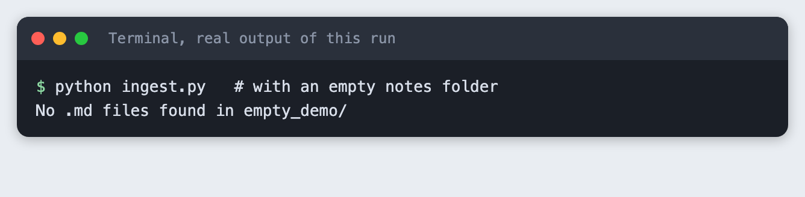

The script stops with one line and a non-zero exit code, instead of storing nothing and reporting success.

## Troubleshooting

- **The first run seems stuck.** It is downloading the model, about 79 MB. Run `python warm_up.py` without `2>/dev/null` to see the progress bar. On the connection used here it took about five minutes.
- **`ANTHROPIC_API_KEY is not set`.** The variable is not in the terminal you are running from. Run `set -a; source .env; set +a` again in that terminal.
- **The answer is wrong but sounds sure.** Run `search.py` with the same question. If the chunk with the answer is not in the top four, retrieval missed it. Raise `k` in `ask.py`, or write shorter, single-topic notes.
- **Old chunks show up after you edit a note.** Run `python ingest.py` again. It rebuilds the collection from the current files.

## Frequently asked questions

**Do I need to write embedding code to use Chroma?**

No. If you pass only text, Chroma embeds it with its default local model. In this tutorial that model, `all-MiniLM-L6-v2`, turned each chunk into 384 numbers. The model is about 79 MB and downloads once. If you need another model, you can give Chroma your own embedding function.

**How do I make a chatbot answer only from my notes?**

Retrieve the closest chunks, put them in the prompt, and tell the model to use nothing else, to cite the file after each fact, and to reply with a fixed phrase when the answer is missing. In the run here, a food question that the notes do not cover got exactly "not in the notes". This reduces made-up answers. It does not remove them, so check the citations.

**How do I show which file an answer came from?**

Store the file name as metadata on each chunk, label each chunk with it in the prompt, and ask for a citation in square brackets. `ask.py` does this, and the SQLite answer cited `tech-stack.md`.

## What to try next

- Add a distance cut-off and measure, on your own notes, which value separates answered questions from missing ones.
- Check that every file name in an answer is one of the files that were sent, and flag the answer if not.
- Re-embed only the notes that changed, instead of rebuilding the whole collection.

## How this tutorial was tested

- Date: 12 November 2026. Python 3.14.6, `chromadb` 1.5.9, `anthropic` 2.8.0, macOS. The model is `claude-haiku-5-5`, set in the `MODEL` constant.
- The code in this article is copied from the project files by a script. The output and screenshots come from saved logs of real runs, including three real API calls.
- Every step was run from a clean folder, then replayed from an empty copy of the folder with no virtual environment. The embedding model stayed cached on the machine between the two runs, so the replay did not download it again. The retrieval distances and the model replies in the replay are noted by the build log, and the model wording differed in places.
- Terminal screenshots are rendered from the saved output of the run. They are not captures of a terminal window.
- Not run: Windows, Linux, Python versions other than 3.14.6, notes longer than a few hundred words, a distance cut-off, and models other than `claude-haiku-5-5`.

