# Build a summariser command-line tool in Python with Claude

You build a small Python command that reads a text file or pasted text and prints a one-line headline and a bullet summary. You choose how long the summary is, and the tool refuses input that is too large.

**Time:** about 30 minutes. **Level:** beginner. **You need:** Python 3.10 or newer, basic comfort with a terminal, and an Anthropic API key. **Tested:** 12 November 2026 with Python 3.14.6 and the `anthropic` package 2.8.0 on macOS.

Model replies differ from run to run. Your wording will not match the output below. The shape of the output will.

A summariser is one of the quickest useful features to add to an AI hackathon project, and a command-line version is easy to test and reuse. If you are looking for a place to use it, see the [upcoming AI hackathons](/ai-hackathons/).

## Why this matters

Most text you want to summarise is longer than you want to read, and sometimes longer than you want to pay to send. Three small decisions make a summariser usable: how long the result should be, what to do when the text is long, and when to say no. This tutorial makes each one a plain piece of code you can read.

## See it running first

This is the finished tool summarising a made-up news item of about 3,400 characters. It splits the text, collects notes on each part, then writes one headline and eight bullets.

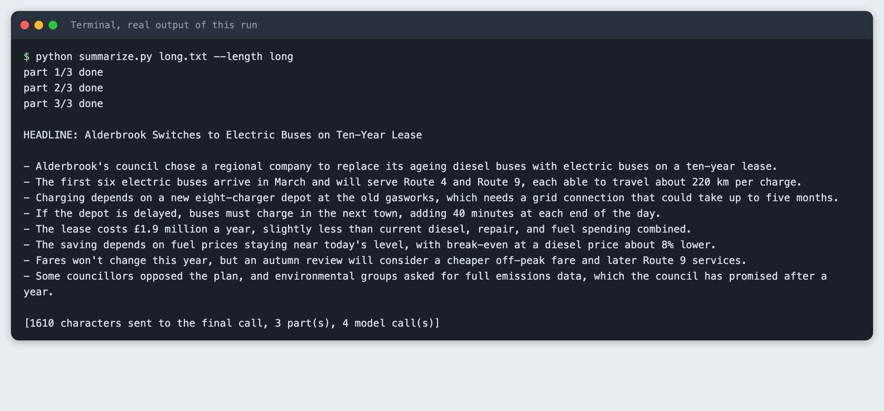

The rest of the tutorial builds it from nothing.

## Step 1: Set up the project

Create a virtual environment. The commands from here on assume it is active (`source .venv/bin/activate`).

```bash
python3 -m venv .venv && .venv/bin/python --version
```

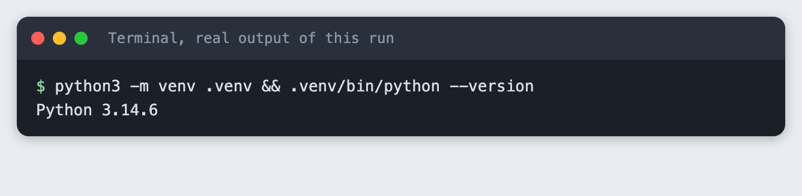

Create `requirements.txt` with one line:

```text
anthropic>=2.7.0
```
*File: `requirements.txt`*

```bash
pip install -r requirements.txt | tail -n 4
```

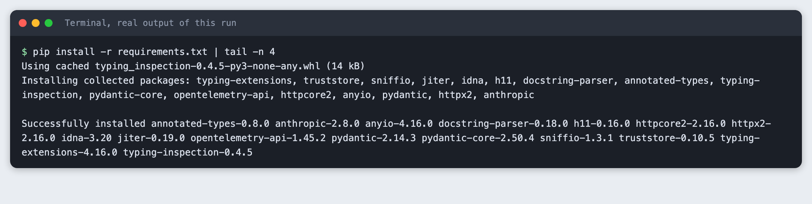

Check the version that was installed:

```bash
pip show anthropic | sed -n 1,2p
```

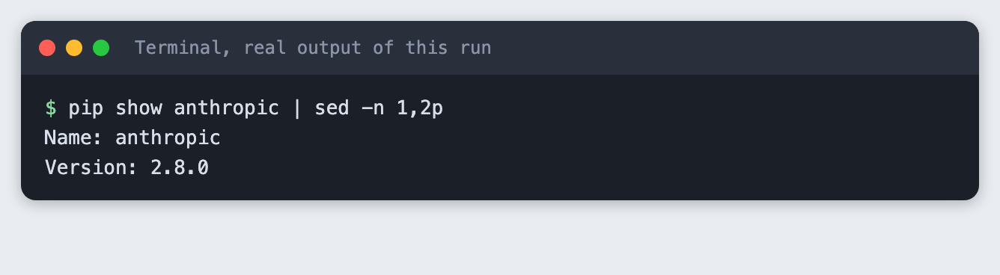

Put your key in a file named `.env`. Copy the placeholder file and edit it:

```
ANTHROPIC_API_KEY=your_key_here
```
*File: `.env.example`*

Never paste a real key into code, a screenshot or a chat. Load the file into your terminal session on macOS or Linux:

```bash
set -a; source .env; set +a
```

## Step 2: The text to summarise

The project has two made-up texts, written for this tutorial. `article.txt` is a news item about a library reopening, 1,121 characters long. `long.txt` is a longer item about a town changing its buses, 3,384 characters long. Any plain text file works.

## Step 3: The whole tool

`summarize.py` has four jobs. It reads the input from a file, or from standard input when you pass `-`. It checks the size before it does anything that costs money. It splits long text into parts. It asks the model for a headline and a fixed number of bullets.

Length is a word you choose: `short` gives 3 bullets, `medium` gives 5 and `long` gives 8. The tool puts the number in the prompt. A bullet count is easier to check than a word count, and it is easy to read at a glance.

```python
import argparse
import os
import sys
from pathlib import Path

MODEL = "claude-haiku-5-5"
BULLETS = {"short": 3, "medium": 5, "long": 8}
CHUNK_CHARS = 1500


def read_input(source):
    """Read a file, or pasted text from standard input when source is '-'."""
    if source == "-":
        return sys.stdin.read().strip()
    path = Path(source)
    if not path.is_file():
        sys.exit(f"Cannot find {source}")
    return path.read_text(encoding="utf-8").strip()


def split_text(text, max_chars):
    """Pack whole paragraphs into chunks of up to max_chars. A longer paragraph is cut at a space."""
    chunks, current = [], ""
    for paragraph in (p.strip() for p in text.split("\n\n") if p.strip()):
        while len(paragraph) > max_chars:
            cut = paragraph.rfind(" ", 0, max_chars)
            cut = cut if cut > 0 else max_chars
            if current:
                chunks.append(current)
                current = ""
            chunks.append(paragraph[:cut])
            paragraph = paragraph[cut:].strip()
        if current and len(current) + 2 + len(paragraph) > max_chars:
            chunks.append(current)
            current = paragraph
        else:
            current = f"{current}\n\n{paragraph}" if current else paragraph
    if current:
        chunks.append(current)
    return chunks


def ask(client, prompt):
    response = client.messages.create(
        model=MODEL,
        max_tokens=600,
        thinking={"type": "disabled"},  # with thinking on, max_tokens can run out before any text appears
        messages=[{"role": "user", "content": prompt}],
    )
    text = "".join(block.text for block in response.content if block.type == "text").strip()
    if not text:
        sys.exit(f"The model returned no text (stop reason: {response.stop_reason}).")
    return text


def summarise(client, text, count):
    prompt = (
        "Summarise the text below.\n"
        "Line 1: a headline of at most 10 words, starting with 'HEADLINE: '.\n"
        f"Then exactly {count} bullet points, each starting with '- ' and holding one short sentence.\n"
        f"Use only facts from the text. Write nothing else.\n\n{text}"
    )
    return ask(client, prompt)


def main():
    parser = argparse.ArgumentParser(description="Summarise a text file or pasted text.")
    parser.add_argument("source", help="a text file, or - to read pasted text from standard input")
    parser.add_argument("--length", choices=BULLETS, default="medium", help="short=3, medium=5, long=8 bullets")
    parser.add_argument("--max-input", type=int, default=20000, help="refuse input longer than this many characters")
    parser.add_argument("--dry-run", action="store_true", help="show how the text would be split, send nothing")
    args = parser.parse_args()

    text = read_input(args.source)
    if not text:
        sys.exit("The input is empty.")
    if len(text) > args.max_input:
        sys.exit(f"Input is {len(text)} characters, over the limit of {args.max_input}. Nothing was sent.")
    parts = split_text(text, CHUNK_CHARS)
    if args.dry_run:
        print(f"{len(text)} characters, {len(parts)} part(s) of up to {CHUNK_CHARS} characters. Nothing was sent.")
        return
    if not os.environ.get("ANTHROPIC_API_KEY"):
        sys.exit("ANTHROPIC_API_KEY is not set. Export it or load your .env first.")

    from anthropic import Anthropic

    client = Anthropic()
    count = BULLETS[args.length]
    calls = 1
    if len(parts) > 1:
        notes = []
        for number, part in enumerate(parts, 1):
            notes.append(ask(client, f"List the 3 main facts in this part of a longer text, one line each.\n\n{part}"))
            print(f"part {number}/{len(parts)} done")
        text = "\n".join(notes)
        calls += len(parts)
        print()
    print(summarise(client, text, count))
    print(f"\n[{len(text)} characters sent to the final call, {len(parts)} part(s), {calls} model call(s)]")


if __name__ == "__main__":
    main()
```
*File: `summarize.py`*

Two details are worth noting. The model is called with thinking turned off. With thinking on, a small `max_tokens` can be used up before any text appears, and the reply comes back empty (see Troubleshooting). The `anthropic` import sits after the guards, so a refused or empty input fails fast.

## Step 4: See how the text will be split, for free

The `--dry-run` flag reports how the text would be split and sends nothing. It needs no key. Run it on the short text:

```bash
python summarize.py article.txt --dry-run
```


It is 1 part. Now the longer text:

```bash
python summarize.py long.txt --dry-run
```

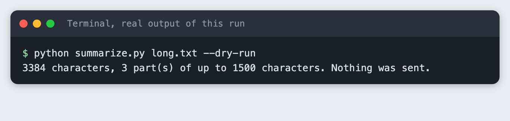

The split is on blank lines. Whole paragraphs are packed into parts of up to 1,500 characters, and a paragraph is only cut if it is longer than that by itself. The 3,384 characters here came out as 3 parts. The number comes from the dry run, not from a model, so it will be the same for you.

## Step 5: The input-size guard

A tool that accepts anything can send a very large file by mistake. `--max-input` sets a limit in characters, and the default is 20,000. The check happens before the key is read and before any call. Lower the limit to see it work:

```bash
python summarize.py long.txt --max-input 2000
```

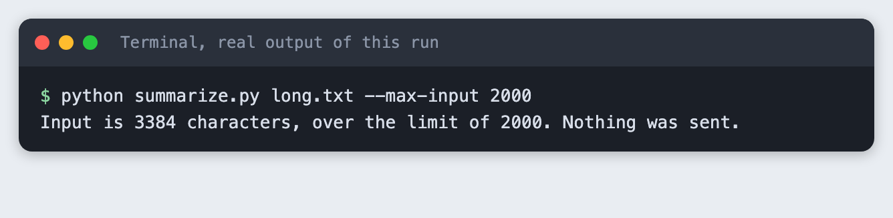

The message gives both numbers and says nothing was sent. The exit code is 1, so a script that calls the tool can tell it stopped. The limit counts characters, not tokens. It is a rough guard against accidents, not a cost cap. The 20,000 default is a choice for this tutorial, not a model limit.

## Step 6: What a missing key looks like

Run the tool in a terminal where the key is not set:

```bash
python summarize.py article.txt
```

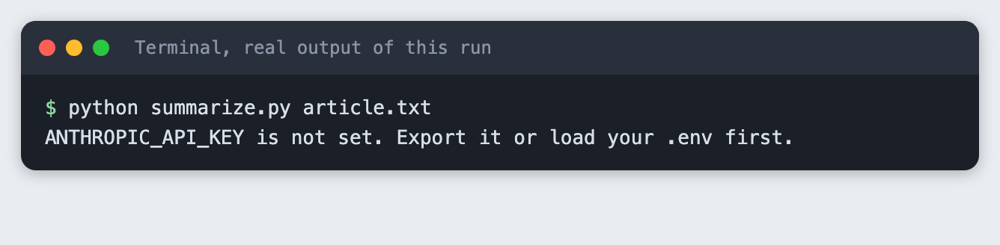

## Step 7: Summarise a file

Load your key and run the tool on the short text. The default length is `medium`:

```bash
python summarize.py article.txt
```

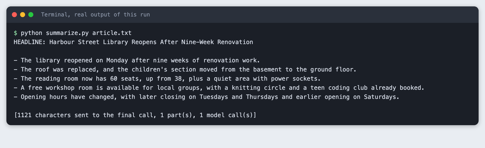

The headline comes first, then 5 bullets. The last line is for you: how many characters went into the final call, how many parts there were, and how many model calls the run made. A short text is 1 call.

## Step 8: Choose a shorter length

```bash
python summarize.py article.txt --length short
```

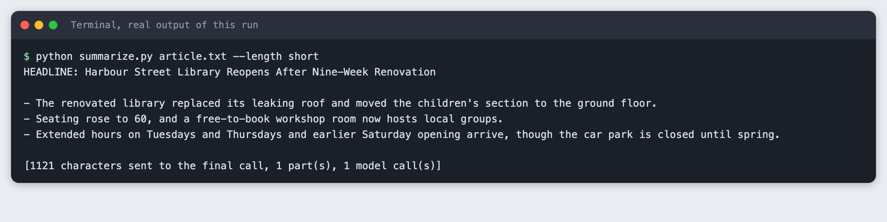

Same text, 3 bullets. The model picks which facts to keep, so the three bullets are not the first three of the longer list.

## Step 9: A text that needs chunks

The long text is 3 parts, so the tool does something different. It asks for the 3 main facts in each part, joins those notes, and asks for the headline and bullets from the notes. That is 3 calls for notes and 1 for the summary.

```bash
python summarize.py long.txt --length long
```

```text
part 1/3 done
part 2/3 done
part 3/3 done

HEADLINE: Alderbrook Switches to Electric Buses on Ten-Year Lease

- Alderbrook's council chose a regional company to replace its ageing diesel buses with electric buses on a ten-year lease.
- The first six electric buses arrive in March and will serve Route 4 and Route 9, each able to travel about 220 km per charge.
- Charging depends on a new eight-charger depot at the old gasworks, which needs a grid connection that could take up to five months.
- If the depot is delayed, buses must charge in the next town, adding 40 minutes at each end of the day.
- The lease costs £1.9 million a year, slightly less than current diesel, repair, and fuel spending combined.
- The saving depends on fuel prices staying near today's level, with break-even at a diesel price about 8% lower.
- Fares won't change this year, but an autumn review will consider a cheaper off-peak fare and later Route 9 services.
- Some councillors opposed the plan, and environmental groups asked for full emissions data, which the council has promised after a year.

[1610 characters sent to the final call, 3 part(s), 4 model call(s)]
```

The run made 4 model calls, and the final call received 1,723 characters of notes instead of 3,384 characters of text. The size of each call stays small however long the input is, up to the guard. The cost is detail: the summary is built from notes, not from the original wording. Something a note did not mention cannot appear in the summary. This tutorial did not test a text near the 20,000-character default limit.

## Step 10: Summarise pasted text

Pass `-` instead of a file name and the tool reads standard input. That works with a pipe, or you can type text and press Ctrl-D on macOS and Linux.

```bash
printf 'The swimming pool on Mill Road closes ... shut.' | python summarize.py - --length short
```

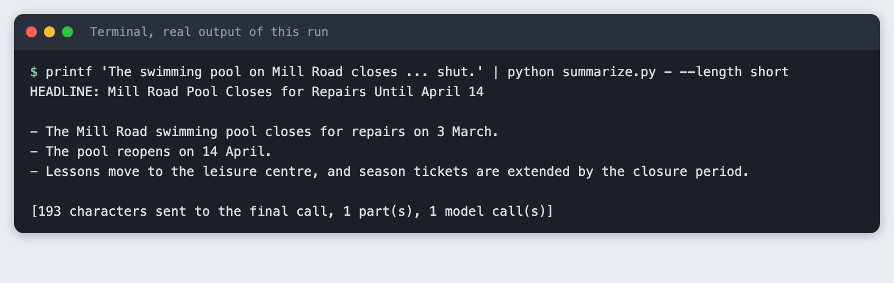

## Step 11: What a mistake looks like

Name a file that does not exist:

```bash
python summarize.py notes.txt
```

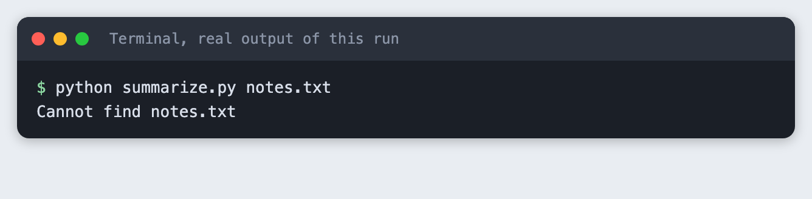

The tool stops with one line and a non-zero exit code.

## Troubleshooting

- **The tool prints "The model returned no text (stop reason: max_tokens)".** This happened while building this tutorial, on the first run of the long text. With thinking left on, the reply budget was spent before any text. The script now turns thinking off and uses a `max_tokens` of 600. I tested that this fixes the run on `claude-haiku-5-5`. I did not test other models.
- **`ANTHROPIC_API_KEY is not set`.** The variable is not in the terminal you are running from. Run `set -a; source .env; set +a` in that terminal again.
- **The number of bullets is not what you asked for.** The model follows the count in the prompt closely but nothing enforces it. If it matters, count the lines that start with `- ` and ask again.
- **A fact is missing from the summary of a long text.** Chunked summaries are built from notes, so a fact that no note kept is gone. Raise the notes from 3 facts per part to more.

## Frequently asked questions

**How do I control the length of an LLM summary?**

Put a count in the prompt. This tool maps `short`, `medium` and `long` to 3, 5 and 8 bullets, and the model followed those counts in the runs for this tutorial.

**How do I summarise a text that is too long for one call?**

Split it on paragraph breaks, take notes on each part, then summarise the notes. For the 3,384-character example that was 3 note calls and 1 summary call.

**How do I stop a command-line tool from sending huge files?**

Check the size before the API call and exit with a clear message. `--max-input` does this in characters, and the check runs before the key is even read.

## What to try next

- Read a whole folder of `.txt` files and write each summary to its own file.
- Add a `--language` option and ask for the summary in another language.
- Count tokens before sending, so the guard measures what you pay for.

## How this tutorial was tested

- Date: 12 November 2026. Python 3.14.6, `anthropic` 2.8.0, macOS. The model is `claude-haiku-5-5`, set in the `MODEL` constant.
- The code in this article is copied from the project files by a script. The output and screenshots come from saved logs of real API calls.
- Every step was run from a clean folder, then replayed from an empty copy with no virtual environment. The replay passed. Model wording differed between the two runs, as expected. The character counts and part counts did not.
- Terminal screenshots are rendered from the saved output of the run. They are not captures of a terminal window.
- Not run: Windows, Linux, Python versions other than 3.14.6, input near the 20,000-character default limit, texts other than the two made-up examples, and models other than `claude-haiku-5-5`.

