# A git workflow for a hackathon team

You will run a two-person git workflow on your own machine: start a repo, work on branches, create a merge conflict on purpose and fix it, keep a key file out of git, and fill in a pull request description. It takes about 40 minutes and needs no API key and no GitHub account.

**Level:** Beginner. **You need:** Git and a terminal. Python 3 is used only to run a two-line program. **Tested:** 12 November 2026 on macOS with Git 2.50.1 and Python 3. Windows and Linux were not run. Two commands use `sed -i.bak`, which is the form that works on both macOS and Linux. Pull requests need GitHub and were not run. They are explained in text only.

In an AI hackathon, several people edit the same few files for a day or two, and a conflict in the last hour costs more than one in the first. Practising on a throwaway repo means the real one stays clean. When you are ready for the real thing, see the [upcoming AI hackathons](/ai-hackathons/).

## Why practise in a sandbox

Merge conflicts are not a sign that someone did something wrong. They happen whenever two people change the same line. The way to stop fearing them is to cause one in a place where nothing is at stake.

On GitHub, the shared copy of your project lives on a server. Git does not care what that server is. A folder created with `git init --bare` behaves the same way for everything in this tutorial. So we use one as a stand-in, and two teammates, Alice and Bob, each get their own working copy. The only thing missing is the website that adds pull requests on top.

## See it running first

By the end, Bob's branch will have been merged with Alice's work, the conflict will be resolved, and a pull request description will be filled in from his commits:

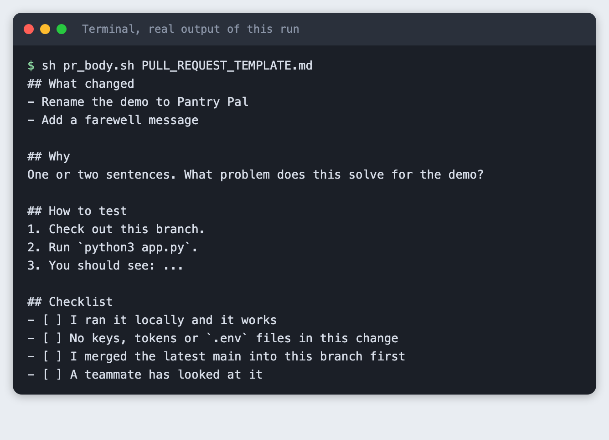

The rest of this tutorial builds that from scratch. Commit IDs differ on every run, so yours will not match the screenshots. The commit messages and structure will.

## Step 1. Check git

```bash
git --version
```

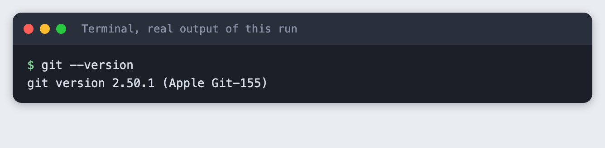

Any recent version works. `git switch`, used below, needs 2.23 or newer.

## Step 2. Make the shared repo

Create a folder called `sandbox`. Inside it, make a bare repository. A bare repo has no working files. It only stores history, which is what a server does.

```bash
mkdir sandbox && cd sandbox
git init --bare -b main remote.git
```

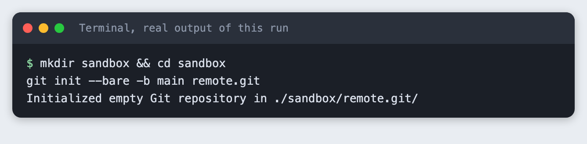

`-b main` names the default branch. From here on, `remote.git` plays the part of GitHub.

## Step 3. Alice starts the project

Alice makes a folder, runs `git init`, tells git who she is and points the project at the shared repo. The name `origin` is the usual label for "the shared copy".

```bash
mkdir alice && cd alice && git init -b main
```

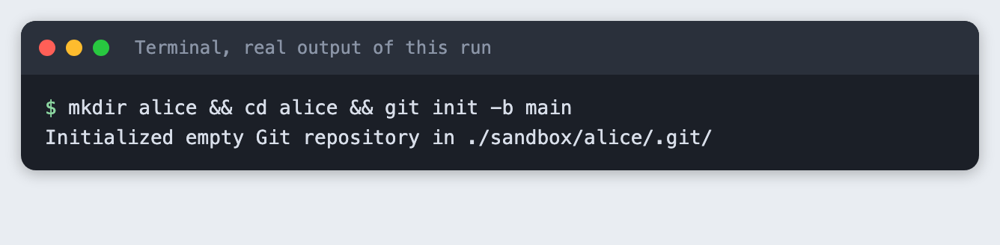

```bash
git config user.name "Alice" && git config user.email "alice@example.com" && git remote add origin ../remote.git && git remote -v
```

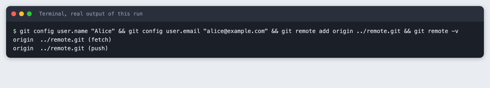

```bash
git status -sb
```

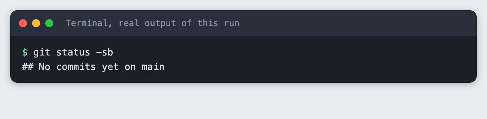

`git config user.name` and `user.email` are set per repo here, so the two teammates can share one computer. On your own machine you set them once with `--global`. The email is a made-up address.

## Step 4. Keep keys out of git

Alice copies in the starter program and a `.gitignore`, then creates a `.env` file that holds a made-up key. Here is the program:

```python
TITLE = "Hackathon demo"


def greet(name):
    return f"Welcome to {TITLE}, {name}!"


if __name__ == "__main__":
    print(greet("team"))
```
*File: `template/app.py`*

And here is the `.gitignore`:

```
# Keys and local settings. Never committed.
.env
.env.*
!.env.example

# Python
.venv/
__pycache__/
*.pyc

# Editor and OS files
.DS_Store
.vscode/
```
*File: `template/.gitignore`*

The first block ignores `.env` and any `.env.something` file, but the line starting with `!` keeps `.env.example` trackable. That is the file where you list key names with no values, so teammates know what to set up.

```bash
cp ../../template/app.py ../../template/.gitignore . && echo 'DEMO_SERVICE_KEY=fake-value-for-this-tutorial' > .env && git status --short
```

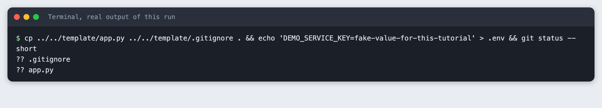

```bash
git check-ignore -v .env
```

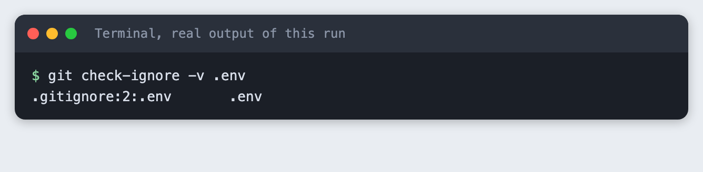

`git status` lists `app.py` and `.gitignore` as new files and does not list `.env`. `git check-ignore -v` explains why: line 2 of `.gitignore` matches it. Use that command whenever you wonder why a file is missing from `git status`.

## Step 5. Check what a mistake looks like

Alice tries to add the `.env` file anyway:

```bash
git add .env
```

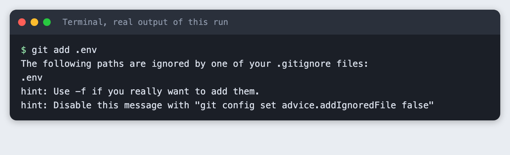

Git refuses and exits with code 1. The hint mentions `-f`. Do not use it for a key file. The `.gitignore` only protects files that were never committed. If a key is committed and pushed, deleting the file later does not remove it from the history. Treat that key as leaked and replace it at the provider.

## Step 6. Commit and push the starting point

```bash
git add . && git commit -m 'Add starter app and gitignore'
```

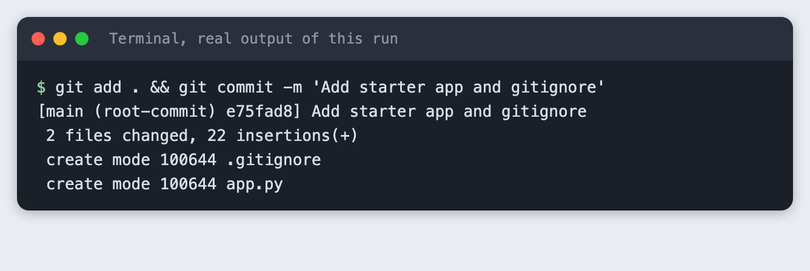

```bash
git push -u origin main 2>&1
```

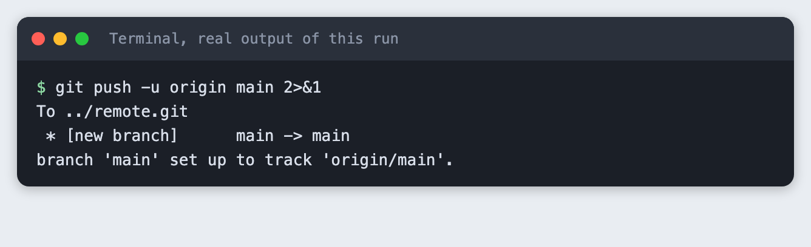

```bash
git ls-files
```

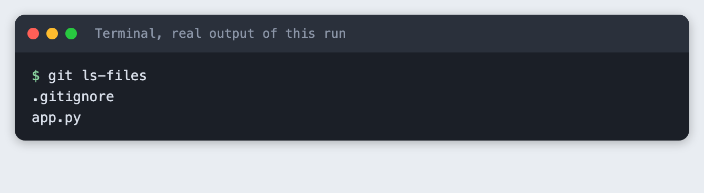

```bash
git log --oneline
```


`git ls-files` lists only `.gitignore` and `app.py`. The `.env` file is not in the repo. The push sent `main` to the shared repo, and `-u` told git to remember that `main` tracks `origin/main`.

## Step 7. Bob clones the project

```bash
git clone remote.git bob
```

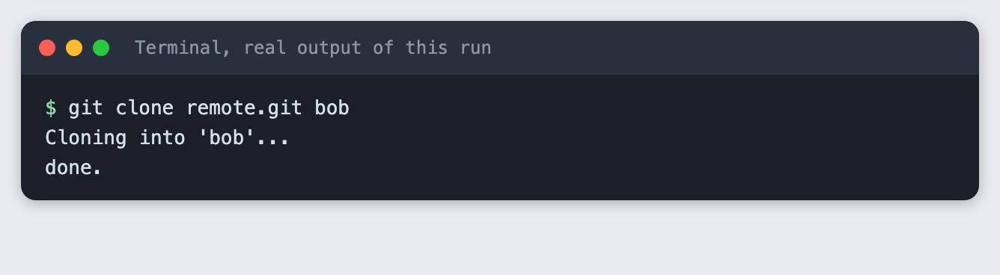

```bash
git config user.name "Bob" && git config user.email "bob@example.com" && git config --get-regexp "^user"
```

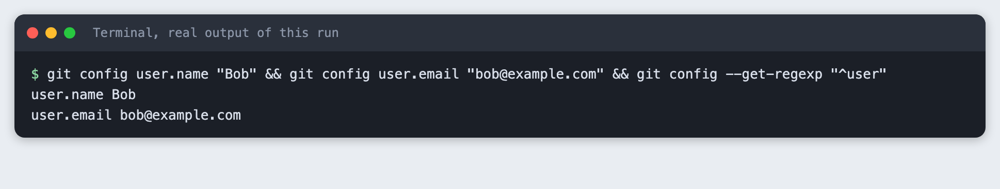

```bash
git log --oneline
```

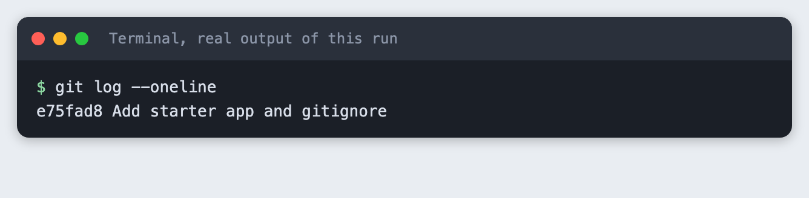

```bash
ls -A
```

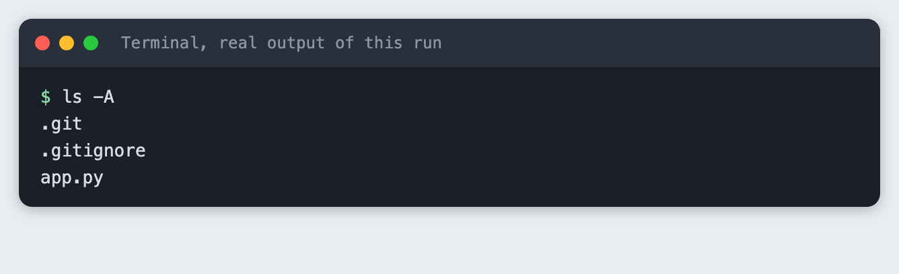

Bob has the history and both files. He does not have Alice's `.env`. Each teammate creates their own, from the names in `.env.example`.

## Step 8. Alice works on a branch

A branch is a named line of work. Teams usually keep `main` working and do new work on branches. `git switch -c` creates a branch and moves onto it. Alice changes line 1 of `app.py`. In the screenshot the change is made with `sed`. In your editor you just change the text.

```bash
git switch -c feature/title
```

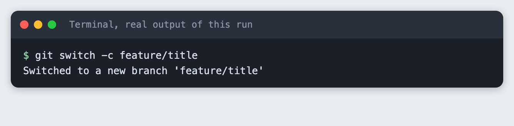

```bash
sed -i.bak 's/^TITLE = .*/TITLE = "Recipe Helper"/' app.py && rm app.py.bak && git diff
```

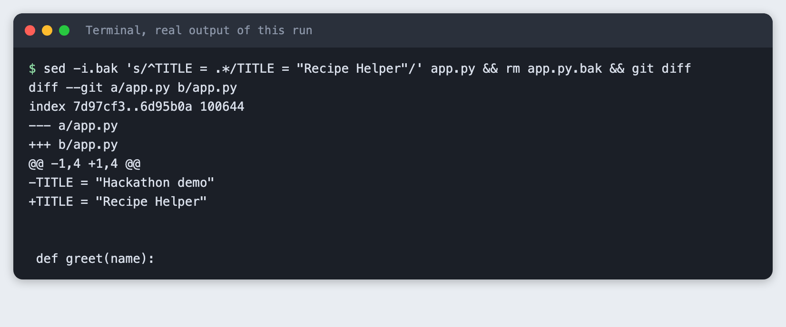

```bash
git commit -am 'Rename the demo to Recipe Helper'
```

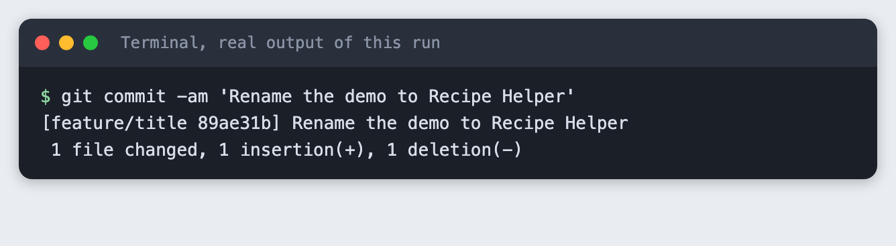

```bash
git log --oneline --graph --decorate --all
```

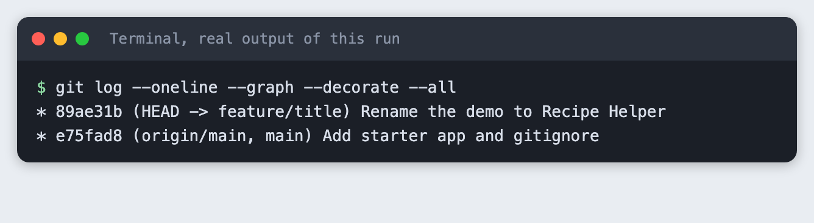

`git diff` shows the old line with a minus and the new line with a plus. The log shows `feature/title` one commit ahead of `main`.

## Step 9. Alice merges and pushes

On a real team this is where a pull request happens. Here Alice does the merge herself. Because nobody else changed `main`, git only moves the label forward. That is called a fast-forward.

```bash
git switch main
```

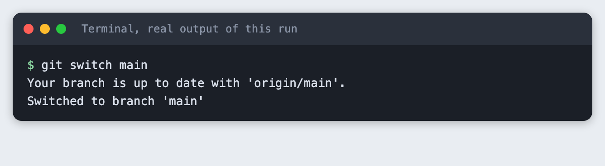

```bash
git merge feature/title
```

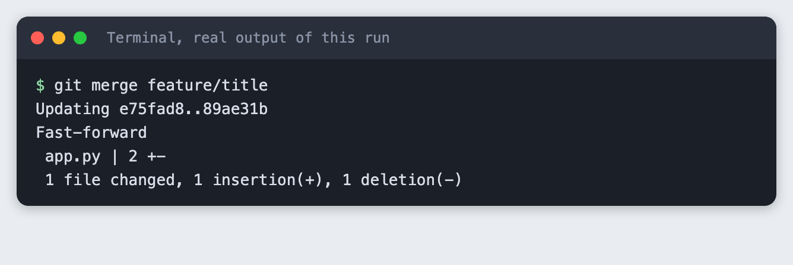

```bash
git push origin main 2>&1
```

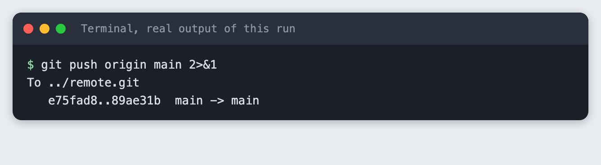

```bash
git log --oneline
```

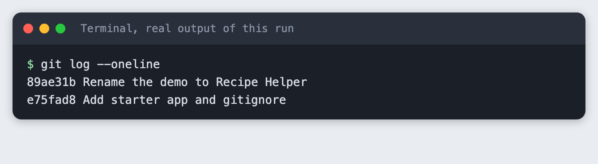

`main` on the shared repo now has the new title. Bob does not know yet.

## Step 10. Bob works on his own branch

At the same time, Bob starts from the old `main`. He changes the same line 1 to a different title, and adds a `farewell` function at the end of the file. Two commits, two different edits.

```bash
git switch -c feature/pantry
```

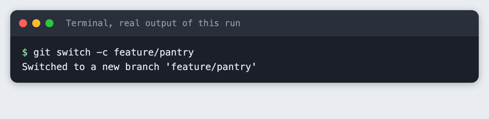

```bash
sed -i.bak 's/^TITLE = .*/TITLE = "Pantry Pal"/' app.py && rm app.py.bak && git commit -am 'Rename the demo to Pantry Pal'
```

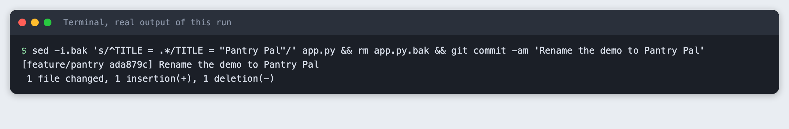

```bash
printf '\n\ndef farewell(name):\n    return f"Thanks for visiting, {name}!"\n' >> app.py && git commit -am 'Add a farewell message'
```

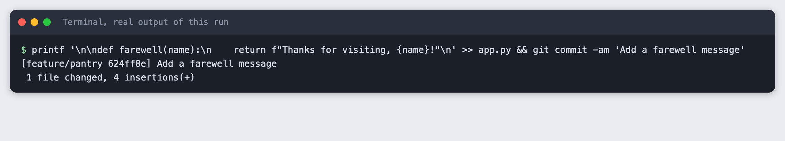

```bash
git log --oneline
```

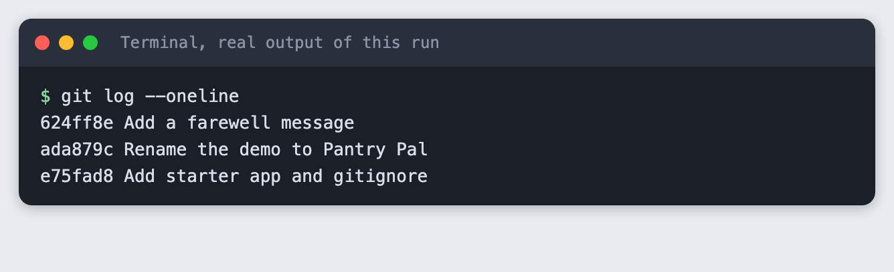

## Step 11. Bob sees that main has moved

`git fetch` downloads what is new on the shared repo without touching Bob's files. The graph shows two lines of history that split from the same starting commit.

```bash
git fetch origin 2>&1
```

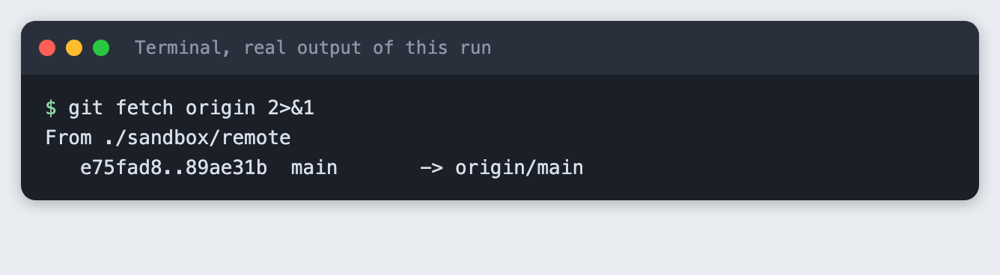

```bash
git log --oneline --graph --decorate --all
```

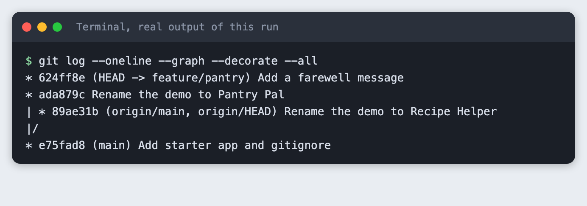

Run `git fetch` before you start work and before you merge. It never changes your files, so it is safe to run any time.

## Step 12. Create the conflict

Before asking for review, Bob merges the latest `main` into his branch. That way he finds problems on his side, not in the reviewer's. Alice and Bob both changed line 1, so git cannot choose between them.

```bash
git merge origin/main
```

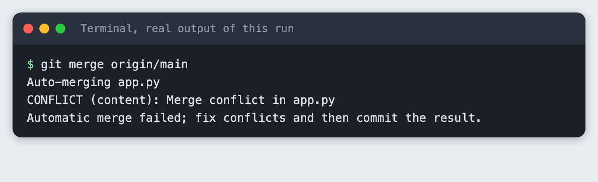

Git merged what it could. The farewell function was merged automatically because only Bob touched it. Only `app.py` line 1 needs a human decision. Git exits with code 1 and leaves the merge half finished.

## Step 13. Read the markers

Git writes both versions into the file, between marker lines.

```bash
git status -sb
```

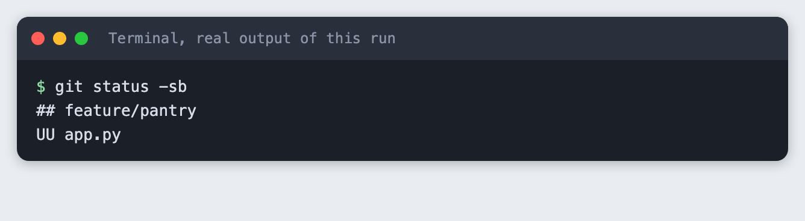

```bash
cat app.py
```

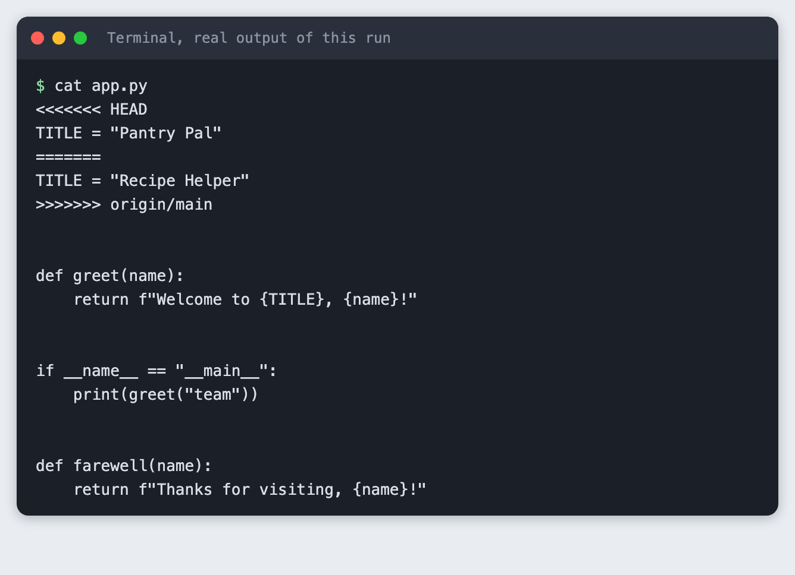

`UU` means both sides modified the file. Between `<<<<<<< HEAD` and `=======` is Bob's version. Between `=======` and `>>>>>>> origin/main` is Alice's. Your job is to decide what the file should say and delete all three marker lines.

## Step 14. Back out safely

If you are not sure what to do, you do not have to decide right now. `git merge --abort` puts everything back as it was before the merge. Here we abort, check that the branch is clean, and merge again so we can resolve it properly.

```bash
git merge --abort && git status -sb
```

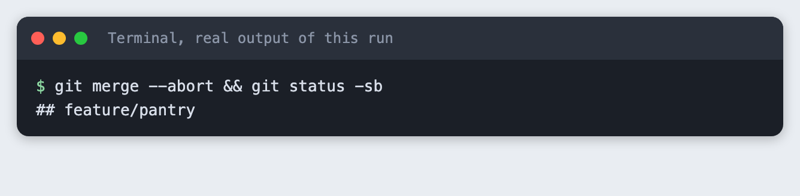

```bash
git merge origin/main
```


The conflict is the same on the second try. It is deterministic, and nothing was lost. Git also exits with code 1 here, as in Step 12. An exit code of 0 means success, and any other number means the command did not finish. A conflict is the second kind, so a script that runs `git merge` stops at this point. The screenshots show the command and git's own output only, so the exit code is not printed in them.

## Step 15. Resolve it

Bob keeps his title, "Pantry Pal", because the team decided on it. He keeps `farewell`, and removes the markers. In your editor you delete the marker lines and the line you do not want. Here the whole file is rewritten so the result is exact. Then three checks: no markers left, the program runs, and only then `git add` and commit.

```bash
cat app.py   # after editing: keep one TITLE, delete the marker lines
```

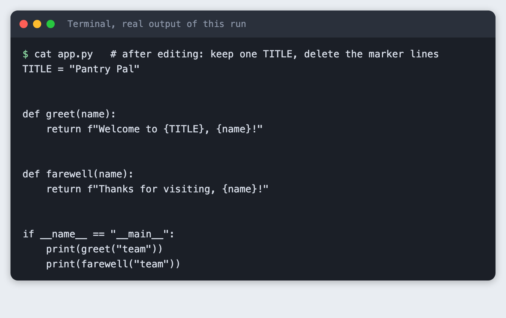

```bash
grep -c '<<<<<<<' app.py || echo 'no markers left'
```

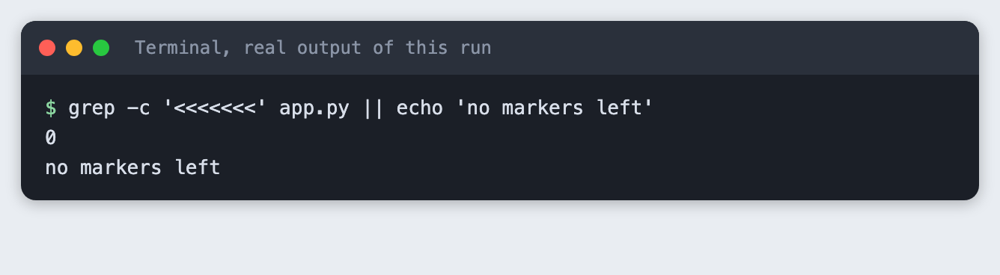

```bash
python3 app.py
```

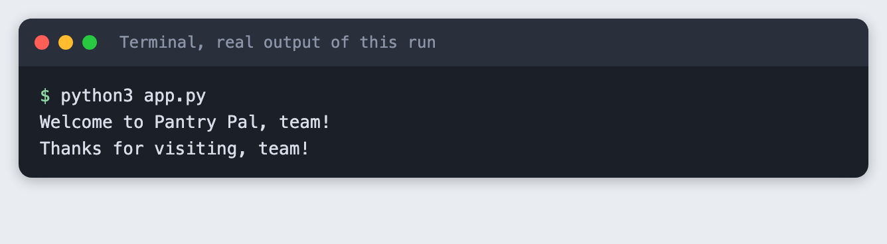

```bash
git add app.py && git commit --no-edit
```

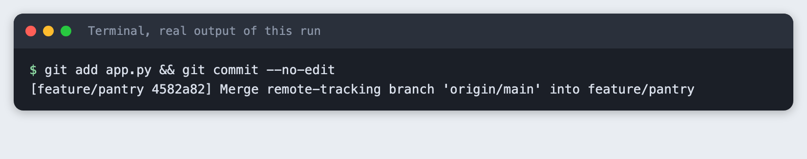

```bash
git log --oneline --graph --decorate
```

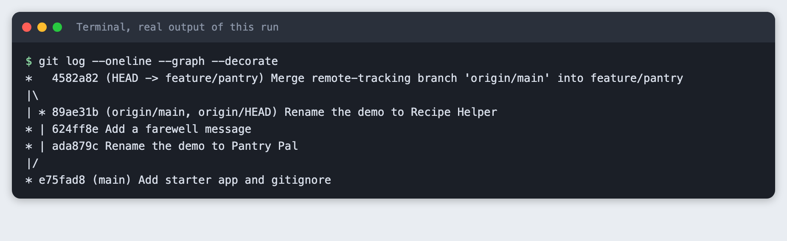

`grep -c` printed `0`, so no markers are left. (`grep` exits with code 1 when it finds nothing, so the command adds a message after it to keep the run clean.) The program ran. The merge commit has two parents, one from each line of history. Run the program before you commit. A file with no markers can still be wrong.

Choosing whose line wins is a team decision, not a git one. Ask the other person if you are not sure.

## Step 16. Push the branch

```bash
git push -u origin feature/pantry 2>&1
```

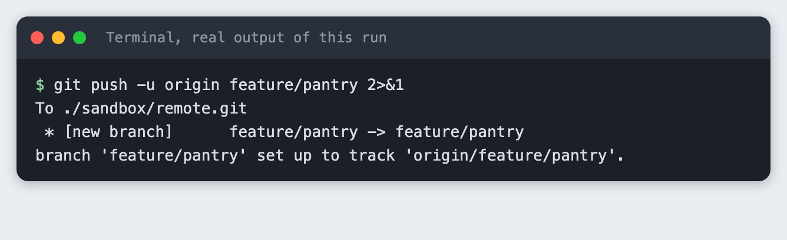

```bash
git -C ../remote.git branch
```

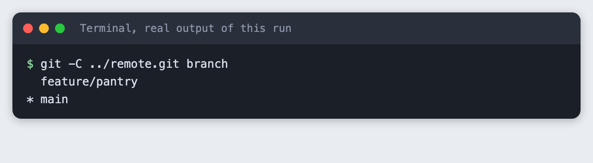

The shared repo now has `main` and `feature/pantry`. On GitHub this is the point where you click "Compare and pull request". That button is not part of git, so it was not run here.

## Step 17. Write the pull request description

A pull request is a request to merge a branch, with a page for discussion and review. It is a GitHub feature, and it was **not run** in this tutorial because it needs an account. What you can practise locally is the description. Reviewers read it before the diff, so a short, consistent template helps them. This is the one used here:

```markdown
## What changed
<!-- commits -->

## Why
One or two sentences. What problem does this solve for the demo?

## How to test
1. Check out this branch.
2. Run `python3 app.py`.
3. You should see: ...

## Checklist
- [ ] I ran it locally and it works
- [ ] No keys, tokens or `.env` files in this change
- [ ] I merged the latest main into this branch first
- [ ] A teammate has looked at it
```
*File: `template/PULL_REQUEST_TEMPLATE.md`*

On GitHub, a file named `PULL_REQUEST_TEMPLATE.md` in the `.github` folder fills the description box for you. That placement is from GitHub's documentation and was not tested here. The script below does a smaller job that you can check: it fills the "What changed" list from your commits.

```bash
#!/bin/sh
# Print the PR template with this branch's commits filled in.
# Usage: sh pr_body.sh <template> [base-ref]
template="$1"
base="${2:-origin/main}"
while IFS= read -r line; do
  case "$line" in
    *"<!-- commits -->"*) git log --reverse --no-merges --format='- %s' "$base"..HEAD ;;
    *) printf '%s\n' "$line" ;;
  esac
done < "$template"
```
*File: `pr_body.sh`*

```bash
git diff --stat origin/main...HEAD
```

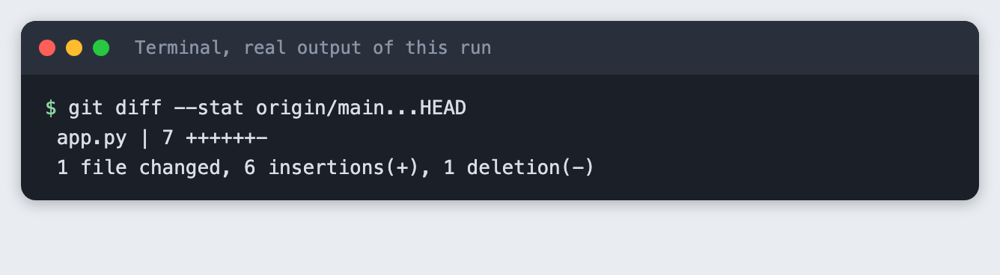

```bash
sh pr_body.sh PULL_REQUEST_TEMPLATE.md
```


Two commits are listed. The merge commit is left out on purpose. You still write "Why" and "How to test" yourself, because git cannot know them.

## Troubleshooting

- **`fatal: not a git repository`.** You are in the wrong folder. Run `pwd` and `cd` into the project.
- **`Author identity unknown` when you commit.** Set `user.name` and `user.email`, as in Step 3.
- **Push is rejected and says the remote contains work you do not have.** Someone pushed first. Run `git fetch`, merge `origin/main` into your branch as in Step 12, then push again. This rejection was not triggered in this run.
- **A file you expect is missing from `git status`.** Run `git check-ignore -v <file>`, as in Step 4.
- **You are stuck in the middle of a merge.** `git merge --abort` returns you to where you were, as in Step 14.

## Frequently asked questions

**How should a team use git in an AI hackathon?**

Keep `main` working and do each piece of work on its own branch. Fetch and merge `main` into your branch before you ask for a review. In this tutorial, Alice merged to `main` and Bob merged `main` into `feature/pantry`.

**How do I fix a merge conflict?**

Open the file and find the `<<<<<<<`, `=======` and `>>>>>>>` markers. Keep the lines you want, delete the three marker lines, run the program, then `git add` the file and commit. If you are unsure, `git merge --abort` undoes the attempt.

**How do I keep API keys out of a git repo?**

Put keys in a `.env` file and list `.env` in `.gitignore` before the first commit. Commit a `.env.example` with names only. In the test, `git add .env` was refused. If a key was already committed and pushed, replace it at the provider.

## What to try next

- Add a third teammate, Carol, and cause a conflict between three branches.
- Try `git rebase origin/main` instead of a merge and compare the log graph.
- Change `pr_body.sh` to add a "Files changed" list from `git diff --stat`.

## How this tutorial was tested

Every command and screenshot above comes from one real run on 12 November 2026 with Git 2.50.1 on macOS. Code and files in the blocks are copied from the project files, not retyped. The steps were then run again from an empty folder, and all 17 passed. The screenshots show the saved output of those commands in a terminal-style frame, rendered from the saved log. They are not captures of a window.

Not run: Windows and Linux, any push to GitHub or another hosted service, pull requests, GitHub's template location, branch protection and review rules, and a push rejected for being behind.

