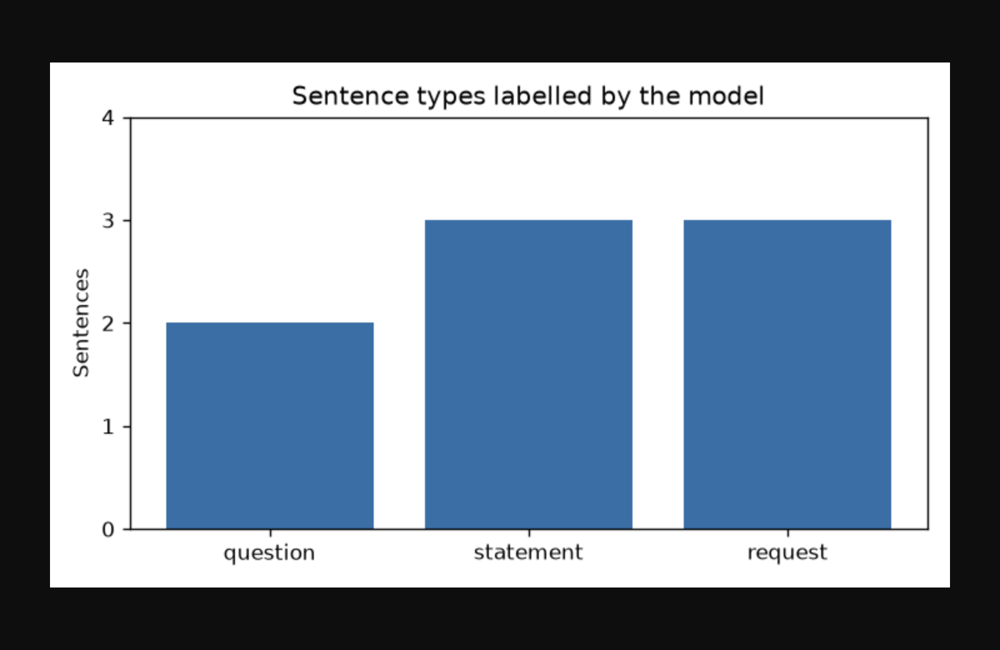
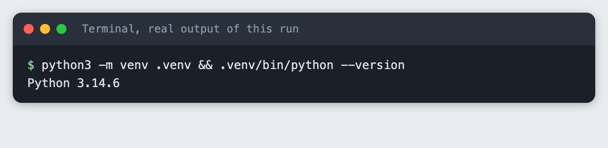
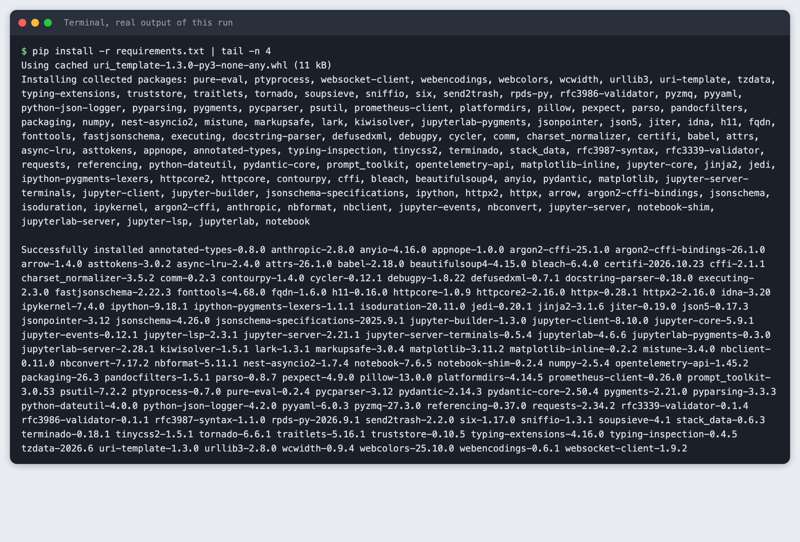
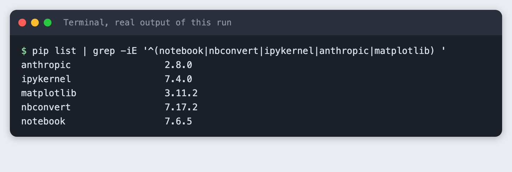
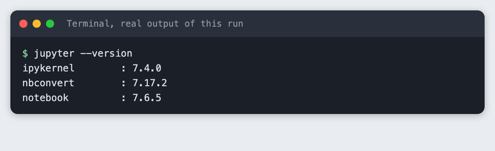
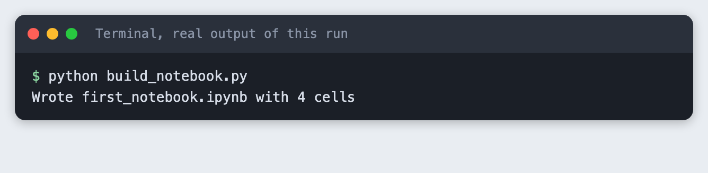
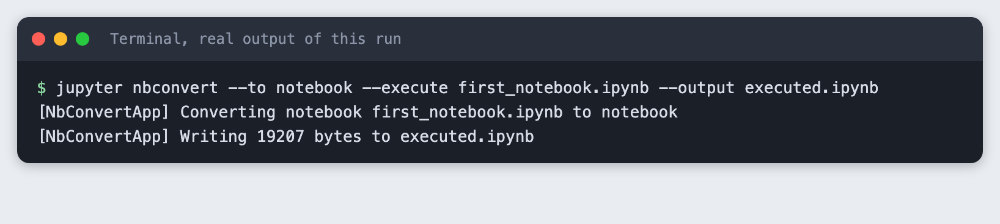
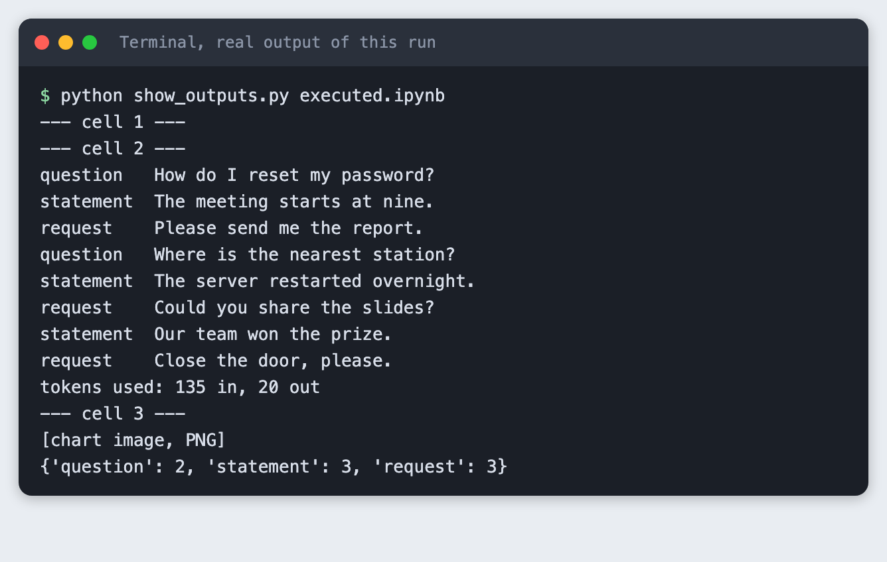
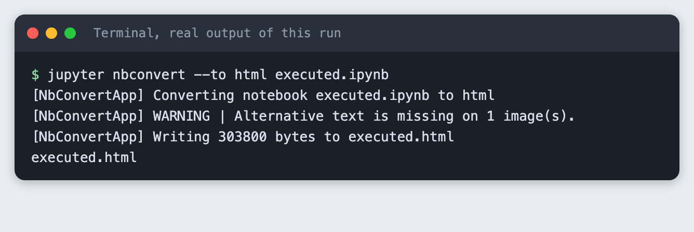
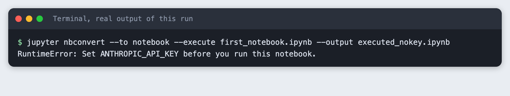

# Set up Jupyter in a virtual environment and run a notebook from the command line

You will install Jupyter in a virtual environment, write a notebook that asks a model to label eight sentences and charts the result, then run the whole notebook without opening a browser. It takes about 30 minutes.

**Level:** Beginner. **You need:** Python 3.10 or newer, a terminal and an Anthropic API key. **Tested:** 12 November 2026 on macOS with Python 3.14.6, `notebook` 7.6.5, `nbconvert` 7.17.2 and `anthropic` 2.8.0. The Windows activation command comes from the Python docs and was not run.

In an AI hackathon you often explore data in a notebook, then need the same steps to run again on a clean machine before a demo. A virtual environment makes the setup repeatable, and a headless run proves the notebook works from top to bottom. When you are ready to use it, see the [upcoming AI hackathons](/ai-hackathons/).

## Why a virtual environment and a headless run

A notebook remembers the order in which you ran its cells, not the order they appear in. A notebook that works on your screen can fail on a fresh run. Running it headless executes every cell from the top, in order, and saves the outputs. If it passes, anyone with the same packages gets the same steps.

## See it running first

By the end one command runs the notebook and writes the chart below. The rest of this tutorial builds it from scratch.



## Step 1. Create a virtual environment

A virtual environment keeps this project's packages apart from the rest of your machine. In an empty folder, run:

```bash
python3 -m venv .venv && .venv/bin/python --version
```



Activate it. On macOS and Linux use `source .venv/bin/activate`. On Windows use `.venv\Scripts\activate`. Every command below assumes it is active.

## Step 2. Install the packages

List what the project needs in `requirements.txt`, so anyone can install the same set. `ipykernel` lets Jupyter run your code with this environment's Python.

```text
notebook>=7.0
nbconvert>=7.16
ipykernel>=6.29
anthropic>=2.7.0
matplotlib>=3.9
```
*File: `requirements.txt`*

```bash
pip install -r requirements.txt | tail -n 4
```



The install downloads a lot of small packages, so allow a few minutes. Your versions will be newer if you install later. List the versions that were installed:

```bash
pip list | grep -iE '^(notebook|nbconvert|ipykernel|anthropic|matplotlib) '
```



## Step 3. Check that Jupyter is installed

```bash
jupyter --version
```



To work in the browser, run `jupyter notebook` in this folder. It opens a page where you create a notebook and type the cells below. This tutorial did not drive that browser page. It built the same notebook from files, so every run could be replayed.

## Step 4. Write the notebook cells

The notebook has three code cells. Each is its own file in `cells/`, so you can read it here and paste it into a cell. The first cell loads the libraries and stops with a clear message if the key is missing. Set the key in your terminal before you start Jupyter, for example `export ANTHROPIC_API_KEY=...` on macOS and Linux. Never paste a key into a cell, because a notebook saves everything you type.

```python
import os
from collections import Counter

import matplotlib.pyplot as plt
from anthropic import Anthropic

MODEL = "claude-haiku-5-5"

if not os.environ.get("ANTHROPIC_API_KEY"):
    raise RuntimeError("Set ANTHROPIC_API_KEY before you run this notebook.")

client = Anthropic()
```
*File: `cells/01_setup.py`*

The second cell sends one request to `claude-haiku-5-5`. It asks for one label per line, so the reply is easy to split. Thinking is turned off so the small `max_tokens` limit is spent on the answer.

```python
sentences = [
    "How do I reset my password?",
    "The meeting starts at nine.",
    "Please send me the report.",
    "Where is the nearest station?",
    "The server restarted overnight.",
    "Could you share the slides?",
    "Our team won the prize.",
    "Close the door, please.",
]

numbered = "\n".join(f"{i}. {s}" for i, s in enumerate(sentences, 1))
prompt = (
    "Label each sentence as exactly one of: question, statement, request.\n"
    "Answer with one label per line, in order, and nothing else.\n\n" + numbered
)

response = client.messages.create(
    model=MODEL,
    max_tokens=100,
    thinking={"type": "disabled"},
    messages=[{"role": "user", "content": prompt}],
)
text = "".join(b.text for b in response.content if b.type == "text")
labels = [line.strip().lower() for line in text.splitlines() if line.strip()]

for s, label in zip(sentences, labels):
    print(f"{label:10} {s}")
print("tokens used:", response.usage.input_tokens, "in,", response.usage.output_tokens, "out")
```
*File: `cells/02_ask.py`*

The third cell counts the labels and draws a bar chart. It also saves the chart as `chart.png`.

```python
counts = Counter(labels)
order = ["question", "statement", "request"]
values = [counts.get(name, 0) for name in order]

fig, ax = plt.subplots(figsize=(6, 3.5))
ax.bar(order, values, color="#3b6ea5")
ax.set_ylabel("Sentences")
ax.set_title("Sentence types labelled by the model")
ax.set_yticks(range(0, max(values) + 2))
fig.tight_layout()
fig.savefig("chart.png", dpi=120)
plt.show()
print(dict(counts))
```
*File: `cells/03_chart.py`*

To get the same notebook file as this tutorial, this script assembles the cells into `first_notebook.ipynb`:

```python
"""Assemble first_notebook.ipynb from the files in cells/, one code cell per file."""
from pathlib import Path

import nbformat

nb = nbformat.v4.new_notebook()
nb.cells.append(nbformat.v4.new_markdown_cell("# Label sentences with a model, then chart them"))
for path in sorted(Path("cells").glob("*.py")):
    nb.cells.append(nbformat.v4.new_code_cell(path.read_text().rstrip()))
nbformat.write(nb, "first_notebook.ipynb")
print(f"Wrote first_notebook.ipynb with {len(nb.cells)} cells")
```
*File: `build_notebook.py`*

```bash
python build_notebook.py
```



The 4 cells are the three code cells plus a title cell.

## Step 5. Run the notebook headless

`nbconvert` runs every cell in order and writes a new notebook with the outputs filled in. The original file stays unchanged.

```bash
jupyter nbconvert --to notebook --execute first_notebook.ipynb --output executed.ipynb
```



The run takes a few seconds. The kernel warning about plain TCP is normal on a local run. Nothing leaves your machine except the one API request.

## Step 6. Read what the run saved

The outputs are stored inside `executed.ipynb`. This small script prints the text outputs of each cell.

```python
"""Print the text output of each code cell in an executed notebook."""
import sys

import nbformat

nb = nbformat.read(sys.argv[1], as_version=4)
for number, cell in enumerate((c for c in nb.cells if c.cell_type == "code"), 1):
    print(f"--- cell {number} ---")
    for out in cell.outputs:
        if out.output_type == "stream":
            print(out.text.rstrip())
        elif out.output_type == "display_data" and "image/png" in out.data:
            print("[chart image, PNG]")
        elif out.output_type == "error":
            print("ERROR:", out.ename, "-", out.evalue)
```
*File: `show_outputs.py`*

```bash
python show_outputs.py executed.ipynb
```



The model labelled 2 sentences as questions, 3 as statements and 3 as requests. The request used 135 input tokens and 20 output tokens. A model can label differently on another run, so your counts may differ.

## Step 7. Export the result to HTML

An HTML file is easy to share with a teammate who has no Jupyter. It holds the code, the outputs and the chart.

```bash
jupyter nbconvert --to html executed.ipynb
```



The warning about alternative text only means the chart image has no description. The export still works.

## Step 8. Check what a mistake looks like

Run the same notebook in a shell where the key is not set. The first cell stops the run.

```bash
jupyter nbconvert --to notebook --execute first_notebook.ipynb --output executed_nokey.ipynb
```



The command ends with exit code 1. A script or a scheduler can use that code to tell that the notebook failed.

## Troubleshooting

- **`jupyter: command not found`.** The virtual environment is not active. Activate it and try again.
- **`No module named 'anthropic'` inside the notebook.** The notebook is using a different Python. Start `jupyter notebook` from the activated environment.
- **The run stops with "Set ANTHROPIC_API_KEY".** The key is not in the environment of the shell that started Jupyter or `nbconvert`. Export it there and run again.
- **The chart does not show in the notebook.** Run the chart cell after the cell that creates `labels`. Cell order matters.

## Frequently asked questions

**How do I set up Jupyter for an AI hackathon project?**

Create a virtual environment, install `notebook`, `ipykernel` and the libraries you need from a `requirements.txt`, then run `jupyter notebook`. In the test the install gave `notebook` 7.6.5 and `ipykernel` 7.4.0.

**How do I run a Jupyter notebook without opening it?**

Use `jupyter nbconvert --to notebook --execute first_notebook.ipynb --output executed.ipynb`. It runs every cell in order and saves the outputs in a new file. Add `--to html` to export a page you can share.

**Why does my notebook fail on a clean run?**

The cells may depend on the order you ran them, or on a package or key that only your session had. A headless run starts from the top with only the environment you give it. In this tutorial it stopped with exit code 1 when the key was missing.

## What to try next

- Change the sentences, or add a fourth label, and run the notebook again.
- Read the sentences from a CSV file instead of a list.
- Run the notebook on a schedule and keep the HTML export.

## How this tutorial was tested

Every command and screenshot above comes from one real run on 12 November 2026. The code in the blocks is copied from the project files, not retyped. The steps were then run again from an empty folder, and all of them passed. The model call used `claude-haiku-5-5`, and the notebook ran against the real API. The terminal screenshots show the saved output of each command in a terminal-style frame. The chart is a real browser screenshot of the saved `chart.png`. Not run: Windows, Linux, and the browser-based Jupyter page opened by `jupyter notebook`.

