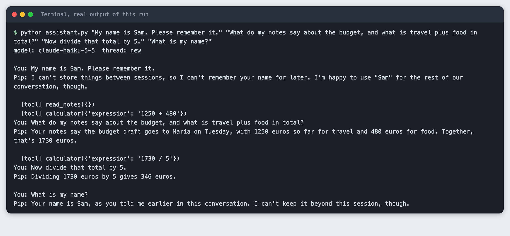
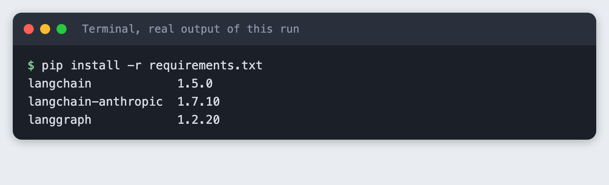
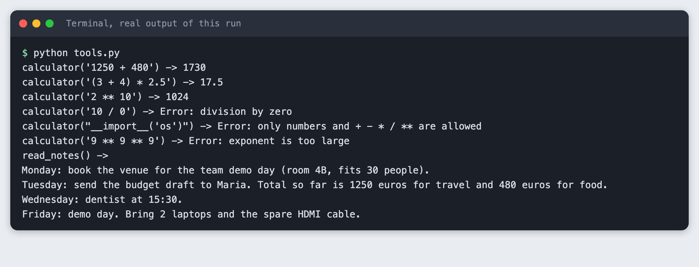
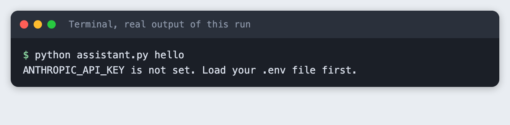
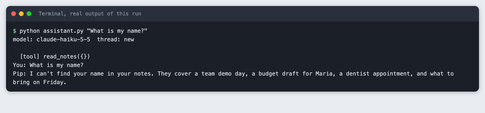

# Build a personal assistant with LangChain and Claude in Python

You build a command-line assistant that follows a prompt template, remembers the conversation, does arithmetic with a calculator tool and answers questions from a notes file.

**Time:** about 40 minutes. **Level:** intermediate. **You need:** Python basics, Python 3.10 or newer, and an Anthropic API key. **Tested:** 12 November 2026 with Python 3.14.6, `langchain` 1.5.0, `langchain-anthropic` 1.7.10 and `langgraph` 1.2.20 on macOS.

Model replies differ from run to run. Your wording will not match the output below. The tool calls and the memory behaviour should.

An assistant that can use tools and keep context is a common starting point for an AI hackathon project. If you are planning one, see the [upcoming AI hackathons](/ai-hackathons/).

## Why this matters

A model on its own cannot do exact arithmetic reliably, cannot see your files, and forgets everything between calls. Tools fix the first two. Memory fixes the third, for as long as the process runs. LangChain 1.x gives you one function, `create_agent`, that wires these together. Older tutorials use `ConversationBufferMemory` and `initialize_agent`. This one uses the current approach, where memory is a LangGraph checkpointer.

## See it running first

This is the finished assistant over four turns in one conversation. It reads the notes, uses the calculator, and recalls a name from the first turn.



The rest builds it from scratch.

## Step 1: Set up the project

```bash
python3 -m venv .venv
```


Create `requirements.txt`:

```text
langchain>=1.0
langchain-anthropic>=1.0
langgraph>=1.0
```
*File: `requirements.txt`*

```bash
pip install -r requirements.txt
```



Put your key in a file named `.env`. Copy the placeholder file and edit it:

```
ANTHROPIC_API_KEY=your_key_here
```
*File: `.env.example`*

Never paste a real key into code, a screenshot or a chat. Load it into your terminal on macOS or Linux:

```bash
set -a; source .env; set +a
```

## Step 2: Write the two tools

A tool is a plain Python function with a type-annotated signature and a docstring. The `@tool` decorator turns the docstring into the description the model reads when it decides which tool to call, so write it for the model.

The calculator does not use `eval`. The model controls the input, and `eval` would run whatever it sent. Instead the code parses the expression into a syntax tree and allows only numbers and the operators `+ - * / **`. It also caps the exponent, because an expression like `9 ** 9 ** 9` would otherwise run for a very long time. Errors come back as text, so the model can read them and try again.

The notes tool takes no arguments and returns the whole file. That works for a short file. A long file would need search or chunking.

```python
"""Two local tools for the assistant: a calculator and a notes reader."""
import ast
import operator
from pathlib import Path

from langchain_core.tools import tool

NOTES_FILE = Path(__file__).with_name("notes.txt")

OPS = {
    ast.Add: operator.add, ast.Sub: operator.sub, ast.Mult: operator.mul,
    ast.Div: operator.truediv, ast.Pow: operator.pow, ast.USub: operator.neg,
}


def _eval(node):
    if isinstance(node, ast.Constant) and isinstance(node.value, (int, float)):
        return node.value
    if isinstance(node, ast.BinOp) and type(node.op) in OPS:
        if isinstance(node.op, ast.Pow) and abs(_eval(node.right)) > 100:
            raise ValueError("exponent is too large")
        return OPS[type(node.op)](_eval(node.left), _eval(node.right))
    if isinstance(node, ast.UnaryOp) and type(node.op) in OPS:
        return OPS[type(node.op)](_eval(node.operand))
    raise ValueError("only numbers and + - * / ** are allowed")


@tool
def calculator(expression: str) -> str:
    """Evaluate an arithmetic expression such as '1250 + 480' or '(3 + 4) * 2.5'."""
    try:
        return str(_eval(ast.parse(expression, mode="eval").body))
    except (ValueError, SyntaxError, ZeroDivisionError, OverflowError) as err:
        return f"Error: {err}"


@tool
def read_notes() -> str:
    """Return the full text of the user's notes file."""
    if not NOTES_FILE.exists():
        return "Error: the notes file does not exist."
    return NOTES_FILE.read_text()


TOOLS = [calculator, read_notes]

if __name__ == "__main__":
    # Call the tools directly, with no model, to check them first.
    for expr in ["1250 + 480", "(3 + 4) * 2.5", "2 ** 10", "10 / 0", "__import__('os')", "9 ** 9 ** 9"]:
        print(f"calculator({expr!r}) -> {calculator.invoke({'expression': expr})}")
    print("read_notes() ->")
    print(read_notes.invoke({}))
```
*File: `tools.py`*

Test the tools without a model first. A failure here is yours, not the model's.

```bash
python tools.py
```



The calculator returns 1730 for `1250 + 480`. Division by zero, a call to `__import__` and the huge exponent each return an error string and do not run.

## Step 3: Write the prompt template and the agent

The system prompt is a `ChatPromptTemplate` with two variables, `assistant_name` and `today`. `format_messages` fills them in and returns a system message, which goes to `create_agent` as `system_prompt`. A template earns its place when the prompt changes per user or per day. For a fixed prompt a plain string does the same.

Memory is the `checkpointer`. `InMemorySaver` stores the message history of each conversation under a `thread_id` that you pass in the call's config. Calls with the same `thread_id` continue one conversation. A different `thread_id` starts a new one. The `ask` function sends only the new question each time, because the checkpointer already holds the earlier messages.

The model is `claude-haiku-5-5` through `ChatAnthropic`, with `max_tokens=300`. The script prints each tool call so you can see what the model chose to do.

```python
"""A small personal assistant: prompt template, memory and two local tools."""
import os
import sys
import uuid
from datetime import date

from langchain.agents import create_agent
from langchain_anthropic import ChatAnthropic
from langchain_core.messages import AIMessage, HumanMessage
from langchain_core.prompts import ChatPromptTemplate
from langgraph.checkpoint.memory import InMemorySaver

from tools import TOOLS

MODEL = os.environ.get("TUTORIAL_MODEL", "claude-haiku-5-5")

PROMPT = ChatPromptTemplate.from_messages([
    ("system",
     "You are {assistant_name}, a personal assistant. Today is {today}. "
     "Use the calculator for any arithmetic and read_notes for questions about "
     "the user's notes. Answer in at most two short sentences."),
])


def build_assistant():
    if not os.environ.get("ANTHROPIC_API_KEY"):
        sys.exit("ANTHROPIC_API_KEY is not set. Load your .env file first.")
    system = PROMPT.format_messages(assistant_name="Pip", today=date.today().isoformat())[0]
    return create_agent(
        ChatAnthropic(model=MODEL, max_tokens=300),
        TOOLS,
        system_prompt=system,
        checkpointer=InMemorySaver(),
    )


def ask(agent, thread_id, question):
    config = {"configurable": {"thread_id": thread_id}}
    result = agent.invoke({"messages": [HumanMessage(question)]}, config)
    messages = result["messages"]
    # Show only what happened in this turn: everything after the last human message.
    last_human = max(i for i, m in enumerate(messages) if isinstance(m, HumanMessage))
    for m in messages[last_human + 1:]:
        if isinstance(m, AIMessage):
            for call in m.tool_calls:
                print(f"  [tool] {call['name']}({call['args']})")
    print(f"You: {question}")
    print(f"Pip: {messages[-1].text}\n")


if __name__ == "__main__":
    questions = sys.argv[1:] or ["Hello! What can you do?"]
    agent = build_assistant()
    thread = str(uuid.uuid4())[:8]
    print(f"model: {MODEL}  thread: new\n")
    for q in questions:
        ask(agent, thread, q)
```
*File: `assistant.py`*

First, see what a missing key looks like:

```bash
python assistant.py hello
```



## Step 4: Chat with memory and tools

Each command-line argument is one turn, and all turns share one thread. The four questions test the pieces in order: a fact to remember, a tool that reads a file, a tool that does arithmetic on a number from the previous reply, and a recall of the fact from turn one.

```bash
python assistant.py "My name is Sam. Please remember it." "What do my notes say about the budget, and what is travel plus food in total?" "Now divide that total by 5." "What is my name?"
```

```text
model: claude-haiku-5-5  thread: new

You: My name is Sam. Please remember it.
Pip: I can't store things between sessions, so I can't remember your name for later. I'm happy to use "Sam" for the rest of our conversation, though.

  [tool] read_notes({})
  [tool] calculator({'expression': '1250 + 480'})
You: What do my notes say about the budget, and what is travel plus food in total?
Pip: Your notes say the budget draft goes to Maria on Tuesday, with 1250 euros so far for travel and 480 euros for food. Together, that's 1730 euros.

  [tool] calculator({'expression': '1730 / 5'})
You: Now divide that total by 5.
Pip: Dividing 1730 euros by 5 gives 346 euros.

You: What is my name?
Pip: Your name is Sam, as you told me earlier in this conversation. I can't keep it beyond this session, though.
```

Read the output in three parts. In turn two the model called `read_notes` and then `calculator` with `1250 + 480`, and answered 1730. In turn three it wrote `1730 / 5` without being told the number, so it took "that total" from the saved history, and the calculator returned 346. In turn four it knew the name Sam.

The tool lines print before the `You:` line of the same turn, because the script prints them first. In turn one the model also said it could not remember your name "for later". That is true of this script too, as the next step shows.

## Step 5: See where memory stops

`InMemorySaver` keeps history in the Python process. Run the script again with a new question and the history is gone:

```bash
python assistant.py "What is my name?"
```



The assistant looked in the notes for a name and found none. To keep history across runs, swap `InMemorySaver` for a database-backed checkpointer from the LangGraph packages. This tutorial did not test one.

## Troubleshooting

- **`ANTHROPIC_API_KEY is not set`.** The variable is not set in the terminal you are using. Run `set -a; source .env; set +a` again there.
- **You find `ConversationBufferMemory` or `initialize_agent` in older guides and the import fails.** Those belong to older LangChain versions. In `langchain` 1.5.0 use `create_agent` with a checkpointer, as above.
- **The assistant forgets the earlier turn.** Check that every call passes the same `thread_id` and that you did not build a second agent object for each question. The checkpointer belongs to the agent.
- **The model does its own sums instead of calling the calculator.** The prompt tells it to use the calculator for arithmetic, but nothing forces it. Check the `[tool]` lines to see whether it did.

## Frequently asked questions

**How do I add memory to a LangChain agent?**

Pass a checkpointer, such as `InMemorySaver`, to `create_agent`, and pass a `thread_id` in the config of each call. The checkpointer stores the messages of that thread, so you send only the new question. In this tutorial the assistant recalled a name from turn one in turn four.

**Can Claude call my own Python functions in LangChain?**

Yes. Decorate a function with `@tool`, give it a clear docstring, and pass it in the tools list to `create_agent`. The model returns a tool call, LangChain runs your function and sends the result back. The calculator and `read_notes` here worked that way.

**Does the assistant remember me after I close the script?**

Not with `InMemorySaver`. The second run in Step 5 had no memory of the name. You need a persistent checkpointer for that, which this tutorial did not test.

## What to try next

- Replace `InMemorySaver` with a persistent checkpointer and run the Step 5 test again.
- Add a tool that appends a line to `notes.txt`.
- Make `read_notes` return only the lines that match a search word.

## How this tutorial was tested

- Date: 12 November 2026. Python 3.14.6, `langchain` 1.5.0, `langchain-anthropic` 1.7.10, `langgraph` 1.2.20, macOS. The model is `claude-haiku-5-5`, set in the `MODEL` constant.
- The code in this article is copied from the project files by a script. The output and screenshots come from saved logs of real API calls.
- Every step was run from a clean folder, then replayed from an empty copy with no virtual environment. The replay passed. Model wording differed between the two runs, as expected, but the same tools were called with the same arguments.
- Terminal screenshots are rendered from the saved output of the run. They are not captures of a terminal window.
- Not run: Windows, Linux, other Python versions, a persistent checkpointer, streaming, and models other than `claude-haiku-5-5`.

