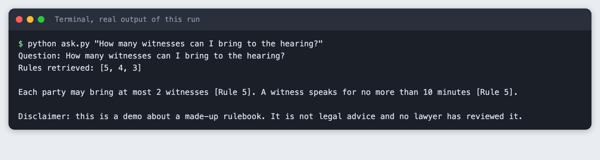
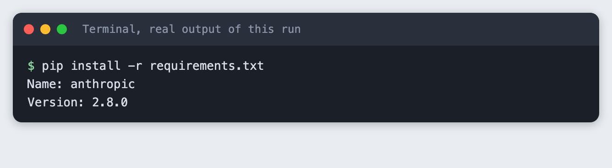
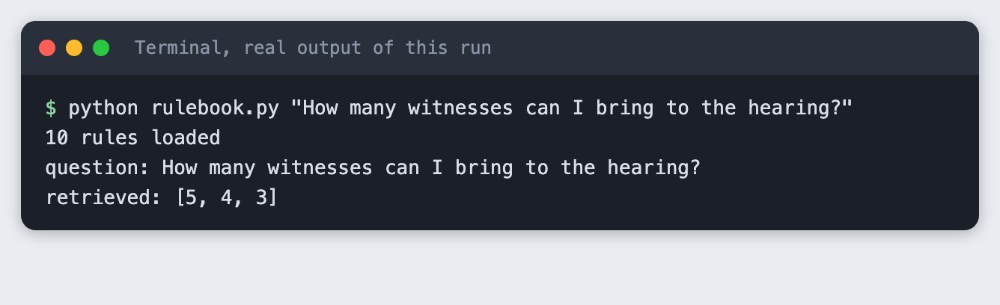
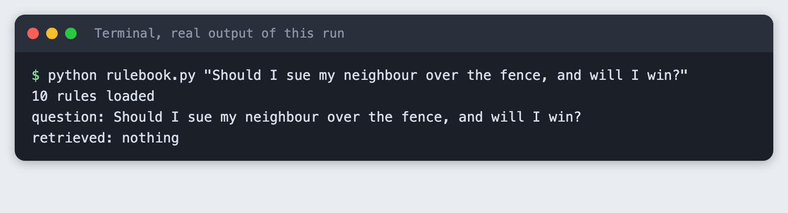
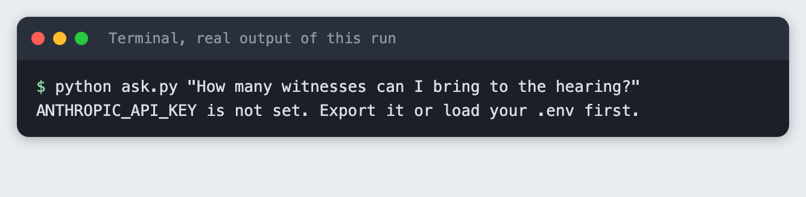
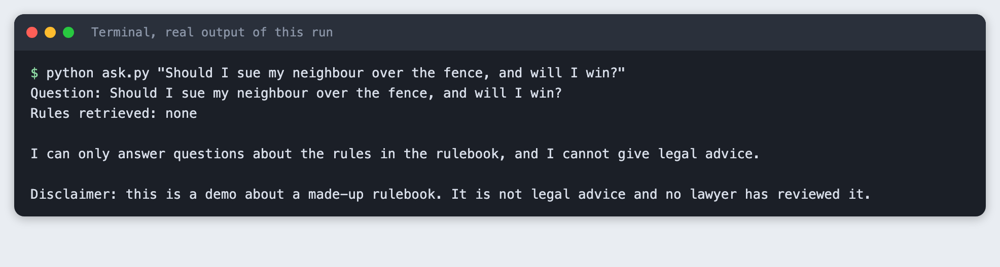
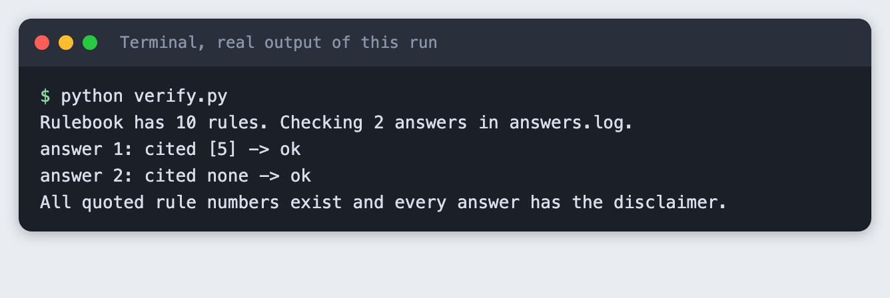
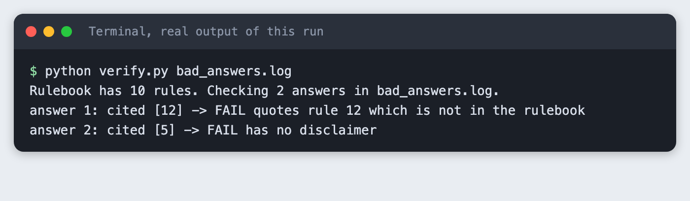

# Build a rulebook Q&A assistant in Python that cites the rule it used

You build a small Python assistant that answers questions about a short, invented court-style rulebook, names the rule number behind each answer, refuses questions that ask for advice, and always adds a disclaimer. A second script checks that every rule number the assistant quoted exists in the rulebook.

**Time:** about 45 minutes. **Level:** intermediate. **You need:** Python basics, Python 3.10 or newer, and an Anthropic API key. **Tested:** 12 November 2026 with Python 3.14.6 and the `anthropic` package 2.8.0 on macOS.

**Legal review:** this tutorial touches on legal-style content and a disclaimer. Starfield Labs Legal must review it before it is published. The rulebook is fiction. Nothing here is legal advice, and the assistant must never be pointed at real court rules and presented as a source of advice.

Model replies differ from run to run. Your wording will not match the output below. The shape will.

Document assistants that quote their source are a common AI hackathon project, and a citation check is what makes them trustworthy enough to demo. If you are planning a project, see the [upcoming AI hackathons](/ai-hackathons/).

## Why this matters

A model that answers questions about rules can sound sure while pointing at a rule that does not exist. Two habits reduce that risk. Give the model only the few rules that match the question, and make it name the rule it used. Then check the names with code, not by eye. A rule number is easy to check because the rulebook is a short list.

## See it running first

This is the finished assistant answering a question that the rulebook covers. It names Rule 5 and ends with the disclaimer.



The rest of the tutorial builds it from nothing.

## Step 1: Set up the project

Create a virtual environment. The commands from here on assume it is active (`source .venv/bin/activate`).

```bash
python3 -m venv .venv
```


Create `requirements.txt` with one line:

```text
anthropic>=2.7.0
```
*File: `requirements.txt`*

```bash
pip install -r requirements.txt
```



Put your key in a file named `.env`. Copy the placeholder file and edit it:

```
ANTHROPIC_API_KEY=your_key_here
```
*File: `.env.example`*

Never paste a real key into code, a screenshot or a chat. Load the file into your terminal session on macOS or Linux:

```bash
set -a; source .env; set +a
```

## Step 2: Write an invented rulebook

The rulebook is `rules.txt`, ten short rules for a made-up body called the Harbourside Small Claims Panel. The panel, the credits and every number in it are invented for this tutorial. One rule per line, in the form `Rule N. text`, so a program can read the number.

```text
Rule 1. Filing window. A claim before the Harbourside Small Claims Panel must be filed within 30 days of the event it describes.
Rule 2. Filing fee. The filing fee is 40 credits. A claimant who cannot pay may ask the clerk for a fee waiver on Form W.
Rule 3. Service. The claimant must deliver a copy of the claim to the other party at least 14 days before the hearing.
Rule 4. Evidence. Each party may bring up to 12 pages of written evidence. Evidence must be given to the clerk 5 days before the hearing.
Rule 5. Witnesses. Each party may bring at most 2 witnesses. A witness speaks for no more than 10 minutes.
Rule 6. Postponement. A hearing may be postponed once. The request must reach the clerk at least 7 days before the hearing and give a reason.
Rule 7. Missed hearing. If the claimant does not attend, the panel closes the claim. If the other party does not attend, the panel may decide the claim in their absence.
Rule 8. Hearing length. A hearing lasts at most 45 minutes. The panel tells both parties when 5 minutes remain.
Rule 9. Decision. The panel announces its decision in writing within 10 days after the hearing.
Rule 10. Appeal. A party may ask for a review of a decision within 14 days after it is announced. The panel allows one review per claim.
```
*File: `rules.txt`*

Do not swap in a real court's rules. Real rules change, differ by place, and carry consequences that a demo cannot account for.

## Step 3: Retrieve the rules that match a question

With ten rules you can send the model only the ones that matter. This keeps the prompt small and gives the model fewer rules to cite wrongly. The retrieval is plain keyword matching. `rulebook.py` lowercases the words, drops common ones such as "the" and "how", and trims a trailing "s" so "witnesses" and "witness" match. It scores each rule by the question words it shares. A word that appears in few rules counts more than a word that appears in many.

The weighting came from a first try that did not work. With a plain count of shared words, "How many witnesses can I bring to the hearing?" ranked Rule 4 (evidence) ahead of Rule 5 (witnesses), because "bring" and "hearing" appear in both and the tie went to the lower number.

```python
import re
from pathlib import Path

STOPWORDS = {
    "a", "an", "and", "are", "at", "be", "by", "can", "do", "does", "for", "from", "how",
    "i", "if", "in", "is", "it", "many", "may", "me", "much", "my", "of", "on", "or",
    "the", "to", "what", "when", "who", "will", "with", "you", "must", "much", "long",
}


def load_rules(path="rules.txt"):
    """Return {rule number: text}. Each line is 'Rule N. text'."""
    rules = {}
    for line in Path(path).read_text(encoding="utf-8").splitlines():
        match = re.match(r"Rule (\d+)\. (.+)", line.strip())
        if match:
            rules[int(match.group(1))] = match.group(2)
    return rules


def words(text):
    found = re.findall(r"[a-z]+", text.lower())
    return {w.rstrip("s") for w in found if w not in STOPWORDS and len(w) > 2}


def retrieve(question, rules, top=3):
    """Score each rule by the question words it shares, so a word found in few rules counts more."""
    asked = words(question)
    rule_words = {number: words(text) for number, text in rules.items()}
    scored = []
    for number, found in rule_words.items():
        score = sum(1 / sum(w in other for other in rule_words.values()) for w in asked & found)
        scored.append((score, number))
    scored = [item for item in sorted(scored, key=lambda s: (-s[0], s[1])) if item[0] > 0]
    return [number for _, number in scored[:top]]


if __name__ == "__main__":
    import sys

    rules = load_rules()
    print(f"{len(rules)} rules loaded")
    question = " ".join(sys.argv[1:])
    if question:
        print(f"question: {question}")
        print("retrieved:", retrieve(question, rules) or "nothing")
```
*File: `rulebook.py`*

Run it on a question the rulebook covers:

```bash
python rulebook.py "How many witnesses can I bring to the hearing?"
```



Rule 5 is first, followed by 4 and 3. The code returns at most three rules. A rule is returned only if it shares at least one word with the question.

Now a question that matches nothing:

```bash
python rulebook.py "Should I sue my neighbour over the fence, and will I win?"
```



No rule shares a word with this question. That is the cue for the assistant to refuse without calling the model.

Keyword matching has limits. It does not know that "postpone" and "postponed" are the same word, and it cannot match a question that uses different words from the rule. This tutorial did not test those cases against a real set of users. Embeddings handle them better, at the cost of an extra service.

## Step 4: Ask the model, cite the rule, add the disclaimer

`ask.py` has three jobs. It retrieves rules, sends only those to the model, and prints the reply with a disclaimer. Three decisions are worth knowing:

- The system prompt tells the model to use only the rules it was given, to cite each one as `[Rule N]`, and to reply with the single word `REFUSE` if the question asks for advice or the rules do not answer it. A fixed format such as `[Rule N]` is easy to find with a regular expression.
- If retrieval finds nothing, the code refuses itself and makes no model call.
- The disclaimer is added by the code, not by the model. A model can forget an instruction. A line of code does not.

```python
import json
import os
import re
import sys

from anthropic import Anthropic

from rulebook import load_rules, retrieve

MODEL = "claude-haiku-5-5"
DISCLAIMER = (
    "Disclaimer: this is a demo about a made-up rulebook. It is not legal advice "
    "and no lawyer has reviewed it."
)
REFUSAL = "I can only answer questions about the rules in the rulebook, and I cannot give legal advice."

SYSTEM = (
    "You answer questions about the court-style rules you are given. "
    "Use only those rules. Cite every rule you rely on as [Rule N], using its number exactly. "
    "Quote the key words of the rule in quotation marks. Answer in at most 60 words. "
    "If the question asks what a person should do, whether they will win, or for any "
    "advice, or if the rules do not answer it, reply with exactly REFUSE and nothing else."
)


def answer(client, question, rules):
    """Return (reply text, rule numbers sent to the model). Refuse without a call if nothing matches."""
    numbers = retrieve(question, rules)
    if not numbers:
        return REFUSAL, []
    context = "\n".join(f"Rule {n}. {rules[n]}" for n in numbers)
    response = client.messages.create(
        model=MODEL,
        max_tokens=300,
        thinking={"type": "disabled"},
        system=SYSTEM,
        messages=[{"role": "user", "content": f"Rules:\n{context}\n\nQuestion: {question}"}],
    )
    text = "".join(b.text for b in response.content if b.type == "text").strip()
    if not text:
        sys.exit(f"The model returned no text (stop reason: {response.stop_reason}).")
    if text == "REFUSE":
        return REFUSAL, numbers
    return text, numbers


def main():
    question = " ".join(sys.argv[1:]).strip()
    if not question:
        sys.exit('Usage: python ask.py "your question"')
    if not os.environ.get("ANTHROPIC_API_KEY"):
        sys.exit("ANTHROPIC_API_KEY is not set. Export it or load your .env first.")
    rules = load_rules()
    reply, numbers = answer(Anthropic(), question, rules)
    final = f"{reply}\n\n{DISCLAIMER}"
    print(f"Question: {question}")
    print(f"Rules retrieved: {numbers or 'none'}\n")
    print(final)
    with open("answers.log", "a", encoding="utf-8") as log:
        log.write(json.dumps({"question": question, "answer": final}) + "\n")


if __name__ == "__main__":
    main()
```
*File: `ask.py`*

First, see what a missing key looks like. Run it in a terminal where the variable is not set:

```bash
python ask.py "How many witnesses can I bring to the hearing?"
```



Now ask the covered question with the key loaded:

```bash
python ask.py "How many witnesses can I bring to the hearing?"
```

```text
Question: How many witnesses can I bring to the hearing?
Rules retrieved: [5, 4, 3]

Each party may bring at most 2 witnesses [Rule 5]. A witness speaks for no more than 10 minutes [Rule 5].

Disclaimer: this is a demo about a made-up rulebook. It is not legal advice and no lawyer has reviewed it.
```

The model cites Rule 5, and the answer matches the rule: at most 2 witnesses, 10 minutes each. Rules 4 and 3 were sent to the model as well, but it did not cite them. The prompt asks the model to quote the key words of the rule in quotation marks. In this run it paraphrased instead. The citation held, the quotation did not. Treat the quotation instruction as a request, not a guarantee.

## Step 5: Ask for advice and get a refusal

Ask a question that wants a prediction and a recommendation:

```bash
python ask.py "Should I sue my neighbour over the fence, and will I win?"
```



No rule matched, so the refusal came from the code and the model was not called. The disclaimer is still there. This run did not exercise the `REFUSE` path in the system prompt, where a question matches some rule words but still asks for advice. I did not test how reliably the model follows that instruction. If you rely on it, test it with your own questions first.

## Step 6: Verify the quoted rule numbers

Every answer that `ask.py` prints is also saved to `answers.log`. `verify.py` reads that file, finds each `[Rule N]`, and checks the number against `rules.txt`. It also checks that each answer has the disclaimer. It exits with code 1 if anything fails, so you can run it in a script or a test suite.

```python
import json
import re
import sys

from rulebook import load_rules

CITATION = re.compile(r"\[Rule (\d+)\]")


def check(answer_text, rules):
    """Return (cited numbers, cited numbers missing from the rulebook, disclaimer present)."""
    cited = [int(n) for n in CITATION.findall(answer_text)]
    missing = sorted({n for n in cited if n not in rules})
    return cited, missing, "not legal advice" in answer_text


def main():
    path = sys.argv[1] if len(sys.argv) > 1 else "answers.log"
    try:
        lines = [json.loads(line) for line in open(path, encoding="utf-8") if line.strip()]
    except FileNotFoundError:
        sys.exit(f"Cannot find {path}")
    rules = load_rules()
    print(f"Rulebook has {len(rules)} rules. Checking {len(lines)} answers in {path}.")
    failed = False
    for i, item in enumerate(lines, 1):
        cited, missing, disclaimer = check(item["answer"], rules)
        problems = []
        if missing:
            problems.append(f"quotes rule {', '.join(map(str, missing))} which is not in the rulebook")
        if not disclaimer:
            problems.append("has no disclaimer")
        status = "FAIL" if problems else "ok"
        failed = failed or bool(problems)
        print(f"answer {i}: cited {sorted(set(cited)) or 'none'} -> {status} {'; '.join(problems)}".rstrip())
    if failed:
        sys.exit(1)
    print("All quoted rule numbers exist and every answer has the disclaimer.")


if __name__ == "__main__":
    main()
```
*File: `verify.py`*

```bash
python verify.py
```



Both answers pass. The refusal cited no rules, which is fine. The check proves that a quoted number exists. It does not prove that the rule supports the answer, so a model could cite a real rule that says something else. Reading the rule text is still the way to catch that.

## Step 7: What a mistake looks like

`bad_answers.log` holds two answers written by hand to fail the check. One cites a Rule 12 that does not exist. The other has no disclaimer.

```bash
python verify.py bad_answers.log
```



The script names the missing rule and the missing disclaimer, and it exits with code 1.

## Troubleshooting

- **The right rule is not retrieved.** Print what `retrieve` returns with `python rulebook.py "your question"`. If the question uses a different word from the rule, add the word to the rule or move to embeddings.
- **The model refuses a question the rulebook covers.** Check the retrieved rules first. If the covering rule was not sent, the model has nothing to cite and may reply `REFUSE`.
- **`ANTHROPIC_API_KEY is not set`.** The variable is not in the terminal you are running from. Run `set -a; source .env; set +a` again.
- **The reply is empty.** This can happen if `max_tokens` is too low and thinking is on. The script turns thinking off and exits with a message when a reply has no text.

## Frequently asked questions

**How do I make an LLM cite the rule it used?**

Give the model only the rules that match the question, label each with its number, and tell it to cite as `[Rule N]`. In this tutorial the model cited Rule 5 for the witness question.

**How do I check that a cited rule really exists?**

Pull each `[Rule N]` out of the answer with a regular expression and look the number up in the rulebook. `verify.py` does this, and it flagged a made-up Rule 12 in the test file.

**Can a chatbot like this give legal advice?**

No. This assistant answers about an invented rulebook, refuses requests for advice, and prints a disclaimer. It is a demo of the pattern. Anything that deals with real law needs review by a qualified person first.

## What to try next

- Send a question that matches some rules but asks for advice, and measure how often the model replies `REFUSE`.
- Replace keyword matching with embeddings and compare the retrieved rules.
- Fail the answer in `verify.py` if a quotation in marks does not appear in the cited rule.

## How this tutorial was tested

- Date: 12 November 2026. Python 3.14.6, `anthropic` 2.8.0, macOS. The model is `claude-haiku-5-5`, set in the `MODEL` constant.
- The code in this article is copied from the project files by a script. The output and screenshots come from saved logs of real API calls for the covered question. The refusal in this run came from the code and used no model call.
- Every step was run from a clean folder, then replayed from an empty copy of the folder with no virtual environment. The replay passed. The wording of the answer differed slightly between the two runs, as expected.
- Terminal screenshots are rendered from the saved output of the run. They are not captures of a terminal window.
- Not run: Windows, Linux, Python versions other than 3.14.6, the `REFUSE` path of the system prompt, questions beyond the two shown, and models other than `claude-haiku-5-5`.

