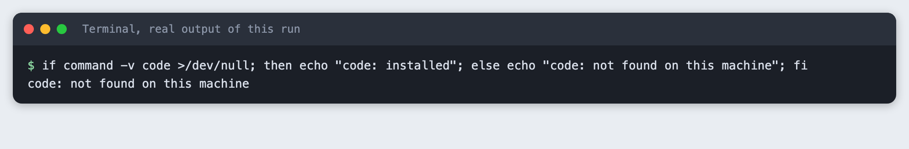
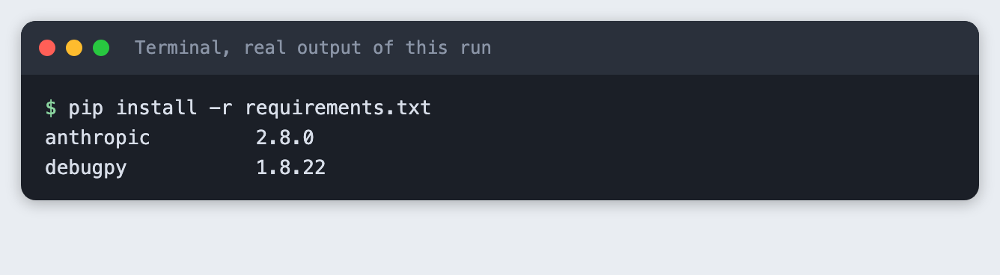
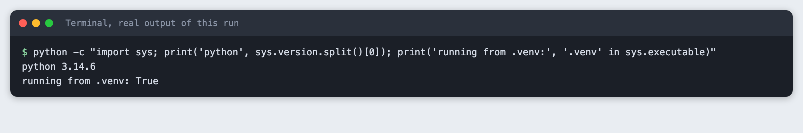
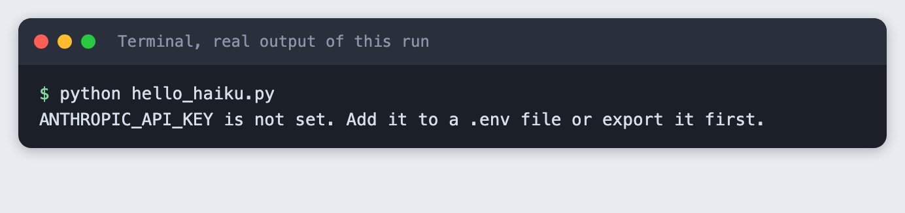
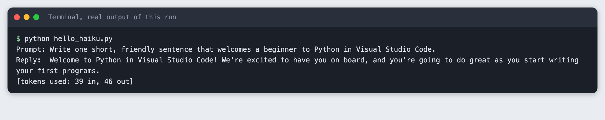
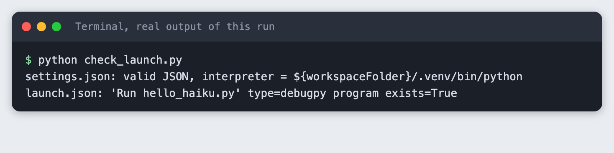
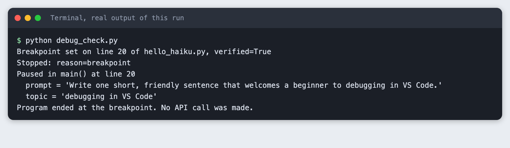

# Set up Python in Visual Studio Code and make your first Claude call

You will set up a Python project in Visual Studio Code with its own virtual environment, run a script that makes one call to `claude-haiku-5-5`, and learn to pause that script at a breakpoint. It takes about 30 minutes.

**Level:** Beginner. **You need:** Python 3.10 or newer, Visual Studio Code, an Anthropic API key. **Tested:** 12 November 2026 on macOS with Python 3.14.6, `anthropic` 2.8.0 and `debugpy` 1.8.22. **Not run:** the VS Code window itself (see "How this tutorial was tested").

In an AI hackathon you lose time when your editor picks the wrong Python or you cannot see why a variable has the wrong value. Fix both before the clock starts, then look at the [upcoming AI hackathons](/ai-hackathons/) and pick one to build for.

## Why this setup

Three small files do most of the work. A virtual environment keeps this project's packages apart from the rest of your machine. A `.vscode/settings.json` file tells the editor which Python to use. A `.vscode/launch.json` file tells the debugger what to run. Once they exist, pressing F5 does the right thing every time.

## What is verified and what is not

The terminal parts of this tutorial were run for real: the virtual environment, the install, the script and the debugger. The VS Code window could not be captured on the test machine, and the `code` command was not installed there:

```bash
if command -v code >/dev/null; then echo "code: installed"; else echo "code: not found on this machine"; fi
```



So the steps that click through the VS Code window are described from how the editor works, are marked **Not run**, and have no window screenshots. Everything else comes from saved output.

## Step 1. Create a project folder (not run in VS Code)

Make a folder called `python-vscode-first-project`. In VS Code choose File, then Open Folder, and pick it. VS Code treats the open folder as the workspace, and `${workspaceFolder}` in the files below means this folder. Open the built-in terminal with Terminal, then New Terminal. It starts inside the folder.

## Step 2. Create the virtual environment

Run this in the terminal:

```bash
python3 -m venv .venv
```


This makes a `.venv` folder that holds a private copy of Python. Activate it with `source .venv/bin/activate` on macOS and Linux, or `.venv\Scripts\activate` on Windows. The Windows command is from the Python docs and was not run.

## Step 3. Install the packages

Save this as `requirements.txt`. `anthropic` is the library that calls the model. `debugpy` is the debugger VS Code uses for Python. The Python extension installs its own debugger too, so `debugpy` here is only needed for the check in Step 8.

```text
anthropic>=2.7.0
debugpy>=1.8
```
*File: `requirements.txt`*

```bash
pip install -r requirements.txt
```



## Step 4. Select the interpreter

The interpreter is the Python that runs your code. In VS Code press Cmd+Shift+P (Ctrl+Shift+P on Windows and Linux), choose "Python: Select Interpreter" and pick the one inside `.venv`. This needs the Microsoft Python extension. **Not run:** this click path is described, not tested.

To make the choice part of the project, create `.vscode/settings.json`:

```json
{
    "python.defaultInterpreterPath": "${workspaceFolder}/.venv/bin/python",
    "python.terminal.activateEnvironment": true
}
```
*File: `.vscode/settings.json`*

`python.defaultInterpreterPath` is the starting choice for this workspace. It points at the `.venv` you just made, so a teammate who opens the folder gets the same one. With the environment active, the terminal should report a Python from `.venv`:

```bash
python -c "import sys; print('python', sys.version.split()[0]); print('running from .venv:', '.venv' in sys.executable)"
```



## Step 5. Write the first script

The script builds a prompt in its own function, so you have something clear to inspect in the debugger. It makes one call with a small `max_tokens`, with thinking turned off, and prints the reply and the token counts.

```python
import os
import sys

from anthropic import Anthropic

MODEL = "claude-haiku-5-5"


def build_prompt(topic):
    return f"Write one short, friendly sentence that welcomes a beginner to {topic}."


def main():
    if not os.environ.get("ANTHROPIC_API_KEY"):
        sys.exit("ANTHROPIC_API_KEY is not set. Add it to a .env file or export it first.")

    topic = sys.argv[1] if len(sys.argv) > 1 else "Python in Visual Studio Code"
    prompt = build_prompt(topic)

    client = Anthropic()
    response = client.messages.create(
        model=MODEL,
        max_tokens=100,
        thinking={"type": "disabled"},
        messages=[{"role": "user", "content": prompt}],
    )
    text = "".join(block.text for block in response.content if block.type == "text").strip()

    print(f"Prompt: {prompt}")
    print(f"Reply:  {text}")
    print(f"[tokens used: {response.usage.input_tokens} in, {response.usage.output_tokens} out]")


if __name__ == "__main__":
    main()
```
*File: `hello_haiku.py`*

Put your key in a file called `.env` next to the script, as one line, `ANTHROPIC_API_KEY=` followed by your key. Never paste the key into the code. The `.gitignore` in this project already lists `.env`, so it is not committed.

First see what a mistake looks like. Run the script with no key set:

```bash
python hello_haiku.py
```



The script stops with exit code 1 and a plain message. Now run it with the key available:

```bash
python hello_haiku.py
```



The call used 39 input tokens and 46 output tokens. The reply will be different each time you run it.

## Step 6. Add the launch configuration

Create `.vscode/launch.json`:

```json
{
    "version": "0.2.0",
    "configurations": [
        {
            "name": "Run hello_haiku.py",
            "type": "debugpy",
            "request": "launch",
            "program": "${workspaceFolder}/hello_haiku.py",
            "args": ["debugging in VS Code"],
            "envFile": "${workspaceFolder}/.env",
            "console": "integratedTerminal"
        }
    ]
}
```
*File: `.vscode/launch.json`*

`program` is the file to run. `args` are the command-line arguments, so the script receives "debugging in VS Code" as its topic. `envFile` loads your `.env`, so the key reaches the script. `type` is `debugpy`, the name current versions of the Python extension use. Older guides write `python`. Check the files are valid JSON and point at a real script:

```bash
python check_launch.py
```



This checks the files only. It does not prove VS Code accepts the configuration. **Not run:** pressing F5 in the window.

## Step 7. Walk through a breakpoint (not run in VS Code)

A breakpoint tells the debugger to pause before a line runs. In the editor you would:

1. Click in the gutter to the left of the line number for `client = Anthropic()`. A red dot appears.
2. Press F5 and choose "Run hello_haiku.py".
3. The program pauses on that line. The Variables panel shows `topic` and `prompt`.
4. Press F10 to run one line, or F5 to continue to the end.

This is the described path. It was not run in a window.

## Step 8. See the debugger stop, from the terminal

To check the debugging part for real, `debug_check.py` talks to `debugpy` directly, using the same protocol VS Code uses. It sets a breakpoint on the `client = Anthropic()` line, runs the script until it stops, prints the variables, and ends the program before the API call.

```python
"""Drive debugpy, the debugger VS Code uses, from a script.

Sets one breakpoint on the line `client = Anthropic()` in hello_haiku.py, runs the
program until it stops there, prints the local variables, then ends the program
before the API call. This is the same sequence of requests VS Code sends when you
press F5 with a breakpoint set.
"""
import json
import subprocess
import sys
from pathlib import Path

SCRIPT = (Path(__file__).parent / "hello_haiku.py").resolve()
LINE = next(i for i, t in enumerate(SCRIPT.read_text().splitlines(), 1) if "client = Anthropic()" in t)

adapter = subprocess.Popen([sys.executable, "-m", "debugpy.adapter"], stdin=subprocess.PIPE, stdout=subprocess.PIPE)
seq = 0


def send(command, arguments=None):
    global seq
    seq += 1
    body = json.dumps({"seq": seq, "type": "request", "command": command, "arguments": arguments or {}}).encode()
    adapter.stdin.write(b"Content-Length: %d\r\n\r\n" % len(body) + body)
    adapter.stdin.flush()
    return seq


def read():
    length = 0
    while True:
        line = adapter.stdout.readline().strip()
        if not line:
            break
        if line.lower().startswith(b"content-length:"):
            length = int(line.split(b":")[1])
    return json.loads(adapter.stdout.read(length))


def wait_for(match):
    while True:
        msg = read()
        if match(msg):
            return msg


def call(command, arguments=None):
    want = send(command, arguments)
    return wait_for(lambda m: m["type"] == "response" and m["request_seq"] == want)


call("initialize", {"adapterID": "debugpy", "linesStartAt1": True, "columnsStartAt1": True})
send("launch", {"program": str(SCRIPT), "args": ["debugging in VS Code"], "console": "internalConsole",
                "python": [sys.executable], "env": {"ANTHROPIC_API_KEY": "placeholder-not-used"}})
wait_for(lambda m: m.get("event") == "initialized")
resp = call("setBreakpoints", {"source": {"path": str(SCRIPT)}, "breakpoints": [{"line": LINE}]})
print(f"Breakpoint set on line {LINE} of hello_haiku.py, verified={resp['body']['breakpoints'][0]['verified']}")
call("configurationDone")
stopped = wait_for(lambda m: m.get("event") == "stopped")
print(f"Stopped: reason={stopped['body']['reason']}")
thread = stopped["body"]["threadId"]
frame = call("stackTrace", {"threadId": thread})["body"]["stackFrames"][0]
print(f"Paused in {frame['name']}() at line {frame['line']}")
scopes = call("scopes", {"frameId": frame["id"]})["body"]["scopes"]
local = next(s for s in scopes if s["name"] == "Locals")
for var in call("variables", {"variablesReference": local["variablesReference"]})["body"]["variables"]:
    if var["name"] in ("topic", "prompt"):
        print(f"  {var['name']} = {var['value']}")
call("disconnect", {"terminateDebuggee": True})
adapter.terminate()  # the adapter waits for a new session, so stop it ourselves
adapter.wait(timeout=10)
print("Program ended at the breakpoint. No API call was made.")
```
*File: `debug_check.py`*

```bash
python debug_check.py
```



The breakpoint on line 20 was verified, the program stopped with reason `breakpoint` inside `main()`, and the debugger reported `topic` as `'debugging in VS Code'` and the full text of `prompt`. No API call was made in this step. This shows the debugger and the script work. It does not show the VS Code window.

## Troubleshooting

- **VS Code uses the wrong Python.** Run "Python: Select Interpreter" again and pick the `.venv` entry. If it is missing, check that the Python extension is installed and that `.venv` is in the opened folder.
- **`ModuleNotFoundError: No module named 'anthropic'`.** The environment is not active or the install did not finish. Activate it and run `pip install -r requirements.txt` again.
- **`ANTHROPIC_API_KEY is not set` when you press F5.** Check that `.env` is in the workspace folder and that `envFile` in `launch.json` points at it.
- **The breakpoint turns grey.** The debugger did not attach to that line. Make sure you started with F5, not the plain Run button, and that the line is code, not a blank line or a comment.

## Frequently asked questions

**How do I set up Python in VS Code for an AI hackathon?**

Open a project folder, create a `.venv`, install your packages into it, and set `python.defaultInterpreterPath` in `.vscode/settings.json`. In the test the interpreter reported that it ran from `.venv` and both packages installed.

**How do I make my first Claude call from Python?**

Install `anthropic`, set `ANTHROPIC_API_KEY`, and call `client.messages.create` with `model`, `max_tokens` and `messages`. The script above used 39 input tokens and 46 output tokens for one short reply.

**How do I debug a Python script in VS Code?**

Add a `.vscode/launch.json` with a `debugpy` configuration, click the gutter to set a breakpoint, and press F5. The terminal check in Step 8 stopped on line 20 and showed the values of `topic` and `prompt`.

## What to try next

- Add a second breakpoint after the call and look at `response`.
- Change the `args` in `launch.json` to another topic.
- Add a second launch configuration that runs the script with no arguments.

## How this tutorial was tested

Every command and screenshot above comes from one real run on 12 November 2026. The code in the blocks is copied from the project files, not retyped. The steps were then run again from an empty folder, and all of them passed. The screenshots show the saved output of those commands in a terminal-style frame.

Not run: the VS Code window itself, including Open Folder, Select Interpreter, pressing F5 and the Variables panel. These steps are described from how the editor works, with no window images. The `code` command was not installed on the test machine. Windows and Linux were not tested. Real VS Code behaviour with `launch.json` should be checked by a person.

