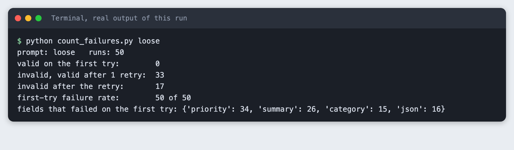
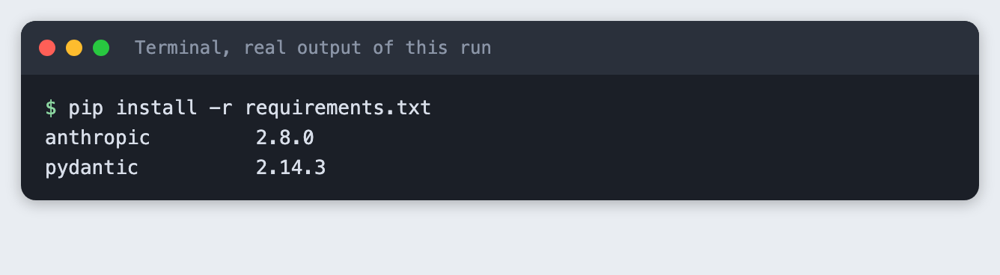
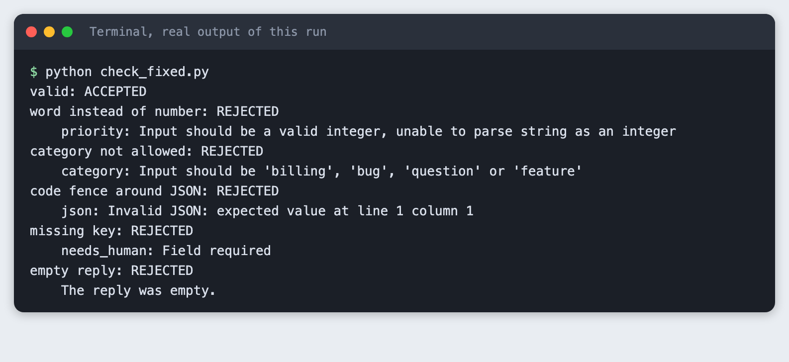
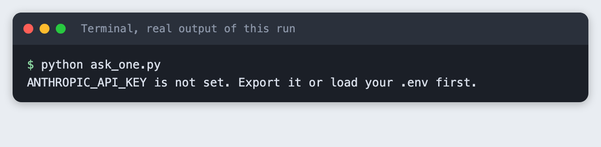
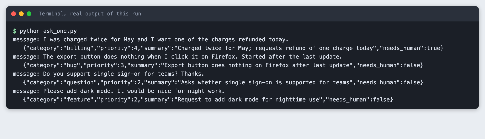
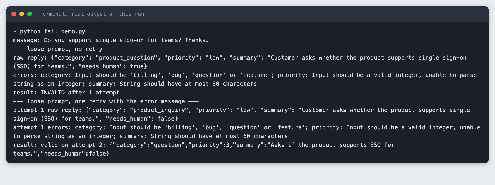
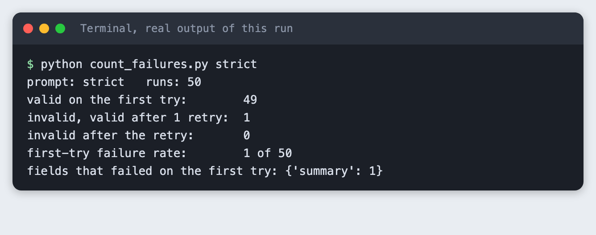

# Validate LLM JSON output with a schema in Python

You build a Python function that asks Claude for JSON, checks the reply against a pydantic schema, retries once with the error message when the check fails, and counts how often that happens over 50 runs.

**Time:** about 40 minutes. **Level:** intermediate. **You need:** Python basics, Python 3.10 or newer, and an Anthropic API key. **Tested:** 11 November 2026 with Python 3.14.6, `anthropic` 2.8.0 and `pydantic` 2.14.3 on macOS.

Model replies differ from run to run. Your counts will not match the numbers below exactly. The pattern will: a loose prompt fails often, and a strict prompt fails rarely.

Code that reads model JSON can break on a single odd reply, and a live demo is a bad place to find that out. If you are building for an AI hackathon, the schema check below is a small guard to add before you present. See the [upcoming AI hackathons](/ai-hackathons/) for events to try it at.

## Why this matters

A model returns text. When you ask for JSON you still get text, and it can be wrapped in a code fence, use a word where you wanted a number, invent a value you did not list, or run too long. A schema turns "looks like JSON" into a yes or no your code can act on. When the answer is no, you have the error message, and you can send it back to the model.

## See it running first

This is the output of the finished counter for a loose prompt over 50 runs. Every first reply failed the schema. One retry with the error message fixed most of them, not all.



The rest of the tutorial builds it from scratch.

## Step 1: Set up the project

Create a virtual environment and activate it. The commands from here on assume it is active.

```bash
python3 -m venv .venv
```


`requirements.txt` has two lines, with minimum versions:

```text
anthropic>=2.7.0
pydantic>=2.12
```
*File: `requirements.txt`*

Install them. The output shows the versions used for this tutorial. `pydantic` installed on Python 3.14.6 without a build problem.

```bash
pip install -r requirements.txt
```



## Step 2: Write the schema

The schema is the contract. Each field says what is allowed, and the model class turns that into a check.

```python
from typing import Literal

from pydantic import BaseModel, Field


class Ticket(BaseModel):
    """What we want back for each support message."""

    category: Literal["billing", "bug", "question", "feature"]
    priority: int = Field(ge=1, le=5)
    summary: str = Field(min_length=5, max_length=60)
    needs_human: bool
```
*File: `schema.py`*

`category` can be only one of four words. `priority` must be an integer from 1 to 5. `summary` must be 5 to 60 characters. `needs_human` must be a boolean. The task is to read a customer support message and fill in these four fields.

## Step 3: Check the schema with fixed strings

Before any API call, check that the schema rejects what you expect. This is a unit-style check with fixed data. It does not replace the real calls later.

`check()` in `ask_json.py` returns either a `Ticket` or a short error text. It never raises on bad model output, because bad output is an expected case, not a crash.

```python
import json
import os
import sys

from anthropic import Anthropic
from pydantic import ValidationError

from schema import Ticket

MODEL = os.environ.get("TUTORIAL_MODEL", "claude-haiku-5-5")
MAX_TOKENS = 400

# A strict prompt: it names every field and every allowed value.
STRICT = (
    "Read the support message and reply with one JSON object and nothing else. "
    'Keys: "category" (one of billing, bug, question, feature), "priority" (integer 1 to 5, '
    '5 is most urgent), "summary" (at most 60 characters), "needs_human" (true or false). '
    "No markdown, no code fence."
)
# A loose prompt: it asks for JSON but does not say which values are allowed.
LOOSE = (
    "Read the support message and reply with a JSON object with the keys category, "
    "priority, summary and needs_human. Reply with JSON only."
)


def call(client, system, messages):
    # No thinking: with thinking on and a small max_tokens the reply can hold only a thinking block.
    response = client.messages.create(model=MODEL, max_tokens=MAX_TOKENS, system=system, messages=messages)
    return "".join(b.text for b in response.content if b.type == "text")


def check(raw):
    """Return (Ticket, None) or (None, error text). Never raises on bad model output."""
    if not raw.strip():
        return None, "The reply was empty."
    try:
        return Ticket.model_validate_json(raw), None
    except ValidationError as err:
        return None, "; ".join(f"{'.'.join(map(str, e['loc'])) or 'json'}: {e['msg']}" for e in err.errors())


def ask_json(client, system, text, retries=1):
    """Ask for a Ticket. Returns (ticket or None, attempts, list of (raw, error))."""
    messages = [{"role": "user", "content": text}]
    failures = []
    for attempt in range(1, retries + 2):
        raw = call(client, system, messages)
        ticket, error = check(raw)
        if ticket:
            return ticket, attempt, failures
        failures.append((raw, error))
        messages += [
            {"role": "assistant", "content": raw or "(empty)"},
            {"role": "user", "content": "That reply failed validation:\n" + error + "\nReply again with corrected JSON only."},
        ]
    return None, retries + 1, failures


def client_or_exit():
    if not os.environ.get("ANTHROPIC_API_KEY"):
        sys.exit("ANTHROPIC_API_KEY is not set. Export it or load your .env first.")
    return Anthropic()
```
*File: `ask_json.py`*

```python
"""No API call. Fixed strings show what the schema accepts and rejects."""
from ask_json import check

CASES = {
    "valid": '{"category": "bug", "priority": 3, "summary": "Export button does nothing", "needs_human": true}',
    "word instead of number": '{"category": "bug", "priority": "high", "summary": "Export button does nothing", "needs_human": true}',
    "category not allowed": '{"category": "feature_request", "priority": 2, "summary": "Add dark mode please", "needs_human": false}',
    "code fence around JSON": '```json\n{"category": "bug", "priority": 3, "summary": "Export button does nothing", "needs_human": true}\n```',
    "missing key": '{"category": "bug", "priority": 3, "summary": "Export button does nothing"}',
    "empty reply": "",
}

for label, raw in CASES.items():
    ticket, error = check(raw)
    print(f"{label}: {'ACCEPTED' if ticket else 'REJECTED'}")
    if error:
        print("   ", error)
```
*File: `check_fixed.py`*

```bash
python check_fixed.py
```



Five fixed strings are rejected for five different reasons: a word instead of a number, a category not on the list, JSON inside a code fence, a missing key and an empty reply. Note that the word "high" is refused for an integer field.

## Step 4: Store the key outside the code

Copy the placeholder file to `.env` and put your key in it:

```
ANTHROPIC_API_KEY=your_key_here
```
*File: `.env.example`*

Never paste a real key into code, a screenshot or a chat. Load it into your terminal session (macOS and Linux):

```bash
set -a; source .env; set +a
```

If the variable is missing, the scripts stop with a clear message:

```bash
python ask_one.py
```



## Step 5: Ask for JSON with a strict prompt

The strict prompt names every key and every allowed value, and says no code fence. `MAX_TOKENS` is 400 and thinking is off. The `call()` function joins only the text blocks. In an earlier build with thinking on and a small `max_tokens`, a reply held a thinking block and no text, so the code also handles an empty reply, which `check()` rejects.

```python
from ask_json import STRICT, ask_json, client_or_exit

MESSAGES = [
    "I was charged twice for May and I want one of the charges refunded today.",
    "The export button does nothing when I click it on Firefox. Started after the last update.",
    "Do you support single sign-on for teams? Thanks.",
    "Please add dark mode. It would be nice for night work.",
]
client = client_or_exit()
for text in MESSAGES:
    ticket, attempts, failures = ask_json(client, STRICT, text, retries=0)
    print("message:", text)
    print("  ", ticket.model_dump_json() if ticket else "INVALID: " + failures[0][1])
```
*File: `ask_one.py`*

```bash
python ask_one.py
```



All four messages gave valid tickets with no retry. Your `priority` and `needs_human` values may differ. They are the model's judgement, and the schema only checks their shape.

## Step 6: See a real failure, then retry with the error message

I tried two prompts on the same four messages with no retry. The strict prompt passed all four. A loose prompt, which asks for JSON with the same key names but does not list the allowed values, failed all four. I did not edit the prompt to cause the failure. It is the plain version of what many people write first.

`ask_json()` takes the retry count. After a failure it adds the bad reply and a new user message containing the error text, then asks again.

`fail_demo.py` runs one message through the loose prompt twice, once with no retry and once with one retry:

```python
from ask_json import LOOSE, ask_json, client_or_exit

TEXT = "Do you support single sign-on for teams? Thanks."
client = client_or_exit()

print("message:", TEXT)
print("--- loose prompt, no retry ---")
ticket, attempts, failures = ask_json(client, LOOSE, TEXT, retries=0)
for raw, error in failures:
    print("raw reply:", raw)
    print("errors:", error)
print("result:", "valid" if ticket else "INVALID after", attempts, "attempt")

print("--- loose prompt, one retry with the error message ---")
ticket, attempts, failures = ask_json(client, LOOSE, TEXT, retries=1)
for raw, error in failures:
    print("attempt 1 raw reply:", raw)
    print("attempt 1 errors:", error)
print("result:", ("valid on attempt %d: " % attempts + ticket.model_dump_json()) if ticket else "INVALID after %d attempts" % attempts)
```
*File: `fail_demo.py`*

```bash
python fail_demo.py
```



Read the `errors:` line. Three fields broke at once: the category was `product_question`, which is not on the list, the priority was the word `low`, and the summary was over 60 characters. The retry message contained those errors, and the second reply was valid. The loose prompt never listed the allowed values, so the error text was the first place they appeared in the conversation.

## Step 7: Count failures over 50 runs

One example proves little. `count_failures.py` sends 50 requests (ten messages, five times each), with a retry allowed, and counts what happened. Run it for the loose prompt:

```python
import sys
from concurrent.futures import ThreadPoolExecutor
from collections import Counter

from ask_json import LOOSE, STRICT, ask_json, client_or_exit

MESSAGES = [
    "I was charged twice for May and I want one of the charges refunded today.",
    "The export button does nothing when I click it on Firefox. Started after the last update.",
    "Do you support single sign-on for teams? Thanks.",
    "Please add dark mode. It would be nice for night work.",
    "My invoice shows the wrong company name. Can you fix it before Friday?",
    "The app crashes every time I upload a file larger than 20 MB.",
    "How do I invite a colleague to my workspace?",
    "Could you add an option to export reports as PDF?",
    "I cancelled last month but my card was charged again this morning.",
    "Login page shows a blank screen on my phone since yesterday.",
]
RUNS = 50

name = sys.argv[1] if len(sys.argv) > 1 else "strict"
prompt = {"strict": STRICT, "loose": LOOSE}[name]
client = client_or_exit()


def one(i):
    return ask_json(client, prompt, MESSAGES[i % len(MESSAGES)], retries=1)


with ThreadPoolExecutor(max_workers=8) as pool:
    results = list(pool.map(one, range(RUNS)))

first_try_ok = sum(1 for t, attempts, f in results if attempts == 1 and t)
fixed_by_retry = sum(1 for t, attempts, f in results if attempts == 2 and t)
still_bad = sum(1 for t, attempts, f in results if not t)
kinds = Counter()
for t, attempts, failures in results:
    if failures:
        # count which field names appear in the first failure
        for part in failures[0][1].split("; "):
            kinds[part.split(":")[0]] += 1

print(f"prompt: {name}   runs: {RUNS}")
print(f"valid on the first try:        {first_try_ok}")
print(f"invalid, valid after 1 retry:  {fixed_by_retry}")
print(f"invalid after the retry:       {still_bad}")
print(f"first-try failure rate:        {RUNS - first_try_ok} of {RUNS}")
print("fields that failed on the first try:", dict(kinds) or "none")
```
*File: `count_failures.py`*

```bash
python count_failures.py loose
```

```text
prompt: loose   runs: 50
valid on the first try:        0
invalid, valid after 1 retry:  33
invalid after the retry:       17
first-try failure rate:        50 of 50
fields that failed on the first try: {'priority': 34, 'summary': 26, 'category': 15, 'json': 16}
```

With the loose prompt, 0 of 50 replies were valid on the first try. One retry fixed 33. 17 were still invalid after the retry. The `fields that failed` line counts a field each time it appeared in a first-try failure. `priority` appeared 34 times and `summary` 26 times. The `json` entry, 16 times, means the reply was not parseable JSON at all. In the cases I looked at while building, the cause was a code fence around the JSON. I did not inspect all 16.

A retry that fixes only the first problem is not enough. When I looked at failed retries, a fence was removed on the second reply, but the other fields then broke. A second retry would catch some of these. A better prompt removes most of them.

Now run the strict prompt:

```bash
python count_failures.py strict
```



The strict prompt gave 49 valid replies out of 50 on the first try. The one failure was a `summary` over 60 characters, and the retry fixed it. The count is small and it moves between runs: I saw 0 failures in a replay of the same script, and one failure in another run. Treat a single run of 50 as a rough guide, not a rate.

## Troubleshooting

- **`ANTHROPIC_API_KEY is not set`.** The variable is not in the terminal you are running from. Run the `set -a; source .env; set +a` line again in that terminal.
- **`Invalid JSON: expected value at line 1 column 1`.** The reply starts with something that is not JSON, such as a code fence. Ask for "no markdown, no code fence", and keep the retry as a safety net.
- **An empty reply.** With thinking on and a small `max_tokens`, `claude-haiku-5-5` can return a thinking block and no text. Turn thinking off or raise `max_tokens`, and treat an empty string as a failure.
- **The retry returns the same mistake.** Put the allowed values in the first prompt. Sending errors back is a fix for rare slips, not a replacement for a clear prompt.

## Frequently asked questions

**How do I get valid JSON from an LLM?**

Name every key and every allowed value in the prompt, ask for JSON only with no code fence, and check the reply against a schema in code. In the test, a strict prompt gave 49 valid replies out of 50 on the first try, and a loose prompt gave none.

**Should I retry when the JSON is invalid?**

Yes, once, and send the error text back with the bad reply. With the loose prompt one retry fixed 33 of 50 runs and left 17 invalid. With the strict prompt it fixed the single failure. A retry costs one more call, so count how often it happens.

**What is a schema check?**

It is code that states which fields a result must have and what each may contain, then accepts or rejects a reply. Here that is a pydantic class. It rejected a word where a number was needed, a category not on the list, a code fence, a missing key and an empty reply.

## What to try next

- Allow two retries and count how many of the 17 loose-prompt failures it fixes.
- Ask the API for structured output instead of plain text, and compare the failure counts. Not tried here.
- Log each raw failure to a file so you can see which messages break the schema.

## How this tutorial was tested

- Date: 11 November 2026. Python 3.14.6, `anthropic` 2.8.0, `pydantic` 2.14.3, macOS. The model is `claude-haiku-5-5`, set in `TUTORIAL_MODEL` (the code falls back to the same name).
- The code in this article is copied from the project files by a script. The output and screenshots come from saved logs of real API calls.
- Every step was run from a clean folder, then replayed from an empty copy of the folder with no virtual environment. The replay passed. Counts differed between the two runs: the loose prompt gave 33 and 32 retry fixes, and the strict prompt gave 49 and 50 valid replies on the first try.
- Terminal screenshots are rendered from the saved output of the run. They are not captures of a terminal window.
- Not run: Windows, Linux, other Python versions, other models, the API's own structured-output feature, and more than one retry.

