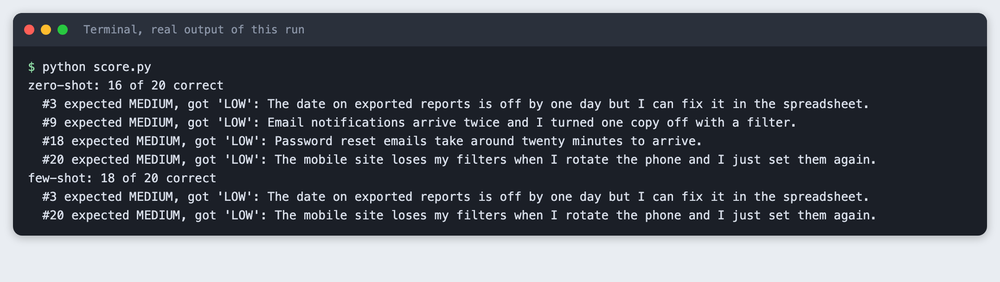
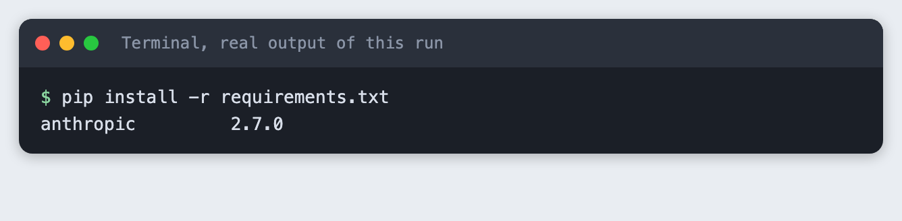
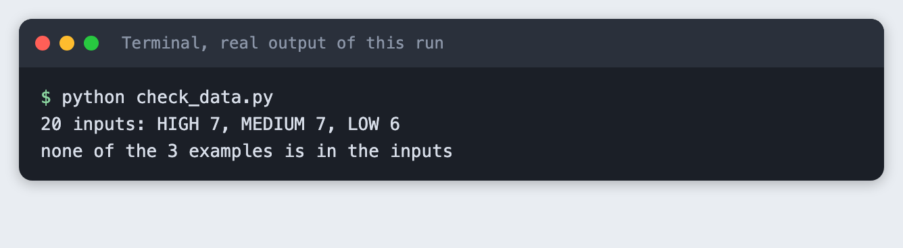
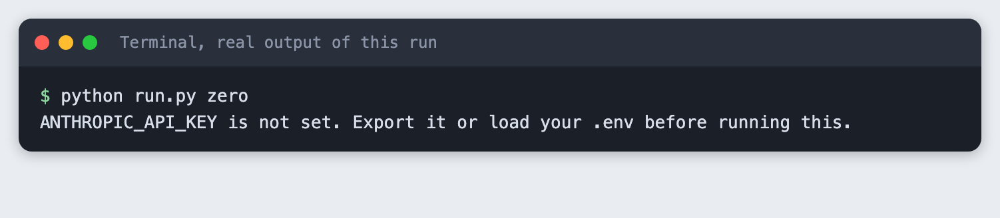
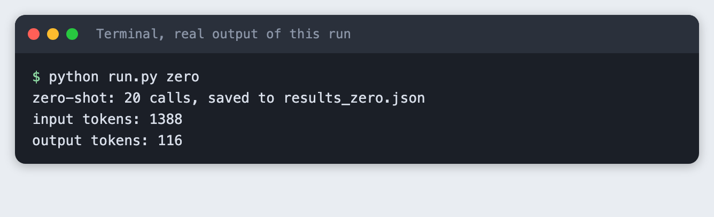

# Compare zero-shot and few-shot prompting in a notebook

You write one small labelling task, run it on 20 inputs with no examples in the prompt, run it again with three examples, and score both runs from the saved output. The task is to label short customer messages as HIGH, MEDIUM or LOW priority. It takes about 45 minutes.

**Level:** beginner. **You need:** Python basics, Python 3.10 or newer, and an Anthropic API key. **Tested:** 10 November 2026 on macOS with Python 3.14.6 and `anthropic` 2.7.0, using the model `claude-haiku-5-5`.

Model replies vary from run to run. If you run this, your scores may differ from the ones below by a message or two.

Choosing between no examples and a few examples is a quick win for any AI hackathon project that uses an LLM, and you can measure it in an afternoon. If you are looking for somewhere to use it, see the list of [upcoming AI hackathons](/ai-hackathons/).

## Why this matters

"Zero-shot" means the prompt describes the task and gives no worked examples. "Few-shot" means the same prompt plus a few examples of input and answer. People often add examples because it feels safer. You can find out with 20 inputs and a scorer whether it changed anything for your task, and what it added to the number of tokens you send.

## The task and the one rule behind the labels

The task has a clear right answer because I wrote the answers myself. I wrote 20 short customer messages for this tutorial. They are original and not copied from any data set. Each has an expected label that follows one rule:

- **HIGH:** the customer cannot use the product, or has lost money or data.
- **MEDIUM:** something works wrongly, but the customer has a way round it.
- **LOW:** a question or a suggestion.

The prompt does not state this rule. It only names the three labels. That is deliberate. A rule that lives in your head is the usual reason to add examples: the examples are the only place the model can see how you draw the lines. It also means some of the misses below may come from the model not knowing my rule, which is not the same as the model being wrong. I did not test that. Keep that in mind when you read the scores.

## See it running

This is the score of the two runs, read from the saved replies. The failures are listed under each score.



The rest of the tutorial builds it from nothing.

## Step 1: Set up the project and the key

Make a folder, create a virtual environment and activate it. The commands from here on assume it is active.

```bash
python3 -m venv .venv
```


Create `requirements.txt`:

```text
anthropic>=2.7.0
```
*File: `requirements.txt`*

Install it.

```bash
pip install -r requirements.txt
```



Put your key in a file named `.env` in the project folder. Copy the placeholder file and edit it:

```
ANTHROPIC_API_KEY=your_key_here
```
*File: `.env.example`*

Never paste a real key into code, a screenshot or a chat. Load the file into your terminal session (macOS and Linux):

```bash
set -a; source .env; set +a
```

## Step 2: Write the inputs and the prompts

`inputs.csv` holds the 20 messages and their expected labels. There are seven HIGH, seven MEDIUM and six LOW. They are mixed in order, so the model does not see a run of one label.

```
id,text,expected
1,I was charged twice for this month and my bank shows both payments.,HIGH
2,Could you add a keyboard shortcut for creating a new note?,LOW
3,The date on exported reports is off by one day but I can fix it in the spreadsheet.,MEDIUM
4,Nobody on my team can log in since this morning.,HIGH
5,Do you have a student discount?,LOW
6,Search is slow at about ten seconds but the results are right.,MEDIUM
7,The checkout page shows a blank screen so customers cannot pay us.,HIGH
8,How do I change the colour of my profile banner?,LOW
9,Email notifications arrive twice and I turned one copy off with a filter.,MEDIUM
10,My invoice export is deleting the original files instead of copying them.,HIGH
11,It would be nice to export to PDF as well as CSV.,LOW
12,Dark mode makes the chart labels hard to read but light mode works fine.,MEDIUM
13,The app crashes the moment I open it on every phone I own.,HIGH
14,Is there a way to see who edited a document last?,LOW
15,The CSV import skips the last row so I add it by hand.,MEDIUM
16,You cancelled my subscription by mistake and my shop page is now offline.,HIGH
17,Thanks for the update and the new layout looks tidy. Any plans for a calendar view?,LOW
18,Password reset emails take around twenty minutes to arrive.,MEDIUM
19,All my saved reports disappeared after the update.,HIGH
20,The mobile site loses my filters when I rotate the phone and I just set them again.,MEDIUM
```
*File: `inputs.csv`*

`prompts.py` builds the prompt. The zero-shot prompt is the instruction and the message. The few-shot prompt puts three examples between them, one for each label. The three examples are not among the 20 inputs. If they were, the few-shot run would be tested on its own examples.

```python
LABELS = ["HIGH", "MEDIUM", "LOW"]

INSTRUCTION = "Label this customer message with a priority: HIGH, MEDIUM or LOW. Reply with the label only."

# Three examples, one per label. None of them is in inputs.csv.
EXAMPLES = [
    ("I paid for the yearly plan but my account still says Free and I cannot open my projects.", "HIGH"),
    ("The calendar shows the wrong time zone for new events, though I can edit each one.", "MEDIUM"),
    ("Does the team plan include extra storage?", "LOW"),
]


def build_prompt(mode, text):
    """mode is "zero" (no examples) or "few" (the three examples above)."""
    parts = [INSTRUCTION]
    if mode == "few":
        for example_text, label in EXAMPLES:
            parts.append(f"Message: {example_text}\nPriority: {label}")
    parts.append(f"Message: {text}\nPriority:")
    return "\n\n".join(parts)
```
*File: `prompts.py`*

A short script checks the data before any call is made: 20 rows, valid labels, and no example inside the inputs.

```bash
python check_data.py
```



## Step 3: Run both versions

`run.py` sends each of the 20 messages once with the prompt for the mode you ask for, and saves the raw replies to `results_zero.json` or `results_few.json`. It scores nothing. Saving the raw replies before scoring means you can change the scorer later without paying for new calls.

`max_tokens` is 10, because a label is one word. `thinking` is disabled so the output is only the label. Each message is one call, so a full run of both modes is 40 calls.

```python
import csv
import json
import os
import sys

import anthropic

from prompts import build_prompt
from spend_log import log_usage

MODEL = "claude-haiku-5-5"
MAX_TOKENS = 10


def run(mode, client):
    """Send each input once with this mode's prompt. Save the raw replies."""
    results = []
    for row in csv.DictReader(open("inputs.csv")):
        response = client.messages.create(
            model=MODEL,
            max_tokens=MAX_TOKENS,
            thinking={"type": "disabled"},
            messages=[{"role": "user", "content": build_prompt(mode, row["text"])}],
        )
        log_usage("run.py", response)
        raw = "".join(block.text for block in response.content if block.type == "text")
        results.append({"id": int(row["id"]), "text": row["text"], "expected": row["expected"], "raw": raw,
                        "input_tokens": response.usage.input_tokens, "output_tokens": response.usage.output_tokens})
    with open(f"results_{mode}.json", "w") as f:
        json.dump(results, f, indent=2)
    return results


if __name__ == "__main__":
    mode = sys.argv[1] if len(sys.argv) > 1 else ""
    if mode not in ("zero", "few"):
        sys.exit("Usage: python run.py zero|few")
    if not os.environ.get("ANTHROPIC_API_KEY"):
        sys.exit("ANTHROPIC_API_KEY is not set. Export it or load your .env before running this.")
    results = run(mode, anthropic.Anthropic())
    print(f"{mode}-shot: {len(results)} calls, saved to results_{mode}.json")
    print("input tokens:", sum(r["input_tokens"] for r in results))
    print("output tokens:", sum(r["output_tokens"] for r in results))
```
*File: `run.py`*

If the key is missing, the script stops with a message. This is what that looks like:



Run the zero-shot version:

```bash
python run.py zero
```



Then the few-shot version:

```bash
python run.py few
```


The two runs sent the same 20 messages. The zero-shot run used 1388 input tokens and 116 output tokens. The few-shot run used 3468 input tokens and 122 output tokens. The few-shot prompt is longer because it carries the three examples on every call, so it sends more input tokens, and providers charge for input tokens. The replies are about the same length.

## Step 4: Score both runs and read the failures

`score.py` reads the saved replies. It takes the opening word of each reply, in upper case, and counts it as right only when it is one of the three labels and matches the expected label. A reply that is not a label counts as wrong. It prints the score and every failure, so you can read what went wrong and not only how many.

```python
import json

from prompts import LABELS


def read_label(raw):
    """The opening word of the reply, upper case. Anything that is not a label counts as wrong."""
    words = raw.strip().upper().split()
    word = words[0].strip(".,:*") if words else ""
    return word if word in LABELS else None


def score(mode):
    results = json.load(open(f"results_{mode}.json"))
    failures = [r for r in results if read_label(r["raw"]) != r["expected"]]
    return len(results) - len(failures), len(results), failures


for mode in ("zero", "few"):
    right, total, failures = score(mode)
    print(f"{mode}-shot: {right} of {total} correct")
    for r in failures:
        print(f"  #{r['id']} expected {r['expected']}, got {r['raw'].strip()!r}: {r['text']}")
```
*File: `score.py`*

```bash
python score.py
```

In this run the zero-shot prompt got 16 of 20 right and the few-shot prompt got 18 of 20. All four zero-shot failures were messages I labelled MEDIUM that the model labelled LOW: numbers 3, 9, 18 and 20. The few-shot prompt got two of those four right. It still labelled numbers 3 and 20 as LOW. Both prompts got every HIGH and every LOW message right.

Do not read too much into this. It is 20 messages and one run of each. A difference of two messages is small, and a replay of this tutorial from an empty folder gave the same two scores with one of the four zero-shot misses being a different message. The failures are also close to the line in my rule: a message about a workaround can read as a small problem. If you disagree with one of my labels, the scores change, and that is a good reason to build the same test with your own messages.

## Use it in a notebook

The code is plain Python, so it moves into a notebook without changes. Put `prompts.py` in one cell and `run.py` in the next, leaving out the last block that starts with `if __name__`. In a third cell call `run("zero", anthropic.Anthropic())` and `run("few", anthropic.Anthropic())`, then paste `score.py` into a fourth cell. Load the key before you start Jupyter, in the same terminal. I did not run it in a notebook for this tutorial.

## Troubleshooting

- **`ANTHROPIC_API_KEY is not set`.** Load the key in the terminal you run the command from, then run it again.
- **The score is lower than expected and every failure shows a long reply.** The reply has more than a label. Check `max_tokens` and the instruction. `score.py` reads only the opening word, and a reply that starts with something else counts as wrong.
- **A 400 error that mentions `thinking`.** The model wants a different thinking setting. The message names the value to send.
- **Your numbers differ from these.** Expected. Model replies change between runs, so a message near the line can move either way.

## What to try next

- Replace my 20 messages and my rule with your own, then compare the scores.
- Change the examples, for instance two MEDIUM examples and one LOW, and see which failures move.
- Run each mode three times and look at how much the score changes with no change to the prompt.

## How this tutorial was tested

- Date: 10 November 2026. Python 3.14.6, `anthropic` 2.7.0, macOS. The model is `claude-haiku-5-5`, set in the `MODEL` constant.
- The code in this article is copied from the project files by a script. The output and screenshots come from saved logs of real API calls, 40 calls in each full run.
- Every step was run from a clean folder, then replayed from an empty copy of the folder with no virtual environment. The replay passed. Model replies differed between the two runs in one message, as expected.
- Terminal screenshots are rendered from the saved output of the run. They are not captures of a terminal window.
- Not run: a Jupyter notebook, other models, other example counts, Windows, Linux, and Python versions other than 3.14.6.

## Questions people ask

### When should I add examples to a prompt?

When the label depends on a rule the instruction does not state. In this run the instruction named three labels and said nothing about where MEDIUM begins, and the three examples took the score from 16 of 20 to 18 of 20. That is one run on 20 messages. Test your own task before you rely on it.

### How many examples are enough?

This tutorial used three, one per label, and did not test other numbers, so it cannot say. Start with one example for each label, score it, and add more only if the failures you read point to a gap the examples could fill.

### Does few-shot prompting cost more?

It sent more input tokens. For the same 20 messages the few-shot run used 3468 input tokens and the zero-shot run used 1388, because the three examples travel with every call. Output tokens were 122 and 116. Check the provider's price page to turn tokens into money.

